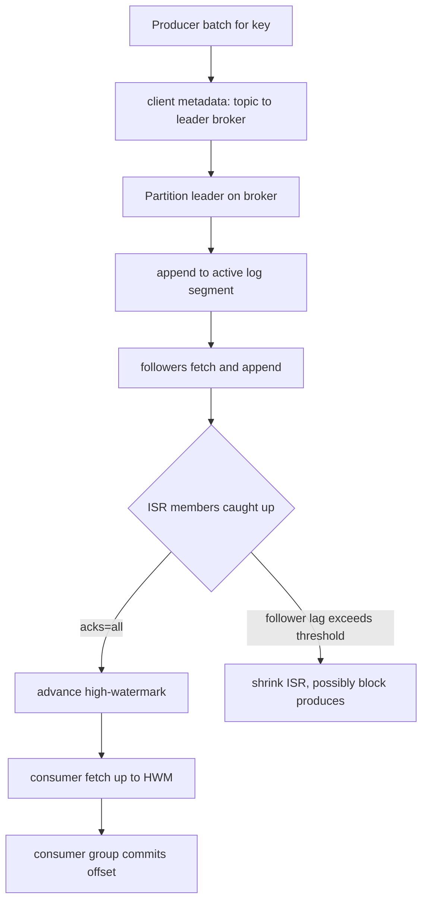

## Concept

### The log is the system

Apache Kafka is not a queue that forgets a message once a worker acks it. It is a replicated, append-only log of records, addressed by topic, partition, and offset. Producers append. Consumers read by offset and decide, independently, how far they have processed. Retention is a time or size policy on the log, not a function of whether anyone has consumed. That is why one click stream can feed a search indexer, a fraud job, a warehouse loader, and a replay from last Tuesday without the producer knowing those readers exist.

A topic is a named stream. A partition is an ordered sequence of records inside that topic, stored as segment files on a broker. The offset is a monotonically increasing integer in that partition, not a global clock. Order is a per-partition contract. Parallelism is partition count, because a consumer group assigns at most one active member per partition. Twelve concurrent handlers need at least twelve partitions. A total order across all events of a type needs one partition, and that is a throughput ceiling.

The performance model is sequential appends, sequential reads, and the operating system's page cache. Random writes and per-message fsync on the hot path are not. Design reviews that treat Kafka as "RabbitMQ but faster" miss the architecture: you are building around a disk-backed commit log that multiple subscribers share, not around a buffer that evaporates at ack.

### Brokers, controllers, and cluster membership

A Kafka cluster is a set of brokers. Each broker stores partition replicas, serves produce and fetch, and holds cluster metadata. Clients talk to any broker; that broker either handles the request or returns metadata pointing at the current partition leader. Sticky metadata in the client is the normal case. A MetadataRequest on error or on a refresh interval is how the client learns that leadership moved.

One broker is the controller. In ZooKeeper-era clusters it is elected through ZooKeeper watches. In KRaft, a quorum of controller voters stores metadata in an internal log and elects a leader among themselves. The controller owns cluster state: live brokers, partition leaders, replica assignment, and in-sync set membership. Data-plane produce and fetch do not go through it. When the controller is slow, you feel delayed reassignment, delayed leadership change after a broker death, and stale client metadata — not a stalled healthy partition whose leader is still up.

Broker identity must be stable. A `broker.id` that changes on every container restart looks like a leave and a join. The controller then moves leadership and ISR membership churns. Persist a logical id and map it to the current advertised listener. Ephemeral pod IPs belong in DNS, not in the identity the replica protocol uses.

### Replication, ISR, and the high-watermark

Each partition has a configurable replication factor, typically three in production. One replica is the leader. Followers fetch from the leader and append to their own logs. The in-sync replica set (ISR) is the subset of replicas that have caught up within `replica.lag.time.max.ms`. A produce with `acks=all` waits until every member of the current ISR has the record. The high-watermark is the offset replicated to the full ISR. Consumers see up to that watermark. They do not see the leader's uncommitted tail, which would vanish if the leader died before followers caught up.

Leader election prefers an ISR member. If `unclean.leader.election.enable` is false, the controller waits for an ISR replica rather than promoting a lagging follower that would truncate committed offsets. That wait is availability against durability. Unclean election is a durability bug with a config name. Leave it off unless the topic is telemetry you would rather lose than stall.

The leader is the only replica that accepts produces. Followers are a fetch-based replication group, not a Paxos write quorum. Adding replicas increases durability and follower fetch load. It does not increase write parallelism for that partition. More partitions increase write parallelism. More replicas increase copies of the same ordered stream.

### Segments, indexes, and the page cache

A partition log is a sequence of segment files. The active segment receives appends. Older segments are closed, then deleted by time or size policy, or compacted if the topic uses log compaction. Each segment has an offset index and a timestamp index so a fetch is a binary search plus a sequential read, not a scan of the partition. Compaction keeps the latest value per key, which is how compacted topics become changelog stores. It is not a queue TTL. A key you never reuse lives until the delete horizon or a tombstone.

The hot path is zero-copy from page cache to socket when the consumer is caught up. A tail reader hits RAM the kernel still holds from the last produce. A consumer hours behind reads from disk, and those reads contend with appends. Lag is not only freshness. It is a change in the broker's I/O profile.

`log.flush.interval` is not a substitute for replication. Kafka acknowledges based on ISR, then relies on replication plus OS cache, not on a synchronous fsync of every record. A power loss of every ISR replica before the OS flushes is the remaining durability hole. That is why replicas live in different racks and, for anything you cannot rebuild, in different failure domains.

### Clients: producers, consumers, and the protocol

The producer batches records by partition, optionally compresses the batch, and sends it to the leader. Idempotent producers add a producer id and a per-partition sequence so a retried batch does not append twice. Transactions extend that to atomic writes across partitions and to coupling consumed offsets with produced output. `linger.ms` and `batch.size` trade latency for broker efficiency. Tiny unbatched produces turn a sequential log into a small-write workload.

The consumer is a pull client. It fetches assigned partitions, processes records, and commits offsets to `__consumer_offsets` or to its own store. Pull is backpressure: a slow consumer fetches less. The log does not know your consumer exists until the group protocol or an explicit commit writes state. You can always start another group at offset zero, or at latest, and read the same bytes.

## Trade-offs

| Approach | When it wins | Cost / risk |
| -------- | ------------ | ----------- |
| Single-partition topic | Total order for a low-rate control plane | Throughput ceiling of one disk and one consumer |
| Many partitions, key by entity id | Parallelism with per-entity order | Rebalance cost, more open files, harder ops at tens of thousands of partitions |
| `acks=1`, replication factor 2 | Telemetry and caches that rebuild | Lost records on leader crash before follower catch-up |
| `acks=all`, RF=3, min.insync=2 | Product events, payments, audit | Higher produce latency; producer blocks when ISR shrinks below min.insync |
| ZooKeeper-coordinated cluster | Existing fleet not yet migrated | Extra system to operate; ZK is on the failover path |
| KRaft metadata quorum | New clusters, simpler ops | Migration cost; controller quorum is now Kafka itself |

Partition count is a capacity and an operations decision. Too few and you cannot scale consumers or spread a hot topic across disks. Too many and you pay metadata, leader-election work, recovery time after a broker restart, and consumer rebalance pauses. Size from expected throughput, consumer parallelism, and the largest partition you are willing to rebuild after a disk loss, not from a round number that looked fine in a demo.

Acknowledgement and ISR settings are the durability contract. `acks=all` with `min.insync.replicas=2` on a three-replica topic means a produce succeeds only if two replicas have the record. One broker can die. A second death or a stuck follower that drops out of ISR makes the topic unavailable for writes. That is the correct failure for a ledger. It is the wrong failure for debug logs. Do not set one cluster-wide default and hope.

KRaft removes ZooKeeper from the critical path and stores metadata in a Kafka log. The operational win is real. The remaining fact is that metadata still has a leader, and a mis-sized controller quorum or a disk full on controllers is still an outage class of its own. Treat controllers as a separate failure domain from the brokers that hold customer data.

## Diagram

## Failure modes

### Leader crash and unclean election

Detection is a burst of `NOT_LEADER_OR_FOLLOWER` errors, a dip in produce success, and a controller log line that a new leader was elected. If unclean election is on, detection after the fact is missing offsets: consumers see a gap or a reset, and downstream unique keys do not save you if the missing record never existed.

Mitigation is `unclean.leader.election.enable=false`, `min.insync.replicas` set so a produce cannot succeed on a lone replica you would then be willing to lose, and rack-aware replica assignment so two replicas do not share a power distribution unit. Clients must retry with backoff on leadership errors. A producer that fails the batch to the application on the first `NOT_LEADER` will appear as data loss while the cluster is doing its job.

### ISR shrink until produces block

Detection is under-replicated partition (URP) count above zero, ISR size below `min.insync.replicas`, and producer timeouts rather than broker 5xx. Slow disks, saturated follower fetch, a full disk, or a GC pause on a follower are the usual causes. Cluster-wide produce latency rising while CPU looks fine is often ISR membership flapping.

Mitigation is disk isolation, separate data directories, and alerting on URP as a page, not a dashboard curiosity. Inspect replica lag in milliseconds and in bytes. If a follower cannot catch up, take it out on purpose, repair the hardware, and let it rejoin. Do not raise `replica.lag.time.max.ms` to hide a dying disk. That setting exists to define "in sync," not to paper over I/O stalls.

### Page-cache miss and lagging consumers

Detection is broker disk read throughput rising, produce p99 climbing, and consumer lag that is hours, not seconds. A new consumer group that starts at earliest, a replay, or a stopped job that resumes will pull cold segments through the same disks that serve the tail.

Mitigation is throttle: `follower.replication.throttled.rate` style limits for replicas, quota on consumer fetch, and operational policy that bulk replays run against a dedicated replica or a mirrored cluster. Keep consumers near the tail as a capacity plan, not as a hope. If a job must scan thirty days, provision IOPS for that scan, or copy the topic to a batch cluster.

### Controller or metadata stall

Detection is partitions that stay leaderless after a broker is killed, `MetadataRequest` taking seconds, and new partition creation hanging. In ZooKeeper clusters, ZK latency and session expirations are the first place to look. In KRaft, controller log end offset stall and voter loss are the equivalent.

Mitigation is a dedicated controller quorum, disks that are not shared with the hottest data partitions, and a change-management rule that you never bounce a majority of controllers at once. Client metadata max age should be short enough to recover from a moved leader and long enough not to DDoS the cluster with metadata. The data plane of a healthy partition should survive a controller election. Test that. If produces stop cluster-wide when the controller restarts, your clients or your version still couple the two planes.

## Real-world example

LinkedIn built Kafka because a fleet of point-to-point pipelines and ad-hoc logs could not be a company-wide data bus. Activity events, metrics, and database changes needed one append path, many independent readers, and the ability to replay. The design that still shows in how they operate at large partition counts is the architecture above: brokers holding partitioned logs, replication to an ISR, a controller for membership and leadership, and consumers that own their offsets.

At that scale the operational truths became product features. Partition counts grew into the hundreds of thousands, which forced attention on controller efficiency, metadata caching, and the cost of a full consumer rebalance. Page-cache hit rate on the tail became a capacity metric because a lagging Hadoop job and a real-time feed did not share an I/O budget. Multi-tenancy needed quotas so one producer could not fill a disk that twenty other teams depended on. None of that changes the core: a durable log with independent subscribers.

When LinkedIn moved coordination toward KRaft, the motivation was operational, not a change in what a partition is. ZooKeeper had been an extra system on the failover path. Putting metadata in a Kafka-replicated log made the cluster one system to patch. The produce path stayed "append on the leader, wait for ISR, advance the high-watermark." If you copy only the topic names from LinkedIn and skip ISR, rack placement, and lag-as-I/O, you have a demo, not their architecture.

## What to remember

- Kafka is a replicated append log with per-partition order; it is not a competing-consumer queue that deletes on ack.
- Durability is ISR plus `acks=all` and `min.insync.replicas`, not a synchronous fsync of every record on one disk.
- Consumers pull and own offsets; retention is a log policy, which is why fan-out and replay are cheap.
- The controller and KRaft (or ZooKeeper) are the metadata plane; a healthy partition leader should keep serving while they elect.
