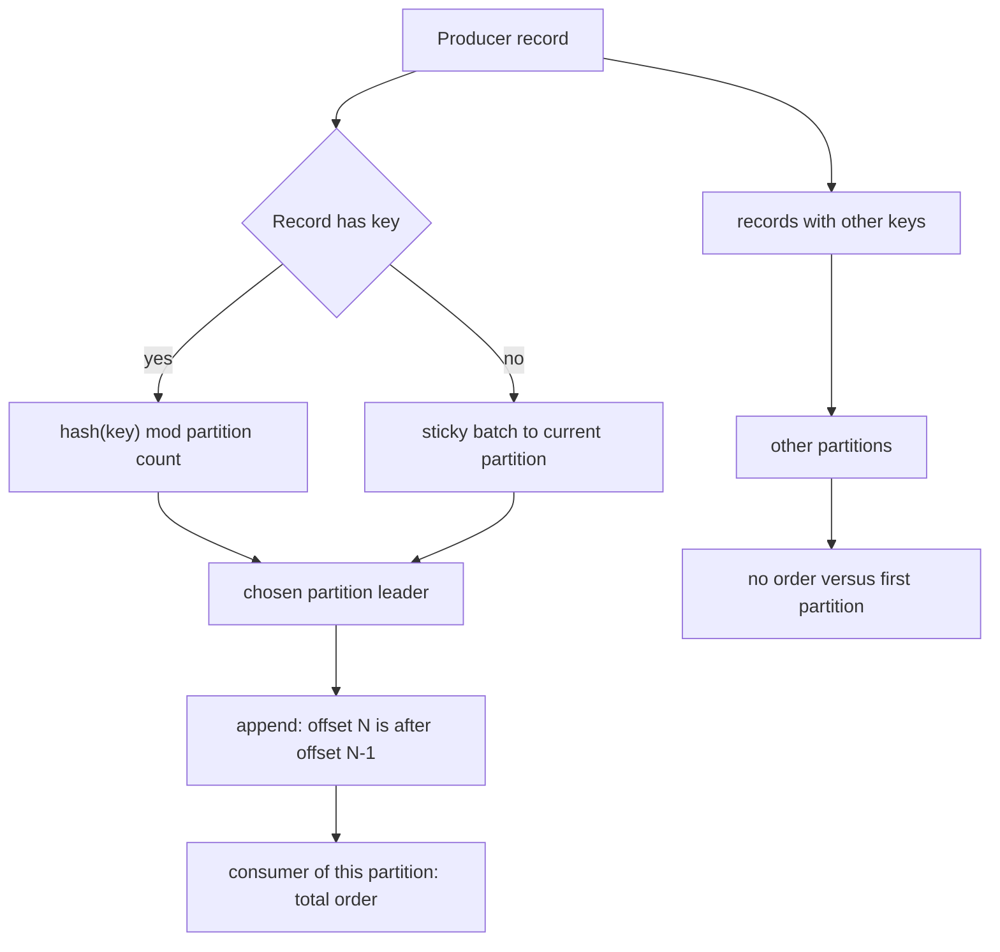

## Concept

### Order is a partition, not a topic

Kafka's ordering contract is narrow and easy to over-claim. Records in one partition are totally ordered by offset. Records in different partitions of the same topic have no order relative to each other. A consumer that reads partitions 0 and 1 will interleave those streams in whatever order the fetches complete. If your product sentence is "events for a user are processed in order," the architecture sentence is "all events for that user share a partition, and a single consumer instance handles that partition at a time."

That coupling is the whole design. Parallelism comes from partition count. Order comes from putting related keys in the same partition. You cannot have both a global total order and horizontal scale on one topic. Teams that "just add partitions" to fix lag silently drop the order they thought they had, unless the partitioner still hashes the same keys onto a larger set in a way that preserves per-key affinity. Adding partitions does not rehash old records. It only changes where new records with a given key may land.

Treat a partition as a single-threaded, durable queue with a high-watermark and a consumer offset. Everything else in Kafka — consumer groups, transactions, compacted changelogs — is built on that unit. If the unit is wrong, no amount of ISR tuning will save the product invariant.

### How a record chooses a partition

The producer decides the partition before the batch hits the broker. If the record includes a partition number, that number wins. If it includes a key and you use the default partitioner, the partition is a hash of the key modulo the current partition count of the topic. If there is no key, modern clients use a sticky partitioner: they fill a batch to one partition, then move, to preserve batching without pinning all null-key traffic on partition 0.

The default hash is not "consistent hashing" in the ring sense. It is `hash(key) % N`. When N changes, keys remap. A user who lived on partition 7 of 12 may live on partition 3 of 24 after an expansion. New events for that user are no longer after the old events in the same partition. Readers that assume per-key order across the expansion are wrong. Compaction, which is per partition per key, will also treat the same key on two partitions as two independent latest-values.

Custom partitioners exist for a reason. A tenant id that would otherwise hot-spot can be salted: `hash(tenant + bucket)` with a bounded bucket count per tenant. An ordered workflow that must not overtake itself can use a business key (account id, order id) even when the payload is large. A partitioner that uses wall-clock time, random, or a field that changes on retry will scatter a single entity's timeline and will duplicate work under producer retries even with idempotence, because idempotence is per producer session per partition, not per business key across partitions.

### Keys, compaction, and the changelog shape

Log compaction keeps the last record per key inside a partition. It is how compacted topics become materialized state: the latest profile, the latest inventory count, the latest stream-processor changelog. Compaction does not run across partitions. The same key on two partitions is two compacted histories. If you need a compacted topic to mean "one latest value per user," the user id must be the key and the partitioner must be stable for the life of that topic, including after you think you are "just scaling."

Tombstones are records with a null value. They mark a key deleted so compaction can drop the history. A tombstone has a retention of its own (`delete.retention.ms`). Consumers that snapshot a compacted topic must understand they can see a tombstone, then later see nothing for that key. Producers that omit keys on a compacted topic create records that cannot be compacted away by key and will grow until time retention, which is usually not what you wanted.

For event logs you will replay (orders placed, payments captured), prefer an append-only topic with time retention and a key used only for partitioning. For state (current balance, current subscription), a compacted topic keyed by the entity is the right shape. Mixing both in one topic forces every reader to filter, and compaction will surprise anyone who thought they had a full audit trail.

### Changing partition count without lying about order

Increasing partitions is a one-way, cheap metadata operation. Kafka does not rewrite historical records onto the new partitions. Consumers of a group that subscribed with `auto.offset.reset` only see new partitions at their reset policy; assigned members get extra partitions and start at earliest or latest depending on configuration and whether committed offsets exist. The dangerous case is a stateful processor: local stores and changelog topics are partitioned the same way as the input. Adding input partitions without a matching restore story splits state.

Decreasing partition count is not a supported live operation in the way operators want. You create a new topic with fewer partitions and copy, or you accept that you will not shrink. Plan the upper bound from day one: consumer parallelism you will need at peak, max partition size you will tolerate for retention, and the largest blast radius of a hot key. Leaving headroom (start at 48, plan for 96) is cheaper than a flag-day rekey.

If you must rekey to restore affinity after a bad partition count, treat it as a migration: new topic, dual-write or mirror, consumers that understand both, then cut reads. Do not "fix order" by changing the partitioner under an existing consumer group. Their in-flight state, their compacted stores, and their "last offset per partition" will not follow the keys.

### Hot keys and the myth of even partitions

Hashing spreads keys, not load. A celebrity account, a popular SKU, a `tenant_id` that every event carries as the only key, or a null-key producer that you thought was sticky but is actually pinned, will make one partition's bytes-in and consumer lag diverge from the rest. The broker is fine. The consumer of that partition is not. Sibling partitions drain to zero lag while one offset crawls.

Hot-key mitigation is application-level. Salt the key into N buckets and reaggregate downstream if you can tolerate out-of-order buckets for that entity. Split the entity (per-region topics, per-shard keys). Move the hottest stream to its own topic and give it more consumers via more partitions only if you can drop cross-event order. Bounded-load ideas from request routing do not apply: a partition cannot skip a key. One key, one ordered log, one active handler.

## Trade-offs

| Approach | When it wins | Cost / risk |
| -------- | ------------ | ----------- |
| No key, sticky partitioner | Metrics, logs, firehose with no per-entity order | Cannot compact by entity; retries may reorder across partitions |
| Key by entity id, default hash | Per-entity order plus scale-out of many entities | Hot entities pin a partition; `% N` remaps on expansion |
| Key by entity plus salt buckets | Celebrity keys, huge tenants | Downstream must merge buckets; per-entity order is gone |
| Single partition | Strict total order, simple mental model | Hard throughput and recovery ceiling |
| Custom partitioner | Affinity to a shard, geo, or downstream store | Must version and freeze it; divergence across languages splits the topic |
| Increase partitions in place | Cheap extra parallelism for keyless or already-wrong order | Breaks per-key order and compacted-state identity for remapped keys |

The default key-hash partitioner is the right starting point for domain events: order id, account id, device id. Document the key as part of the event contract. If two producer languages hash UTF-8 versus bytes differently, you have two partitions for one id. That is a silent order bug, not a Kafka bug.

Sticky partitioning for null keys is a throughput feature. It is not a substitute for a key. Operators see "balanced partitions" and assume order is fine. It is not. Null-key topics are bags of records. Process them with that honesty.

Salted keys are a product decision: you are saying this entity may be processed out of order in exchange for surviving a load spike. Fraud scoring that must see login then payment in order cannot salt. A click-stream counter that will be recomputed in a window can.

## Diagram

## Failure modes

### Partition expansion that splits an entity

Detection is downstream uniqueness or session logic breaking after an `alter topic --partitions` change: duplicate "latest" state, out-of-order status transitions, or a compacted view that shows two current rows for one id. Produce metrics look healthy. Partition byte-in is more even, which is how the change got approved.

Mitigation is to treat partition count as a schema. Freeze it for topics that claim per-key order, or migrate to a new topic with a planned count. If you must expand a keyed topic, stop claiming order across the cut, reprocess from the new topic only, and rebuild compacted state. Consumer groups should be reset with a documented starting offset, not left to find empty committed offsets on new partitions and silently start at latest.

### Hot partition, idle siblings

Detection is per-partition lag, bytes-in, and request-handler time, not topic-level averages. One partition's consumer CPU at 100% while the group has spare members is the signature. Disk on the broker holding that leader may also show elevated write.

Mitigation is key redesign, not more consumers in the same group: extra members sit idle because assignment is one member per partition. Split the hot key with salting if order can be relaxed. Isolate the tenant. Increase partitions only when the keyspace, not a single key, is the bottleneck. Alert on lag p99 across partitions, not on average lag.

### Partitioner drift across clients

Detection is the same key appearing on multiple partitions in a short window, often after a client library upgrade or a new language producer. Compaction metrics show more unique keys than the business has entities. Support sees "state went backwards."

Mitigation is a golden test: for a fixture list of keys, every producer must emit the same partition number against a recorded topic partition count. Changing the hash is a migration. Pin partitioner version in the client. Do not hash a JSON object serialization; hash a stable canonical id.

### Producer retries and unkeyed batches

Detection is duplicate records with different offsets and no key, or keyed records that appear out of order relative to a failed produce that later succeeded on a different partition because the partitioner used time or randomness. Idempotent producers prevent duplicates on the same partition and producer id; they do not fix a partitioner that changed partition on retry.

Mitigation is idempotent producers plus a stable key. Set `enable.idempotence=true` and do not override `acks` and retries into a conflicting combination. For null-key firehoses, accept duplicates at the consumer with an application key inside the payload, or accept lossy metrics.

## Real-world example

Uber's Apache Kafka deployment is built around trip and marketplace events that must stay ordered per entity while the company runs a very large number of partitions and clients. Public engineering writing on their Kafka and streaming stack describes the practical constraint: a trip, a driver, or a rider is the affinity key, because status transitions (requested, accepted, en route, completed) are illegal out of order, while the global topic cannot be one partition at their volume.

The partitioner is therefore a product API. Events for a trip id hash to one partition so the consumer that writes trip state, the one that updates maps, and the one that bills can each maintain per-trip order without coordinating with each other. When a city or a product line generates a hot key — a batch of events pinned on one driver id during a surge, or a bad default key — they see it as one partition's lag, not as "Kafka is slow." The mitigation is the same one every large user rediscovers: change the key, isolate the stream, or salt where order can be reconstructed later.

Uber also runs into the partition-count trap that LinkedIn documented at even larger metadata scale: more partitions mean more leadership metadata, more files, more recovery work, and longer rebalances. Adding partitions to chase consumer parallelism is how per-trip order dies if the hash modulus changes. Their operational pattern, shared by other marketplace companies, is to over-partition early within a safe upper bound, keep keys stable, and treat a topic expansion as a migration when the topic is a source of truth for state. Copy the trip id as the key, not as a field buried in JSON that one client hashes and another ignores.

## What to remember

- Kafka orders records inside a partition; a topic is a bag of independent ordered logs.
- The producer key and partitioner are the order contract; `% N` remaps keys when N changes.
- Compaction and stream state follow keys per partition, so a remapped key is a split brain of "latest."
- Hot keys need application salting or isolation; extra consumers in the group cannot split one partition.
