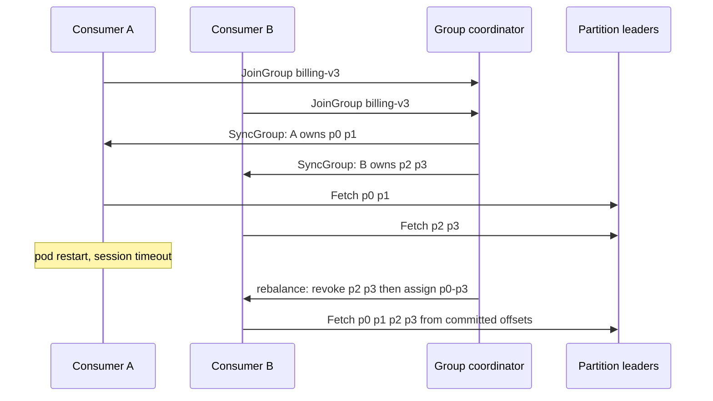

## Concept

### A group is a competing-consumer lease on partitions

A Kafka consumer group is a named set of clients that together read a topic as one logical subscriber. The group coordinator, a broker, assigns each partition of each subscribed topic to at most one member of the group. That assignment is exclusive: two members of `billing-v3` will not fetch the same partition at the same time. Two different groups (`billing-v3` and `warehouse-load`) will both read every partition, each with its own committed offsets. Fan-out is "start another group." Load sharing inside one pipeline is "add members to the same group."

Offsets live in `__consumer_offsets` keyed by group, topic, and partition. Committing an offset is the group saying "we have processed through here." The log itself does not care. If the group dies, the records remain. If you create a new group id, you start a new cursor. Reusing a group id after a rewrite of the handler is how you accidentally skip a week of data or reprocess a year, depending on where the old commits sit.

The unit of assignment is the partition, not the record. You cannot put two workers on one partition inside one group without breaking the "one active reader" rule. Scale-out of a group is therefore bounded by partition count. Members beyond that sit idle, or they thrash if join/leave events keep triggering rebalances.

### The group protocol: join, sync, heartbeat

Members send JoinGroup, then SyncGroup, then Heartbeat (and Fetch) on a loop. One member is elected group leader for the protocol, not to be confused with a partition leader. The group leader receives the member list and, depending on protocol version, computes the assignment or receives it from the broker under newer assignors. SyncGroup distributes the map: member A owns partitions 0,1; member B owns 2,3.

Heartbeats tell the coordinator the member is alive. `session.timeout.ms` is how long the coordinator waits without a heartbeat before it declares the member dead and triggers a rebalance. `max.poll.interval.ms` is how long the client library will go without `poll()` before it leaves the group itself, even if heartbeats are still going, because the processing loop is stuck. Those two timers exist because a machine can heartbeat while its handler is deadlocked, and a machine can be busy in a long poll interval while still healthy.

`heartbeat.interval.ms` should be a fraction of the session timeout. `max.poll.interval` must exceed the longest legitimate batch processing time. If you fetch 500 records and each calls a 200 ms HTTP API, your poll interval is already too short or your batch is too large. The failure looks like a rebalance storm, not like "our HTTP is slow."

### Assignment strategies

Range assignment slices partitions per topic into contiguous ranges. It is simple and tends to give a member adjacent partitions of the same topic, which can help locality. It also unbalances when topic partition counts differ. Round-robin and the later cooperative sticky assignor spread partitions more evenly and try to minimize movement when membership changes.

Sticky assignment remembers the previous map and moves as few partitions as possible when a member joins or leaves. That is the property you want in production: a scale-out should not revoke every partition in the group. Eager rebalancing (the classic "stop the world" protocol) does revoke everything. Cooperative incremental rebalancing revokes only the partitions that must move, in rounds, so the rest of the group keeps fetching.

Static membership (`group.instance.id`) tells the coordinator that this member is a named slot, not a random UUID. A rolling restart of a pod with the same instance id can rejoin without being treated as a leave plus a new join, if it returns before the session timeout. That removes the rebalance that used to accompany every Kubernetes deploy. The instance id must be stable and unique. Two pods sharing an instance id steal each other's assignment. An instance id that changes every start is just a dynamic member with extra config.

### What a rebalance actually does to processing

When a partition is revoked, the member must stop fetching it, finish or abort in-flight work, and commit offsets if you want the next owner to continue. The next owner starts at the last committed offset. Work processed but not committed is done again. Work committed but not processed is skipped. That is the same at-least-once versus at-most-once fork as any crash, except it happens on a schedule every time you deploy, autoscale, or miss a poll.

Cooperative rebalancing reduces the number of partitions that go through that fork at once. It does not eliminate the fork for the partitions that move. Handlers still need idempotency. Offset commit still belongs after the side effect, or in the same transaction as a Kafka produce if you are in a consume-transform-produce loop.

A rebalance that never completes is a group that never fetches. A member that joins slowly, a stuck JoinGroup, or a member that cannot Sync will hold the group in rebalancing. This is more damaging than a single slow partition, because every partition in the group is paused under eager protocol, and even under cooperative a join still coordinates.

### Scaling, autoscaling, and the partition ceiling

Adding members is useful until member count equals partition count. After that, extra pods wait. Autoscaling on CPU of a group that is already at one member per partition will not reduce lag; the hot partition's member is the bottleneck. Autoscaling on lag that adds members during a transient spike can cause a rebalance that makes lag worse for a minute, then idle the extra members.

Prefer static membership and a known replica count. Scale partitions when you need more parallelism, which is a topic-admin decision with order implications. Scale members when you have unassigned partitions or when you are replacing capacity, not as a reaction to a single-partition hotspot. Split the consumer into separate groups only when they are independent pipelines; two groups on the same topic double the fetch load on the brokers.

## Trade-offs

| Approach | When it wins | Cost / risk |
| -------- | ------------ | ----------- |
| Eager rebalance, dynamic member ids | Small groups, rare deploys, simple clients | Stop-the-world pause; every rolling pod bounce reassigns all partitions |
| Cooperative sticky + static membership | Production groups with rolling deploys | Requires recent clients and brokers; mis-set instance ids cause silent theft |
| Many small groups | Isolation of failure and release cadence | Multiplied fetch and coordinator load; easy to mis-share group ids |
| One giant group across many topics | Single worker fleet, fewer processes | A rebalance or poison topic stalls unrelated partitions; assignment gets messy |
| `max.poll.interval` very high | Long batch jobs that must not leave the group | Dead handlers hide for that long; poison messages pin a partition |
| Autoscale members on lag | Bursty keyless topics with spare partitions | Rebalance amplification; cannot split a hot partition |

Static membership plus cooperative assignor is the default I want on a new service. The remaining work is operational: unique instance ids from the StatefulSet ordinal or a locked identity, session timeout longer than a planned SIGTERM drain, and a shutdown hook that leaves the group if the process will not return (a job that scales to zero) but does not leave if it is a rolling restart that will be back in ten seconds.

Group topology is an architecture choice. Putting fifteen topics in one group means one poison payload or one slow handler configuration pauses or rebalances a large surface. Splitting groups by SLO and by side-effect store is usually worth the extra consumer processes. Do not split by "microservice purity" if the handlers share the same inbox database and the same release; you will coordinate deploys anyway and pay twice the rebalances.

## Diagram

## Failure modes

### Rebalance storms

Detection is `rebalance-rate` or coordinator logs showing successive generations, consumer metrics for `assigned-partitions` flapping, and lag that sawtooth-increases during deploys or network blips. Heartbeat expired and poll interval expired are the two causes to separate. The first is often GC, CPU starvation, or network to the coordinator. The second is handler time.

Mitigation is to fix the timer that is actually firing. Raise `max.poll.interval.ms` only after you shrink batch size or make the handler faster. Raise `session.timeout.ms` only after you confirm heartbeats are the issue, and keep heartbeat interval well below that timeout. Enable cooperative rebalancing and static membership so a single leave does not revoke the world. Kill chatty "debug" consumers that join a production group id from a laptop.

### Stuck member and partition starvation

Detection is one member's `records-consumed` at zero while it still heartbeats, or a partition with no fetchers after a partial assignment. A livelock in user code that still calls `poll` in a tight error loop can look healthy to the coordinator.

Mitigation is liveness on processed offsets, not on heartbeats. Alert when a partition's committed offset is frozen while the log end offset moves. Bounded handler time, a circuit breaker on downstream, and a dead-letter after N failures keep `poll` moving. For cooperative protocol bugs or old clients, a coordinated bounce of the group is the last resort; bouncing members one at a time with static ids is safer.

### Duplicate processing after revoke

Detection is duplicate side effects immediately after deploys or scale events, with the same payload at two offsets commits apart or at the same offset processed by two instance ids. The first owner processed, crashed before commit, and the second owner replayed.

Mitigation is the inbox pattern: unique key in the same database transaction as the effect, then commit the Kafka offset. On revoke, commit what you have finished and do not start a new batch you cannot complete. `prepare`/`revoke` callbacks exist for this. Idempotent handlers make the replay safe. They do not make it free; a rebalance that replays a 10-minute batch is still a latency incident.

### Group id collisions and offset loss

Detection is a sudden jump of offsets, a drop of lag to zero on a topic that should have backlog, or two applications sharing a group id in the same cluster and "stealing" partitions from each other. A mis-copied config in a second environment pointed at production is the classic version.

Mitigation is group ids as owned identifiers: `{service}-{pipeline}-{suffix}`, packed into config as a constant, not interpolated from a hostname. ACLs on the group id so only that service's principals can join. Never reset offsets in production without a ticket that states the new offset and the reason. `auto.offset.reset=latest` on a new group that was supposed to replay is silent data skip; set `earliest` only when that is the product, and disable reset in steady state by always having committed offsets.

## Real-world example

Netflix runs Kafka (and adjacent streaming systems) as a multi-tenant bus for viewing events, application telemetry, and service-to-service streams. Public talks on their consumer platform emphasize group stability under constant deploys. A playback-events pipeline cannot stop the world every time a container scheduler replaces a pod. Eager rebalancing at their member counts would pause assignment long enough to miss SLO, then slam the new owners with a burst of fetch.

The engineering response is the protocol features Kafka later made mainstream: incremental cooperative rebalancing so only moving partitions pause, and static membership so a restarting instance is the same member. Netflix-style platforms also split groups by job rather than running one consumer JVM subscribed to every topic the company owns. Isolation of rebalance blast radius is an explicit goal: a poison schema in a debug topic must not revoke partitions that feed personalization.

They still hit the partition ceiling. A job that lags on one partition does not get faster because the autoscaler added ten pods. The platform metrics that matter are per-partition lag, rebalance duration, and assigned-partition churn during a deploy, not CPU of the consumer fleet. When Netflix describes "consumer scaling," they mean matching members to partitions and keeping membership stable, then scaling the topic's partition count as a planned change with the producers. Copy that operational sequence. Do not copy only the cluster size.

## What to remember

- A consumer group is an exclusive lease of partitions plus a cursor in `__consumer_offsets`; fan-out is another group id.
- Rebalance is a planned crash: uncommitted work replays, committed-unprocessed work skips.
- Cooperative sticky assignment and static membership turn rolling deploys from stop-the-world events into small revokes.
- You cannot scale past partition count; extra members and lag-based autoscaling often make rebalances worse.
