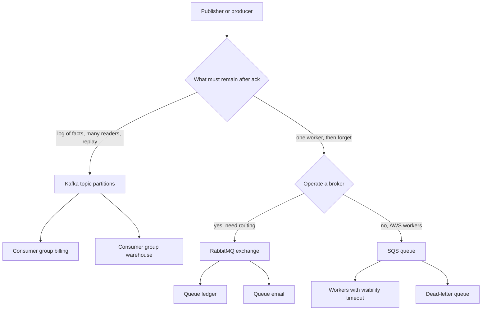

## Concept

### Three products, three units of work

RabbitMQ, Apache Kafka, and Amazon SQS are all "messaging," and they disagree about what a message is after it is accepted. RabbitMQ is a broker of queues and exchanges. A message is routed, sits on a queue, is delivered to a competing consumer, and is forgotten when it is acked (or dead-lettered). Kafka is a replicated log. A record stays until retention, and every independent consumer group reads it at its own offset. SQS is a hosted competing-consumer queue (standard or FIFO) with visibility timeouts, a managed API, and no log you can rewind.

Pick from the unit of work, not from a latency graph. If the product is "many independent readers, replay, and a stream of facts," you are in Kafka's shape. If the product is "hand this task to one worker, ack, forget, maybe retry," you are in RabbitMQ or SQS. If you need that task shape without operating brokers, SQS. If you need protocol flexibility, priority, complex routing, or AMQP consumers that already exist, RabbitMQ.

Using Kafka as a job queue is a common compromise: it works, you lose cheap competing-consumer semantics, and you invent visibility timeouts with consumer groups and idempotency. Using SQS as an event bus is the opposite compromise: every new subscriber needs its own queue and a copy of the publish (SNS-to-SQS, or an application fan-out), and you cannot replay last Tuesday unless you stored the payload somewhere else.

### Routing versus log consumption

RabbitMQ's power is the exchange. Direct, topic, fanout, and headers exchanges bind queues with routing keys and patterns. A publisher sends to an exchange, not to a worker. Bindings decide copies. A payment service can publish `payment.captured` once and, through bindings, fill a ledger queue, a risk queue, and an email queue. Each queue is a competing-consumer group. Removing a binding stops a subscriber without changing the publisher. Priority, TTL per-queue, and length limits are native.

Kafka's "routing" is the topic name and the partition key. There is no broker-side pattern match that copies a record into another topic unless you run a connector, Streams job, or MirrorMaker. Fan-out is extra consumer groups on the same topic. That is operationally beautiful at large fan-out: one write, N readers, no N-fold broker memory of inflight copies. It is awkward when you wanted AMQP-style "only fraud cares about this routing key" without teaching every producer a topic taxonomy.

SQS has no exchange. A queue is an address. Fan-out is SNS topics with SQS subscriptions, EventBridge rules, or application-level double sends. FIFO queues add a message group id that is the closest thing to a Kafka key: order is per group, parallelism across groups. Standard queues offer best-effort order and at-least-once with more duplication. There is no consumer group offset. There is a visibility timeout: after receive, the message is hidden, then reappears if you do not delete it.

### Retention, replay, and operational ownership

Kafka retention is hours to days to forever, by time or size, plus optional compaction. Replay is a new group or a reset. That is the reason companies put their canonical event stream in Kafka even when workers would have been happier with a queue.

RabbitMQ queues are not a system of record. You can enable lazy queues and disk persistence, and you can set TTL, but the design center is drain-and-ack. A stuck consumer with a million unacked messages is a memory or disk incident on the node. Replay means you kept the data elsewhere, or you never acked.

SQS retention is up to fourteen days. There is no replay after delete. Dead-letter queues catch messages that exceeded `maxReceiveCount`. Operators like this because failure is a queue they can inspect, not a log they must offset-reset carefully. They dislike it when a bug is discovered on day fifteen.

Ownership follows. Kafka is a platform: brokers, disks, partitions, consumer lag, ACLs, schema registry. RabbitMQ is a broker you still patch, cluster, and disk-provision, with a different failure vocabulary (split brain, queue mirroring vs quorum queues, high unacked). SQS is AWS's operations story: you pay per request and payload, you accept regional APIs, and you do not SSH into a broker. The hidden ownership in SQS is IAM, DLQ alarms, lambda concurrency, and the application-level idempotency you still need.

### Delivery, order, and transactions

RabbitMQ: at-least-once with manual acks is the honest default. Publisher confirms give the producer a durability signal. Transactions exist but are not the scaling path. Order is per-queue if you have one consumer; competing consumers interleave. Quorum queues (Raft) are the modern durability story; classic mirrored queues had a worse failure record.

Kafka: per-partition order, ISR durability, optional idempotent producers and transactions for log-to-log atomicity. Consumer offset commit is your ack. Exactly-once is a pipeline that stays inside Kafka plus idempotent sinks.

SQS standard: at-least-once, duplicates more often than Kafka-with-idempotent-producer, no cross-queue transactions. FIFO: at-least-once with deduplication windows (five minutes, on a dedup id) and per-message-group order. Dedup is not an inbox for a day-later replay. Long polling reduces empty receives. Batch send/receive is the throughput path.

### Cost and the shape of traffic

Kafka is cheap per byte at high sustained throughput if you already run it, because a sequential log and page cache are efficient. It is expensive in people if you have three topics and no platform team. RabbitMQ is fine at moderate rates and painful when a queue becomes a large disk log you never designed. SQS is cheap to start and linear with API calls; a chatty producer that sends one-byte messages at high QPS will notice the bill. Batching, SNS fan-out copies, and Lambda invocations are the cost knobs.

## Trade-offs

| Approach | When it wins | Cost / risk |
| -------- | ------------ | ----------- |
| Kafka log + consumer groups | Event bus, replay, many subscribers, stream processing | Platform ops; poor native job-queue semantics; order is per partition |
| RabbitMQ exchanges + queues | Tasking, complex routing, AMQP clients, priority | No cheap replay; unacked and queue length are memory/disk hazards |
| SQS standard | Simple tasks, AWS-native workers, minimal ops | Duplicates, no replay past retention, no global order, per-request cost |
| SQS FIFO | Ordered tasks per group id, exactly-once-ish within 5 min dedup | Throughput caps; dedup window is not a business inbox |
| Kafka used as a work queue | You already have Kafka and need "one handler per item" | Reinvent visibility timeout; consumer group rebalances look like retries |
| SNS + SQS fan-out | Multiple task subscribers without a log platform | N copies stored; no rewind; schema and IAM sprawl |

If the consumer is a fleet of workers doing HTTP calls with a visibility window, SQS or RabbitMQ will match the mental model of the code you write. If the consumer is a data product that must catch up from offset 0 after a bug, Kafka is the only one of the three that treats that as normal.

Do not mix the ack models accidentally. An SQS delete is "this receipt is done." A Kafka offset commit is "this group is done through this offset," which is stronger and easier to get wrong if you commit the batch before the last handler returns. A RabbitMQ ack is "this delivery is done"; another consumer of another queue may still have a copy from the same publish.

## Diagram

## Failure modes

### Kafka: lag and rebalance mistaken for a lost job

Detection is a worker that "never got the message" while the record is sitting in the log at an uncommitted offset, or a group that reset to latest after a bad group-id change. SQS-shaped thinking (if I did not receive it, it is gone) is the cognitive failure.

Mitigation is lag dashboards, committed versus log-end offset, and a forbidden `auto.offset.reset=latest` on pipelines that cannot skip. Treat group id as a durable resource. For job-like work on Kafka, the handler must be idempotent because rebalance is a redelivery.

### RabbitMQ: unacked pile-up and node memory

Detection is growing unacked count, rising memory, publishers blocked by flow control, and consumers that prefetch too high then die. A classic mirrored queue under partition is a split-brain story; quorum queues fail more safely but still stall if a majority is gone.

Mitigation is bounded prefetch, quorum queues for durable work, lazy queues or overflow to disk for known backlogs, and publisher confirms. Page on queue length and unacked, not only on "is the node up." Poison messages need a DLX and a retry bound, or one bad payload holds the consumer.

### SQS: visibility timeout shorter than the handler

Detection is duplicate work while the first worker is still running, CloudWatch showing rising `ApproximateReceiveCount`, and DLQ depth if max receives is too low for slow but valid jobs. The opposite failure is a timeout so long that crashed workers hide messages for minutes.

Mitigation is visibility timeout greater than p99 handler time, `ChangeMessageVisibility` heartbeats for long jobs, and an idempotency key in the payload. FIFO dedup will not save a second receive after the five-minute window. DLQ alarms must page; a silent DLQ is where payments go to die.

### Fan-out copy divergence

Detection is subscriber A processed an event subscriber B never saw, because SNS retry failed, a binding was missing, or one SQS queue was not subscribed. In Kafka this is "B's group lag." In RabbitMQ it is a missing binding. In AWS it is a missing subscription or a filter that dropped the payload.

Mitigation is a contract test: publish a canary event and require each subscriber's queue or group to observe it. Version the schema. Do not rely on "the producer code listed three send() calls" as fan-out.

## Real-world example

Amazon SQS is the public system that made competing-consumer tasking a default on AWS. The product exists because Amazon needed to decouple internal services without every team running a broker. Standard queues accept a very high send rate, hide a message for a visibility timeout after ReceiveMessage, and delete on explicit DeleteMessage. If the worker dies, the message reappears. That is at-least-once with a clock, not a log cursor.

AWS's own builders, and every large customer that followed, pair SQS with SNS when they need fan-out: a payment captured event publishes to an SNS topic; billing, risk, and email each own a queue. That architecture is the right answer for task isolation. It is a poor canonical event store. When Amazon retail or AWS service teams need replay, analytics, and many lagging readers, they do not stretch SQS retention; they put the facts on a log (internally, or on Kinesis/Kafka-class systems) and use SQS for the worker edge: "call this downstream, retry, DLQ."

The lesson for an architecture review is the split Amazon already lives with. SQS wins for "run this job with visibility and a DLQ, and I do not want pager duty for brokers." Kafka wins for "this topic is the history of the business for a retention window." RabbitMQ still wins in shops whose language runtimes, routing keys, and operators are AMQP-native, and whose messages are tasks. Copy Amazon's split, not a single-tool religion. If your payments bus must replay a day of captures into a rebuilt ledger, SQS will not do that after delete; if your payments bus must call a card network with a visibility window, Kafka will make you fake SQS.

## What to remember

- Kafka is a retained log with independent cursors; RabbitMQ and SQS are competing-consumer queues that forget on ack or delete.
- Fan-out is extra groups on one Kafka topic, extra bindings in RabbitMQ, and extra copies (SNS/SQS) in AWS.
- SQS visibility timeout is not an inbox; FIFO dedup is five minutes, not a business uniqueness constraint.
- Choose by replay and subscriber shape first, then by who will operate the brokers and pay the API bill.
