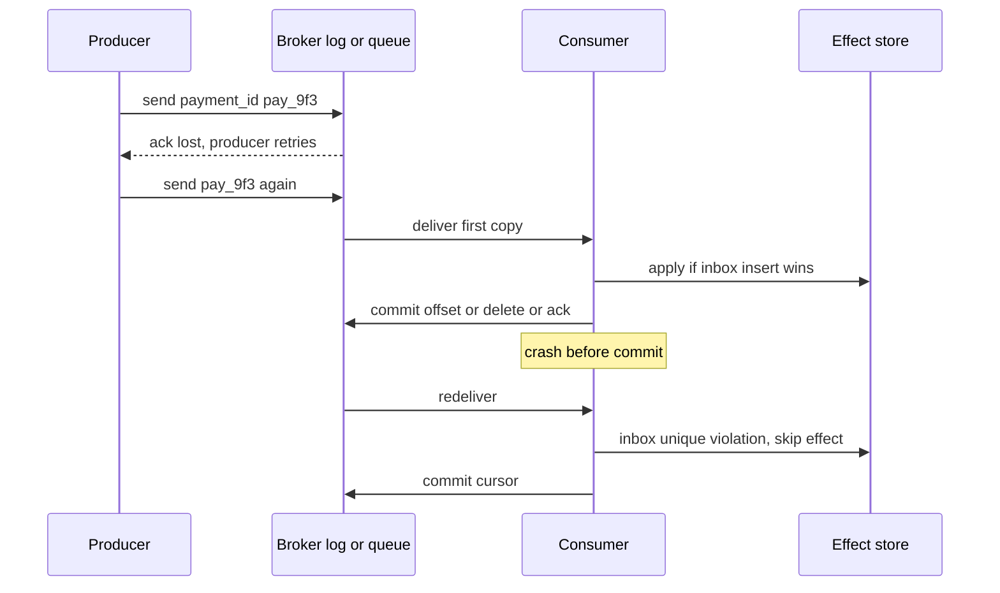

## Concept

### Three contracts, one crash window

Delivery semantics answer a single question: after a crash, a timeout, or a retry, how many times may a receiver run the handler for one logical message? At-most-once: zero or one. The failure mode is loss. At-least-once: one or more. The failure mode is duplicates. Exactly-once: one observable effect. The failure mode is pretending the first two do not exist.

The crash window is always the same shape. A sender does not know whether a missing acknowledgement means "never arrived" or "arrived, and the ack was lost." A consumer does not know whether a missing offset commit means "we did not process" or "we processed and died before the cursor moved." Protocols pick a default: retransmit (at-least-once) or move on (at-most-once). They cannot pick "know the truth" without a shared unique key and a store that both sides trust.

Say "effectively once" in design reviews when you mean at-least-once transport plus an idempotent effect. Say "exactly-once inside the log" when you mean Kafka transactions or an equivalent consume-transform-produce atomic commit. Say "exactly-once everywhere" only if you are prepared to show the inbox, the remote idempotency key, and the retention of those keys across replay. Marketing slides collapse those three. Production incidents are the collapse.

### At-most-once is commit-then-work, or fire-and-forget

At-most-once is not a missing feature. It is a choice that loss is cheaper than double application. Metrics, sampled traces, cache invalidations that rebuild from source, and some UI notifications qualify. The implementation is usually: advance the cursor, then process; or send UDP-style with no retry; or Kafka `enable.auto.commit` with processing after the poll that already committed the previous batch; or SQS delete before the handler (almost no one should do that).

The trap is accidental at-most-once. Auto-commit in a Kafka client that commits on poll, combined with a handler that can throw after the next poll has already committed, drops the batch. A worker that acks RabbitMQ in the AMQP interceptor before the database write drops the task on crash. If the product cannot tolerate loss, this is a bug, not a semantic.

When you choose at-most-once on purpose, make loss visible. A gap in a sequence number, a drop counter, a comparison against a source of truth that is allowed to be slightly ahead, should exist. Silent loss is how at-most-once becomes "we thought we were at-least-once."

### At-least-once is work-then-commit, plus retries

At-least-once is the default of every serious broker. Kafka consumers commit offsets after processing. RabbitMQ consumers ack after work. SQS workers delete after work; visibility timeout expiry is the retry. Producers retry on missing acks, which can double-append if the broker had the first copy.

Duplicates are not a misconfiguration. They are the recovery path. A well-run pipeline has a non-zero duplicate-skip rate. Zero skips on a topic with retries means either you are losing retries (and maybe data) or you are applying duplicates as new facts.

The consumer's job is to make the second delivery cheap. Unique keys, upserts, and state machines that ignore illegal transitions (you cannot "ship" twice) are the tools. Increments, emails, and "charge the card" are not idempotent unless keyed. The key must be assigned before the first send, persist across retries, and survive a new consumer host.

### Exactly-once is a boundary, not a broker flag

Broker-level exactly-once, when it exists, covers a closed system. Kafka's idempotent producer assigns a producer id and a sequence per partition so a retried produce does not create a second record. Kafka transactions add a transaction coordinator: a set of partitions and a consumer offset commit in `__consumer_offsets` commit together, or they abort. A Streams job can read input, update a changelog, and write output without a crash emitting a double count into the output topic.

The boundary is the process that leaves the log. An HTTP call, a SMTP send, a SQL database that is not in the transaction, a search index, a card network: none of these join Kafka's transaction coordinator. After the connector or handler talks to them, you are at-least-once again unless they have their own idempotency key and you pass it.

End-to-end exactly-once is therefore a chain of closed systems, each with a uniqueness constraint, not a single `isolation.level=read_committed` on the client. `read_committed` only hides aborted transactional records from consumers. It does not make your ledger unique.

### Offset, ack, and visibility are the same fork

All three brokers encode the fork in a cursor:

- Kafka: commit offset before process → at-most-once; after process → at-least-once; in the same transaction as output records → exactly-once for those records.
- RabbitMQ: ack before process → at-most-once; after → at-least-once; no native exactly-once across a SQL write.
- SQS: delete before process → at-most-once; after → at-least-once; FIFO dedup id → producer-side collapse of retries for five minutes, not a consumer inbox.

Draw that fork on the whiteboard before you discuss "we need exactly once." Most services need at-least-once plus an inbox. A minority of stream processors need Kafka transactions. Almost none need at-most-once for money.

## Trade-offs

| Approach | When it wins | Cost / risk |
| -------- | ------------ | ----------- |
| At-most-once | Telemetry, samples, rebuildable caches | Silent loss on crash, timeout, rebalance, or auto-commit |
| At-least-once + application inbox | Payments, orders, mail, any external side effect | Unique key design; extra write; retention of keys for the replay horizon |
| Idempotent producer only | Stops duplicate appends from producer retries | Does not help consumer crashes or other producers of the same business event |
| Kafka transactions (EOS) | Consume-transform-produce entirely in Kafka | Throughput and operational complexity; sinks outside the log are not covered |
| SQS FIFO dedup / broker dedup windows | Short retry storms from the same producer | Window expiry; different id means a new message; not a ledger constraint |

Idempotent producers are cheap relative to their benefit. Turn them on for Kafka product topics. They do not replace consumer idempotency. Two producers with two producer ids can still emit two records for one business payment if the application retried with a new client.

Transactions are the right tool when the output is more Kafka records and you cannot tolerate double those records. They are the wrong tool when the output is a Stripe charge. Teams enable `processing.guarantee=exactly_once_v2`, call Stripe in the `transform()`, and then file an incident about two charges. The guarantee held: two output records or two handler invocations still happened at the sink.

A durable inbox in the same database as the business row is the workhorse for effects. Cost is a unique index and a transaction. Cost of skipping it is a duplicated money movement. There is no third knob that is both cheaper and safe for that class of handler.

## Diagram

## Failure modes

### Accidental at-most-once

Detection is missing business facts that exist in the producer's outbox or access log but not downstream, clustered around deploys, rebalances, and client library upgrades that changed auto-commit. Consumer lag looks healthy because the cursor moved.

Mitigation is explicit commit after the handler, auto-commit off, and tests that kill the process between effect and commit. For Kafka, prefer cooperative rebalance and commit on revoke of finished work only. For SQS, never delete before the effect. Alert on a join from producer audit to consumer inbox that shows holes, not only on lag.

### Duplicate effects because the key is wrong

Detection is two ledger rows, two emails, or two charges for one user intent, with different event ids. The producer minted a UUID per attempt, or the consumer used `(topic, partition, offset)` as the key and a legitimate republish created a new offset for the same payment.

Mitigation is a business key assigned once at intent creation: `payment_id`, `order_id`, `Idempotency-Key` on the HTTP edge. Offset is a valid key only if this log is the only origin and you will never copy the payload to another topic or replay by republishing. Support tools must republish the original id.

### Transactional produce, non-transactional sink

Detection is "EOS enabled" in the processor config and duplicate documents in Elasticsearch, duplicate rows in a warehouse that appends, or duplicate webhooks. The Kafka output topic looks clean.

Mitigation is upserts at the sink keyed by the same id, or an inbox in front of the sink. Connectors should be documented as at-least-once unless they prove a unique constraint. Isolation `read_committed` on a downstream consumer only filters aborted Kafka transactions.

### Dedup window shorter than replay

Detection is a second application of an event after a DLQ replay, a backup restore, or a FIFO window expiry. Metrics show a gap in "duplicate skipped" then a spike in side effects.

Mitigation is key retention longer than every redelivery path you actually operate, including operator replay and stream reset. A five-minute broker window is a retry collapse, not an archive. If operators can replay thirty days, the inbox keeps thirty days plus margin, or it is the ledger itself (insert-only facts).

## Real-world example

A payments bus at a large processor — think the shape Stripe, Adyen, or a bank's internal payment orchestration — cannot choose at-most-once. A captured charge that never reaches the ledger is an unreconciled hole. A captured charge that reaches the ledger twice is stolen money in the customer's eyes even if you later refund. The industry pattern is at-least-once delivery on the bus (Kafka is common, so are clustered queues) and exactly-once effect in the ledger.

The producer of `payment.captured` writes an outbox row in the same database transaction as "we accepted the intent," then a relay publishes with `payment_id` as the key and as an idempotency header. Kafka's idempotent producer collapses broker retries of that publish. The ledger consumer inserts `payment_id` into an inbox unique index in the same SQL transaction as the ledger entry. A crash before offset commit redelivers; the insert fails; the offset commits. The card-network call, if it happens in this service, uses the same `payment_id` as the network's idempotency key so a timeout after a successful capture does not capture again.

Where these buses go wrong is borrowing "exactly-once" from the Kafka Streams job that aggregates risk scores. That job's EOS guarantee is real for the risk topic. The payments consumer that reads the same cluster is still an at-least-once worker with an inbox. Reconciliation jobs exist because the chain can still fail at the vendor: captured at the network, missing locally, or the reverse. Effectively-once is the inbox plus the vendor key plus a reconcilers that treats mismatch as a first-class state, not a broker setting on the topic.

## What to remember

- At-most-once loses, at-least-once duplicates; "exactly-once" is a closed-system atomic commit or an idempotent effect, not a wish.
- Commit or ack after the effect for at-least-once; before the effect is accidental loss.
- Kafka transactions and idempotent producers protect the log; every HTTP or SQL effect needs its own key.
- Retain uniqueness keys for the real replay horizon, including DLQ and operator republish of the original id.
