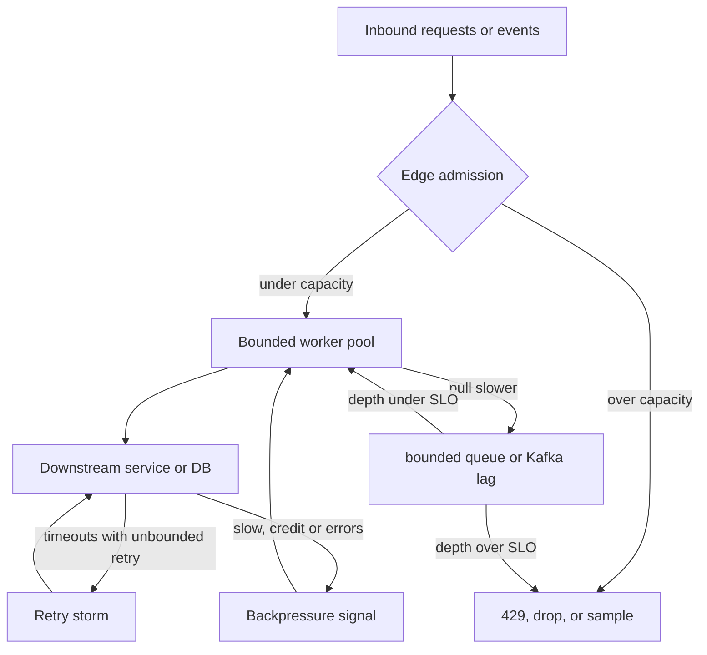

## Concept

### Slow consumers must slow producers, or something drops

Backpressure is the signal from a downstream stage that it cannot accept work at the current rate, and the upstream reaction that reduces that rate. Without it, the only remaining buffers are memory, disk, and other people's timeouts. Those buffers always overflow. The overflow is an out-of-memory kill, a full disk, a latency explosion, or a retry storm that makes the downstream slower.

In a single process, bounded queues and blocking put() are backpressure. In TCP, the receive window shrinking is backpressure. In HTTP/2, STREAM_WINDOW updates are backpressure. In reactive streams, `request(n)` is backpressure. In Kafka, the consumer simply fetches less; the broker's disk is a large buffer, and lag is the signal. In SQS, ReceiveMessage slowing down is not enough if producers keep SendMessage at full rate; the queue grows until retention or until you alarm. The mechanism changes. The invariant does not: every stage either applies backpressure, load-sheds with a declared policy, or becomes the incident.

Unbounded `ExecutorService` queues, unbounded Go channels used as buffers, and "just add a Kafka topic" without a lag SLO are the same bug at different scales. You moved the pile. You did not create a control loop.

### Push versus pull

Pull systems give the consumer the brake. Kafka fetch, SQS receive, and a worker taking from a queue at its own rate are pull. The producer can still overwhelm the broker's disk, but the worker does not get a flood of callbacks it cannot refuse. Push systems (many AMQP setups with high prefetch, gRPC streaming without flow control, websocket fan-out) send until a buffer fills. Prefetch and credit-based flow control are how you put a brake on push.

Kafka's architecture is pull on the consumer path and bounded on the producer path only if you configure it: `max.block.ms` when the producer buffer is full, `max.in.flight`, and broker quotas. A producer that fails fast on a full buffer is load-shedding at the edge. A producer that blocks is applying backpressure into the calling thread. A producer that grows an unbounded in-memory list "to not block the request" is the anti-pattern.

RabbitMQ prefetch is a credit window. Prefetch 1 is strict backpressure per consumer and kills throughput. Prefetch 1000 is a burst buffer that looks like performance until the consumer dies with 1000 unacked in RAM. SQS has no prefetch in the broker; workers choose batch size. Too large a batch is a visibility-timeout problem. Too small is throughput. That batch size is a backpressure knob.

### Where the buffer lives

Every pipeline is a series of buffers: client heap, producer batch, broker log or queue, consumer heap, downstream connection pool, database. Backpressure policy is choosing which buffer is allowed to grow, to what bound, and what happens at the bound.

Disk-backed logs (Kafka) are good shock absorbers for a consumer outage of minutes to hours, if you sized retention and disk and if lag has an SLO. They are bad shock absorbers for a producer that writes faster than disk forever. Memory queues are good for milliseconds of jitter and bad for seconds. The database connection pool is a buffer of 20; when it is exhausted, the next stage must block or fail, not start another 200 connections.

"Queue-based load leveling" only works if the queue's drain rate and depth are first-class SLOs. A queue that can grow without alarm is not load leveling. It is deferred overload. The deferred form hits you when consumers catch up and stampede the database, or when the disk fills at 3 a.m.

### Load shedding is backpressure with a no

When upstream cannot slow down (a public API, a sensor, a partner file drop), you shed. Shedding policies must be explicit: HTTP 429 with Retry-After, drop oldest, drop newest, sample, or degrade quality (smaller images, skip enrichment). Dropping newest preserves old work; dropping oldest preserves fresh work. Choose from product. A payments API should 429, not drop. A telemetry pipeline should sample. A live video pipeline should drop oldest frames.

Retries without budget invert backpressure. A 429 that the client immediately retries with ten other clients is a thundering herd. Retry-After, jitter, and an admission control token bucket on the client are part of the same design. Circuit breakers stop calls to a sick dependency; they do not slow the arrival of user requests unless the shed happens at the edge.

### Propagation across threads and services

Backpressure that stops at a thread boundary is a lie. A servlet that writes to an unbounded BlockingQueue consumed by a Kafka producer thread has moved overload into the heap. A reactive pipeline that uses `publishOn` onto an unbounded queue has done the same. `onBackpressureBuffer()` in Reactor without a bound and a handler is a name that pretends.

Across services, the signal is usually latency, queue depth, or an explicit code. Propagate it: if the billing service 429s, the API that called it should 429 or queue with a bound, not retry internally until the user times out. Timeout plus retry without a queue bound is how you amplify. The resilience stack (timeout, retry, breaker, bulkhead) is backpressure's sibling; bulkheads bound concurrency so one dependency cannot take every thread, which is a form of not applying backpressure to the rest of the process.

## Trade-offs

| Approach | When it wins | Cost / risk |
| -------- | ------------ | ----------- |
| Blocking / credit-based pull | In-process pipelines, Kafka consumers, TCP | Latency as load rises; a stuck consumer stalls the pipeline |
| Bounded queue plus reject | HTTP edges, producers, thread pools | Caller must handle 429/timeout; need a policy for the rejected work |
| Disk log as shock absorber | Consumer outages, bursty producers with a lag SLO | Disk and rebuild cost; lag hides a capacity miss until retention |
| Load shed (drop or sample) | Telemetry, media, overload of a public API | Data loss; must be visible and product-approved |
| Unbounded buffer "for smoothness" | Never, except a proven tiny jitter window | OOM, GC death spiral, multi-minute latency, then collapse |
| Client retries without a budget | Brief blips | Retry storms; downstream never recovers |

Blocking pull is the correct default inside a service you control. The cost is that a slow stage shows up as latency, which is honest. Adding an unbounded queue to "keep latency low" under load is how you get a cliff: p50 stays pretty until the heap dies.

A Kafka topic between services is a legitimate shock absorber when the consumer can catch up faster than retention burns, and when lag pages. It is not a substitute for producer quotas. If produce rate can exceed consume rate indefinitely, you will fill the cluster. Broker quotas and application-level 429 at the ingest API are the real brakes.

Load shedding must be louder than a dropped counter in a dashboard nobody watches. If you drop 2% of telemetry, product should know the metric is sampled. If you 429 checkout, the client should show a retryable error, not a generic 500 that the user double-submits.

## Diagram

## Failure modes

### Unbounded in-memory queues

Detection is heap growth correlated with downstream latency, GC time rising, then a sudden crash or a latency cliff. Thread dumps show producers blocked later, after the queue already ate RAM. In Java, `LinkedBlockingQueue` with default unbounded capacity on a thread pool is the usual footprint.

Mitigation is a capacity on every queue, a rejection policy (caller-runs, abort, shed), and a metric for queue depth and reject count. Caller-runs is backpressure into the inbound thread, which is often what you wanted at the edge. Size from p99 downstream time times offered rate, plus a small jitter margin, not from "a million feels safe."

### Retry storms and amplified load

Detection is downstream QPS above inbound QPS, a sawtooth of errors and retries, and recovery that never happens until you block the clients. Timeouts set shorter than the dependency's p99 guarantee this shape.

Mitigation is retry budgets (only a fraction of traffic may retry), jittered exponential backoff, circuit breakers, and making the first timeout larger than the dependency's SLO or failing fast without retry for non-idempotent calls. Hedge only with a cap. Load-test the failure, not only the happy path.

### Kafka lag treated as infinite buffer

Detection is consumer lag growing for hours, disk filling, then produce failures, or a catch-up that DDoSes the sink when consumers are scaled. Broker page-cache miss rate climbs as consumers leave the tail.

Mitigation is a lag SLO with pages, producer quotas, and a catch-up plan that throttles consumers against the sink. Do not start 50 new group members against a database that was sized for 5. For replays, use a separate cluster or throttled consumers. Retention should exceed the lag SLO, not the other way around.

### Prefetch and visibility hiding overload

Detection is RabbitMQ unacked count or SQS in-flight growing while consumer CPU is already maxed, then a restart that redelivers a punch. Prefetch or batch size was "tuned for throughput" on a good day.

Mitigation is prefetch and SQS batch sized so in-flight work fits memory and visibility timeout. Adaptive prefetch exists in some clients; even then, cap it. On overload, lower credit, do not raise it. Heartbeat visibility for long jobs so you do not double-execute, and still bound how many long jobs you start.

## Real-world example

Netflix's streaming and API edge is a public case of backpressure as product. Playback and recommendation traffic cannot be allowed to take down a dependency and then retry it to death. Their published work on Zuul, concurrency limits, and adaptive retry describes the control loop: bound outstanding requests to a dependency (a bulkhead plus a limit derived from latency), reject or fail fast at the edge when the limit is hit, and retry only with a budget so retries cannot dominate.

When a backend slows, Zuul does not grow an unbounded queue of servlet requests. It sheds. The user may see a slightly degraded page or a retryable error. The backend sees a ceiling, not a herd. That is backpressure plus load shedding, with the bound in the proxy where it can protect every caller. The same company uses Kafka heavily; consumer lag is a different buffer, used for data pipelines where delay is acceptable and disk is sized. They do not use "put it on Kafka" as the admission control for a live API.

Copy the split. User-facing request paths: bounded concurrency, explicit 429 or degraded responses, retry budgets. Asynchronous pipelines: pull consumers, lag SLOs, broker quotas, and no unbounded in-process queues in front of the producer. Netflix's incidents historically show what happens when a retry layer and a timeout layer disagree: the downstream recovers slower than the clients retry. The fix is always a bound, not a larger buffer.

## What to remember

- Every stage must brake, shed, or become the outage; unbounded queues only delay the same failure.
- Pull and credit windows are honest brakes; disk logs absorb shocks only with a lag SLO and producer quotas.
- Retries without a budget invert backpressure and prevent recovery.
- Load shedding is a product policy (429, sample, drop oldest) that must be visible, not a silent catch block.
