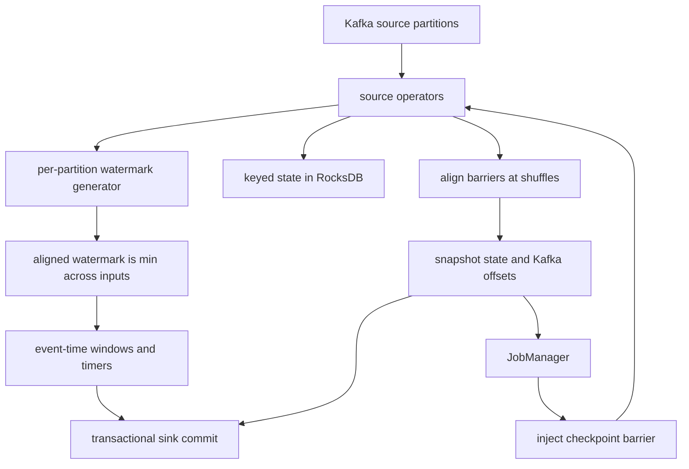

## Concept

### Two engines that share a problem and almost nothing else

Stream processing treats an unbounded sequence of records as the primary compute surface. The record arrives, you update keyed state, you emit a result, and you keep going. Apache Flink and Kafka Streams both do that job. They are not interchangeable libraries.

Flink is a dedicated runtime. A JobManager owns the graph, checkpoints, and recovery. TaskManagers own slots, local state, and network shuffles. You submit a job. Operators are scheduled onto slots. Parallelism is a property of the job, not of the number of application pods you happened to roll. Kafka Streams is a library inside your JVM service. There is no JobManager. Kafka's consumer group protocol is the scheduler. Each running instance claims a subset of input partitions. Topology parallelism cannot exceed the partition count of the source topics unless you add partitions, which is a cluster change, not a config bump.

That split drives every later choice. If you already operate Kafka and the transform is per-key, local, and bounded in state, Kafka Streams keeps the moving parts inside one ops domain. If you need event-time windows over minutes of disorder, large keyed state, custom windows, or a graph that shuffles independently of Kafka partitions, Flink is the engine. Pretending they are the same product with different APIs is how teams stall for a quarter.

### Event time, watermarks, and what "lateness" actually means

Processing time is wall-clock on the operator. Event time is a timestamp in the record: when the click happened, when the sensor fired, when the payment was authorized. Windows that matter to a business are almost always event-time windows. A ten-minute session that closes when the operator's clock says so will split a user's session across a lag spike and merge two users who happened to be processed together.

A watermark is not a heuristic for "data is probably here." It is an assertion the source makes about event time: no record with timestamp earlier than `W` will arrive on this stream, except those you have already classified as late. Each source partition tracks its own watermark. Downstream operators take the minimum across inputs because a window cannot close until every upstream partition has advanced past the window end. That minimum is the whole game. One idle or stuck partition holds the watermark for the job. Windows do not fire. State grows. Timers pile up. Operators look busy and produce nothing.

Flink exposes this as watermark generators on sources, idle-source timeouts so a quiet partition does not freeze the min, and allowed lateness so a late record can still update a window after the watermark has passed the end. Kafka Streams has a weaker built-in story: stream-time advances with the max timestamp seen on a task, and you configure grace periods on windows. It works when partitions are well-keyed and lag is even. It fights you when one partition is silent, when timestamps are missing, or when you need to align watermarks across several input topics with different lag.

Set watermarks from bounded out-of-order delay you can measure, not from a guess. Instrument the difference between event time and processing time, the rate of late arrivals, and the watermark vs. the newest event. If those three charts are not on the job dashboard, you do not have event-time processing. You have a batch job that happens to run forever.

### Checkpoints, changelog topics, and the word "exactly-once"

Flink checkpointing injects a barrier into each source. Barriers flow with records. At a shuffle, the operator waits until it has the barrier from every upstream channel, then snapshots keyed state and acknowledges the checkpoint. Sources snapshot their Kafka offsets as part of the same checkpoint. Sinks that participate in two-phase commit hold output until the checkpoint completes, then commit. On restore, every operator rolls back to the last completed checkpoint. The effect is that a failover replays from the checkpointed offsets and rebuilds output that had not committed. That is what Flink means by exactly-once end-to-end, and it only holds if the sink is transactional or idempotent and if the checkpoint actually completed.

Kafka Streams uses Kafka itself as the checkpoint store. Changelog topics capture changelog of local RocksDB or in-memory state. With exactly-once semantics enabled, a task writes its output and its changelog in a Kafka transaction, and it commits consumer offsets in that same transaction. A crash aborts the transaction. Standby replicas keep a warm copy of state so a rebalance does not replay the entire changelog. The mechanism is elegant when everything stays inside Kafka. It is awkward the moment you write to a database, a search index, or an HTTP API: those sinks are not in the transaction. You are back to at-least-once plus idempotent consumers, which is the honest default for most side effects.

Do not advertise exactly-once unless you can name the sink protocol. A Flink job that HTTP-posts to billing is at-least-once with nicer recovery. A Streams app that writes to Elasticsearch is the same. Exactly-once is a pipeline property, not an engine logo.

### State backends, key groups, and why RocksDB shows up

Windowed aggregations, joins, and session state have to live somewhere. Heap state is fast and dies with the process. RocksDB state spills to disk, checkpoints incrementally, and survives sizes that would garbage-collect a JVM to death. Flink's keyed state is partitioned by key-group, which is how restore can redistribute state when you change parallelism. Kafka Streams state is partitioned by the same keys as the source topic; change the partition count and you have a migration, not a slider.

State is the cost center. Checkpoint duration tracks state size and the number of incremental SST files. Changelog topic disk tracks how often you update keys. A join that keeps 30 days of user profile on the stream side will checkpoint for minutes and fail under a backfill. The fix is not a larger TaskManager. The fix is state TTL, a compacted changelog, a dimension store looked up rather than joined, or a window that matches the actual question.

Treat state size as a product metric. Alert on checkpoint duration, checkpoint size, and the ratio of changelog write rate to input rate. If changelog bytes exceed input bytes by a large factor, you are rewriting state on every record and you will not catch up after a reprocess.

### Choosing an engine without a bake-off theater

Pick Kafka Streams when the team already ships JVM services, the job is a topology of filters, grouped aggregations, and KTable joins, partition counts match desired parallelism, and you can accept Kafka as both transport and checkpoint store. Pick Flink when you need event-time watermarks that align across sources, when state is large or must be rescaled independently of Kafka partitions, when the job must read more than Kafka, or when you want a SQL surface that operators can evolve without a full service release. Running both is normal. Running both on the same job is not.

## Trade-offs

| Approach | When it wins | Cost / risk |
| -------- | ------------ | ----------- |
| Kafka Streams library | Per-key transforms inside existing JVM services; Kafka is already the ops boundary | Parallelism capped by partitions; weak watermark alignment; rebalances stall processing |
| Flink DataStream / SQL | Event-time windows, large keyed state, sources beyond Kafka, independent scaling | Separate cluster, checkpoint tuning, and a JobManager as a new failure domain |
| Spark Structured Streaming | Batch-shaped org, micro-batch SLAs, one engine for lake and stream | Latency floor of a batch interval; different failure and state model than Flink |
| Hand-rolled consumer group | Tiny stateless maps, no windows, no joins | You will rebuild watermarks, retries, and state badly under load |

Kafka Streams wins on operational locality. The same pipeline, the same ACLs, the same disk for logs and changelogs. That locality becomes a trap when a job needs 200-way parallelism on a 24-partition topic, or when a quiet partition freezes stream-time. Adding partitions is a Kafka change with consumer impact. It is not a Flink parallelism knob.

Flink wins on the semantics of time and on state that must outlive a partition assignment. The cost is real: checkpoint storage, RocksDB tuning, savepoint discipline for upgrades, and a platform team that understands barriers. Teams that treat Flink as "Kafka Streams with SQL" skip idle timeouts, set watermarks from processing time, and then page on windows that never close.

Spark Structured Streaming is legitimate when the same engine already owns the lake and the SLA is minutes. It is the wrong comparison for sub-second event-time windows. A custom consumer is fine for a fire-and-forget projector, not for a session window.

## Diagram

## Failure modes

### Watermark stall from an idle or skewed partition

Detection is a watermark that stops advancing while input rate is non-zero on other partitions, plus window firing rate dropping to zero and state size climbing. The silent partition is often a key that went quiet, a producer that stopped, or a source marked idle too late.

Mitigation is an idle-source timeout so the min watermark ignores a partition that has no records, plus a measured out-of-order bound instead of a decorative one. For Kafka Streams, consider an external punctuation or a heartbeat topic if a partition can go silent for longer than your window grace. Do not "fix" this by switching to processing time. That hides the stall and splits event-time windows.

### Checkpoint timeout and state blow-up

Detection is checkpoint duration approaching the interval, unaligned checkpoints, and TaskManagers spending CPU on RocksDB compaction. A job that used to checkpoint in seconds and now takes minutes after a traffic increase is not "slow Kafka." It is state growth or too many small SST files.

Mitigation is incremental checkpoints, state TTL aligned to the window plus allowed lateness, tighter key design so hot keys do not bloat one operator, and a savepoint-based resize rather than an in-place parallelism change under load. If changelog volume dominates, stop updating unchanged values and stop joining a slowly changing dimension into the stream.

### Kafka Streams rebalance storms

Detection is `REBALANCING` state flapping, processing latency spikes that match consumer group membership changes, and changelog restore on every bounce. Causes are aggressive session timeouts, frequent deploys, instance count oscillating on autoscaling, and static membership left unset.

Mitigation is cooperative rebalancing, static group membership so a restarting instance reclaims its partitions, standby replicas for hot tasks, and deploy strategies that replace instances one at a time. Autoscaling a Streams app without a partition-aware policy is a self-inflicted outage.

### Late data dropped after a backfill or a clock jump

Detection is a late-record counter, output that disagrees with a batch recomputation for the same window, and a watermark that leapt forward after a producer bug emitted future timestamps.

Mitigation is allowed lateness or a side output for late events, a watermark strategy that caps how far a single record can advance time, and a reprocess path from the log when the window results are wrong enough to matter. Document the lateness SLA in the same place you document the window size. A five-minute window with zero allowed lateness is a different product from a five-minute window that still accepts two minutes of disorder.

## Real-world example

LinkedIn is the origin story of this problem space. Kafka was built there so producers and consumers could disagree about rate and still share a durable log. The first generation of stream jobs sat on Samza: a library model close in spirit to Kafka Streams, with changelog-backed local state and YARN as the cluster. That model is excellent when the unit of parallelism is the Kafka partition and when the team already knows how to operate topics, ACLs, and consumer groups.

As jobs moved from "count events per member" to multi-stream joins, large windows, and SQL that analysts expected to iterate on, LinkedIn invested in Flink as a first-class processor on top of the same Kafka spine. The interesting architectural move is not "Flink replaced Kafka." Kafka stayed the log. Flink became the engine for jobs whose state and event-time semantics outgrew a consumer-group scheduler. Watermarks, checkpoints, and savepoints turned reprocessing from a tribal script into a job restore. Changelog-style state did not disappear; it moved behind Flink's state backend and checkpoint storage.

LinkedIn could afford two runtimes because the log was already a product: retained, replayable, with schemas and a platform team. Flink jobs read Kafka. Simpler topologies still look like Kafka Streams. Standing up Flink for a three-operator map-filter puts a JobManager in the paging rotation for no gain. Use the log as the contract. Use Kafka Streams when the topology fits a partition. Use Flink when time and state do not.

## What to remember

- Watermarks are a min-across-inputs contract; one idle partition can freeze every event-time window.
- Exactly-once is a sink protocol plus a completed checkpoint or Kafka transaction, not a checkbox on the engine.
- Kafka Streams parallelism is partition count; Flink parallelism is a job setting with key-group restore.
- Treat checkpoint duration and state size as product metrics, or the first failover will be the first outage.
