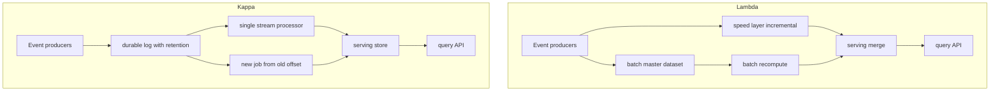

## Concept

### Why two pipelines existed in the first place

Lambda architecture was a response to a specific constraint of the early 2010s: batch engines could compute a correct answer over a large store, and stream engines could compute a fast answer over a recent window, but neither could do both with the same code, the same latency, and the same operational budget. Nathan Marz's original sketch therefore split the world. A batch layer recomputes views from the master dataset on a schedule. A speed layer fills the gap since the last batch with an incremental approximation. A serving layer answers queries by merging both.

That split is easy to draw and expensive to live with. Every feature now has two implementations, two clocks, two failure domains, and a merge function that must hide the seams. The merge is the product. If the speed layer counts in a different window than the batch layer, dashboards lie during the overlap. If the batch layer uses a later schema than the speed layer, yesterday's correction never appears in the live view. Teams discover they are not operating a data platform. They are operating a reconciliation desk.

Kappa architecture, named by Jay Kreps, is the counter-proposal: keep a durable log as the system of record for events, and run a single stream processor that can catch up from offset zero when the logic changes. There is no batch layer as a second codebase. Reprocessing is the same job pointed at an older offset, or a new job reading the same topics. The serving store is an output, not a third source of truth.

### The log as the master dataset

Lambda's master dataset is usually files in a lake: immutable, cheap, and awkward to replay through a streaming engine. Kappa's master dataset is the log: Kafka, Pulsar, or a cloud equivalent, retained long enough that a new consumer can rebuild derived state. Retention is the architectural parameter people underprice. Seven days of Kafka is not a master dataset. It is a buffer. Ninety days, compacted topics for current state, and a cheap dump of the log into object storage for years is a master dataset.

Compaction changes the meaning of replay. A compacted topic can rebuild the latest value per key. It cannot rebuild the sequence of values. If your job is a windowed aggregation or an audit, you need the uncompacted history, in object storage if not in the live cluster. Kappa does not magically make Kafka infinite. It makes replay a first-class operation, and then you have to fund the storage that replay requires.

Batch still exists in a Kappa shop. It exists as a consumer of the same log, or as a job over the dump of the log, using the same transform functions you compiled into the stream processor. The distinction is whether batch is a second pipeline with a second schema and a second serving table, or a slower reader of the same events.

### What "merge" actually does in Lambda

The serving merge is underspecified in most whiteboard Lambda. Typical patterns: the speed layer writes recent counts into a key-value store; the batch layer writes complete daily partitions into a warehouse or serving OLAP store; the query API reads both and adds them, subtracting overlap if the batch has caught up to a watermark the speed layer also knows. That overlap subtraction is where bugs hide. Off-by-one hours, time zones, late events that landed in speed but not yet in batch, and late events that landed in batch after speed already expired the key.

Some shops skip a real merge and just let batch overwrite speed on a delay. That is simpler and produces a visible jump when the batch lands. Product managers notice. Some shops query only the speed layer for interactive traffic and use batch for billing, which means you have two numbers for the same noun and you will spend the rest of the year explaining which one is "real."

If you cannot write the merge function in one paragraph, including how late data and reprocessing interact, you do not have a Lambda architecture. You have two pipelines and a hope.

### Kappa reprocessing is a product feature, not a script

Reprocessing in Kappa means: ship new code, start a new consumer group at an old offset or at the start of a retained dump, write to a new serving sink or to a shadowed one, cut reads when the new job has caught up. The old job keeps serving until then. Checkpointed engines make this a savepoint plus a new sink. Kafka Streams makes this a new application id so state is rebuilt from changelogs and sources.

The constraints are catch-up rate, dual-write cost, and schema compatibility across the retained history. If the new job processes at 1.2x realtime and you are replaying 30 days, you need a week plus headroom, and during that week you still have to ingest live data. People plan replay as if the world pauses. It does not. Parallelism, partition count, and sink capacity have to be sized for catch-up, not for steady state.

Code that cannot run against last year's events is not Kappa-ready. That includes dropping fields, changing keying, and reading a side table that did not exist. The log is only as replayable as the contracts and the dependencies you kept.

### When Lambda is still the honest design

Lambda still wins when the batch engine is a different shape of computation, not a slower clone of the stream. Training a model over a year of features is not a Flink window. Compacting a lakehouse table with a layout that streaming writers cannot maintain is not a Kafka Streams job. Regulatory reports that must scan every raw file with a locked Spark job are not a serving-layer merge.

The mistake is using those facts to justify two implementations of the same dashboard counter. Isolate the batch-shaped work. Keep a single streaming path for the serving numbers that product actually refreshes. Hybrid is a scoped exception, not a license to duplicate every aggregate.

## Trade-offs

| Approach | When it wins | Cost / risk |
| -------- | ------------ | ----------- |
| Lambda, two pipelines plus merge | Batch engine is a genuinely different computation; stream engine cannot economically recompute history | Dual code, dual schemas, merge bugs, two clocks in every incident |
| Kappa, single stream plus replay | Serving views are incremental; the log is retained and replayable; same functions can catch up | Retention cost; catch-up capacity; replay blocked by schema or side tables |
| Hybrid: stream for serving, batch for ML and lake layout | Interactive numbers and model training have different engines on purpose | Teams copy aggregates into both paths "for consistency" and recreate Lambda |
| Batch-only warehouse | Latency in hours is acceptable; event volume is modest | You will still grow a shadow stream for the one dashboard that cannot wait |

Lambda's cost is not the extra cluster. It is the extra meaning. Every metric has a batch definition and a stream definition. They drift. Incidents become debates about which number is correct. That debate is unbillable and unbounded.

Kappa's cost is funded retention and a processor that can run faster than realtime during a replay. If legal wants seven years and Kafka is priced on hot disks, the log dump to object storage is part of the architecture, not a backup afterthought. If the stream job is coupled to a live RPC for enrichment, replay will hit that RPC with yesterday's traffic and take it down. Enrichment has to be in the log, in a compacted table, or versioned in the same store the job can read historically.

Hybrid is the usual adult outcome. Netflix-style and LinkedIn-style platforms look like Kappa for the serving path and like a lake for everything that is not serving. The serving path is not allowed to grow a second implementation "just in case batch is more correct." Correctness is replay plus tests against retained events.

## Diagram

## Failure modes

### Dual-pipeline drift

Detection is a growing gap between batch and speed for the same key after the batch watermark has passed, plus support tickets that quote two dashboards. Causes are different window definitions, different late-data policies, different schema versions, and a merge that double-counts the overlap.

Mitigation is one transform library used by both layers, or deletion of one layer. If you must keep Lambda, emit a reconciliation job that computes `batch - merged_speed` per key and pages above a threshold. Do not let analysts pick a source ad hoc.

### Replay that cannot catch up

Detection is a reprocess consumer lag that grows or holds steady while live lag is fine, sink write throttling, and a cutover date that slips. Causes are under-partitioned topics, a sink sized for steady state, and enrichment RPCs that serialize replay.

Mitigation is sizing replay parallelism independently, writing to a shadow sink, throttling live and replay fairly, and putting enrichment on a compacted changelog instead of a live service. If catch-up cannot exceed realtime by a comfortable margin, Kappa is not operational yet. Fix that before the first schema incident.

### Schema or code that cannot read retained history

Detection is deserializer errors at old offsets, jobs that skip years of data, or a reprocess that silently drops fields. Causes are compatibility mode `NONE`, renaming keys, and reading a side table by current-only primary key.

Mitigation is a schema registry with transitive compatibility on the log, dual-read of old and new fields during a migration, and embedding dimension versions in the event or in a historically queryable store. Reprocess tests should run against a sample of old offsets in CI, not only against last week's topic.

### Serving layer as a third source of truth

Detection is operators correcting rows in the serving database by hand, or a job that reads the serving store as input to the next job. The serving store then diverges from any replay of the log.

Mitigation is treating the serving store as derived and rebuildable. Corrections are new events. Backfills are replays. If a human must edit a row, that edit is an event with an actor and a reason, appended to the log.

## Real-world example

Netflix's Keystone pipeline is a working picture of Kappa in a company that still owns a serious lake. Events from devices and services land on a durable stream. Stream processors derive sessionization, quality metrics, and operational views into serving stores that power real-time dashboards and downstream systems. The same events land in the data warehouse and lakehouse stack for longer-horizon analytics, recommendations training, and content science. Those batch jobs are not a second implementation of the Keystone sessionizer. They are different questions on the same facts.

When Netflix needs to change a streaming derivation, the path is a new job, a catch-up from retained stream data or from the copy of that stream in object storage, and a cutover of readers. The company has talked publicly about the cost of dual pipelines and about unifying around a stream-first ingestion spine so that batch is a consumer, not a parallel birth of the event. That is Kappa's claim in production form: one ingestion contract, many readers, replay as a planned operation.

The lake did not disappear. Recommendation models still train on large scans. Those scans would be a caricature of a stream job. The architectural win is that the serving number and the training feature can both trace to the same encoded event, not to a speed-layer approximation that the batch layer later "corrects" into a different meaning. When the numbers disagree, the investigation is a processor bug or a schema bug, not a merge function.

Copy the spine, not the org chart. If your Kafka retention is two days and your warehouse is loaded by a nightly dump from OLTP, you have neither Lambda nor Kappa. You have a warehouse and a lossy buffer. Fund retention and a replayable encoding before you pick a Greek letter.

## What to remember

- Lambda's hard part is the merge of two meanings; Kappa's hard part is funded retention and catch-up capacity.
- Batch still exists in Kappa as a reader of the same log, not as a second definition of the same metric.
- Replay is a product operation: shadow sink, faster-than-realtime, schema that can read old offsets.
- Do not treat the serving store as source of truth; corrections are events, and views are rebuilt.
