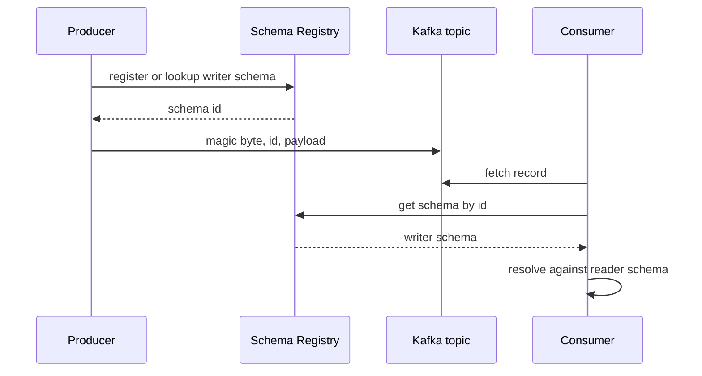

## Concept

### Payloads without contracts are an unofficial API

An event on a log is a public API the moment a second team consumes it. JSON with "we'll be careful" is not a contract. It is a rumor. Fields appear, types widen, enums gain values, and a consumer written last year throws in production on a record that the producer tests never deserialized. The blast radius is every downstream job, not the service that shipped the change.

A schema registry exists to make that API checkable at produce time and resolvable at consume time. The producer registers a schema, or looks up one it already registered, and writes a payload tagged with a schema identifier. The consumer fetches the writer schema by that identifier and resolves it against the reader schema it was compiled with. The registry is the catalog of those versions, with compatibility rules that reject a register that would break the consumers you claim to support.

Without the identifier in the record, a consumer has to guess the version from the topic or from the bytes. Guessing works until two versions share a topic. Then you have a parser that sometimes works, which is worse than a parser that always fails.

### Compatibility modes are consumer-driven or producer-driven, not decorative

Confluent-style registries expose a small set of modes. They are not interchangeable, and picking the wrong one is a silent future outage.

**BACKWARD** means a new schema can be used to read data written with the previous schema. Consumers upgraded first can still read old records sitting in the log. Typical allowed changes: add an optional field with a default, delete a field the new consumer no longer reads. This is the default that matches "consumers roll before producers" and "the log still holds last week's bytes."

**FORWARD** means a new schema can be used to write data that old consumers can still read. Producers can upgrade first. Typical allowed changes: add a field that old consumers ignore, delete a field that had a default so old consumers can fill it. This matches a world where you cannot roll every consumer before a producer release.

**FULL** is backward plus forward for adjacent versions. **FULL_TRANSITIVE** (and BACKWARD_TRANSITIVE, FORWARD_TRANSITIVE) apply the same rule across all stored versions, not only against the latest. Transitive is what you want if you reprocess from offset zero or if you keep consumers that skipped three releases.

**NONE** is a registry used as a catalog with the teeth removed. Every incompatible change registers. The first replay of history fails. Do not use NONE on a topic you claim is replayable.

Protobuf and JSON Schema have their own evolution rules; Avro's defaults and union rules are the ones most Kafka shops trip over. A field without a default cannot be added under BACKWARD because old records have no value to fill. Renaming a field is a delete plus an add, not a rename, unless you use aliases. Changing a type from int to long is not "compatible enough." It is a new field or a staged dual-write.

### Subject strategies: what the schema is bound to

The registry keys schemas by subject. **TopicNameStrategy** uses `<topic>-value` and `<topic>-key`. One schema family per topic. Simple, and hostile to a topic that carries several event types. **RecordNameStrategy** uses the fully qualified record name, so the same type can appear on many topics and many types can appear on one topic. **TopicRecordNameStrategy** binds both, which is the usual compromise for a multi-event topic that must not collide with the same record name on another topic.

Wrong strategy is a compatibility hole. Two event types on one topic under TopicNameStrategy force a union schema that grows forever, or they silently overwrite each other's compatibility history. RecordNameStrategy without care lets a producer register a type that a consumer of that topic never expected, because the subject is not the topic. Pick the strategy when you create the topic, document it next to the ACLs, and do not change it in place.

Keys need schemas too. A compacted topic whose key encoding changes is a different keyspace. Compacted log, wrong key schema, and you now have two current values for what humans think is one entity.

### The contract is more than a struct

A useful event contract names the aggregate, the key, the uniqueness of the event id, the delivery expectation (at-least-once, so consumers must be idempotent), and the compatibility mode. It names whether the event is a fact ("payment captured") or a command ("capture payment"), because those evolve differently and attract different consumers. It names retention and whether the topic is compacted.

Schema registry does not encode most of that. If you only store Avro, teams will still break each other with key changes, semantic changes to a field that kept its type, and "repurposed" enums. Pair the registry with a review path: who owns the subject, who may register, and a changelog of semantic meaning, not only of fields.

Producer-owned contracts work when the producing team is the source of truth for the domain. Consumer-driven contracts work when many consumers have SLAs and the producer is a platform. Either can work. Neither works when anyone with produce ACL can register a schema because CI was given a global API key.

### What happens on the wire

The common Kafka wire format is a magic byte, a four-byte schema id, then the serialized payload. Consumers do not parse Avro by topic name; they parse by id. That is why a registry outage does not immediately break consume of already-cached ids, and why a produce path that cannot reach the registry cannot mint a new version. Cache the schemas in the client. Treat a missing id as a poison record, not as "skip and hope."

For Protobuf, the registry may store the file descriptor set; the payload still needs a way to select the message type. For JSON Schema, you pay for human readability and you pay again for a weaker compatibility checker. Choose the format for evolution rules and for language support, not for aesthetics on a whiteboard.

## Trade-offs

| Approach | When it wins | Cost / risk |
| -------- | ------------ | ----------- |
| Avro plus BACKWARD_TRANSITIVE | Kafka-centric shops, many language clients, replay from deep retention | Defaults and aliases are easy to get wrong; unions grow messy |
| Protobuf plus FORWARD or FULL | RPC and events share types; strong codegen across services | Message type selection and registry integration are extra machinery |
| JSON Schema, compatibility checked | Heterogeneous producers, debugging by eye, browser-adjacent tools | Weaker, slower checks; people "just add a field" and break readers |
| No registry, implied JSON | Two services, one team, topic is not a platform | The third consumer makes this an incident; replay is folklore |

BACKWARD_TRANSITIVE is the right default when the log is a system of record. Consumers can roll first, old records remain readable, and a Flink job from last year can still deserialize. FORWARD is the right default when you cannot touch consumers yet and producers must ship. FULL_TRANSITIVE is insurance when you do not know the roll order. It rejects more changes, which is a feature.

JSON Schema is not a shortcut. It is a different checker with more escape hatches. If your compatibility test is "the pipeline went green," you do not have a contract. You have a coincidental parse.

Running without a registry is acceptable for a private topic that will die with the service. The moment the topic is on an architectural diagram other teams copy, register it. Retrofitting ids into a live topic is a dual-write migration with a poison-pill window. Do it once, on purpose, with a new topic if you can.

## Diagram

## Failure modes

### Poison records and deserializer explosions

Detection is a consumer stuck on one offset, error rate equal to retry rate, and a DLQ filling with the same schema id. Causes are a payload that does not match the registered schema, a truncated record, or a client that wrote JSON into an Avro topic.

Mitigation is a DLQ with the original bytes, schema id, and exception, plus a skip policy that is explicit, not "auto-offset-reset." Block the producer in CI with a compatibility check against the subject. Never skip poison records in a compacted topic without a human; you may skip the current value for a key.

### Compatibility checks bypassed

Detection is a new schema version that appeared without a review, consumers breaking on new fields without defaults, or a registry configured to NONE in an environment that was supposed to mirror production.

Mitigation is authenticate produce-time registration, restrict who can change compatibility mode, and run the same check in CI against a read-only replica of the registry. Application code should not hold a registry API key that can set NONE. That key is a break-glass credential.

### Dual-write during a contract migration

Detection is two schema ids for "the same" event, consumers that only understand one, and a lagging job that sees a mix. Causes are a field rename implemented as a new name without an alias, or a topic split that producers did not all join.

Mitigation is aliases and dual fields with a deprecation window, or a new topic with a projector from the old. Cut consumers after the producer fleet has moved. Measure the fraction of records on each schema id and do not retire the old field until that fraction is zero for a full retention period if you care about replay.

### Registry outage blocking produce

Detection is produce errors with registry timeouts while Kafka itself is healthy, plus a drop in unique schema-id lookups succeeding. Cached clients continue with known ids; new versions and new producers fail.

Mitigation is aggressive client caching, a registry that is actually highly available (not a single container next to the brokers), and a policy that existing schema ids do not require a registry write on the hot path. Do not put the registry in the same failure domain as a single Kafka broker and call it "the platform." If producers must keep running through a registry outage, they can only emit already-registered schemas. Treat new schema registration as a deploy-time action, not a first-request action.

## Real-world example

LinkedIn's Kafka deployment forced the industry's hand on this problem. Thousands of topics, many languages, and stream processors that reprocess history cannot survive undocumented JSON. The schema registry pattern that spread through the Kafka ecosystem — centralized subjects, version ids on the wire, compatibility checks at register time — is the production answer to that fleet.

The practical LinkedIn-shaped setup is: Avro (or a similar evolvable format) for values, explicit key schemas on compacted topics, BACKWARD or FULL compatibility as a platform default, and a registry that producers talk to at deploy or at first use of a new version. Stream jobs at LinkedIn and in the companies that copied the design fail first in a compatibility CI job, not at 2 a.m. on a consumer that has been at offset 10^11.

What they still had to learn operationally is the part the registry cannot see. Semantic changes — a `status` enum value that used to mean "pending" and now means "pending customer" — pass compatibility and break billing. Multi-event topics need a subject strategy that does not smash types together. Reprocessing jobs need transitive checks because last year's schema is still in the log. The registry is necessary. It is not sufficient. The contract is the schema plus the owner plus the compatibility mode plus a prohibition on silently changing meaning.

If you are smaller than LinkedIn, you still want that shape. You do not want a process that requires a meeting for every optional field. You want a default mode, a CI gate, a DLQ, and an owner on the subject. That is the architecture. The rest is a spreadsheet of topic names.

## What to remember

- Compatibility mode is a roll-order decision; BACKWARD_TRANSITIVE is the default for a replayable log.
- Put a schema id on the wire; guessing version from topic name fails the first time two versions coexist.
- Subject strategy is chosen when the topic is born; changing it later is a migration.
- The registry cannot see semantic lies; field types can stay compatible while the business meaning does not.
