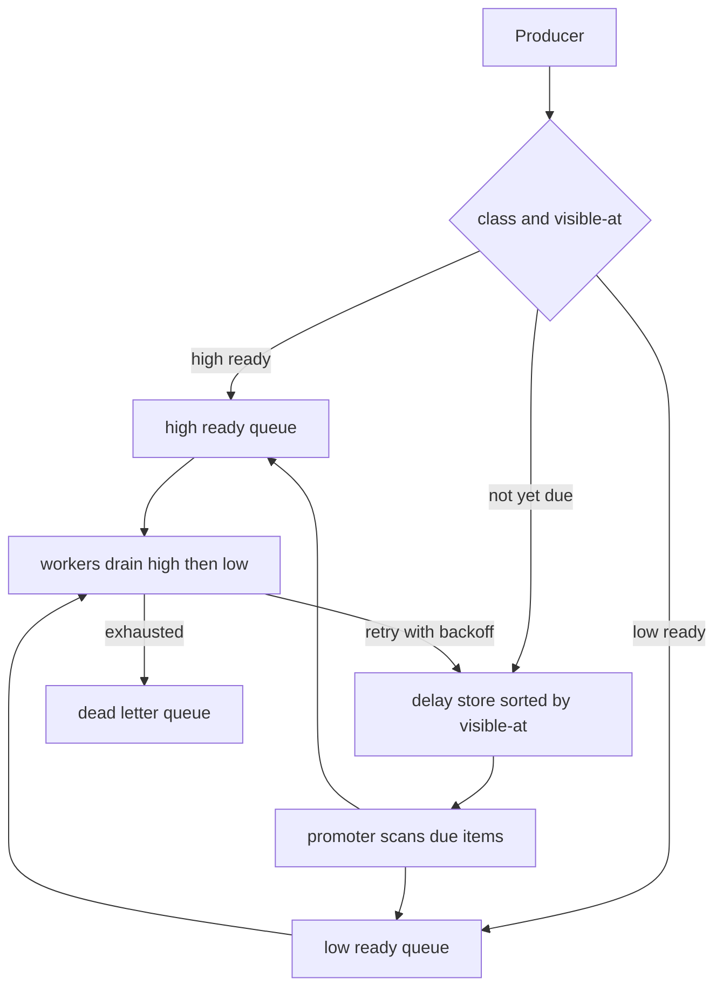

## Concept

### FIFO is a default, not a requirement

Most brokers give you arrival order per partition or per queue, fair enough for "process these in the order they happened." Product systems are not that shape. A password-reset email outranks a weekly digest. A fraud hold outranks a loyalty point grant. A retry that must wait 30 seconds should not occupy a worker now. If you model those needs as "the consumer will sleep" or "the producer will poll until later," you have moved scheduling into application code that will get it wrong under load.

Priority and delay are scheduling. They belong in the messaging layer or in a dedicated scheduler that feeds a ready queue. They do not belong in a random sleep inside a request handler.

### Priority: separate queues, weighted fairness, or a heap

Three implementations show up in production.

**Separate queues per priority** is the one that actually operates. High, normal, and low are three topics or three SQS queues. Workers always drain high before polling normal, or you run more consumers on high. Starvation of low is a policy you can see: the low queue depth is a metric. Kafka users often resist this because "one topic is simpler." One topic with a priority field and a single consumer group is not a priority queue. It is a FIFO that sometimes feels important.

**Weighted fair queuing** assigns a share of worker time to each class so low traffic still moves. You need a scheduler in the consumer or a broker that supports it. Without a share, a flood of high-priority work permanently parks low-priority work. That flood is often a retry storm of the high-priority class, which is how a bug in the important path takes down the unimportant path and then, through a shared database, takes down everything.

**A single heap ordered by priority** exists in in-memory brokers and in some database-backed queues. It is attractive and it is a hot spot. Every insert and every pop contends. It also destroys partition-based ordering: two messages for the same aggregate can be processed by different workers in priority order rather than in causal order. If you still need per-key ordering, priority has to be nested inside a key: you may not jump a later high-priority message ahead of an earlier low-priority message for the same order id. Most teams that skip this sentence double-charge someone.

Do not encode priority as "partition 0 is high." Partition assignment is not a scheduler. Rebalances will move that partition. Consumer counts will not match your mental model. Use separate queues or a broker primitive.

### Delayed messages: visible-after, delay queues, and scheduled topics

A delayed message is one that must not be delivered before time T. Implementations:

**Broker visibility timeout with a delay on send.** Amazon SQS delay queues and per-message delay set `visible-at` in the broker. The message sits in the queue's delay structure, then becomes visible to polling consumers. This is the right primitive for "send this in 15 minutes" up to the broker's max delay.

**A delay store plus promotion.** Messages go to a table, Redis sorted set, or compacted topic keyed by `visible-at`. A scanner promotes due items into the ready queue. This is how you implement delays longer than a broker's cap, and how you implement delays on Kafka, which does not have a delay queue. The scanner is a new job with its own lag metric: time-since-due of the oldest unpromoted message.

**Consumer-side sleep.** The worker receives the message now, sleeps until T, then acts. This holds a consumer slot, holds a partition if you are in Kafka, and dies on deploy. It is acceptable for delays of milliseconds in a single process. It is not a delayed message architecture.

**Scheduled workflow engines.** Temporal, Step Functions, and similar systems store a timer as workflow state. Use them when the delay is part of a longer saga with retries and human steps. Do not stand up a workflow cluster to postpone an email by two minutes.

Kafka is a bad delay queue. A pause on a partition stalls everything behind the delayed record. A retry loop with `Thread.sleep` stalls the consumer. The pattern that works is: write to a delay store, promote to a ready topic when due, consume the ready topic. Some shops use a pause/resume on a punctuator in Kafka Streams; it is still a custom scheduler, and you should treat it as one.

### Interaction of priority, delay, and retries

Retries are delayed messages with a priority attached. A naive retry that re-enqueues at the head of the high-priority queue will starve first-attempt work. A retry that goes to a separate retry queue with backoff (seconds, minutes, dead-letter) keeps the ready queue for live traffic. Exponential backoff belongs in the delay store, not in `Thread.sleep` on a hot consumer.

Visibility timeouts on competing consumers are not delay. They are lock leases. If processing exceeds the timeout, the message reappears and you have a duplicate. If you extend the timeout in a loop, a crashed worker holds the message until a human notices. Set the timeout to a budget, make handlers idempotent, and send true delays as new messages with a `visible-at`, not as stretched leases.

Clock source matters. `visible-at` in UTC from a trusted clock, stored as an absolute timestamp, not as "delay 300 seconds from whenever the scanner happens to see it." Relative delays plus a stalled scanner stretch the delay in ways product did not accept.

## Trade-offs

| Approach | When it wins | Cost / risk |
| -------- | ------------ | ----------- |
| Separate queues per priority class | Few classes, independent consumer counts, clear SLAs | More topology; misrouted messages; low class can starve without a share |
| Weighted fair consumers on one broker | Must guarantee progress for every class under flood | Scheduler complexity; still need per-key ordering rules |
| SQS-style broker delay | Delays within broker caps, competing consumers, ops already on the broker | Max delay caps; weaker ordering; visibility-timeout duplicates |
| Delay store plus promoter into ready queue | Long delays, Kafka-backed systems, backoff retries | Scanner lag is a new outage; exactly-once promotion is extra work |
| Sleep in the consumer | Sub-second pause in one process | Holds slots and partitions; dies on deploy; not a platform |

Separate queues are the default I will sign off on. Three classes cover most products: interactive, batch, and retry. If you need ten priorities, you need a fairness policy, not ten queues you will not staff.

Broker delay wins when you are already on SQS, RabbitMQ with delayed-message plugins you trust, or a cloud scheduler that writes into your ready queue. Kafka shops should budget a promoter. Fighting Kafka into a delay queue produces paused partitions and folklore.

Sleeping in the consumer is how delay first appears in a prototype. Remove it before the prototype is a platform. The metric you will miss is "how many worker threads are asleep on purpose," which looks like low CPU and high lag at the same time.

## Diagram

## Failure modes

### Low-priority starvation

Detection is low-queue age growing while high-queue age stays near zero, and SLAs on digest or batch work quietly missed. Causes are a high-priority retry storm, too many high producers, and workers coded to poll high in a tight loop with no share for low.

Mitigation is a weighted poll (for example, four high then one low), separate worker pools with cgroups so high cannot take all CPU, and retries that leave the high ready queue. Alert on age per class, not on a single combined depth.

### Delay scanner lag and clock skew

Detection is messages becoming visible minutes after `visible-at`, a promoter lag metric in seconds, and a clock offset between producers and the scanner host. Causes are a single-threaded scan of a huge sorted set, an undersized partitioner on `visible-at` buckets, and producers stamping delay with local clocks.

Mitigation is sharding the delay store by time bucket and key, running competing promoters with idempotent promote (a fence token or a compare-and-delete), and requiring NTP plus UTC timestamps. If the promoter is down, ready-queue workers looking idle is not health. Page on promoter lag.

### Head-of-line blocking on a partition

Detection is Kafka consumer lag on a partition whose current record is not due for an hour, while later records in that partition are due now. Cause is using a partition as a delay queue.

Mitigation is the ready-topic split. Never park a delayed record at the head of a partition that also carries ready work. If you must keep Kafka-only, use a punctuator and a state store, and accept that you are now operating a scheduler inside Streams.

### Duplicate delivery after delay or visibility timeout

Detection is downstream duplicates correlated with processing duration near the visibility timeout, or with promoter retries. Causes are lease expiry during a slow handler and at-least-once promotion.

Mitigation is idempotency keys that survive the delay, a visibility timeout strictly above p99 processing plus a margin, and exactly-once promotion into the ready queue (transactional write plus delete, or a conditional move). Do not stretch visibility timeouts to five minutes because p99 is four. Split the work.

## Real-world example

Amazon SQS is the public system most architects already operate, and it is honest about what it will and will not do. Standard queues are competing-consumer, at-least-once, best-effort ordering. FIFO queues give per-group ordering at a throughput cap. Delay queues and per-message delay, up to 15 minutes, are broker-side `visible-at`. Visibility timeout is a lease, not a scheduler. Dead-letter queues after a max receive count are the retry cap.

Amazon's own product shape around this is instructive. When 15 minutes is not enough, the design moves to EventBridge Scheduler or a DynamoDB delay table with a TTL or a due-time index, then a worker promotes into SQS for execution. Priority is not a field SQS sorts on. Priority is multiple queues and separate auto-scaling for the high-urgency fleet. That is not an accident of the API. A multi-tenant delay+priority heap at SQS scale would be a different product with different contention.

The architectural copy for a non-Amazon stack is the same split. Ready work lives on a fast queue. Future work lives on a store indexed by due time. Promotion is a job with an SLO. Priority is topology plus consumer counts, not a hope that the broker will pop the right item from a million-key heap. If you are on Kafka, you are the broker; you still need that split. LinkedIn-scale Kafka does not make delay a partition property.

Teams that "just use SQS delay" for everything until they need a 24-hour delay discover the cap in production. Design the promoter on day one even if the first delays fit in 15 minutes. The contract of the ready queue stays stable when the delay backend changes.

## What to remember

- Priority is separate queues or weighted shares; a priority field on a FIFO topic is not a scheduler.
- Delayed work belongs in a `visible-at` store and a promoter, not in a sleeping consumer or a paused Kafka partition.
- Retries are delayed messages that must not starve first-attempt high-priority work.
- Visibility timeout is a lock lease; duplicates are normal unless handlers are idempotent.
