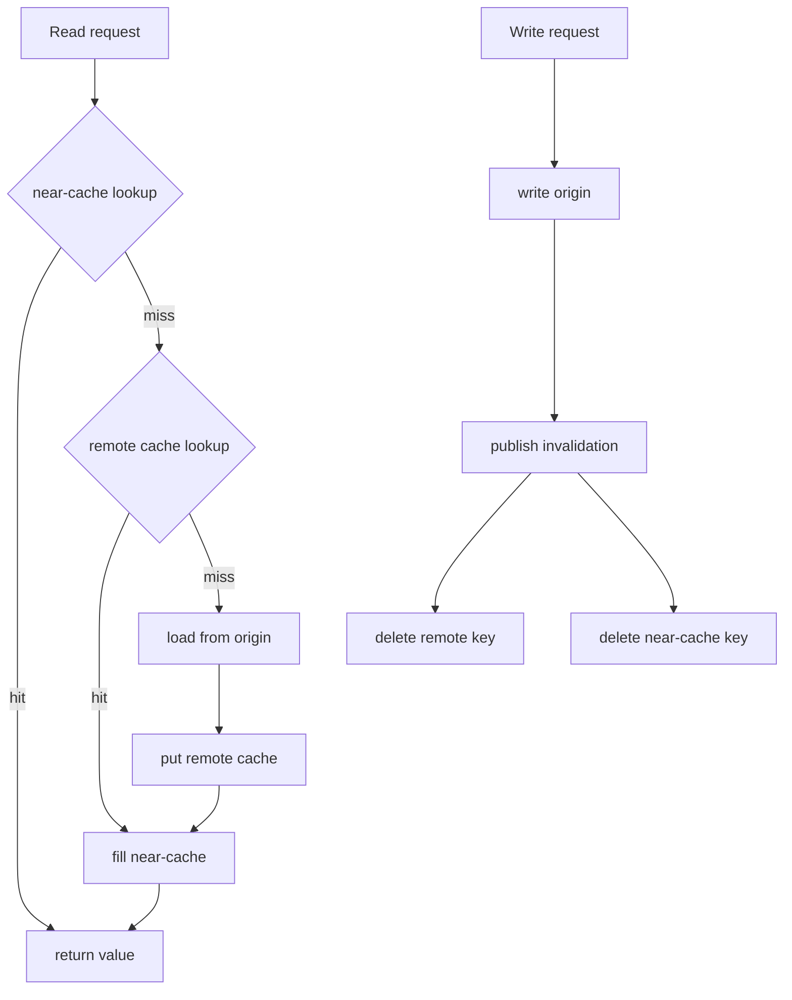

## Concept

### The cache is a performance replica, not a database

A distributed cache exists to absorb repeated reads of data whose origin is slower or more expensive: a database, a service call, a rendered blob. It is not the system of record. If you cannot answer "what happens when every node of this cache is empty," you do not have a cache. You have an unofficial database with worse durability, and the first cold start will take the origin down.

The patterns below are about who writes the cache, who deletes it, and how many hops sit between the caller and a coherent value. They are not about Redis vs Memcached as a brand. Both will store bytes. The pattern decides whether those bytes are wrong.

### Cache-aside (lazy loading)

The application looks up a key. On a hit, it returns. On a miss, it loads from origin, stores the value, and returns. Writers update origin first, then delete or overwrite the cache key. That is the whole pattern. It is the default because it fails toward origin: an empty cache is slow, not wrong, if writers treated origin as truth.

The hard parts are the miss path and the write path. Concurrent misses for the same key stampede the origin. A write that updates origin and then fails to evict leaves a stale hit until TTL. A write that evicts then updates origin leaves a window where a reader refills from the old origin row. The usual production fill is: lock or single-flight the miss, write origin then evict (or version-bump) with retries on the eviction, and keep a TTL as a backstop for lost invalidations, not as the primary correctness mechanism.

Cache-aside fits read-heavy keys with a tolerable staleness measured in TTL, plus explicit invalidation on write. It does not fit values that must be correct on the next read with no TTL window, unless the invalidation path is as reliable as the write path.

### Write-through and write-behind

**Write-through** updates the cache in the same path as origin, usually through a library or a proxy that writes both and fails the caller if either fails (or fails if origin fails, and treats cache failure as a degraded miss). The next read hits. You pay write latency of origin plus cache. You avoid the empty-key window after a write that cache-aside eviction can create. You still need a policy for partial failure: origin succeeded, cache did not. Retry the cache write or evict. Do not return success with a known stale value if your SLA forbids it.

**Write-behind** writes the cache (or a queue) first and flushes to origin asynchronously. Write latency looks wonderful. Durability looks like the cache's durability, which is to say: not your database's. A node restart loses acknowledged writes unless the write-behind log is itself durable. This pattern belongs in very specific places: write coalescing for counters, session stores that already accept loss, or a store whose origin is a reconstruction. It does not belong in payments, inventory, or anything you would restore from backups.

**Read-through** is cache-aside with the load function inside the cache client or cache product. The application always talks to the cache. Miss handling, stampede control, and sometimes refresh-ahead live in one place. Fine when one team owns the client. Dangerous when every service embeds a different load function for the same key.

### Invalidation bus

At more than one cache node, or with a near-cache in each application process, a local eviction is not enough. The writer publishes "key K is stale" on a bus: Redis pub/sub, Kafka, SNS, a dedicated invalidation topic. Every cache node deletes K or increments a generation. The next read misses and refills.

The bus is a second distributed system. It must be faster than your staleness SLA, it must not drop messages without a TTL backstop, and it must not amplify a burst of writes into a mesh of evictions that then stampede origin. Fanout to hundreds of application nodes with in-process near-caches is a different problem than fanout to a 20-node remote cache cluster. Pub/sub that is not persisted will miss a node that was restarting. That node will serve stale until TTL. If that is unacceptable, the node must load a recent invalidation log on boot, or you must not use a near-cache.

Versioned keys (`user:42:v:17`) turn invalidation into a pointer bump: write origin, increment version in a small highly-available key, readers cache the versioned payload. Old versions age out. This avoids broadcast deletes at the cost of a version lookup and garbage.

### Near-cache plus remote cache

A process-local map in front of Memcached or EVCache-style remote cache is the usual latency win for ultra-hot keys. It is also the usual coherence loss. Local maps do not see other processes' writes. Without an invalidation bus or a tiny TTL, you have N independent caches. Cap the local TTL in tens of seconds or less, subscribe to invalidations, and bound the local size so a leak is not a heap dump.

Hash the remote cache with a consistent hash, not `hash % N`, so a node join does not flush the fleet. That topic is its own essay. Here the pattern warning is: client-side hashing plus a near-cache plus a missed invalidation is a three-layer stale read.

## Trade-offs

| Approach | When it wins | Cost / risk |
| -------- | ------------ | ----------- |
| Cache-aside | Read-heavy keys, origin is source of truth, simple application code | Miss stampedes; write-then-evict races; TTL as the only safety net if eviction fails |
| Write-through | Read-your-writes required, write rate modest, cache is a true replica of origin | Higher write latency; partial failure policy; cache must take every write |
| Write-behind | Coalesced writes, loss-tolerant data, origin cannot keep up with write rate | Acknowledged data lives in the cache; replay and crash stories get ugly |
| Invalidation bus plus near-cache | Many local copies, low hit latency, writes must reach every copy | Dropped invalidations; fanout storms; restart holes without a log |
| TTL-only | Values with natural expiry, worst-case staleness acceptable | You will still get a stampede at expiry; you cannot hide a write |

Cache-aside plus TTL plus explicit delete on write is the pattern I expect in a service review. Write-through is the upgrade when product can feel a stale read after their own save. Invalidation bus is the upgrade when you added a near-cache or a second region. Write-behind is a special case that needs a durability story in the same document as the latency graph.

Do not mix patterns per key without naming the key. A profile blob can be cache-aside. An inventory count cannot quietly share the same "we cache things" library with a 10-minute TTL. The library will win. The inventory will be wrong.

## Diagram

## Failure modes

### Miss stampede and expiry alignment

Detection is origin QPS spikes that match TTL boundaries or a cache failover, plus a thundering herd of identical keys in origin logs. Causes are no single-flight, synchronized TTLs on a popular key, and a cold cluster after a deploy.

Mitigation is request coalescing per key, jittered TTLs, probabilistic early refresh, and a hot-key replica or request collapse at the cache node. After a fleet restart, rate-limit the fill path. An empty cache is an expected state; an unprotected empty cache is an outage.

### Stale hit after a successful write

Detection is users reading their own old data, and cache keys whose value disagrees with origin for longer than the invalidation SLO. Causes are evict-after-write that never ran, a near-cache that missed the bus, and write-through that failed on the cache side and returned success anyway.

Mitigation is origin-first then delete with retry, a version bump that readers check, and treating cache write failure as a required eviction. Measure staleness with sampled compare-origin jobs, not with hit rate. Hit rate can be excellent while every hit is wrong.

### Near-cache split brain

Detection is different app instances returning different values for the same key after a write, especially right after a pub/sub blip. Causes are unbuffered pub/sub, process-local maps with long TTL, and no invalidation on boot.

Mitigation is short local TTL, a durable invalidation log to replay on startup, and a generation number in the remote cache that local entries must match. If you cannot afford the bus, you cannot afford the near-cache.

### Write-behind loss

Detection is acknowledged writes missing from origin after a cache node death, and a flush lag that only alerts when it is already too late. Causes are memory-only queues and flush workers that drop on shutdown.

Mitigation is a disk-backed queue, shutdown drain with a hard refuse of new writes, and a product decision that those writes are loss-tolerant. If they are not, this is the wrong pattern. Move to write-through or origin-first cache-aside.

## Real-world example

Netflix EVCache is a Memcached-based, consistently hashed, multi-zone cache that sits in front of origin services for session-like and personalized data. The application uses a client that hashes keys onto a ring of cache nodes, talks to the local zone first, and can fall back across zones. The pattern is cache-aside at planetary scale: origin remains the source of truth, the cache is a performance replica, and failure of a cache node is a miss plus a fill, not a data-loss event.

What Netflix had to add around the obvious get/set is the rest of this essay. Hot keys cannot live on one node; they replicate inside the cluster. A zone outage must not stampede origin, so they size headroom and control fill. Cross-zone copies create a coherence problem, so TTLs and explicit invalidation on writes are part of the client contract. Near-caches in the application exist where latency demands them, with the understanding that they increase the invalidation problem.

The architectural lesson is not "use Memcached." It is that a mature distributed cache is a client, a placement function, a miss-protection policy, and an invalidation path, operated as a platform. Hit rate is a vanity metric if origin error rate spikes on every cache deploy. EVCache-style systems are judged on origin protection and on bounded staleness, not on whether Redis would have been equally fine as a byte store.

If your cache is a sidecar Redis with a 30-minute TTL and no delete on write, you are not running EVCache. You are running a time bomb that looks fast in staging. Add cache-aside correctly first: origin on write, delete on write, jittered TTL, single-flight on miss. Add the bus when you add a second copy. Add write-through only when a user-visible read-after-write forces it.

## What to remember

- Cache-aside keeps origin as truth; protect the miss path or the origin becomes the outage.
- Write-through buys read-your-writes at the cost of write latency and a partial-failure policy.
- An invalidation bus is mandatory once you have near-caches or multiple replicas of the same key.
- Write-behind is a durability decision, not a performance trick you apply to every entity.
