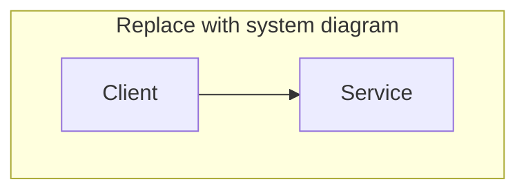

> **Draft placeholder** — target length 1,500–2,500 words: concept, trade-offs, diagram, failure modes, and one real-world example.

## Concept

_TODO_

## Trade-offs

| Approach | When it wins | Cost / risk |
| -------- | ------------ | ----------- |
| _TODO_   |              |             |

## Diagram

## Failure modes

- _TODO_

## Real-world example

_TODO_
