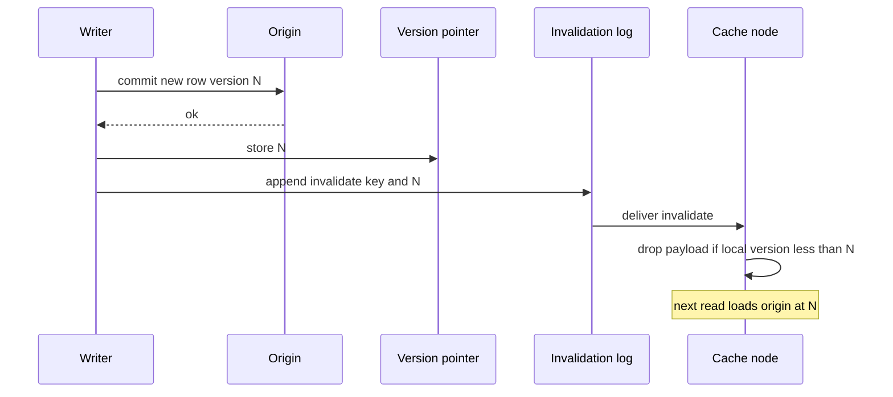

## Concept

### TTL is a bound on how wrong you can be, not a strategy

Time-to-live is a safety fuse. If every explicit invalidation fails, the fuse blows and the key dies. That is valuable. It is not a design for "users see the new bio after they save." A 10-minute TTL on a profile means you accepted 10 minutes of lies. A 10-minute TTL on a price during a flash sale means you accepted 10 minutes of sold-out items at old prices. Write down the staleness SLO in the same units as the TTL. If they do not match, the TTL is decoration.

At scale, TTL also clusters. Keys loaded in a burst expire in a burst. That is an invalidation of a sort: the entire working set becomes a miss storm. Jitter is part of invalidation strategy, not a cute random() in the client.

### Explicit delete, versioned keys, and generation numbers

**Explicit delete** is the write path issuing `DEL key` (or equivalent) after origin commits. It is precise, cheap on a single remote cluster, and racy: a reader that missed, loaded old origin because the write has not committed, and filled the cache after your delete, wins. The fill-after-delete race is the classic bug. Fixes: version at origin (CAS, row version, updated_at that the fill checks), delete-after-write with a short block on fills, or write the new value into the cache instead of deleting so the fill cannot resurrect the old bytes.

**Versioned keys** put the version in the name: `user:42:v:N`. Readers learn N from a small, highly available pointer (or from a session token, or from the origin row header) and cache the payload under that name. Invalidation is incrementing N. Old payloads expire via TTL and are never read. Broadcast deletes go away. Cost is a pointer lookup and garbage of old versions. At Twitter-like fanout, this is often cheaper than telling millions of cache entries to die on a bus.

**Generation or epoch numbers** sit on a cluster, a namespace, or a tenant. Bump the epoch and every key hashed with the old epoch is a miss. This is the nuclear invalidation: a bad deploy of cached HTML, a poisoned value, a region failover. It is not a per-key strategy. Operators love it because it works. They hate it because origin dies unless you rate-limit the refill.

### Invalidation bus at fleet scale

Once the same key lives in many places — replica cache nodes, near-caches in application processes, a CDN, a second region — delete on the writer's client is not enough. You publish an invalidation event. Subscribers evict. The bus has to answer four questions: durability, ordering, fanout, and restart.

Durability: if a subscriber is down, does it learn later? Redis pub/sub says no. Kafka says yes, if the subscriber keeps an offset. For near-caches, a restart hole of "I missed five minutes of deletes" is a stale hole of five minutes plus TTL. Either replay a log on boot or keep local TTL short enough that the hole is inside the SLO.

Ordering: a delete then a fill of the new value must not be overtaken by a late delete that kills the new value, or by a late fill of the old value. Per-key ordering on the bus, or version checks on fill, or last-writer timestamps with a well-defined clock. Global ordering of all invalidations is usually unnecessary and always expensive.

Fanout: one write to a celebrity key can invalidate millions of timeline entries. That is not a pub/sub message. That is a fanout problem with its own queues, rate limits, and sometimes a decision to invalidate a pointer instead of the leaves. If you broadcast per-leaf deletes for a celebrity, the bus is the outage.

Restart: subscribers must not assume they saw every message since process start. Cold near-caches should start empty (safe, origin load) or replay. Starting full from a process-local snapshot without replay is serving stale on purpose.

### What to invalidate: keys, graphs, and derived views

A user change is not one key. It is a profile object, a search document, a recommendation feature, a CDN path, and every timeline that embedded the old display name. Invalidation strategy has to name the graph. If you only delete `user:42`, the timeline still has the old name until those entries expire. That may be the SLO. If it is not, you need either fanout invalidation, versioned embeds ("display name v=N"), or an architecture that does not copy the name into a million cached tweets.

Derived views — materialized counts, rendered HTML, GraphQL persisted queries — are caches even when they live in a database. They need the same invalidation story. CDC from origin to a worker that deletes or rebuilds the view is a valid bus. A nightly rebuild is a TTL. Do not pretend a table named `cache_user_html` is not a cache.

### Bounded staleness as an API

The honest product language is "reads may lag writes by up to S seconds in the 99th percentile, except on the writer's own session, which is read-your-writes." Then you pick techniques that meet S: TTL ≤ S as backstop, invalidation p99 ≤ S, session sticky to a node that took the write, or a version check on the read path for the writer. Trying to get S=0 on a global cache with a best-effort bus is how you get both complexity and lies.

Read-your-writes is often cheaper than global immediate consistency: write origin, write the caller's near-cache or a session overlay, invalidate the shared cache asynchronously. Other users may lag. The writer does not. That split has shipped more products than a globally ordered invalidation fabric.

## Trade-offs

| Approach | When it wins | Cost / risk |
| -------- | ------------ | ----------- |
| TTL plus jitter only | Staleness SLO matches TTL; writes are rare or users cannot tell | Expiry herds; no read-your-writes; product will still ask "why is it stale" |
| Explicit delete after origin commit | Single remote cache cluster, low fanout, keys map 1:1 to writes | Fill-after-delete race; missed deletes without a TTL backstop |
| Versioned keys / pointer bump | High fanout, many derived caches, celebrity keys | Pointer becomes hot; garbage of old versions; extra lookup |
| Durable invalidation log (Kafka-style) | Many subscribers, restart replay required, SLO tighter than TTL | Bus lag; ordering bugs; operational cost of another cluster |
| Epoch bump | Emergency poison, region failover, schema of cached blobs changed | Origin stampede unless refill is paced |

TTL-only is acceptable for weather, public content with a published delay, and feature flags that already have a tick. It is not acceptable for the user's own account settings. Explicit delete is the workhorse for a Memcached cluster the writers can see. Versioned keys win when the same logical entity is cached in many shapes. A durable bus wins when you have near-caches. Epoch is an operations tool; put it on a runbook, not on the write path of every request.

Combining them is normal: versioned payload, explicit pointer update, TTL on both, bus for near-caches, epoch for emergencies. Combining them without a single SLO is how five mechanisms still produce a stale read and nobody knows which mechanism was supposed to have caught it.

## Diagram

## Failure modes

### Missed invalidation

Detection is sampled mismatches between origin and cache after the SLO window, concentrated on nodes that restarted or on a partition of the bus. Causes are pub/sub without replay, a subscriber that dropped exceptions, and a delete that targeted the wrong key name (missing tenant prefix, old version scheme).

Mitigation is TTL as backstop, a durable log with offsets, boot replay or cold start empty, and tests that the write path emits the same key the read path fills. Alert on subscriber lag, not only on cache hit rate.

### Invalidation storm and origin stampede

Detection is bus throughput spikes, cache CPU on deletes, then origin QPS following the same shape. Causes are celebrity fanout, a batch job that rewrites millions of rows and deletes each key, and an epoch bump.

Mitigation is invalidate pointers not leaves, coalesce deletes for the same key, pace batch rewrites, and rate-limit fills after epoch. A data backfill should optionally skip cache delete and let TTL expire, or should rebuild cache in the background instead of delete-and-stampede.

### Fill-after-delete race

Detection is a key that is stale immediately after a write, even though metrics show a delete occurred. Cause is a concurrent miss that started before the write, read old origin, and filled after the delete.

Mitigation is origin versions: the fill stores `(value, version)` and a later fill or a compare refuses to overwrite a newer version with an older one. Alternatively, write-through the new value. Deletes without versions are not safe under concurrent reads.

### Bus collapse or reorder across regions

Detection is one region serving new data and another serving old, or a region that never receives deletes because the cross-region replicator lagged. Causes are a best-effort bus, no per-key version, and a DNS-based failover that left a warm stale cache.

Mitigation is versions that travel with the payload, region-local TTLs tighter than cross-region lag, and failing a region cache to empty on failover rather than serving it warm. Do not fail over users to a cache that did not see the bus.

## Real-world example

Twitter's cache fleet — historically Twemcache and related Memcached-based layers in front of Manhattan and earlier stores — is a public case of invalidation as a fanout problem, not a `DEL` problem. A tweet is not one key. It is a status object, embeddings in home timelines, fanout to followers, and copies in multiple colocations. When a user deletes a tweet or changes a protected account, the system cannot rely on TTL alone: the SLO for "this must not be visible" is tighter than a comfort TTL, and the number of cached copies can be enormous.

The techniques that show up in that design space are the ones in this essay. Timeline caches are often structured so that a change updates a pointer or a small index rather than broadcasting a delete to every cached timeline page. Status objects carry versions. Negative caching of deletions has its own TTL and invalidation so a deleted tweet does not resurrect from a fill-after-delete race. Colos have local caches; cross-colo coherence is a lag budget plus a bus, not a global lock. When something poisonous is cached, operators need an epoch-style flush with paced refill so origin survives.

The lesson from Twitter-scale caches is that invalidation strategy is a function of fanout. Low fanout: delete the key, version the row, keep a TTL. High fanout: stop copying the mutable field into every derived cache, or version the embed so a pointer bump cheaply orphans the old copies. If your product copies a mutable user field into a million cached records, no bus will save you at a cost you will like. Change the cache shape first. Then pick the invalidation primitive that matches the new shape.

A smaller system still inherits the race. You do not need Twitter's follower graph to hit fill-after-delete on a single profile key. You need concurrent reads and a write. Put the version on the origin row before you buy a new pub/sub.

## What to remember

- TTL bounds worst-case staleness; it does not implement read-your-writes.
- Explicit delete needs an origin version or write-through, or a concurrent fill will resurrect the old value.
- At high fanout, invalidate a pointer or version the embed; do not broadcast a million leaf deletes.
- Near-caches require a durable invalidation log or a local TTL inside the SLO; pub/sub alone has restart holes.
