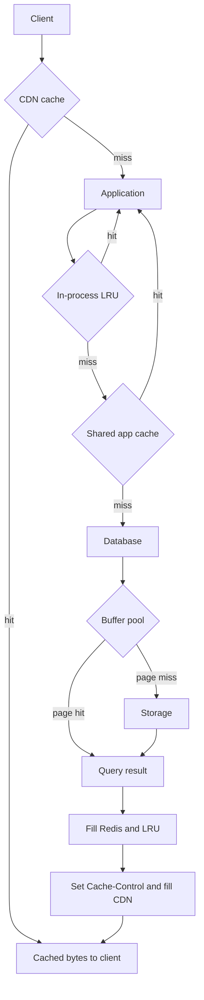

## Concept

### Why one cache is never the whole story

A single cache answers one question well: can this process avoid one expensive trip? Production traffic asks several questions on the same request. The browser wants bytes that never touch your origin. The application wants a computed object that is expensive to rebuild. The database wants pages it already read last millisecond. Those are different working sets, different owners, and different failure domains. Stacking them is not decoration. It is how you keep origin CPU, origin egress, and origin QPS from becoming the same bottleneck.

The layers do not substitute for each other. A CDN hit never consults Redis. A Redis hit never consults InnoDB's buffer pool. A buffer-pool hit still paid a SQL parse, a lock, and a network hop from the app. Architects who "just add Redis" after the CDN is already serving HTML are solving yesterday's problem with a new failure mode. Draw the request path. Name the byte that each layer is allowed to store. Name who may invalidate it.

### CDN versus origin: what lives at the edge

The CDN is a geographically distributed object cache in front of HTTP. It wins on immutable or slowly changing bytes: versioned JavaScript, images, video segments, public product media, and cacheable GET APIs whose URL is the full cache key. The unit of identity is the URL plus a defined set of headers, cookies, and query parameters. The unit of freshness is `Cache-Control`, `ETag`, `Age`, and purge.

Two properties make the edge special. First, it absorbs traffic you will never see: bots, retries, and regional spikes. Second, it is far from your invalidation control plane. A purge that succeeds in one POP and is delayed in another is a correctness incident if the object is a price or an inventory flag. That is why serious CDNs cache content by content-hash URL (`/static/app.a1b2c3.js`) and treat HTML documents as short-TTL or private. If the URL changes when the bytes change, you do not need a coordinated purge of every edge. If the URL is stable and the bytes are not, you have volunteered for a global invalidation problem.

Authenticated HTML, per-user JSON, and anything that varies on a session cookie do not belong at the public edge unless you have designed the vary key with the same care you would give a database unique index. A missed `Vary` is a user seeing another user's cart.

### Application caches: process memory and shared Redis

The application cache stores objects the origin computed: rendered fragments, hydrated aggregates, feature flags, session blobs, authorization decisions, and the results of fan-out reads. Two seats exist, and they are not interchangeable.

In-process memory (an LRU, a Caffeine/Guava cache, a local map with TTL) is the fastest layer you control. Lookup is a pointer chase. There is no serialization and no network. The cost is that every pod has its own copy. A rolling deploy starts cold. A popular key is stored N times. Two pods can disagree for the full TTL after a write. Use it for data that is small, extremely hot, and tolerant of replica divergence measured in seconds.

A shared cache (Memcached, Redis, a lookaside store next to the service) is one working set for the fleet. It survives a rolling restart. It is also a cluster you must capacity-plan: eviction policy, slab or maxmemory behavior, replica failover, and a network hop on the request path. The key design is the contract: lookaside (read through on miss, write through or write behind on mutation) versus a fully populated replica of a query. Lookaside is the default because it fails open to origin. A fully populated cache that is treated as source of truth is a second database with worse durability.

### Database caches: buffer pools, query results, and derived tables

The database is already a cache. InnoDB's buffer pool, Postgres `shared_buffers`, and RocksDB's block cache keep recently used pages in RAM. A "database cache" in architecture conversations usually means one of three things, and mixing the names causes bad designs.

The buffer pool is automatic and local to the engine. You size it. You do not key it. You do not invalidate it. When it is too small, you see disk reads and checkpoint storms, not application-level miss rates. Query-result caches (MySQL's old query cache, some ORM identity maps, prepared-plan caches) remember a statement's output or plan. They are fragile under write-heavy workloads because any table mutation can invalidate large ranges. Derived tables — materialized views, summary tables, and CQRS read models — are caches you built in SQL. They have an explicit refresh policy. Treat them as a cache layer with a documented lag, not as "the database, so it must be fresh."

The application should not fight the buffer pool. If the hot working set of pages does not fit in RAM, no Redis cluster will make range scans cheap. Redis can hide a point lookup. It cannot hide a tablescan that the planner chose because statistics were stale.

### Coherence: who is allowed to be stale

Multi-layer caching is a freshness problem wearing a performance costume. Each layer independently answers "may I serve this?" The user sees the first layer that says yes. If the CDN holds HTML for 60 seconds, Redis holds the user object for 30, and the buffer pool holds a page until eviction, a write has three different visible times.

Pick a policy per object class. Immutable assets: URL versioning, long CDN TTL, no app cache. Public catalog: CDN with short TTL plus purge on publish, app cache with the same key and a matching TTL, database as source. Per-user mutable state: private, no CDN, app cache with explicit delete on write, database as source. Derived analytics: lag is a product feature, refresh on a schedule, do not purge the CDN because a dashboard moved.

Invalidation must flow inward-out: write the source, then delete or overwrite the app key, then purge or bypass the edge. The reverse order lets a concurrent reader refill the outer layer from a still-stale inner layer. That race is the usual "we purged and it came back" incident.

## Trade-offs

| Approach | When it wins | Cost / risk |
| -------- | ------------ | ----------- |
| CDN with long TTL and versioned URLs | Immutable assets, media, public static API | Purge of a stable URL is slow and regional; HTML is a poor fit |
| Shared app cache (Redis / Memcached) | Hot computed objects shared across many pods | Stampede on expiry; extra failure domain; serialization cost |
| In-process LRU | Microsecond hits on a per-pod working set | Cold start after deploy; replicas diverge until TTL |
| Database buffer pool only | Working set already fits in engine RAM | No help for computed objects or cross-region reads |
| Full stack with explicit invalidation | Writes must become visible inside a tight SLA | Every layer must share a key scheme; races refill stale data |
| TTL-only stack, no purge | Operational simplicity, eventual freshness | Stale windows add; no way to retract a bad object quickly |

A CDN is the wrong place to store anything whose correctness depends on a write you just issued in the app. Pay the origin on those paths. An in-process cache is the wrong place to store a global counter that checkout must see. Pay Redis or the database. A shared cache is the wrong place to store a 20 MB report that one analyst runs twice a day. Pay the warehouse.

The expensive mistake is treating layers as equivalent RAM. They have different hit costs, different miss penalties, and different operators. Size the CDN from egress and origin-offload. Size Redis from working-set bytes and QPS, including serialization. Size the buffer pool from the pages the query planner actually touches, measured, not from "the database server has 256 GB." Eviction in the wrong layer looks like a capacity problem in the layer below. A Redis `maxmemory` eviction storm is an origin incident, then a database incident, within one TTL.

## Diagram

## Failure modes

### Thundering herd on a shared miss

When a hot key expires, every concurrent request can miss every layer at once and reconstruct the value from origin. Detection is a cliff: origin QPS and origin p99 jump at TTL boundaries, while cache hit ratio dips in a sawtooth. Mitigation is request coalescing on the miss path, a soft TTL that refreshes before expiry, and jitter so a million keys do not share one clock. The CDN equivalent is origin shielding: one POP talks to origin, the others talk to the shield.

### Stale refill after invalidation

You delete Redis and purge the CDN, then a reader arrives, misses, and refills from a replica that has not applied the write, or from a layer you forgot. Detection is user reports of "old data after save," plus mismatched object versions across layers. Mitigation is a monotonic version on the object, compare-and-set on fill, and a single writer path that updates source then inner cache then outer cache in that order. Ban "purge and hope" for mutable keys.

### Serving the wrong tenant

A cache key that omits tenant, locale, currency, or auth context stores one user's response under a public URL. Detection is cross-user data in a support ticket, and CDN logs showing a hit on a URL that should have been `private`. Mitigation is treating the cache key as a primary key: include every dimension that changes the bytes, default the CDN to `Cache-Control: private` for authenticated routes, and add a canary that fetches the same URL with two sessions and asserts inequality.

### Negative caching that outlives the fix

A 404 or empty result cached at the edge or in Redis will survive the publish that created the object. Detection is a support spike of "missing asset" while origin has the file, with cache `Age` older than the publish time. Mitigation is short TTLs on negative entries, a purge hooked to publish, and never caching 5xx at all. A cached 503 turns a one-second origin blip into a regional outage.

### Eviction of the working set

A scan, a bad key pattern, or a new tenant dumps a large unique set into Redis or the buffer pool and evicts the keys that were paying the bills. Detection is a rising eviction rate, a falling hit ratio, and origin load with no traffic increase. Mitigation is key isolation (separate Redis DBs or clusters per class), caps on value size, and never using the user-facing cache as a bulk-export scratch pad.

## Real-world example

Facebook's read path is a textbook stack of CDN, application cache, and database cache, each with a different object class. Public photos and static assets terminate at a geographically distributed HTTP cache. The social graph does not. Graph reads historically went through memcache as a lookaside store in front of MySQL. A cache hit returns an object the application already understands. A miss reads MySQL, whose InnoDB buffer pool is the last RAM before disk, then fills memcache. TAO later wrapped that pattern so the graph's consistency rules lived in one service instead of in every PHP client, but the layers remained: edge for bytes, lookaside for computed objects, engine buffer pool for pages.

The operational lessons are the ones that still fail in smaller systems. Facebook published that a memcache miss storm is a MySQL incident, so they invested in lease-based coalescing to stop thundering herds, in explicit deletes on write rather than hoping TTLs line up, and in treating memcache as a fleet with its own failure domains, not as a magic hashmap. They also learned that a web cache in front of personalized HTML is a correctness hazard; the edge is for content whose URL is the identity of the bytes. When you copy the stack, copy the object classes, not the brand names. A CDN in front of a per-user GraphQL POST is not "doing Facebook caching." It is putting someone else's news feed in the POP.

## What to remember

- Each layer caches a different object: CDN bytes, app-computed values, database pages. They do not replace one another.
- Invalidation must update the source first, then the inner cache, then the edge; the reverse order refills stale data.
- Versioned URLs beat coordinated purge for immutable assets; mutable per-user data should not sit on a public CDN.
- A miss storm at any layer is a load test of the layer below — design coalescing and jitter before you need them.
