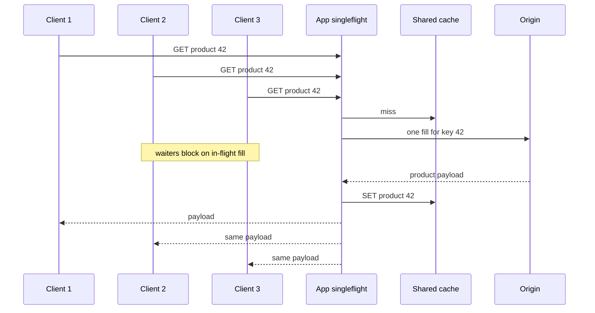

## Concept

### The stampede is the default behavior

Caches and databases do not naturally collapse duplicate work. If a thousand concurrent requests miss the same key, a thousand reconstructions start. TTL expiry makes this periodic. A deploy that flushes a local cache makes it simultaneous. A flash sale makes it continuous. The origin does not see "one popular product." It sees a thundering herd whose concurrency is the number of waiters, not the number of distinct keys.

Request coalescing (singleflight, request collapsing, stampede protection, a lease) is the decision that only one in-flight computation may exist per coalescing key. Later arrivals wait for that result or share the fill. The origin sees one miss per key per collapse window. Everyone else shares the outcome, including the error.

That last clause is the product decision. Sharing a success is why you built this. Sharing a timeout can turn one slow dependency into a fleet-wide wait. Sharing a 404 can be correct. Sharing a 500 is usually not.

### Singleflight: collapse in one process

In-process singleflight is the smallest correct implementation. A map from key to a wait group or a future: the first caller inserts a placeholder and runs the function; others block on that placeholder; when the function returns, waiters are released with the same value or error; the placeholder is deleted so the next miss can run again.

This is Go's `singleflight`, Java's `computeIfAbsent` used carefully, and the "lock around cache fill" pattern that every Memcached tutorial warns you to get right. The lock must be per key, not a global mutex. A global lock serializes unrelated misses and will show up as a latency cliff under mixed traffic. The in-flight map must not retain completed keys, or it becomes an unbounded second cache with no eviction policy.

In-process collapse only helps waiters inside that process. Fifty pods, each running singleflight, still send fifty origin requests. That is often enough: you reduced a herd of thousands to a herd of replica count. For a hot key that every instance will miss at the same TTL, it is not enough.

### Cross-process collapsing

To collapse across a fleet you need a shared coordinator. Three patterns show up.

A cache lease (Facebook's memcache lease, Redis `SET NX` with a short TTL used as a lock) lets the first miss-holder fill. Others either wait and retry the cache, or serve stale, or take a backup lease after a timeout. The lease TTL must exceed the 99th percentile fill time and be short enough that a dead holder does not block the key for an incident-length interval.

An origin shield or collapse at the proxy (CDN request collapsing, nginx proxy cache lock, Envoy's cache filter) makes the edge or the sidecar the waiter room. Application code stays simple. The collapse key is the cache key the proxy already understands, which is usually a URL, not an application object id. That is the right trade for public HTTP GET. It is the wrong trade for an authenticated checkout call whose URL is identical across users.

A dedicated singleflight service is rarely worth it. If you need collapse that far from the origin, put it in the cache product or the proxy.

### What you can and cannot coalesce

Collapse is correct when waiters want the same bytes and can share the same failure. Public product JSON, a remote config blob, a translated string table, a signed-out homepage fragment: yes. A checkout inventory reservation, a payment authorization, a "place order" POST: no. Those are not reads. Collapsing them would either drop orders or double-charge, depending on how you merged the waiters.

Even among reads, the coalescing key is a design artifact. Too coarse (`tenant:42`) serializes unrelated work and couples latency across customers. Too fine (`tenant:42:user:9:request-uuid`) collapses nothing. The key should be the identity of the origin computation: the cache key you would have used anyway.

Idempotent GET with a shared response is the sweet spot. Non-idempotent methods should pass through. Conditional requests (`If-None-Match`) can collapse on the same ETag fill: one origin 304, many clients updated.

### Timeouts, hedging, and the waiting room

Waiters need a timeout independent of the origin timeout. If the leader's origin call can take five seconds, waiters should not all sit for five seconds with no progress. Options: serve stale to waiters immediately, return a 503 with `Retry-After`, or let waiters start a second computation after a hedge interval.

Hedging reintroduces duplicate origin work, which is the thing you were avoiding. Use it only when the leader is likely stuck (no bytes after p99) and the origin can tolerate a second call. A hedge that fires at p50 doubles origin load under normal conditions.

Stale-while-revalidate is coalescing's friend. If the cache may serve an expired value while one owner refreshes, waiters never block and origin sees one refresh. The remaining stampede is the true miss: key never present, or negative-cached empty, or flushed. Design for that case explicitly. Most "we have coalescing" systems still stampede on first fill after a flush.

## Trade-offs

| Approach | When it wins | Cost / risk |
| -------- | ------------ | ----------- |
| In-process singleflight | Duplicate misses inside one pod; cheap to add | Fleet of N pods still issues N origin calls |
| Distributed lease / lock on fill | One fill for the whole fleet on a hot key | Holder death, clock skew, lock in Redis during Redis outage |
| Proxy or CDN request collapsing | Public GET, URL is the cache key | Wrong for personalized or mutating requests; opaque to app metrics |
| Soft TTL plus background refresh | Predictable expiry on already-warm keys | Does not help true cold misses; refresh load is constant |
| Jittered TTL only | Cheap reduction of synchronized expiry | No collapse of simultaneous first misses |
| Do not coalesce | Unique keys, cheap origin, mutating paths | Origin dies on celebrity keys and deploys that flush |

Coalescing is not free latency. Waiters inherit the leader's duration. Under a healthy cache this never runs. Under a flush, every request for that key takes origin time, including the ones that would have been fast misses returning an error quickly in a non-collapsed design. If origin p99 is two seconds, you have created a two-second wait room. Pair collapse with a waiter timeout and a stale path, or you will trade an origin outage for an application thread-pool outage.

Distributed locks as coalescing have a second cost: the lock store is now on the miss path. If Redis is the cache and the lock, a Redis slowdown stops both hits and miss coordination. Split them only if you have evidence the lock keyspace is the problem; most teams should use the cache product's own lease primitive so there is one failure domain with a documented behavior.

## Diagram

## Failure modes

### Leader dies mid-fill

The process holding the in-flight computation crashes, the lease expires slowly, or the future is never completed. Waiters block until their timeout. Detection is a timeout spike on one key, a stuck in-flight gauge, and origin QPS that dropped rather than rose. Mitigation is a lease TTL slightly above fill p99, a waiter timeout below the user SLA, and a code path that always completes the placeholder in a `finally`. For distributed leases, treat expiry as permission for a new leader, not as an error.

### Coarse coalescing keys

One lock for "all products" or "the homepage" serializes independent work. Detection is lock wait time that scales with total QPS rather than per-key QPS, and latency coupling: a slow origin for SKU A delays SKU B. Mitigation is hashing the actual cache key, plus a bounded wait-group map with a maximum number of in-flight keys so a scan cannot create millions of placeholders.

### Latency coupling and thread exhaustion

Waiters occupy workers, connections, and client timeouts while the leader talks to origin. A popular miss can fill the application thread pool with people waiting for one Redis round trip that is itself waiting for MySQL. Detection is a rising "in-flight coalesced" count, thread-pool saturation, and user timeouts while origin QPS looks modest. Mitigation is serving stale, failing waiters fast with retry, and isolating the miss path on its own bulkhead so a stampede cannot eat the hit path.

### Poisoned shared result

The leader gets a timeout, a truncated body, or a 500, and every waiter stores or returns that failure. Negative caching then preserves it. Detection is a burst of identical errors with the same trace-derived fill id, and a cache value that is an error sentinel. Mitigation is: do not cache 5xx; do not complete waiters with a retryable error — let them retry independently after a short backoff; cache empty only with a short negative TTL.

### Lock convoy on the coordination store

A hot key turns `SET NX` into a QPS amplifier against Redis: every waiter polls. Detection is Redis CPU on a single slot, and client-side retry storms. Mitigation is blocking wait (pubsub, or an in-process wait after a single check), exponential backoff with jitter, and a cap on pollers. The coalescing mechanism must not be hotter than the origin it protects.

## Real-world example

Checkout stampedes are where coalescing is both mandatory and easy to implement wrong. Consider a flash-sale checkout on a large retailer: a finite SKU, a product-detail page that hammers inventory, and a checkout start that re-reads the same availability record. When the sale opens, the product key expires or was never warm in every region. Without collapse, every browser tab becomes an origin read of the inventory row. The row is a hotspot. The database lock, the Redis key, and the origin CPU all see the same celebrity key. The checkout POST then contends on the remaining stock. Reads and writes share a fate they should not share.

The correct split is: coalesce the *read* of availability (public, identical, cacheable for a second or two, singleflight plus a shared cache with a lease on fill) and refuse to coalesce the *reservation* (a unique, mutating operation with an idempotency key per attempt). Teams that collapse checkout POST "to protect the database" merge independent customers onto one reservation and either sell the same unit twice or drop orders. Teams that do not collapse the product GET watch the inventory replica fall over before the first order is placed.

The public pattern is the same one Facebook described for memcache leases and that CDN vendors ship as request collapsing: one fill, many waiters, short freshness, and a hard line between GET and POST. Flash-sale architecture is mostly that line, plus a stock service that can answer "still available?" without opening a checkout transaction.

## What to remember

- Coalesce identical, idempotent fills; never collapse mutating checkout, payment, or reservation calls.
- In-process singleflight cuts a herd to replica count; a lease or proxy collapse is required to cut it to one.
- Waiters inherit the leader's latency — give them a timeout, a stale path, or they will exhaust the thread pool.
- Do not share retryable errors into the cache; a poisoned fill turns one origin blip into a synchronized outage.
