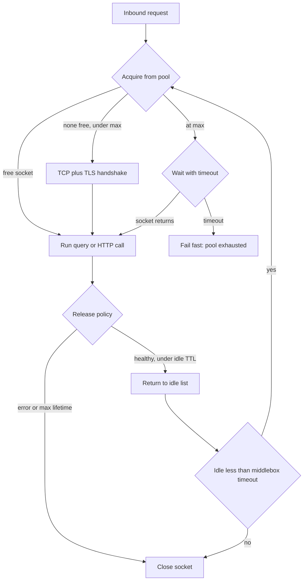

## Concept

### Handshake cost is the first bottleneck

A TCP handshake is a round trip. TLS on top is more: certificate verify, key exchange, and usually another round trip unless you already have a session ticket. On a 40 ms mobile path that is 80–160 ms before the first application byte. On a busy origin it is also CPU: crypto, accept queue, and a new control block in the kernel. If every HTTP request or every SQL query opens a socket, you are paying that tax on the user-visible path and you are allocating kernel state at the rate of QPS, not at the rate of concurrent work.

Keep-alive (persistent connections, connection reuse) is the decision to amortize that handshake across many requests. Connection pooling is the decision to bound how many of those live sockets exist, how they are acquired, and what happens when none are free. They are related and not the same. Keep-alive without a bound is a leak. A pool without keep-alive is a queue in front of a handshake.

### Pools are capacity, not a convenience wrapper

A pool has a size, a wait policy, an idle policy, and a health policy. Size is capacity: it is the maximum concurrency you are willing to present to the dependency. Set it from the dependency's safe concurrency, not from the number of application threads you happened to configure. An application with 800 Tomcat threads and a Postgres `max_connections` of 200 will queue in the database, then in the pool, then in the load balancer, and you will debug the wrong layer first.

The wait policy is what a caller does when the pool is empty: block with a timeout, fail immediately, or open a temporary extra connection (which defeats the bound). Production defaults should fail or block with a short timeout, and that timeout should be visible as a distinct metric. "Pool exhausted" is a first-class incident class. It is not a generic `SQLException`.

Idle policy decides when a live socket is a liability. An idle connection costs file descriptors and origin memory. It also goes stale: the other side, a NAT, or a load balancer will close it without telling you. The next request then fails on write. Health policy is how you detect that before the user does: a validation query, a TCP keepalive probe, or a max-lifetime that rotates sockets before the middlebox does.

### Keep-alive, idle timeouts, and middleboxes

HTTP keep-alive is a protocol feature (`Connection: keep-alive` in HTTP/1.1, which is the default; streams on one TCP connection in HTTP/2). Database keep-alive is a product feature (the session stays authenticated). gRPC keep-alive is HTTP/2 ping. The numbers that matter are the idle timers on every hop: client pool, OS TCP keepalive, NAT, load balancer, origin server, and any sidecar.

The rule is simple and widely violated: the client's idle timeout must be shorter than the shortest middlebox or server idle timeout. If a load balancer drops idle TCP at 60 seconds and your pool keeps sockets for 5 minutes, a fraction of requests fail with connection reset after idle. Those failures cluster after traffic dips — lunch, overnight, the minute after a deploy when instances are up but quiet. Operators describe this as "flaky in staging, fine under load," which is the signature of idle-timeout mismatch.

TCP keepalive (SO_KEEPALIVE) is not HTTP keep-alive. It is a kernel probe on a silent socket. Use it as a backstop, with intervals that detect dead peers in minutes, not as a substitute for application-level max lifetime. Application max lifetime (for example 30 minutes, jittered) bounds the damage of a server-side restart, a stale TLS session, and a NAT mapping you cannot see.

### HTTP, database, and gRPC pools are different products

An HTTP/1.1 pool is a set of sockets, each able to run one request at a time. Concurrency equals connection count. An HTTP/2 or HTTP/3 pool is a small number of multiplexed connections, each able to run many streams. Concurrency is stream count, bounded by the peer's `MAX_CONCURRENT_STREAMS`. Copying HTTP/1.1 pool sizes onto HTTP/2 creates a handful of overloaded connections and a new head-of-line problem.

A database pool is a set of sessions. Each session may hold locks, temp tables, and session state. Sharing a session across requests without resetting that state is a correctness bug (see `SET search_path`, leftover transactions, leftover temp tables). Database pools therefore have checkout/reset semantics that HTTP pools do not. PgBouncer and ProxySQL exist because the database's `max_connections` is a scarce, memory-heavy resource and application pools multiply by replica count.

gRPC channels are long-lived HTTP/2 connections with their own keepalive pings, flow-control windows, and name-resolver reconnection. Treating a gRPC channel like a Java `HttpURLConnection` that you open per RPC throws away the point of the stack.

### Sizing: min, max, wait, and saturation

Minimum idle connections buy you warm handshakes after a lull and cost origin memory at 3 a.m. Maximum connections are a safety valve and a weapon: too low and you queue; too high and you stampede the dependency during a retry storm. Start from Little's law on the dependency: safe concurrency is roughly `offered_load × service_time`. If Postgres can do 4 ms queries and you want 5,000 QPS, you need about 20 busy connections, plus headroom for variance, not 500.

Wait timeout should be a fraction of the user SLA, not the origin timeout. Waiting 10 seconds for a free connection when the query would have taken 4 ms is how pools turn a saturation event into a user-visible outage. Fail fast, shed load, and let the retry policy (if any) sit above the pool, with jitter, and never retry pool-exhaustion in a tight loop.

Saturation is when every connection is busy and the wait queue is growing. That is the moment to shed. It is also the moment a keep-alive pool looks identical to a connection-per-request design: you cannot reuse a socket that is not free. Pooling helps average handshake cost. It does not create capacity the origin does not have.

## Trade-offs

| Approach | When it wins | Cost / risk |
| -------- | ------------ | ----------- |
| Connection per request | Tiny batch jobs, one-shot CLIs | Handshake dominates; ephemeral port and accept-queue exhaustion |
| Keep-alive, unbounded reuse | Low-concurrency clients you fully control | Idle sockets, NAT timeouts, no ceiling on origin sessions |
| Bounded pool with wait timeout | Services with known concurrency toward a scarce dependency | Pool exhaustion becomes a latency cliff; sizing is now an SLO |
| Multiplexed connections (HTTP/2, mux DB) | Many concurrent calls, few sockets, high RTT | Head-of-line and noisy-neighbor on one connection; stream limits |
| External pooler (PgBouncer, ProxySQL) | Many app replicas, scarce database sessions | Extra hop; prepared-statement and session-feature constraints |
| Aggressive TCP/HTTP keepalive probes | Long-lived origins behind NAT or LBs | Probe cost; false kills if probe interval is tighter than jitter |

A pool is a circuit breaker that nobody named. When it is exhausted you have already decided to queue or fail. Make that decision explicit and metric it. Unbounded keep-alive feels faster in a load test that never idles and then fails in production every night when the idle timer and the NAT disagree.

Multiplexing reduces socket count, which is a win for mobile networks and for file-descriptor limits. It concentrates failure: one TCP loss, one congested connection, or one stuck stream window can delay many unrelated RPCs. For databases, multiplexing is still rare in mainstream OLTP protocols; you scale with pooling and pooling proxies, not with twenty queries on one session unless the protocol was built for it.

## Diagram

## Failure modes

### Pool exhaustion

Every socket is checked out, waiters hit the timeout, and user latency cliffs while the dependency's CPU looks fine — or the dependency is saturated and the pool is correctly refusing to amplify it. Detection is a dedicated `pool_wait` / `pool_timeout` metric, not a generic error rate. Mitigation is the bound you meant to have: size from Little's law, fail fast, shed at the edge, and stop retrying exhaustion. Raising `max` without measuring origin safe concurrency moves the outage into the database.

### Stale sockets and half-open connections

The server or a NAT closed an idle connection; the client learns on the next write. Detection is spikes of connection-reset errors after idle periods, recovered on retry. Mitigation is client idle timeout below the path's idle timeout, max lifetime with jitter, and a single transparent retry on a fresh connection for idempotent requests only. Do not retry POSTs that may have reached origin.

### Connection leaks

Checkout without return, a forgotten transaction, a stream never closed. The pool shrinks until it is exhausted. Detection is checked-out count that ratchets up, never returning to baseline, and sockets in `CLOSE_WAIT` or stuck in `idle in transaction`. Mitigation is try-with-resources as policy, a leak-detection wrapper that logs checkout stacks, and a server-side `idle_in_transaction` timeout so a leaked DB session cannot hold locks forever.

### Reconnect stampede

Origin restarts, a TLS cert rotates, or a VIP fails over. Every client pool dumps its sockets and redials at once. Detection is a thundering accept queue, SYN drops, and a second outage during recovery. Mitigation is jittered reconnect, a cap on concurrent dials per process, and warm-min connections that refill slowly. HTTP/2 and gRPC should cap new connections the same way; "the channel will reconnect" is not a backoff policy.

### Ephemeral port and TIME_WAIT exhaustion

Connection-per-request or a pool that churns (max lifetime of seconds, validation that opens a new socket every checkout) burns local ports. Detection is `connect() EADDRNOTAVAIL`, a pile of `TIME_WAIT` sockets, and failures only on high-QPS nodes. Mitigation is reuse, `SO_REUSEADDR` where appropriate, longer pool lifetimes, and not placing a chatty proxy on a host with a tiny ephemeral range.

## Real-world example

Cloudflare's edge is a connection-management machine at a scale where handshake cost is a line item. Browsers and devices terminate TLS at a nearby POP. That POP must then talk to a customer origin. If the POP opened a new TCP+TLS session to origin on every cache miss, origin CPU and the POP's own file-descriptor tables would collapse under the miss rate, and miss latency would include a transcontinental handshake. Cloudflare keeps origin connection pools: keep-alive to the customer server, coalescing of concurrent misses onto warmed sockets, and protocol choices (including HTTP/2 to origin where the customer allows it) so many fetches share few connections.

The failure modes they publish around this are the ones every platform team rediscovers. Idle timeouts between the proxy and origin must match; otherwise a quiet site's first morning request dies on a recycled socket. Connection reuse without bounds would pin origin `max_connections`. Connection reuse with too little jitter after an origin restart is a SYN flood from the CDN itself. Their "Argo" and connection-coalescing work is an admission that the expensive resource is often the session, not the GET. When you run a handful of services behind a load balancer, you are solving a smaller version of the same problem: warm, bounded, shorter-idle-than-the-path, and measured as a pool, not as "the HTTP client."

## What to remember

- A pool is a concurrency limit; size it from the dependency's safe occupancy, not from your thread count.
- Client idle timeout must be shorter than every NAT, load balancer, and server idle timeout on the path.
- Keep-alive amortizes handshakes; it does not add capacity once every socket is busy.
- Jitter max lifetime and reconnects, or an origin restart becomes a reconnect stampede.
