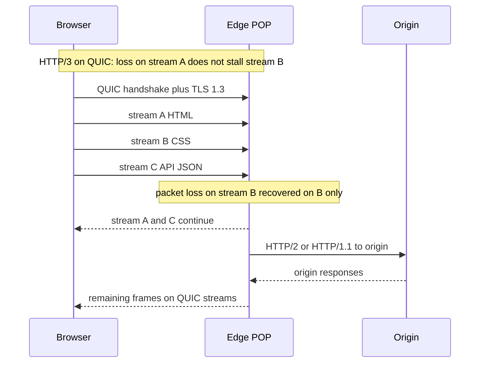

## Concept

### What HTTP/1.1 actually serializes

HTTP/1.1 sends one request at a time on a connection unless you enable pipelining, which browsers never made reliable. The practical workaround was six connections per host. Each connection pays TCP slow start and TLS. Head-of-line blocking is obvious: a large image or a stalled first byte holds everything queued behind it on that socket. Domain sharding (splitting assets across hostnames) was a hack to raise the connection cap. It multiplied DNS, sockets, and certificates, and it fights connection reuse.

Any performance story that still recommends sharding as a default is optimizing a protocol you should have left. HTTP/2 and HTTP/3 exist to put many streams on one session without pretending that more sockets are a concurrency API.

### HTTP/2 multiplexing and header compression

HTTP/2 maps streams onto one TCP connection. Each stream has its own frames. The client can open many requests at once, and the server can interleave responses. Priorities (the original tree, later revised) exist because not all streams are equal: the HTML and the CSS should outrank the third-party beacon. In practice, browser priority and server frame scheduling matter more than the spec diagram on your whiteboard.

HPACK compresses headers with a table that both peers maintain. That is a large win: HTTP/1.1 repeated cookies and user-agent on every request. It is also state. A large dynamic table costs RAM per connection. A malicious or buggy peer can try to explode CPU with Huffman tricks or table churn. Treat HPACK limits as a security knob, not only a performance knob.

TLS is effectively mandatory. Browsers speak HTTP/2 only over TLS with ALPN `h2`. Cleartext `h2c` exists for internal proxies and almost nowhere else. Server push was the headline feature and became the disappointment: the server guesses which subresources the client needs, often guesses wrong, and wastes bandwidth. Most CDNs and browsers have de-emphasized push. Multiplexing and header compression are the features that remained.

gRPC sits on HTTP/2 streams and inherits the same wins and the same TCP problems. If you deploy gRPC at the edge of a lossy mobile network, you will feel TCP head-of-line even if every RPC is a separate stream.

### Head-of-line blocking: streams versus TCP

HTTP/2 removes HTTP-level HOL: a slow response no longer occupies the only HTTP/1.1 slot on that socket. It does not remove TCP HOL. TCP delivers a single ordered byte stream. If a packet is lost, the receiver cannot give later bytes to HTTP/2 until the gap is filled. All streams on that connection pause, even streams whose packets arrived. On a clean data-center path this is rare enough to ignore. On cellular, on coffee-shop Wi-Fi, and on any path with a non-trivial loss rate, it is the reason HTTP/2 can look worse than six HTTP/1.1 connections: loss on one multiplexed socket stalls everything, whereas loss on one of six sockets stalls a sixth of the work.

Flow control is a second source of stalls. HTTP/2 has connection windows and per-stream windows. A window that is too small under high bandwidth-delay product starves the sender. A window that is huge reduces the backpressure the protocol promised. Mis-set windows look like "HTTP/2 is slow" in a load test that HTTP/1.1 passed because HTTP/1.1 hid the problem across sockets.

### QUIC and HTTP/3: streams over UDP

QUIC is a transport in user space, typically over UDP, that provides streams with independent loss recovery. HTTP/3 is HTTP on QUIC. A lost packet delays the stream that needs it, not every stream on the connection. Handshake is combined with TLS 1.3: fewer round trips to the first byte than TCP plus TLS. Connection identifiers let a session survive a client IP change, which is the NAT-rebinding and mobile-handoff case TCP handles by starting over.

QUIC is not free. It costs CPU: loss recovery, crypto, and ACK processing in user space. It costs operational complexity: UDP is filtered on corporate networks, some home routers, and some middleboxes that only "understand" TCP 443. A successful HTTP/3 deployment is a happy-eyeballs story: try QUIC, time out, fall back to TCP HTTP/2, and remember the outcome so you do not pay the failed race on every navigation.

0-RTT is the sharp edge. QUIC can send application data in the first flight using a remembered ticket. That data can be replayed by an attacker who captured it. Idempotent GET of a public resource is the intended use. POST of a checkout, a transfer, or a login is not.

### Migration, 0-RTT, and the TLS story

TLS 1.3 is the shared foundation. HTTP/2 over TCP still needs TCP's handshake plus TLS unless TFO and 0-RTT session resumption cooperate, which they often do not across the public internet. QUIC folds the cryptographic handshake into connection setup. Connection migration uses a CID so the server can recognize the client after a 4G-to-Wi-Fi shift. That is a mobile win HTTP/2 cannot match without a new TCP+TLS session and a new slow start.

At the origin, reality is mixed. Many CDNs speak HTTP/3 to the browser and HTTP/2 or HTTP/1.1 to origin. The protocol upgrade is an edge feature, not a promise that your app server runs a QUIC stack. Plan for that translation: timeouts, retry semantics, and logging of the protocol the client actually used.

## Trade-offs

| Approach | When it wins | Cost / risk |
| -------- | ------------ | ----------- |
| HTTP/1.1 plus a small connection pool | Simple internal services, tiny backends, debug-friendly | Slow start per socket; browser connection caps; header repetition |
| HTTP/2 over TLS/TCP | Browsers, gRPC, many small assets on a clean path | TCP HOL under loss; HPACK state; stream and window tuning |
| HTTP/3 over QUIC | Lossy mobile, connection migration, fewer handshake RTTs | UDP blocking; CPU; 0-RTT replay; immature enterprise middleboxes |
| Mixed: H3 at the edge, H2/H1 to origin | CDNs and brownfield origins | Protocol translation bugs; two timeout models; split observability |
| Domain sharding on HTTP/1.1 | Legacy clients you cannot upgrade | Extra DNS and sockets; fights HTTP/2 coalescing if you keep it |

HTTP/2 is the right default between services in a well-managed network and for browsers on broadband. HTTP/3 is the right default at the public edge when you have a CDN or a stack that already implemented the fallback. Forcing QUIC inside a VPC that never loses packets buys CPU and buys you a new packet-capture story for a problem you did not have.

Do not enable 0-RTT on origins that process non-idempotent methods. Disable HTTP/2 server push unless you have measurements that it reduced time-to-complete without inflating bytes. Keep HTTP/1.1 as a fallback, not as the long-term browser strategy, and stop sharding hostnames once HTTP/2 coalescing is in play: two hostnames can mean two connections and a return of the problem you were solving.

## Diagram

## Failure modes

### TCP head-of-line under loss

All HTTP/2 streams freeze during retransmission. Detection is a mobile-only latency regression after an HTTP/2 rollout, with packet-loss correlation, while wired clients improve. Mitigation is HTTP/3 at the edge, or, if you must stay on TCP, more connections (partially undoing multiplexing) and not packing unrelated tenants onto one long-lived h2 connection without isolation.

### 0-RTT replay

Captured early data is replayed, duplicating a mutation. Detection is duplicate orders or duplicate POSTs with the same 0-RTT ticket window, often without a new full handshake in the log. Mitigation is refusing 0-RTT for non-idempotent methods, anti-replay caches at the origin, and treating early data as unauthenticated until after the handshake completes where the protocol allows that distinction.

### UDP blocked and fallback storms

QUIC probes fail, every client waits for a timeout, then falls back to TCP. Detection is a rise in connect time, a high rate of HTTP/3 attempts with HTTP/2 completions, and support tickets from corporate networks. Mitigation is a short happy-eyeballs timer, caching "this network failed QUIC" on the client, and never removing HTTP/2. Measure the failed-race cost; a 3-second UDP timeout is an outage.

### Stream and window exhaustion

`MAX_CONCURRENT_STREAMS` or a stuck flow-control window rejects or stalls new RPCs while the connection looks up. Detection is gRPC `RESOURCE_EXHAUSTED`, HTTP/2 stream-refused, and idle-looking connections with growing p99. Mitigation is tuning streams and windows from bandwidth-delay, closing unused streams, and not assuming one connection per process is enough under a fan-out graph.

### Compression and implementation bugs

HPACK or QPACK CPU spikes, request-smuggling variants at protocol translation, or a middlebox that "supports HTTP/2" by breaking it. Detection is CPU on the proxy, 400s that vanish when forced to HTTP/1.1, and mismatches between `:path` and the origin's view. Mitigation is current proxy versions, protocol-specific integration tests, and a kill switch that disables h2/h3 per route.

## Real-world example

Google's QUIC deployment is the public existence proof. Chrome, YouTube, and search needed faster first byte and better behavior on lossy mobile paths than HTTP/2 over TCP could give. QUIC moved loss recovery into streams, collapsed the handshake with TLS 1.3, and accepted UDP as the tax. The rollout was not a flag day. Chrome raced QUIC against TCP, measured abandonment and latency, and fell back. Networks that dropped UDP did not become outages; they became HTTP/2. Google published that the wins were concentrated where TCP HOL was real — mobile, loss, connection migration — not in the lab on a lossless LAN.

HTTP/3 standardized that work. If you turn on HTTP/3 at a CDN today, you are riding that fallback design. The origin can stay on HTTP/2. The browser gets independent streams over QUIC when the path allows it. The architectural lesson is not "UDP is faster." It is that multiplexing only pays if the transport does not reintroduce a single queue, and that a new transport without a fast fallback is a connectivity incident waiting for a corporate firewall.

## What to remember

- HTTP/2 multiplexes streams; TCP still HOL-blocks all of them on a lost packet.
- HTTP/3/QUIC recovers loss per stream and cuts handshake RTTs, at the cost of UDP and CPU.
- Never enable 0-RTT for non-idempotent methods; replay is a feature of the protocol.
- Keep HTTP/2 (and HTTP/1.1) fallback with a short race timeout, or blocked UDP becomes a hang.
