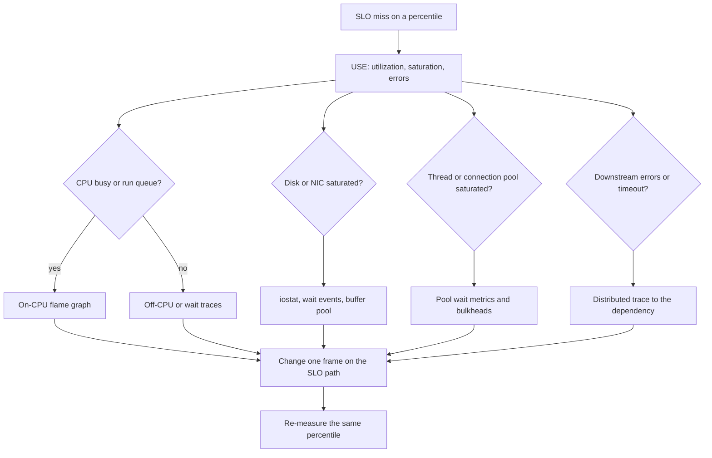

## Concept

### You cannot optimize a feeling

A latency complaint is a hypothesis: "the service is slow." It is not a location. CPU, disk, lock, network, GC, a downstream timeout, a cold cache, and a client that serializes requests all produce the same ticket. Profiling is how you turn that ticket into a resource and a stack. Bottleneck hunting is how you decide which resource is the constraint before you collect stacks. Skipping the first step produces flame graphs of a machine that is waiting, which look empty, which then produces a rewrite of code that was not on the path.

The loop is boring on purpose. Define the SLO in percentiles and in saturation, not in averages. Pick a resource method. Confirm the resource is the one that is in trouble. Profile that resource. Change one thing. Re-measure the same percentile on the same traffic shape. If you cannot name the metric that should move, you are not profiling. You are sightseeing.

### The USE method

USE asks three questions of every resource: utilization, saturation, errors. Utilization is the fraction of time the resource was busy (or the fraction of capacity in use). Saturation is the length of the queue of work that could not be served immediately. Errors are the operations that failed. CPU, memory, disk, NIC, thread pools, connection pools, and downstream clients are all resources. Apply the three questions before you open a profiler.

High utilization without saturation can be healthy: a well-sized CPU at 70% with no run-queue. High saturation with modest utilization is a red flag: a lock, a single-threaded section, or a pool that is too small. Errors that you retry become saturation somewhere else. USE is not a dashboard theme. It is a search order. Start at the resources the request touches, in order of how hard they are to add: CPU is cheaper than a database core, which is cheaper than a cross-region RTT.

Brendan Gregg's formulation exists because utilization graphs lie in isolation. A disk at 20% utilization with a queue of 40 is not fine. An NIC at 40% with packet discards is not fine. A JVM at 30% CPU with a growing GC pause time is not fine. Saturation and errors are first-class.

### Latency is a distribution

p50 can improve while p99 and the user experience die. Averages hide bimodal behavior: cache hits versus misses, warm versus cold instances, one noisy neighbor. Hunt bottlenecks on the percentile you sell, on the endpoint that carries revenue, and on the trace slice that represents a real user, not the mean of a synthetic ping.

Histograms beat rolling averages. Heatmaps of latency versus time show the mode split. If you only have an average, you do not yet have a performance system. Coordinated omission in the load generator will also fake a distribution: if the client waits for a response before sending the next request, slow responses reduce offered load and the measured p99 understates reality. Open-loop load and latency measurement that accounts for intended start time are part of profiling, not a separate discipline.

### Flame graphs and on-CPU time

A sampling profiler interrupts threads (or uses PMU events) and records stacks. A flame graph aggregates those stacks: x-axis is the collected samples, y-axis is stack depth, width is how often that frame was on-CPU. Wide frames at the top are where CPU went. They are not where time went if the thread was off-CPU.

Use CPU flame graphs when USE says CPU is utilized or saturated (run queue). Do not use them as the first tool for a latency problem on a service whose CPUs are idle. You will "find" that JSON parsing is 12% of CPU and rewrite it while the p99 is a 200 ms lock wait that never appears on-CPU.

Production sampling should be cheap enough to leave on: a few hundred hertz, or always-on profiles with pprof, JFR, async-profiler, or Linux `perf` in a bounded window. Symbolize. Without symbols you have a Rorschach test. Container images that strip debug symbols make this an operational problem, not a tooling problem.

### Off-CPU: I/O, locks, and waiting

Latency lives in wait. Off-CPU flame graphs, scheduler traces, and distributed traces answer where the thread went when it was not running: `futex`, disk, network, GC safepoint, a mutex, a connection-pool wait. Application traces (spans) are a coarse off-CPU map across services. They miss in-process locks unless you instrument them.

The usual production bottleneck is not an O(n^2) function. It is a pool of 20 connections in front of a 4 ms query at 8,000 QPS, or a synchronized map, or a DNS lookup on every request, or a GC pause aligned with a traffic burst. USE plus off-CPU data finds those. On-CPU flame graphs find the rest.

### One change, then measure again

A profile that shows ten frames is not a list of ten projects. Pick the widest frame that you control and that sits on the SLO path. Deploy behind a flag. Compare p99 and saturation on the canary, not a laptop benchmark. Microbenchmarks are for algorithm choice once you already know the function is hot and the allocation pattern matches production. They are not a substitute for a production profile.

If the change does not move the SLO percentile, you profiled a hot function on a cold path, or CPU was not the constraint. Revert and return to USE. The discipline is what keeps a performance program from becoming a rewrite club.

## Trade-offs

| Approach | When it wins | Cost / risk |
| -------- | ------------ | ----------- |
| USE dashboards on every resource | First pass: is this CPU, disk, pool, or errors? | Averages hide one-hot keys and one-slow instance |
| Sampling profiler and CPU flame graphs | CPU utilization or run-queue saturation | Blind to off-CPU wait; observer effect if sampling is too heavy |
| Off-CPU / scheduler traces | Latency with idle CPU: locks, I/O, pool waits | Noisier; needs symbols and kernel cooperation |
| Distributed traces and APM | Cross-service p99, fan-out, tail of a dependency | Sampling bias; incomplete spans; cost; still misses in-process locks |
| Microbenchmarks (JMH, criterion) | Isolated algorithm once the frame is known hot | Wrong heap, wrong CPU, wrong input size; false confidence |
| Always-on production profiling | Rare tails and real traffic mix | Must stay cheap; privacy of stacks; symbol pipelines |

Dashboards without profiles guess. Profiles without USE optimize the wrong resource. Traces without histograms miss the distribution. The cost of always-on profiling is real — CPU, storage of stacks, and the risk of collecting user data in arguments — but the cost of a quarterly "perf week" is that you never see the incident-only stack. Prefer cheap always-on CPU profiles plus on-demand off-CPU and traces with a high sample rate during an investigation.

Vendor APM is not a flame graph. A span named `SELECT` that takes 80 ms does not tell you whether the time was parse, lock, IO, or network. Use APM to find the service and the query. Use engine-side `EXPLAIN`, wait events, and OS profiles to find the resource.

## Diagram

## Failure modes

### Observer effect

The profiler, the debug log, or the 100% trace sample becomes the load. Detection is a latency or CPU step that starts when profiling is enabled and ends when it is disabled. Mitigation is sampling, ring buffers, and treating profiler-on as an experiment with a control. Never raise log level to DEBUG on the hot path to "see" a performance bug.

### Looking at the wrong percentile or the wrong host

You optimize p50 on a canary that is not taking the heavy tenant. Detection is a victory dashboard and an unchanged user SLO. Mitigation is to pin the investigation to the SLO percentile, the endpoint, and the instance class that is saturated. USE per instance, not a fleet average that hides one hot shard.

### Optimizing a cold path

A flame graph from a batch job or a health check is treated as the request path. Detection is a merged profile with no URI or thread-group filter. Mitigation is to profile under the real mix, filtered to the serving threads, during the hours the SLO is missed.

### Misattribution

GC, CPU steal, noisy neighbor, or time spent in the kernel is blamed on the widest user frame. Detection is a JVM pause histogram, `steal` in CPU stats, or a flame graph that is all `sys` with no symbols. Mitigation is to include GC, steal, and kernel in the USE pass, and to install symbols before arguing about frames.

### Profiling the load generator

The client is saturated, so the service looks fine and the test says you are done. Detection is generator CPU at 100%, closed-loop coordinated omission, and service utilization that never rises. Mitigation is to USE the generator as a resource, switch to open-loop, and confirm the service's saturation actually moved.

## Real-world example

Netflix's public performance work, especially Brendan Gregg's production flame graphs, is the template for bottleneck hunting at fleet scale. They did not start with a rewrite. They started with resource questions: is this instance on-CPU, waiting on disk, waiting on the network, or waiting on a lock? CPU flame graphs, generated from `perf` and later from always-on profilers, turned "Java is slow" into a specific frame: a checksum, a regex, a JSON library, a kernel path. Off-CPU graphs turned "latency is high, CPU is idle" into futex contention and TCP waits.

The cultural piece is what transfers. Profiles run in production, on the traffic that matters, with symbols, cheap enough to keep on. USE-style saturation (run queue, disk queue, network drops) is a first-class signal next to request latency. When they published reductions in CPU from a single library change, the proof was a flame graph that got narrower and an SLO percentile that moved, not a microbenchmark on a laptop. If your organization only profiles after an outage, you will only ever see the stacks that survive a pager. Netflix's lesson is to make the graph ordinary, then hunt.

## What to remember

- Ask USE (utilization, saturation, errors) on each resource before you collect stacks.
- CPU flame graphs explain on-CPU time; most user-visible latency is off-CPU wait.
- Measure the SLO percentile on the real mix; averages and laptop benchmarks lie.
- Change one thing and re-measure — a wide frame is not automatically the bottleneck you sell.
