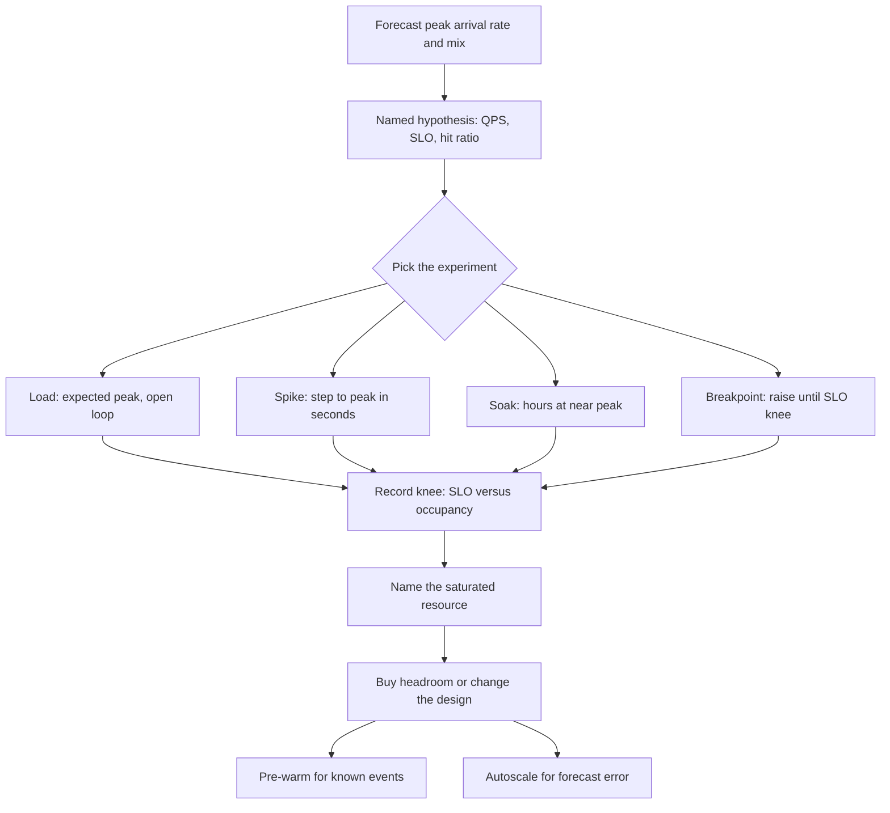

## Concept

### A load test is a hypothesis, not traffic

Production traffic has a mix of endpoints, a distribution of payload sizes, a cache temperature, a session length, a geographic arrival process, and a set of clients that retry. A load test has whatever you put in the script. If the script is "10,000 GETs of `/health`," you have proven that your load balancer can return 200. You have not proven Black Friday.

Write the hypothesis down. "At 8,000 checkout starts per minute, with a 70% cache hit ratio on product reads, p99 of `POST /checkout` stays under 300 ms and CPU stays under 70% on the checkout pool." Then build the smallest test that can falsify it. Capacity planning is the same hypothesis aimed at a date: a forecast of offered load, a model of how much resource that load consumes, and a margin for the model being wrong.

### Types: smoke, load, stress, soak, spike, breakpoint

Smoke is "does it start and serve one replica of the mix." It catches missing indexes and exploded configs. Load is the expected peak, held long enough for caches, JITs, and autoscalers to settle. Stress is beyond peak, to find the first resource that saturates and what failure looks like (timeouts, 429s, data corruption — you want the first two). Soak is peak or near-peak for hours, to find leaks, disk growth, and fragmentation that a 10-minute test will never see. Spike is a step function: 10× in a minute, which is the flash-sale and the retry storm. Breakpoint (or capacity test) raises load until SLO breakage and records the number.

These are different experiments. Combining them into one "we ran JMeter" night produces a graph nobody can interpret. Name the type in the report. Name the arrival process. Name whether the test is closed-loop (N virtual users who wait for a response) or open-loop (a scheduled arrival rate that does not slow down when the service does).

Closed-loop is easier to run and systematically lies about tails: slow responses reduce throughput, so the generator never piles on. Open-loop is how the internet behaves and how coordinated omission gets out of the measurement. Use open-loop for peak planning. Use closed-loop only when you are modeling a finite call-center of humans who truly wait.

### Saturation is the number that matters

Throughput that still "succeeds" while p99 has left the SLO is not capacity. Capacity is the offered load at which you still meet the SLO with headroom on the bottleneck resource. Find the knee: the load where latency or error rate inflects. That knee is usually a saturated pool, a saturated CPU, a saturated disk queue, or a saturated downstream. USE the resources during the test. A load test without utilization and queue metrics is a latency anecdote.

Little's law is the planning arithmetic: `concurrency ≈ arrival_rate × service_time`. If you want 5,000 QPS at 20 ms service time, you need about 100 concurrent requests in the system, plus variance. That concurrency must fit in thread pools, connection pools, and database `max_connections`. When it does not, you queue, and queues turn a 20 ms service into a 2 s wait. Capacity planning that only multiplies last year's QPS by 1.3 without converting to occupancy will buy the wrong resource.

Headroom is the difference between forecast peak and the knee, after you apply a safety factor for mix error, region loss, and a bad deploy. Teams that run at 90% of the knee on a good day have no place to put a retry storm.

### Modeling: utilization, replicas, and the bottleneck shift

A linear model (`need 2× boxes for 2× QPS`) holds until the bottleneck shifts. CPU-linear services scale with replicas until the database, the NAT gateway, or a singleton lock becomes the constraint. Plan for the shift. The output of a good load test is not "we handled 12k QPS." It is "CPU was the constraint to 9k, then checkout_id lock wait on SKU table, then p99 left SLO." The capacity plan buys CPU to 9k and a design change for the lock.

Autoscaling is not a substitute for a plan. It has a control loop: metric, delay, boot time, warm caches, connection pools. A spike test that the autoscaler passed in 20 minutes can still fail a 90-second flash sale. Plan pre-warmed capacity for events whose start time you know. Use autoscaling for the uncertainty around the forecast, not as the entire forecast.

### Production shape versus synthetic QPS

The mix must include reads and writes in production ratio, cache key cardinality, payload sizes, authentication, and the expensive endpoints people avoid in tests because they are hard to script. Cold-cache tests and warm-cache tests are both required: the first day after a flush is a different system. Replay of sanitized production traffic is the gold standard when legal and technical constraints allow it. Synthetic scripts are what you have for new endpoints; they need a review of "what did we leave out" as a first-class artifact.

Run against an environment that shares the bottleneck with production, or say in the report that it does not. A staging database with 5% of the rows and SSD-equivalent RAM will pass a test that production will fail on buffer-pool misses. Shadow traffic and production canaries close that gap at the cost of blast radius.

## Trade-offs

| Approach | When it wins | Cost / risk |
| -------- | ------------ | ----------- |
| Closed-loop N users | Modeling a finite human pool; simple tools | Coordinated omission; understates tail under saturation |
| Open-loop arrival rate | Peak internet traffic, retry storms, breakpoint tests | Generator must keep up; harder to operate |
| Synthetic mix | New products, controllable factors | Easy to omit the expensive endpoint and the cold cache |
| Production replay / shadow | Real mix, real cardinality | Privacy, staleness of mix, blast radius |
| Staging soak | Leaks and growth before the event | Staging is not production data size or neighbor noise |
| Pre-warmed peak capacity | Known events: Black Friday, launches | Cost; still need a spike plan if the forecast is short |
| Autoscaling as the plan | Uncertain growth, gradual ramps | Boot and warmup delay; thundering scale events |

The generator is part of the system under test. If it saturates, you are measuring the generator. Budget CPU, network, and open file descriptors for the load cluster, and USE it the way you USE the service. Distributed generators need a common clock for histograms, or your p99 is a merge of unsynchronized windows.

Do not treat a passed test as a certificate. Treat it as evidence for a named hypothesis, dated, with the mix version. Next year's Black Friday will not match this year's script unless you maintain the script like a product.

## Diagram

## Failure modes

### Testing the load generator

Offered load plateaus, service CPU is idle, and the report claims a ceiling. Detection is generator USE: CPU, network, error logs, and a gap between intended and achieved arrival rate. Mitigation is to scale the generator first, use open-loop, and abort the test if achieved RPS diverges from intended.

### Coordinated omission

Closed-loop clients slow down, p99 looks acceptable, production p99 will not. Detection is a throughput drop that tracks latency, and histograms that ignore wait-to-start. Mitigation is open-loop plus latency measured from intended send time, as in good wrk2/ghz-style reporting. If your tool cannot do that, do not use its p99 for capacity sign-off.

### Wrong mix, cold cache, tiny data

You tested the fast path on a warm cache against a toy database. Detection is production p99 on one endpoint you never scripted, or a disk-read cliff that staging never saw. Mitigation is mix review against access logs, a mandatory cold-cache run, and data volume within an order of magnitude of production for the bottleneck store.

### Autoscaler lag and cold instances

The spike hits before new replicas pass readiness, or new replicas pass readiness with empty caches and cold JITs. Detection is a latency hole lasting boot plus warmup, then recovery. Mitigation is scheduled scale-out before the event, readiness that includes cache warmup if warmup is required to meet SLO, and a spike test that starts from the replica count you will actually have at T-0, not from the autoscale end state.

### Hidden shared resources

The test environment does not share production's NAT, DNS, connection tracker, or noisy-neighbor disk. Detection is a production-only saturation of a resource that was not in the USE list. Mitigation is to include edge, DNS, and data-store replicas in the test, and to run at least one rehearsal on production-sized infrastructure.

## Real-world example

A Black Friday capacity plan at a large retailer is this discipline on a calendar. Forecast starts from last year's peak plus growth plus a marketing multiplier for campaigns that did not exist last year. The hypothesis is per funnel step: browse QPS, cart QPS, checkout QPS, payment-authorization QPS, each with an SLO and a dependency (catalog cache, inventory, payment gateway). Load tests are open-loop against a production-shaped mix, including the "add to cart" write path people skip because it is annoying to stub. Spike tests imitate the 00:00 deal drop. Soak tests run the peak mix overnight to catch leaks before the weekend.

The plan that survives is the one that names the knee and the resource. Checkout CPU might be fine to 1.4× last year while inventory row locks fail at 1.1×. The buy is not "20% more app boxes." It is more app boxes *and* a change to inventory (coalesced availability reads, per-SKU sharding, or a reservation service) *and* pre-warmed replicas in each region an hour before open *and* a payment-gateway rate bargain that the load test already proved you will hit. After the event, compare forecast to actual and file the mix gaps. Next year's plan is that diff. Teams that skip the breakpoint test learn the knee from customers. Teams that treat autoscaling as the plan learn it in the first ninety seconds, which is the part of Black Friday you do not get back.

## What to remember

- A load test falsifies a named hypothesis: mix, arrival rate, SLO percentile, cache temperature.
- Capacity is the knee where SLO and saturation fail, not the highest QPS that still returned 200.
- Prefer open-loop tests; closed-loop plus naive p99 hides the tail via coordinated omission.
- Known events need pre-warmed headroom — autoscaling is for forecast error, not for 00:00.
