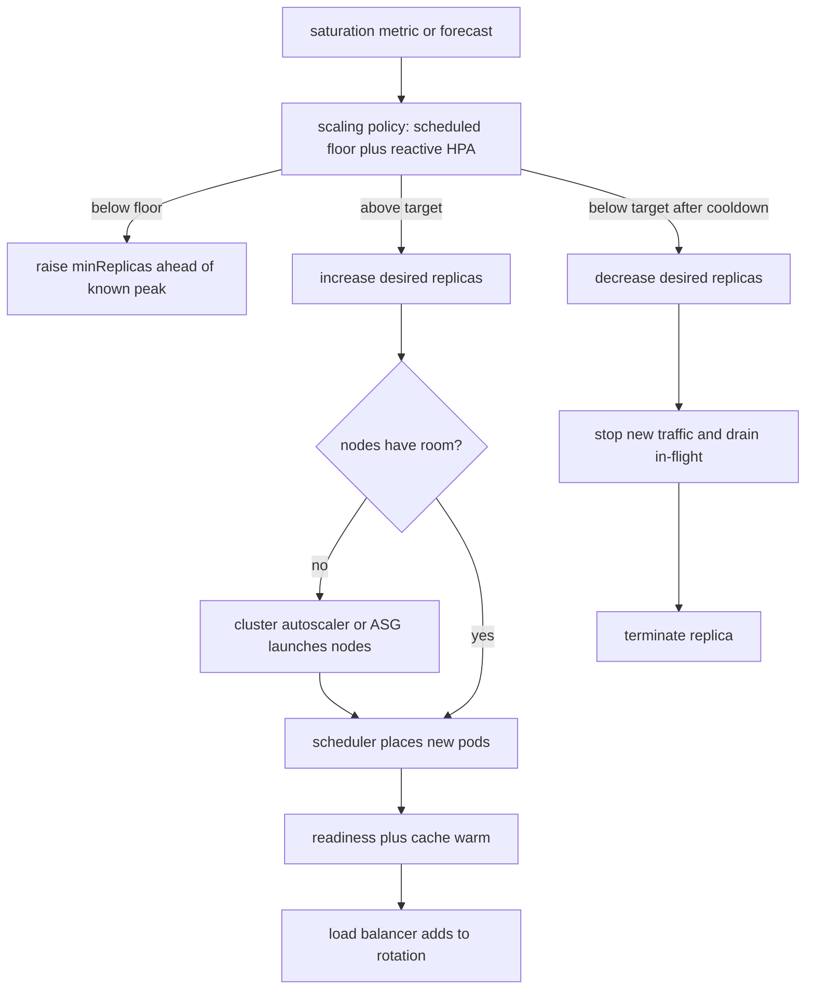

Autoscaling is a control loop around capacity, not a checkbox that makes cost and latency someone else's problem. The loop observes a signal, compares it to a target, and adds or removes compute. The interesting design is which signal you trust, how much lag you will tolerate between decision and ready capacity, and what the product does in the minutes while that lag is still open. Horizontal Pod Autoscaler, scheduled scale, and predictive scale are three answers to those questions. They are not three names for the same knob.

## Concept

### Horizontal Pod Autoscaler versus scheduled versus predictive

Horizontal Pod Autoscaler, and its cloud cousins such as AWS target-tracking Auto Scaling, are reactive. They watch a metric that is already happening: CPU, request concurrency, custom queue depth, or a business gauge you export. When the metric sits above the target for a window, the controller raises desired replicas. When it sits below, after a longer cooldown, it lowers them. The policy is honest about the present and silent about the future. That is why reactive loops lose the first minutes of a spike. Pods do not appear when the metric trips. They appear after image pull, scheduling, readiness probes, connection pools, and cache warm. If your p99 budget is two hundred milliseconds and cold start is ninety seconds, the loop has already spent an incident's worth of latency before the new replica takes traffic.

Scheduled scaling is a calendar. You know Black Friday opens at midnight, the batch window runs from 01:00 to 04:00, or the European morning rush arrives every weekday. You raise `minReplicas` or desired capacity ahead of the event and lower it after. There is no metric lag. The cost is operational memory: calendars drift, marketing moves a sale, and last quarter's schedule is now a surprise under-provision. Scheduled scale is the right default when the load shape is a known function of wall time and being early is cheaper than being late.

Predictive scaling tries to learn that function instead of typing it. AWS predictive scaling, Netflix's older Scryer, and several in-house forecasters fit a model to historical traffic and pre-warm capacity before the metric would have tripped. They win on diurnal curves and weekly seasonality. They lose on a launch that has no history, a viral spike, or a dependency failure that looks like load. Treat a forecast as a floor you still overlay with a reactive loop, not as a replacement for one. The forecast covers the shape you have seen. The reactive loop covers the shape you have not.

I run them as layers, not as alternatives. Scheduled or predictive policy sets the floor. HPA or target tracking moves inside a band above that floor. Cluster autoscaler or node groups sit underneath so that pods actually have machines. If you only scale pods onto a fixed node pool, you have an autoscaler that queues Pending and calls it a success in the application metrics.

### The metric is the policy

CPU is the metric teams start with because it is already on the box. It is the wrong primary signal for most request-serving systems I review. A service blocked on a database, a lock, or a downstream timeout can be at fifteen percent CPU and still be dropping SLO. A CPU-bound image processor can be at eighty percent and healthy. Use CPU for genuinely compute-bound workers. For request paths, prefer concurrency, inbound QPS versus healthy capacity, or a saturation signal such as queue time at the load balancer.

Custom metrics make HPA useful and make it dangerous. Queue depth is an excellent scale-out signal for a worker pool: more messages, more consumers, up to a cap set by the broker and the downstream. The same depth is a terrible scale-in signal if a poison message is holding the queue. Latency as a scale metric is worse. Latency is an output. Scaling on p99 will add replicas after users already felt the loss, and will add them in response to a slow dependency you cannot fix with more of yourself.

Target, window, and cooldown are the rest of the policy. A target of seventy percent utilization with a sixty-second window will chatter if the metric is noisy. A five-minute window will miss a flash sale. Cooldown on scale-in should be longer than scale-out: adding capacity late is expensive in user pain, removing it early is expensive in the next spike. I want scale-out in one or two metric periods and scale-in only after several periods plus a floor that covers the next known peak.

### Scale-out is easy; scale-in is the product decision

Adding a replica is almost always safe for a stateless service that is behind a load balancer and has no sticky sessions. Removing one is a drain problem. If you terminate a pod with in-flight requests, you convert a cost optimization into 502s. Kubernetes `preStop` hooks, connection draining on the target group, and a readiness gate that stops new traffic before SIGTERM are not polish. They are the difference between a scale-in event and an error budget spend.

Stateful services do not become stateless because HPA exists. A cache node, a Kafka broker, a database replica, or a session store has membership, data, and failover cost. Horizontal scale of those systems is a rebalance, not a replica count. Use HPA on the stateless tier in front. Scale the data tier with its own operator, and treat "desired count went up" as a topology change you schedule.

Scale-to-zero wins for idle workers and internal tools. It loses for user-facing APIs whose cold start exceeds the latency SLO. A min of two in two zones is the default until a measured warm pool is faster than a ready replica.

### Capacity below the autoscaler

Pod autoscaling without node autoscaling is a Pending queue with extra steps. Cluster autoscaler, Karpenter, or an ASG that reacts to unschedulable pods has its own lag: instance launch, node bootstrap, CNI, and disk. Warm pools and overprovisioned buffer nodes exist to hide that lag. Budget them as deliberately idle capacity, not as waste you will "fix" next quarter.

Quotas are a hard ceiling the control loop cannot see unless you teach it. Account instance limits, IP space in a subnet, storage IOPS, and downstream connection limits all cap scale-out. An autoscaler that wants two hundred pods and is allowed eighty will sit at eighty, look healthy on replica count, and burn latency. Alert on `Desired` versus `Ready`, on Pending, and on the first quota error, not on CPU after the fact.

## Trade-offs

| Approach | When it wins | Cost / risk |
| -------- | ------------ | ----------- |
| Reactive HPA / target tracking | Unpredictable load, custom saturation metrics, worker pools | Misses the first minutes of a spike; wrong metric scales the wrong thing |
| Scheduled scale | Known peaks, business calendars, batch windows | Stale calendars; surprise campaigns; paying for capacity you do not use |
| Predictive scale | Stable diurnal and weekly shapes with history | Blind to novel events; overfits last week's outage as next week's load |
| Vertical scaling | Single-process bottlenecks, licensed software, tiny services | Hard ceilings; blast radius of one box; disruptive resizes |
| Fixed min with no autoscaler | Strict latency SLOs, tiny fleets, cost that is already noise | You pay peak all day; operators become the control loop |

Reactive loops are the default for good reason: they do not require you to be right about the future. They require you to be right about the metric and the boot time. If boot time is longer than the spike, reactive scaling is a cost optimizer for the hours after the incident, not a latency control during it.

Scheduled and predictive policies exist to buy the minutes reactive loops cannot. Use them as floors. Leave a reactive loop in place so a wrong forecast still has a correction. A forecast that is also the only scaler will be confidently wrong on the day marketing sends a push notification you did not model.

Vertical scaling still has a place when a license or a huge in-process cache favors one fat process. Resize is a restart. Treat it as a deploy, with the same drain rules.

## Diagram

## Failure modes

### Thrashing and metric oscillation

The control loop adds replicas, the metric drops, the loop removes them, the metric rises, and you pay for churn plus a sawtooth of errors. Detection is a replica-count graph that tracks the metric with a lag, plus elevated 5xx aligned to scale-in events. Mitigation is asymmetric policy: faster scale-out, slower scale-in, a hysteresis band around the target, and a min that covers the next known peak. Do not fix thrashing by tightening both directions.

### Cold start during the spike you scaled for

Desired count is not ready count. Image pulls, init containers, JIT, and empty caches mean the replica that "exists" still fails or is slow. Detection is `Ready` lagging `Desired`, plus p99 rising while replica count looks like the policy worked. Mitigation is a warm image cache on nodes, readiness that includes dependency checks, a min replica floor, and pre-warming scheduled ahead of known events. If the spike is shorter than boot time, autoscaling cannot save that SLO. Provision for it.

### Scaling on the wrong signal

CPU-based HPA on an I/O-bound service sits idle while latency burns. Latency-based HPA adds replicas because a downstream database is slow, which makes the database worse. Detection is replica count rising while the bottleneck metric on a dependency rises with it, or replica count flat while saturation is obvious in queue time. Mitigation is to scale on a saturation metric you own: concurrency, outstanding requests, or your own queue depth, with a hard cap. Never scale a caller on the callee's latency.

### Scale-in as an outage

Terminating pods with open connections, or killing the last replica in a zone, looks like random 502s at the edge. Detection is error spikes aligned with `replica count decreased` events, and connection-reset counters on the load balancer. Mitigation is drain time longer than your p99 in-flight duration, a zone-aware min, and pod disruption budgets that refuse to evict below that min. Cost dashboards that celebrate aggressive scale-in are incomplete without the error budget next to them.

### Hitting a ceiling the loop cannot see

Subnet IP exhaustion, instance family quota, registry rate limits, and downstream connection caps all freeze scale-out. Detection is Pending pods, `FailedScheduling`, and quota API errors while HPA still reports a higher desired count. Mitigation is quota headroom as a capacity item, alerts on Desired minus Ready, and a documented cap so on-call knows the loop is done and the next lever is shedding or a quota ticket.

## Real-world example

Shopify has published repeatedly on Black Friday and Cyber Monday, when traffic is not a smooth diurnal curve but a set of cliffs as deals open. A purely reactive HPA on CPU would notice the cliff after checkout latency had already moved. Their public engineering writing emphasizes capacity that is in place before the event: raising floors, load-testing the peak shape, and treating the sale as a scheduled capacity problem with reactive correction on top, not as a surprise the controller will absorb.

The shape is the lesson. A sale is a known function of marketing calendar plus an unknown function of virality and dependency health. Shopify-style operations pre-provision the known function: more storefront and checkout capacity in the hours before the campaign, warmed caches, and database headroom that an autoscaler on the app tier cannot create by itself. During the event they still let reactive loops add workers onto that floor when a particular shop or flash SKU exceeds the model. After the event they scale in slowly, because the next deal is often an hour away and because draining checkout pods mid-payment is a product incident. Autoscaling automated the band around a plan: calendar and forecast set the floor, HPA moves inside it, cluster capacity is already there, and drain rules make scale-in boring.

## What to remember

- Use scheduled or predictive policy as a floor, and keep a reactive loop for the load you have not seen.
- Scale on a saturation signal you own, not on CPU by default and never on downstream latency.
- Desired replicas are not ready capacity; boot time and drain time are part of the SLO.
- Quotas, node launch, and downstream connection limits are ceilings the pod autoscaler cannot wish away.
