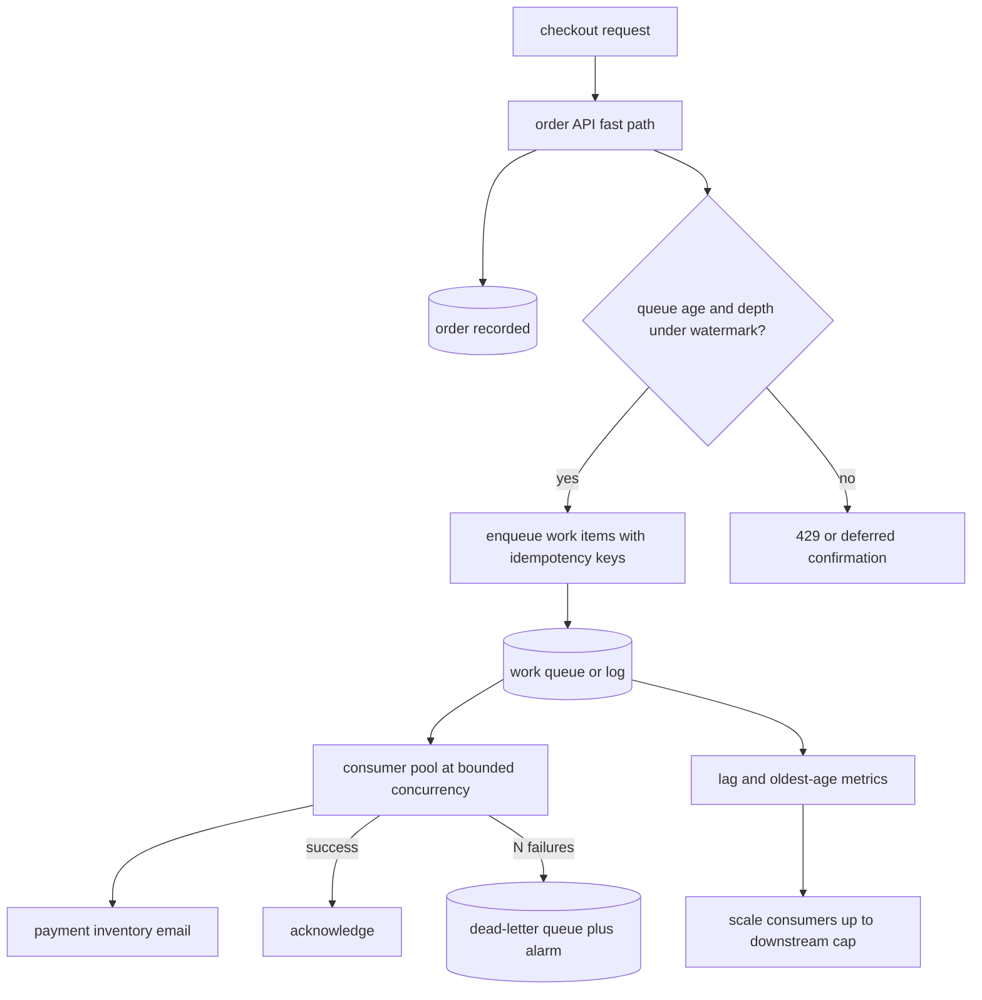

A spike that would have knocked over a synchronous API can sit in a queue and drain at the rate the downstream can actually sustain. That is load leveling: you buy time with buffering so that compute does not have to match the peak arrival rate. The queue is a contract among producers, the broker, and consumers about identity, ordering, backpressure, and what happens when the buffer becomes a multi-hour backlog with a business clock on it.

## Concept

### Why a queue absorbs a spike

Synchronous request paths couple arrival rate to service rate. If checkout, image processing, or notification fan-out can do N work items per second and marketing just produced 10N, the surplus becomes latency, then timeouts, then retries, then a worse surplus. A queue decouples those rates. Producers enqueue at 10N. Consumers continue at N. The difference lives as depth, which is a number you can page on, scale on, and explain to a product owner.

That number has a cost. Depth is delay. A message that waits twenty minutes is a twenty-minute RTT for whatever business fact it carries: an order confirmation, a fraud decision, a stock decrement. Load leveling is the right pattern when the caller can accept that delay, or when you can accept the enqueue and complete the user-visible work on a different path. It is the wrong pattern when the caller is a human waiting on a TCP connection for the same work. In that case the HTTP request still needs a fast path, and the queue is for side effects after you have already answered.

The useful mental model is a shock absorber, not infinite storage. Size the queue for a peak you can name, a drain time you can defend, and a dead-letter path for work that will not drain. An unbounded topic with no alarm is how you discover, hours later, a day's worth of failed payments.

### Producer, broker, and consumer contract

Producers must decide what "enqueued" means to the user. At-least-once producers retry. That means the broker will see duplicates unless the producer uses an idempotency key the consumer will honor. At-most-once producers drop on failure, which is acceptable for metrics and unacceptable for money. Design the producer as if duplicates will happen, because they will.

The broker's job is durability, fan-out, and a retention policy. SQS, Kafka, Pub/Sub, and RabbitMQ all level load and none of them are interchangeable. A queue (SQS standard, a competing-consumer Rabbit queue) is a work pile: many consumers steal messages, order is best-effort or nonexistent, and scaling consumers is the point. A log (Kafka) is a replayable history: consumers are positioned, order exists inside a partition, and leveling happens because producers can burst into the log while consumers lag. Choose the structure from the retry and ordering needs, not from which managed service is already in the account.

Consumers must be pullers with a bounded in-flight window, not hopeful loops that prefetch the world. Visibility timeout or partition lag is how you detect a stuck consumer. Processing must be idempotent with respect to the message identity. If processing is a call into a system that is itself a bottleneck, the consumer is not leveling load. It is moving the spike three hops downstream. The consumer's concurrency is a bulkhead. Set it from the downstream's safe rate, not from how many pods HPA will give you.

### Depth as a scaling signal

Queue depth, or consumer lag, is one of the few honest autoscaling metrics. More lag than the target, add consumers, up to a cap. The cap is not a guess. It is the rate the database, the payment processor, or the warehouse API will take without falling over. Scale consumers without a cap and load leveling becomes load concentration onto the next hop.

Time-in-queue is the user-facing form of depth. Alert on age of the oldest message, not only on count. A million tiny messages can be a one-minute delay. Ten huge messages can be an hour. Scale and pages should follow age against the product SLO: confirmation within two minutes, fraud check within thirty seconds, analytics whenever.

Scheduled draining matters as much as autoscaling. A sale that enqueues for two hours and a consumer fleet that you will not pay for all week is a valid design if you told the business the drain window. Leveling is allowed to finish after the spike. It is not allowed to finish after the refund window, the inventory hold, or the SLA you printed on the status page.

### Backpressure versus buffering

Buffering hides a mismatch. Backpressure exposes it to the producer so the producer can slow down, shed, or fail a user-facing request before the buffer is a liability. Production systems need both, in that order of preference at each hop.

At the edge, tell the caller no when the queue is past a watermark: HTTP 429, a "we will email you," or a closed checkout. That is load shedding with a queue behind it, not a queue as infinite hospitality. Inside the platform, let the broker apply backpressure: Kafka produce buffers, SQS in-flight limits, HTTP/2 window exhaustion. Consumers apply backpressure by not acknowledging and by not increasing concurrency when the downstream is already at its bulkhead.

The failure I see in reviews is buffering without a watermark. Everything succeeds for ninety minutes, the queue is a cliff, and then consumers, databases, and on-call discover the cliff together. A watermark is a product decision recorded as a number: max depth, max age, and the user-visible behavior when either trips.

### Identity, ordering, and poison

Load leveling does not excuse ignoring identity. Every message needs a stable key the consumer can use to ignore a duplicate. For orders that is usually the order id plus a purpose (`charge`, `email`, `decrement-stock`). Processing without that key and then retrying is how you double-charge.

Ordering is a narrower need than people claim. Most business events are commutative if you store the latest state. The cases that are not — ledger append, inventory that must not go negative without a reservation, session sequences — belong on a partition or FIFO queue keyed by the entity, with the throughput limit that implies. Do not FIFO the entire site because one entity needs order.

Poison messages are how queues die quietly. A payload that crashes the consumer, fails a schema check, or hits a 400 from a downstream will retry until the retry policy is exhausted, or forever if you did not set one. After N failures the message leaves the hot path for a dead-letter queue with an alarm. Operators replay from the DLQ once the bug is fixed. Leaving poison in the main queue pins a partition or burns visibility timeouts while healthy work waits.

## Trade-offs

| Approach | When it wins | Cost / risk |
| -------- | ------------ | ----------- |
| Synchronous API, no queue | User is waiting, work is small, downstream is scaled to peak | Peak cost; timeout storms; no shock absorber |
| Competing-consumer queue | Independent jobs, scale-out of workers, simple retry | Weak ordering; duplicates; easy to stampede the next hop |
| Partitioned log | Replay, per-key order, many independent consumer groups | Partition hot keys; lag is a first-class outage; operational cost |
| FIFO / exclusive consumer | Ledger-like order per entity | Throughput cap; head-of-line blocking |
| Bounded queue plus 429 at the edge | Honest capacity; protects drain time | Visible "no" to users; needs a designed fallback |

The first trade-off is delay versus headroom. A queue lets you buy fewer consumers than the peak, which is the whole point, in exchange for a delay distribution you must publish as an SLO. If product will not accept that delay, you do not have a leveling problem. You have a capacity problem and you should provision the synchronous path.

The second is duplication versus loss. At-least-once plus idempotent consumers is the default I will sign. At-most-once is for signals you would rather drop than double. A transactional outbox keeps the database commit and the message from splitting; writing after commit loses the message, writing before it processes work that will roll back.

The third is fan-out. One queue per purpose keeps failure domains small. One mega-topic couples every consumer to every producer's worst payload.

## Diagram

## Failure modes

### Unbounded growth and a silent backlog

Producers stay healthy because enqueue succeeds. Consumers fall behind because a dependency slowed or because HPA hit a cap. Detection is oldest-message age and consumer lag, not CPU on the API. If those graphs are not on the same dashboard as the checkout success rate, you will learn about the backlog from Twitter. Mitigation is a watermark that sheds or defers new work, a consumer cap tied to downstream safe rate, and a drain runbook that includes "stop producers" as a first-class action.

### Duplicate side effects

Retries, visibility-timeout expiry, and consumer crashes redeliver. Without an idempotency store you charge twice, email twice, or decrement stock twice. Detection is finance and customer tickets before it is a metric, unless you emit a "duplicate suppressed" counter. Mitigation is a persistent key per message purpose, unique constraints on the side-effect table, and consumers that check that store before calling the payment API. Visibility timeout must exceed the 99th percentile processing time or you will create duplicates as a steady state.

### Head-of-line blocking and hot partitions

A FIFO queue or a Kafka partition keyed by a popular shop id serializes the sale onto one consumer. Detection is one partition's lag exploding while others are idle, or one queue's in-flight always at max. Mitigation is a better key for work that does not need cross-item order, reservation-based inventory instead of serial decrements, and a dedicated hot-key path. Do not "fix" it by adding consumers that cannot share the partition.

### Poison pinning the queue

A bad payload retries forever. Competing consumers waste cycles. A partitioned log stalls that key. Detection is a spike in retry count, DLQ volume, or a consumer crash loop on the same offset. Mitigation is a bounded retry with jitter, a DLQ with an alarm, schema validation at produce time, and a replay tool that is not "copy paste into prod."

### Leveling into a smaller bottleneck

Consumers scale to one hundred and the database or a partner API accepts twenty. Detection is downstream error rate and latency rising in lockstep with consumer count. Mitigation is a bulkhead on outbound calls, a consumer concurrency ceiling derived from that bulkhead, and queue-based scaling that treats the ceiling as the target, not as a surprise.

## Real-world example

Amazon's retail order path is the public case that made this pattern ordinary. A Prime Day or holiday sale produces order arrivals far above the rate payment, fulfillment assignment, and email can run at every instant. The storefront still has to answer the customer quickly: the order is accepted, the id exists, the payment authorization is in motion or already recorded. The rest of the work is leveled through internal queues and streams so that warehouse assignment, downstream notifications, and slower partner calls drain at sustainable rates instead of sitting on the checkout request.

The public lesson from Amazon's own talks on SQS, internal queueing, and Prime Day operations is not "put everything on a queue." It is that the user-visible commit and the asynchronous drain are different systems with different SLOs. Checkout success is a tight latency budget. Fulfillment and communication are age-of-oldest-message budgets measured in minutes. During a sale they raise consumer capacity on the drain path, they watch backlog age as a first-class metric, and they already know the downstream caps because hitting the payment processor at unbounded concurrency would turn leveling into a partner outage.

When the buffer would exceed a delay the business will not accept, the remaining lever is admission control on the storefront: queue the shopper, slow a deal page, or refuse a bot. A retailer that only scales the website and leaves order side effects on the request thread discovers, at peak, that they built neither a fast path nor a leveled one.

## What to remember

- A queue levels load only if consumers are capped at the downstream's safe rate and the leftover is delay you have agreed to.
- Enqueue success is not business success; alert on oldest-message age and drain against a published SLO.
- Design for at-least-once delivery with idempotent consumers; duplicates are the steady state under retry.
- Bound the buffer with a watermark, a DLQ, and an edge behavior for when leveling is no longer enough.
