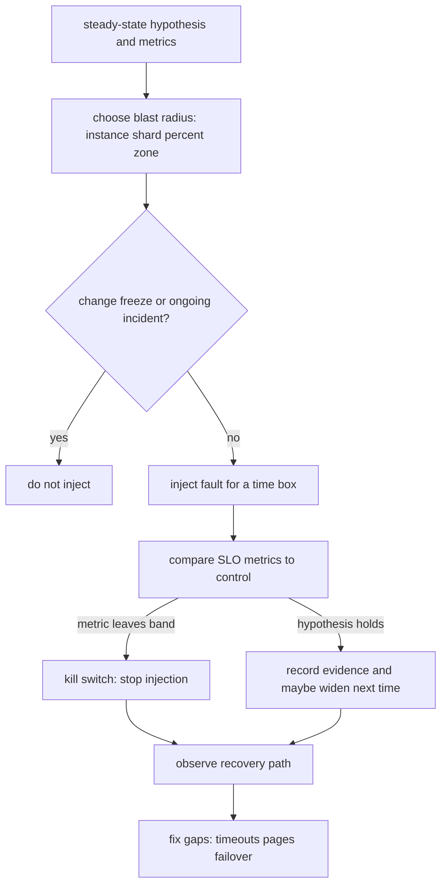

Chaos engineering is a disciplined way to learn whether the system you think you run is the system that is actually running. You state a steady-state hypothesis, you inject a failure inside a blast radius you can afford, and you watch the hypothesis hold or fail. Killing a random instance in production without that frame is not engineering. It is an unscheduled incident you chose to cause. The value is the evidence: failover works, timeouts fire, clients retry within budget, operators see the right pages. The cost is that the evidence is gathered on a live path, so the experiment has to be safer than the outage it is trying to prevent.

## Concept

### Blast radius and the steady-state hypothesis

Two ideas make chaos something you can defend to a risk committee. The first is the steady-state hypothesis: a measurable claim about healthy behavior. Not "the site is up," which is a slogan. Something you can plot: checkout success rate above 99.9 percent, p99 latency under two hundred milliseconds, stream starts per second within five percent of the control, replication lag under two seconds. If you cannot name that metric and its threshold, you are not ready to inject failure. You would have no way to know whether the experiment did harm, and no way to abort.

The second is blast radius. An experiment that can take the whole company down is not a probe. It is a disaster-recovery test you have not scheduled. Start with one instance, one shard, one percentage of traffic, one availability zone's worth of a non-critical service. Expand only after the small experiment is boring. Blast radius is also temporal: a five-minute kill is a different product from a forty-minute partition. Time-box the injection and make abort a single command that stops the fault and leaves the system to recover the way it would in a real failure, because recovery is part of what you are testing.

Steady state needs a control. If you can send a fraction of traffic through a cell or a slice that you do not perturb, compare the two. Global metrics hide a local disaster if the rest of the fleet is large. Per-cell, per-shard, and per-region dashboards are the experiment's instrumentation, not a nice-to-have.

### Designing an experiment, not a random kill

A useful experiment is a sentence: "If we lose the primary cache cluster in zone A, error rate stays within SLO because clients fail over to zone B and the origin holds the extra load for ten minutes." That sentence names the failure, the expected mitigation, the metric, and the duration. Then you implement the smallest injection that represents that failure: a security group deny, a tc netem delay, a pod kill, a dependency 500 from a fault injector, a clock skew on one host. The injection has to resemble the real fault. Killing a process is not the same as a disk full, a slow memory leak, or a network partition that still delivers some packets.

Prioritize experiments from production risk, not from tool features. The last three incidents, the dependencies without timeouts, the failovers you have never fired, and the "we think Kubernetes will reschedule it" comments in design reviews are the backlog. A catalog of twenty fancy faults you never run is theater. Three faults you run every week on the payment path are an engineering practice.

Game days are scheduled, human-heavy versions of the same idea: a scenario, a war room, a hypothesis, observers who are not the people typing. They are how you test runbooks and page routing, which no automated monkey will evaluate. Continuous chaos is the opposite shape: small, automated, in production or production-like, abortable, with the same gates as a deploy. You want both. Game days find the social holes. Continuous injection finds the regressions in the week you shipped a client without a timeout.

### Safety rails that make production chaos legal

Production is the only environment that has production traffic, production data shape, and production unknown-unknowns. Staging is still worth breaking; it is not a substitute. To keep production experiments legal you need rails that a tired operator cannot bypass by accident.

Abort is the first rail. A kill switch stops injection and is tested as part of the experiment. Automatic abort trips when the steady-state metric leaves its band, when error budget burn exceeds a threshold, or when a human hits the switch. The experiment runner must have permission to abort without a change-management ticket.

Scope is the second. Target a service, a cluster, a percentage, a zone. Never "the account." Never the database primary of a system whose failover you have not already tested in a smaller way. Feature flags and traffic shaping should let you confine the blast to canary traffic when you can.

Observability is the third. If the metric that defines steady state is delayed fifteen minutes, you cannot abort in time. Experiment dashboards need the same SLO signals the on-call already trusts, at a resolution of seconds to a minute. Logs and traces for the injected fault belong in the same view so you can tell "failover worked" from "nobody is sending traffic."

Change windows and freeze calendars are the fourth. Chaos during a sale, a migration, or someone else's incident is how you become the incident. The pipeline that injects faults should know about freezes. Humans should too.

### What the practice is not

Chaos engineering is not load testing. Load testing asks how much you can take. Chaos asks whether the mitigations you already paid for actually fire. Chaos is not disaster recovery of a region, although a well-run DR test uses the same hypothesis discipline. It is not an excuse to skip unit tests, contract tests, or staged rollouts. It is evidence about the remainder: the timeout that is only in one of three clients, the retry that storms, the page that never fires because the alert lives on a host that dies with the service.

It also does not prove the next novel failure. A monkey that kills instances will not find a poison message, a leap second, or a certificate that expires on a box you forgot. You still need other tests. Chaos is for the failures you already believe you handle.

## Trade-offs

| Approach | When it wins | Cost / risk |
| -------- | ------------ | ----------- |
| Staging-only fault injection | Unsafe dependencies, first experiments, data you must not touch | Misses production traffic shape, real fan-out, real operator paths |
| Automated production chaos with tight blast radius | Catching regressions in failover, timeouts, retries | Requires abort, metrics, and freeze awareness or you cause the outage |
| Game days | Runbooks, paging, cross-team coordination | Expensive in people; too rare if it is the only practice |
| Region or AZ evacuation tests | Validating the actual DR story | Wide blast radius; needs executive cover and a rollback |
| Random instance death with no hypothesis | Almost never | Noise, no learning, occasional avoidable SEV |

Staging is cheaper and lying. The cache is colder, the data is smaller, the clients are the staging clients, and nobody pages. Use it to debug the injector and to find the dumb bugs. Promote the same experiment to production at one percent or one shard when the hypothesis is about production behavior.

Automated production chaos earns its keep when it is as routine as a canary. That means the same change discipline: review the experiment, start small, watch, abort. Teams that "turn on Chaos Monkey" on Friday afternoon without a dashboard are not practicing. They are rolling dice.

Game days are how you discover that the runbook says "fail over to the replica" and the replica has been out of disk for a week, or that the person who knows the DNS cut lives in another timezone. Do them on a cadence, with a scribe, and convert every surprise into an automated check or a smaller continuous experiment.

## Diagram

## Failure modes

### Experiment without a hypothesis or without abort

You kill something, graphs move, nobody knows whether that movement is success or harm, and nobody can stop it quickly. Detection is an incident whose timeline starts with "we were running chaos" and whose dashboard was the general service dashboard, not an experiment view. Mitigation is a written hypothesis, a numeric abort threshold, a tested kill switch, and a rule that no production injection ships without those three.

### Blast radius larger than the mitigation

Taking a whole zone on a service whose clients are not zone-aware is not a test of zone isolation. It is a zone outage. Detection is SLO burn that matches the injection scope rather than a small slice. Mitigation is starting below the mitigation's claimed granularity: one pod before one node, one node before one zone, one zone before one region. Widen only when the smaller test is dull.

### Observability that cannot see the fault

Metrics average away the canary. Traces do not include the injected error. Pages fire on the wrong host. Detection is a post-hoc "we did not notice" in the write-up. Mitigation is experiment-scoped metrics, comparing to a control, and paging the same way a real failure would. If the page does not fire, that is a finding, not a convenience.

### Chaos during someone else's incident

Injection plus a real regression equals a blended outage you cannot debug. Detection is overlapping timelines and a freeze calendar nobody consulted. Mitigation is a freeze signal the injector reads, a human check against current incidents, and a default of "no" on Fridays, sales, and migrations.

### False confidence from a narrow fault

Killing pods all year and never partitioning the network produces a team that believes they are resilient to "failure" while their timeouts are still thirty seconds. Detection is incidents that look nothing like the experiment catalog. Mitigation is a backlog driven by real incidents and by dependency risk, including latency, clock, disk, and identity, not only process death.

## Real-world example

Netflix's Chaos Monkey is the public origin story, and it is still the right example if you read what they actually did rather than the meme. In the Simian Army era, Chaos Monkey terminated instances in production during business hours, on purpose, because Netflix had already bet on redundancy in AWS. The hypothesis was not "random death is fun." It was that a stateless service behind auto scaling, with multiple instances and no unique snowflake hosts, should see instance death as a non-event. If a service broke when a VM disappeared, that was a design bug to fix before an AWS host actually disappeared.

They constrained the blast. Chaos Monkey ran in working hours so humans were present. It was configurable per service so a team that was not ready could opt out, which is both a safety rail and a social signal: opting out was an admission that the service was not as resilient as the platform story claimed. Later tools in the same family moved up the stack: latency injection, zone awareness, and eventually larger game days that pulled traffic from an availability zone to see whether the regional story held.

The lasting architecture lesson is the coupling between chaos and design. Chaos Monkey only made sense because Netflix had already chosen cattle over pets, auto scaling, and multi-instance deployments. Injecting instance death into a single-node database with no failover is vandalism. The experiment validated a redundancy strategy that was already paid for. Teams that copy the monkey without copying the redundancy copy the outage. Teams that write a steady-state metric, start with one instance, abort on SLO burn, and turn every surprise into a timeout or a retry budget are doing the work Chaos Monkey was invented to force.

## What to remember

- Write a steady-state hypothesis with numbers before you inject anything.
- Bound blast radius in space and time, and keep a tested abort that trips on SLO burn.
- Use staging to debug the injector and production, in small slices, to test the real traffic path.
- Drive the catalog from incidents and untested failovers, not from random process death alone.
