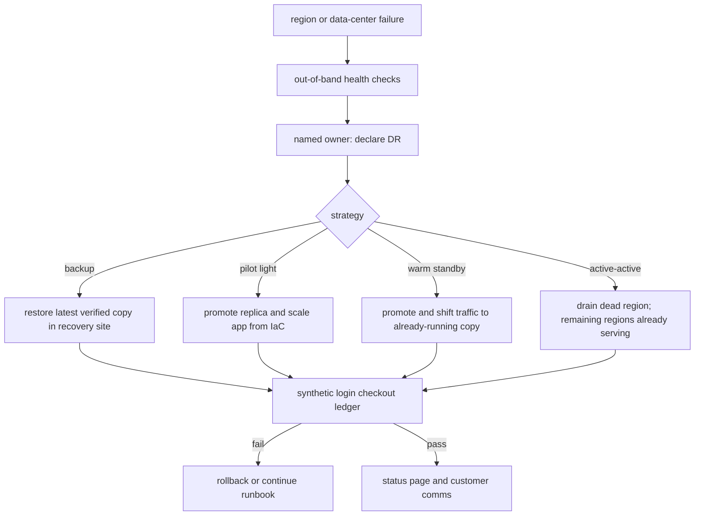

Disaster recovery is the plan for a failure that is larger than a single instance and longer than a reboot. Two numbers decide the plan: RPO, how much data you are willing to lose, and RTO, how long you are willing to be down or degraded. Backup, pilot light, warm standby, and active-active are four ways to buy those numbers. They are not a maturity ladder you climb for sport. Each one is a price in duplicate systems, people, and testing. Pick the price that matches the product, then test the restore, because an untested backup is a story you tell yourself about RPO.

## Concept

### RPO and RTO are product numbers

Recovery Point Objective is the maximum gap between the last durable copy you can restore and the moment of disaster. An RPO of twenty-four hours means daily backups might be enough and a day's work can vanish. An RPO of zero means synchronous replication into another failure domain, with the latency and cost that implies. Recovery Time Objective is how long until the service is usable again: DNS, cold starts, data replay, identity, and the human steps that never show up in a slide. An RTO of four hours with a restore that has never been timed is a fiction.

These numbers are not the same for every subsystem. Billing and ledger data often need a tighter RPO than recommendation caches. A marketing site can have a looser RTO than checkout. Write them per capability, not once for "the platform." Then convert them into engineering: snapshot interval, replication mode, failover runbook, and a test that proves the clock.

RPO and RTO trade with consistency and latency. Synchronous cross-region commit can give you a near-zero RPO and a worse p99 on every write. Asynchronous replication can give you a fast primary and a replica that is thirty seconds behind, which is a thirty-second RPO when the primary's last writes never left the building. Do not promise both a snappy local write and zero loss across a continent. Pick.

### Backup and restore

Backup is the cheapest DR strategy and the one teams think they have when they have a snapshot job. A backup is a point-in-time copy plus a restore path that completes inside the RTO. The copy can be volume snapshots, logical dumps, object-store versions, or WAL shipped to another region. The restore path is the system: IAM to read the bucket, a place to restore onto, schema compatibility, secret access, DNS, and a practiced operator. If restore takes fourteen hours and RTO is two, you do not have backups. You have archives.

Backups need a retention story and an integrity story. Retention is legal and product: thirty days, a year, a point-in-time window for the database. Integrity is checksums, periodic restore to a scratch environment, and a test that the backup is not empty. Encryption keys are part of the backup. A snapshot you cannot decrypt is as gone as a disk that melted.

This strategy wins when RTO is hours to days, RPO is minutes to hours, and the disaster is data loss or a region you will rebuild rather than fail over to live traffic. It loses when the business cannot be down for the restore window. It also loses when the backup lives in the same failure domain as the primary: same account, same region, same identity provider, same ransomware blast.

### Pilot light

Pilot light keeps a minimal version of the system running in the recovery site: a database replica, a small app tier, infrastructure as code that can scale out. You pay for data to be there, or almost there, and you pay a little for control plane. On disaster you scale the app, promote the replica, and re-point traffic. RTO is the scale-out plus promotion plus DNS. RPO is the replica lag.

The failure mode is that the light is too dim. AMIs are old, the Terraform does not apply, the replica has never been promoted, certificates are wrong, and the "small app tier" cannot pull images because the registry was in the failed region. Pilot light is a restore with a head start. Treat the promotion as a drill you run, not as a button you will find during the incident.

### Warm standby

Warm standby runs a scaled-down but complete copy in the recovery site: enough capacity to take traffic immediately, maybe not at full peak. Data is replicated continuously. Failover is promote and shift traffic, without a cold bootstrap of the whole platform. You pay more than pilot light because you are running real services, real caches to warm, real connections to partners. RTO shrinks to failover time. RPO remains replica lag unless you write synchronously.

Warm standby is the default I want for a revenue path that cannot wait for scale-from-zero but cannot justify active-active conflict resolution. Keep the standby honest: send synthetic traffic, run the same deploys, and fail over in drills. A standby that is a snowflake will fail in a new way on the day you need it.

### Active-active

Active-active serves production traffic in more than one region at once. RTO for a region loss can be "that region's users retry and land elsewhere," which can be seconds if DNS, anycast, or a client list is already multi-homed. RPO depends on how you write. Independent regional data stores with async replication mean conflicts. A globally synchronous store means you bought a latency and availability problem on every write.

This is the most expensive strategy in engineering, not only in compute. You need session and identity stories, a conflict rule for data, a deploy process that does not require both regions to be healthy, and a way to drain a region without splitting brains. Active-active is justified when the product cannot be down for a region event and the team can operate two of everything, including on-call. Copying stateless frontends active-active while leaving a single-region database is not active-active. It is a warm frontend in front of a single point of failure.

### The restore path is the system

Whichever strategy you pick, DR is a path: detect, decide, execute, validate, communicate. Detection is not "the region feels quiet." It is health checks from outside the region, from another cloud, from a status vendor. Decision is a named person and a pre-agreed trigger, because committee failover burns RTO. Execution is automation you have run. Validation is synthetic transactions that prove checkout, login, and the ledger, not just HTTP 200 on a homepage. Communication is the status page and the customers who will otherwise write the narrative for you.

## Trade-offs

| Approach | When it wins | Cost / risk |
| -------- | ------------ | ----------- |
| Backup and restore | Loose RTO, cost-sensitive systems, data archives | Restore untested; RPO of last good copy; same-region backups are theater |
| Pilot light | Medium RTO, want data warm, will scale on the day | Promotion and scale-out unpracticed; hidden config drift |
| Warm standby | Tight RTO without dual-write complexity | Paying for idle-ish capacity; standby rot if not in the deploy path |
| Active-active | Region loss must be a non-event for users | Conflict resolution; 2x operations; global consistency tax |
| Single region, hope | Never, except truly disposable systems | One flooding, one IAM event, one provider outage ends the product |

Cost is not only the replica's invoice. It is the people who can promote a database, the pipeline that deploys to two regions, the contract with a DNS provider that is not the same as your compute provider, and the hours of drills. A warm standby that nobody has failed over in a year is priced like insurance you will not be able to file.

Data gravity dominates the choice. Stateless services fail over cheaply. The database, the object store, the search index, and the message log are the actual DR project. Design those first. The app tier will follow.

RPO of zero across regions is a rare requirement and an expensive one. Most businesses can lose a few seconds of in-flight writes if they can also reconcile. Most cannot lose a day. Put the money on tested asynchronous replication plus backup integrity before you buy a global consensus round trip.

## Diagram

## Failure modes

### Untested backups and a surprise RPO

Snapshots exist. Restore has never been run, or last ran on a different schema. Detection is the DR drill that fails, or the incident in which it fails for real. Mitigation is automated restore to an isolated account on a cadence, checksum verification, and a clocked RTO from "declare" to "synthetic checkout green." Count that clock as the real RTO.

### Replication lag as silent RPO violation

Async replica is thirty minutes behind because of a load spike or a paused slot. You fail over and lose thirty minutes of orders. Detection is replica lag as an SLO, paged like error rate. Mitigation is lag budgets, parallel replicas, and a policy for "do not fail over if lag exceeds RPO unless the primary is gone and we accept the loss." Write that policy before the event.

### Failover that cannot complete inside RTO

DNS TTLs of an hour, certificate issuance, manual IP allow lists, partner callbacks still pointing at the old region. Detection is a drill timeline that spends RTO on paperwork. Mitigation is low TTLs or anycast, dual-registered partners, secrets already in the recovery site, and automation. Humans should confirm, not invent, the steps.

### DR in the same blast radius

Backups in the same cloud account, same identity provider, same region. Ransomware, a bad IAM policy, or a regional control-plane event takes primary and recovery together. Detection is an architecture review that asks "what if this account is gone." Mitigation is another account, another region, another provider for identity and DNS, and immutable, isolated backup copies.

### Split brain and conflicting truth

Two primaries after a false failover, or active-active without a conflict rule. Detection is divergent balances, duplicate orders, or operators arguing about which database is real. Mitigation is fencing: the old primary must not accept writes once the new one is promoted. Use lease, STONITH, or a consensus lock. For active-active, define merge rules per entity and test them with concurrent writes.

## Real-world example

GitLab's 2017 production database incident is the public DR story I still send to teams who think snapshots equal recovery. An administrator deleted the primary database directory on a live system. Backups that were believed to exist were missing, incomplete, or unusable in the way the team needed. Replication was not in a state that could simply be promoted. The company spent many hours recovering from a chance copy on a replica disk, while a very public RPO and RTO unfolded on a status thread.

The engineering content of that incident is not "do not run rm." It is that RPO was assumed to be "last backup" and the restore path had not been proven against the failure they actually had. Backup jobs that succeed in a green check are not a restore. Replication that is "usually on" is not a promotion drill. Secrets, disk snapshots, and the question of which host is allowed to accept writes are the DR system. GitLab's later write-up is valuable because they treated those as product defects: tested restores, clearer replication, better safeguards on destructive actions.

When I set DR strategy now, I use that incident as the negative template. We time a restore. We page on replica lag. We isolate backups from the production account. We write RPO and RTO per capability and refuse a strategy whose drill cannot meet them. Backup, pilot light, warm standby, or active-active is then a choice we can defend, not a label on a diagram.

## What to remember

- Write RPO and RTO per capability, then pick backup, pilot light, warm standby, or active-active to match those clocks.
- The restore, promotion, and traffic-shift path is the DR system; an untested copy is not an RPO.
- Keep recovery in a different failure domain than production, including identity and DNS.
- Drill with a clock and synthetic transactions; failover policy including fencing belongs in writing before the event.
