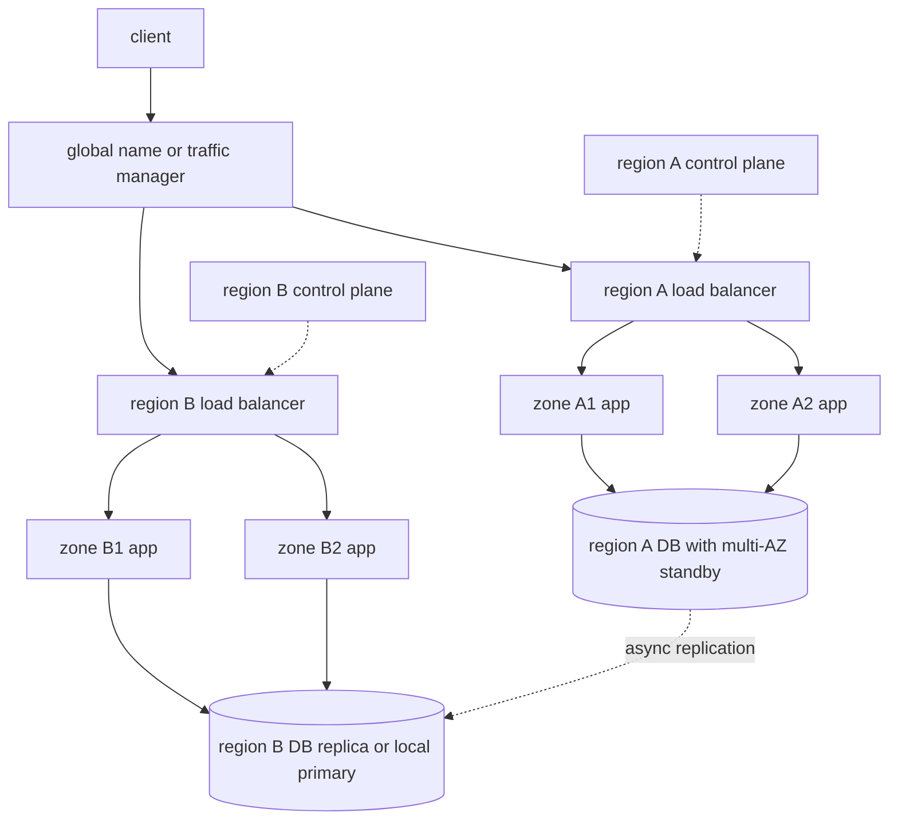

Availability zones and regions are different failure domains, sold under similar names. A zone is a data-center-scale boundary inside a region: separate buildings, power, and cooling, with a short fat network between them. A region is a geographic and control-plane boundary: separate API endpoints, separate physical distance, separate classes of disaster. Multi-AZ is how you survive a building. Multi-region is how you survive a geography, a regional control plane, and a class of operator error that takes an entire regional product with it. Deploying the same Terraform twice does not give you the second thing if the data, identity, and DNS still live in the first.

## Concept

### Availability zones and regions as failure domains

An AZ failure looks like a building problem: power, cooling, a fiber cut inside the metro, a flood, a bad deploy that only landed on the hardware in that zone. The other zones in the region are designed to keep running, and the network between them is low enough latency that a database can often replicate synchronously. That is why multi-AZ is the default for anything that already pays for a managed database. You are buying the failure domain the provider actually isolates.

A region failure looks like a much larger problem: a wide network partition, a regional control-plane outage, a software bug in a regional service, a hurricane that takes several buildings, a configuration that applied to every AZ because you targeted the region. Latency between regions is tens of milliseconds on a good path and worse across oceans. Synchronous commit across regions is a product decision, not a checkbox. The control plane is a separate domain. If you cannot launch instances, describe load balancers, or rotate secrets because the regional API is sick, your "multi-AZ" app is intact and you still cannot operate it.

Treat three domains in design reviews: instance, zone, region. Then add the ones vendors under-advertise: account, identity provider, DNS, package registry, and the CI system. Multi-AZ does not help if IAM is global and you delete the role. Multi-region does not help if both regions pull images from a registry in the dead one.

### What multi-AZ actually buys

A production service in one region should run in at least two zones, preferably three, because a two-zone system loses quorum stories and loses the ability to take a zone down for maintenance. Stateless pods spread with topology constraints. Load balancers health-check per target and stop sending to a dead zone. The data tier is the part that matters: a multi-AZ database with a synchronous standby in another zone, or a quorum that can lose one zone and still write.

What you get is automatic or fast failover for zonal loss, with RPO near zero for the database that was synchronous, and RTO of seconds to minutes if the client retries and the DNS or NLB does not pin to the dead zone. What you do not get is protection from a regional API outage, a bad IAM change, a region-wide service incident, or a bug you rolled to every zone at once. Rolling deploys that land in all zones in ten minutes have a blast radius of the region. Canaries per zone, pod disruption budgets, and a pause between zones are how multi-AZ stays multi-AZ during your own changes.

Sticky sessions and zonal data gravity undo the purchase. A cache that only lives in zone A, a disk that cannot move, a license daemon in one building: the app is nominally spread and still dies with that building. Audit for zonal singletons the same way you audit for single instances.

### What multi-region actually costs

Multi-region means users or traffic managers can be served from more than one region, and a region can be lost without losing the product. The cost starts with data. You replicate the database, the object store, the search index, and the queue. Async replication is the usual honest design: each region has a local write path or a primary region for writes, and the others lag. Sync replication across regions is possible and will show up in p99. Conflict resolution is the tax on active-active writes.

Then you pay in operations: every deploy, schema migration, certificate, partner callback, and rate limit, twice. CI must ship to the surviving region while the other is gone. On-call must know which region is primary for which data.

Then you pay in product. Latency to the nearest region is a feature. A user in Tokyo talking to a region in Virginia is a different product from a user talking to Tokyo. Session stickiness, data residency, and "read your writes" after a POST all get harder. If you cannot explain where a user's row lives and how a failover changes that, you are not multi-region. You are running a hobby copy.

### Data, identity, and the control plane

Compute is the easy replica. Copy the container. Data is the hard replica: choose a primary-secondary with planned failover, or active-active with merge rules. Object storage often replicates asynchronously; a 404 on a newly written image in the other region is a real bug if the HTML was served globally. Queues are usually regional; draining a region's queue on failover is a runbook, not magic.

Identity is often accidentally global. An IdP outage or a deleted OIDC application is a multi-region incident even if compute is fine. DNS is the same: a single registrar, a single Route 53 hosted zone with a single-person MFA device, is a regional-looking architecture with a global choke. Put DNS and identity in a failure domain you could still use if a compute region vanished.

Control plane versus data plane is the distinction that surprises teams during provider incidents. The data plane (packets to your load balancer, disks attached, VMs that are already up) can keep running while the control plane (launch more, change DNS, scale, attach a new volume) is broken. Multi-AZ in one region shares a regional control plane. Multi-region gives you another control plane, if you already have capacity and credentials there. Autoscaling during a regional control-plane event will not save you. Pre-provisioned headroom will.

### Failover is a product, not a DNS toggle

Shifting traffic between zones is usually automatic: unhealthy targets fall out. Shifting traffic between regions is a decision: health checks from multiple vantage points, a threshold, a human or an automated executor, and a way back. DNS failover with long TTLs is a slow RTO. Anycast or a global load balancer with health checks is faster and still needs the origin to be ready, including warm caches and connection pools.

Clients that cache a single regional endpoint forever will not honor your failover. Mobile apps with hardcoded URLs are a regional coupling. Use a small, highly available bootstrap that lists regions, or a global name that you actually operate.

## Trade-offs

| Approach | When it wins | Cost / risk |
| -------- | ------------ | ----------- |
| Single AZ | Labs, truly disposable workloads | One building event is the outage |
| Multi-AZ, single region | Default for production; survive zonal loss with near-zero RPO on sync data | Regional control plane and regional product bugs still win |
| Active-passive second region | Tight-ish RTO without dual-write | Idle cost; failover drills; replica lag is RPO |
| Active-active multi-region | Region loss must be a user non-event; latency to nearby users | Conflicts, 2x ops, data residency complexity |
| Multi-cloud as if it were multi-region | Almost never as a first step | Two providers' failure modes plus your glue |

Multi-AZ is not optional for production in a public cloud that offers zones. Skip it only when the data is ephemeral and the users are internal.

Multi-region is optional until the business writes down a regional RTO. Many products are better served by a rock-solid multi-AZ region, tested backups in another region, and a four-hour rebuild than by a half-done active-active. Half-done multi-region is worse than none: you pay, you think you are covered, and the failover has never moved traffic.

Latency and consistency set the data topology. If users are on one continent and writes must be linearized, a single-region primary plus multi-AZ is a clean design. If users are global and reads dominate, regional read replicas plus a write region can be enough. If writes must happen locally in two continents, you are in CRDT, conflict, or partitioned-product territory. Be explicit.

## Diagram

## Failure modes

### Zonal spread that is only on the app tier

App pods in three zones, database or Redis in one. The zone event takes the data and the app "spread" does nothing. Detection is a topology report: where primaries, disks, and licenses live. Mitigation is multi-AZ for every stateful dependency that is on the request path, and caches that can rebuild from a replica or origin without that zone.

### Regional coupling through a hidden singleton

Image registry, Terraform state, secrets manager, CI, or a third-party API in one region. Failover compute comes up and cannot pull images or read the state file. Detection is a dependency map that includes build and operate paths, not only runtime calls. Mitigation is replicating those dependencies or hosting them in a third location, and a drill that fails a region including the registry.

### Split-brain after a false regional failover

Health check flaps, both regions accept writes, data diverges. Detection is conflicting rows and dual primaries. Mitigation is fencing the old primary, conservative health checks from multiple regions, and a human gate on regional failover unless the data layer can tolerate dual writes.

### Control plane outage while data plane is healthy

You cannot scale, cannot replace a dead node, cannot change DNS, and dashboards lie because they use the same API. Detection is provider status plus your own out-of-band checks. Mitigation is pre-provisioned capacity, data-plane-only operation runbooks, and admin paths that do not require the sick regional API.

### Rolling deploys as a region-wide blast

A bad binary lands in every AZ in minutes because the pipeline treats the region as one unit. Detection is error rate in all zones together after a release. Mitigation is zonal or cellular rollouts, canaries, and a stop button that does not depend on the new binary being healthy.

## Real-world example

AWS's public story for Amazon.com and for its own regional services is multi-AZ as the baseline, not as an upgrade. An Elastic Load Balancing target group with instances in multiple zones, an RDS Multi-AZ standby, and an S3 design that replicates within the region are the ordinary shape. When a single AZ has a power or network event, those services are expected to continue on the remaining zones with failover that customers notice as a brief retry, not as a rebuild.

That design was paid for in the data layer. RDS Multi-AZ uses a standby in another zone and a failover that updates DNS to the standby. The RPO for committed writes is intended to be near zero because replication is synchronous at that distance. The RTO is the failover plus client reconnect. Application owners who put all of their instances in one AZ, or who disabled the Multi-AZ flag to save money, discovered during real zone events that they had opted out of the failure domain AWS actually isolates.

Multi-region at AWS is a different product: S3 cross-region replication, DynamoDB global tables, Route 53 health checks, and explicit second-region stacks. Amazon.com's retail site has historically been careful about which capabilities are regional versus global, because a naive dual-write of every cart and every order is a consistency project. The architectural lesson I take from their public multi-AZ guidance is to buy the zonal failure domain completely — compute, load balancing, and the database — before spending engineering on a second region. A second region that still has a single-AZ database in the primary is not a regional strategy. It is a copy of the frontend.

Surviving a zone event is table stakes: Multi-AZ on, clients retry. Surviving a region event is a program: failover already drilled, data replicated, identity and DNS out of the hole.

## What to remember

- Zones cover building-scale failure with low latency; regions cover geography and regional control planes at much higher cost.
- Spread stateful systems, not only app pods, and hunt zonal and regional singletons including registry, DNS, and identity.
- Multi-AZ is the production default; multi-region is a program you drill, not a second Terraform apply.
- Regional failover needs fencing, out-of-band health, and a data story; DNS alone is not a strategy.
