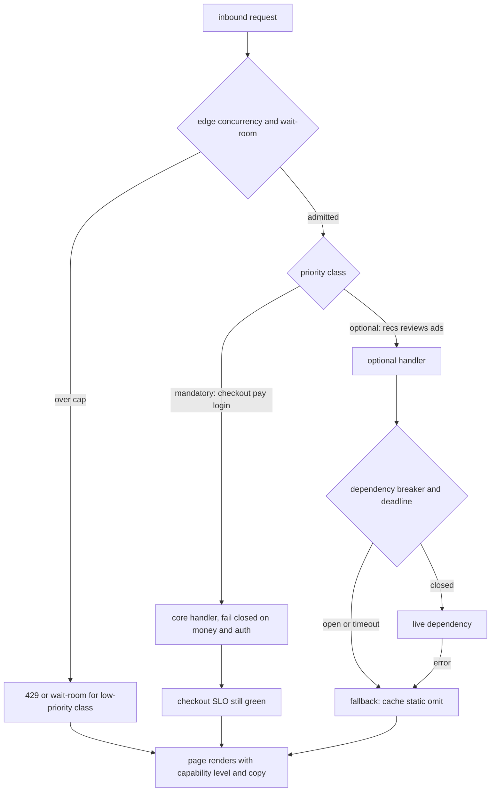

Graceful degradation is a planned, user-visible mode in which the system stops doing some work on purpose so it can keep doing the work that still matters. It is not a catch block that returns null. It is a product contract: which capabilities are mandatory, which are optional, what the user sees when an optional one is gone, and which traffic you will refuse so the mandatory path stays inside SLO. Load shedding and fallbacks are the two mechanisms. Shedding says no to some arrivals. Fallbacks say yes with a worse answer. Together they turn a dependency failure or a load spike into a worse product instead of an absent one.

## Concept

### Shedding and fallbacks

Load shedding drops or defers work before it consumes a scarce resource: a thread, a connection, a lock, a partner rate limit. You shed at the edge when the queue is past a watermark, when concurrency is at the bulkhead, when CPU or outstanding requests cross a line you measured in load tests. The response is explicit: 429, 503 with Retry-After, a wait-room, a "try again." Silent timeouts are not shedding. They are the failure shedding exists to prevent.

Fallbacks substitute a degraded answer for a missing one. The recommendation panel becomes a non-personalized list. The review widget becomes a placeholder. The price is cached. The avatar is a default. The search ranking drops from machine-learned to a simpler match. A fallback must be something you would ship on a slow day, not an empty JSON document that makes the client throw. It also must be cheaper than the call it replaces. A fallback that hits a colder, larger database is how you turn one outage into two.

Use both, in layers. Shed what you cannot serve even in degraded form. Fall back what you can serve worse. Never fall back a correctness-critical path: charging a card, recording a legal consent, authorizing a permission. There the degraded mode is a clear error, not a guess.

### Capability levels, not binary up or down

I want a short ladder of modes, named, and tested. Level 0 is full product. Level 1 drops expensive personalization, extras, and non-critical writes such as analytics. Level 2 serves from cache, static lists, and precomputed pages; mutating APIs may go read-only. Level 3 is the keep-the-lights-on path: login, browse a stale catalog, complete an in-flight checkout, or whatever the business named as the last remaining job. You do not invent the ladder during the incident. You flip it with a flag, a breaker, or an automatic policy tied to SLO burn.

Each level has an owner, a user-facing copy, and a test. If marketing never agreed that recommendations can vanish, the on-call will not flip the flag. If the client assumes a field is always present, the fallback becomes a white screen, which is not graceful. Contract tests for degraded payloads belong next to the happy-path tests.

Automatic promotion down the ladder should be conservative and automatic promotion back up should be slower. Oscillating between personalized and generic every thirty seconds is a worse product than sitting on generic for ten minutes. Hysteresis belongs here the same way it belongs in autoscaling.

### Where to shed: edge, application, dependency

Edge shedding protects the whole site: a wait-room, bot throttling, WAF rate limits, API gateway 429s. It is coarse and cheap. Use it for overload you can see in global concurrency or queue age. Do not use it as the only tool; it cannot distinguish "this tenant is hot" from "this URL is hot" unless you built that key.

Application shedding is a bulkhead plus a priority. Interactive checkout gets a slot. Report exports wait or fail. Background refresh of a widget is the first to die. This is where graceful degradation is actually designed: per-endpoint budgets, per-tenant caps, and a rule that list endpoints may degrade before pay endpoints.

Dependency shedding is the circuit breaker and the retry budget. When the recommendation service is down, stop calling it. When it is slow, stop waiting. The fallback lives in the caller. A mesh timeout without a fallback is a fast 500, which is an improvement on a hung worker and still a failed page unless the UI can omit the panel.

Priority matters more than people admit. Random 429s punish paying users and bots equally. Shed anonymous browsing before authenticated checkout, or the reverse, depending on the business; write it down. Shed retries and crawlers first. Shed new work before in-flight work. A fair queue with classes is an implementation. The classes are a product decision.

### The user-visible contract

Degradation that only engineers can see is incomplete. Users need a truthful, calm signal: "recommendations are temporarily unavailable," "showing cached prices," "checkout is delayed." Lying with a spinner until the gateway times out trains users to retry, which is extra load. Empty regions of a page without explanation look like a broken app, which they will report as an outage even if cart and pay still work.

Clients are part of the system. A mobile app that crashes when a JSON field is missing converts your graceful API into an ungraceful client. Optional widgets, feature flags on the client, and default UI for missing panels are required. Server-driven UI or honest optional fields beat a rigid schema that cannot shrink.

Support and status pages are part of the contract too. If you are in level 2, the status page should say so before the first tweet. Internal dashboards should show the current capability level as a first-class signal, next to error rate, so on-call does not "fix" a degraded mode by turning personalization back on into a burning dependency.

### Coupling degradation to SLOs and money

You degrade to protect an SLO, not because a breaker library had a default. Name the SLO that authorizes each level: p99 of checkout, success rate of pay, availability of read-your-writes for the cart. When that SLO is in danger, drop the features that are not on it. When the SLO is healthy, do not stay degraded out of caution; the product is the point.

Cost is a reason to degrade under load you will not pay to serve. A report that scans cold data can wait. A crawler that wants every SKU can get 429. A user in checkout cannot. If finance will not fund peak capacity for a rare spike, graceful degradation is how you stay honest instead of pretending HPA will appear in time.

## Trade-offs

| Approach | When it wins | Cost / risk |
| -------- | ------------ | ----------- |
| Fail closed, no fallback | Money, auth, legal writes | User-visible outage when the dependency is down |
| Cached or static fallback | Read-mostly extras: recs, reviews, avatars, search ranking | Stale content; cache stampede if you stampede back |
| Omit the panel | UI can reflow; client is optional-aware | Looks broken if the client is not optional-aware |
| Load shed with 429 / wait-room | Overload; protects mandatory paths | Angry users; unfairness if you shed the wrong class |
| Read-only mode | Inventory and catalog still useful; writes would corrupt | Lost revenue; clients that cannot handle 403 on POST |

Fail closed is the right default for anything you cannot undo. A guessed authorization is an incident. A guessed charge is a finance incident. Graceful degradation does not mean "always return 200." It means the failure mode is designed.

Stale fallbacks need a bound. A price from yesterday can be fraud or a regulatory problem. A recommendation from this morning is usually fine. Put TTLs and a "as of" rule on every cached degraded path. Search that falls back to a dumb index is better than search that 500s, unless the dumb index returns forbidden documents.

Shedding without fairness becomes a DDoS you run against your best customers. Token buckets per user, separate pools for checkout, and bot detection are the difference. A global 50 percent coin flip is easy and wrong.

## Diagram

## Failure modes

### Fallback that is heavier than the primary

The recommendation service dies. The fallback scans the catalog database, which is also the checkout database. Detection is the core SLO falling when an optional dependency fails, and a traffic spike on the fallback store. Mitigation is a fallback that is cheaper: a precomputed list in object storage, a small cache with a long TTL, or omit. Load-test the degraded path. If it cannot hold the traffic of the primary, it is not a fallback.

### Silent nulls and client crashes

The API omits a field. Old clients throw. Detection is client crash analytics aligned with breaker opens, not server 5xx. Mitigation is schema compatibility: optional fields, default objects, and client UI that treats missing widgets as empty space plus a string. Version the degraded payload in contract tests.

### Shedding the wrong traffic

You 429 checkout because it is expensive, and let bots crawl. Detection is conversion dropping while overall QPS looks "protected." Mitigation is explicit classes, separate bulkheads, and dashboards of shed rate per class. Review the class map with product, not only with SRE.

### Oscillation and stampede on recovery

Breakers close, every client refetches personalization, the dependency dies again. Detection is a square wave on error rate and a thundering herd on the dependency at the same timestamps as half-open. Mitigation is jittered retry, cached fallbacks that stay in place for a cooldown, and half-open probes that do not release the full waiting set.

### Degraded mode that never ends

A flag stays on. Caches stay stale. Nobody owns the return to level 0. Detection is a capability-level metric that is not level 0 for days without an incident ticket. Mitigation is an expiry, a dashboard, and a post-incident item that restores the product, not only the dependency.

## Real-world example

Amazon.com's product and homepage during Prime Day and other peaks is the public illustration I use for shedding plus fallbacks. The pages are a composition of many services: price, inventory, reviews, recommendations, ads, delivery promise. Not all of them have the same SLO. Playbacks of Amazon's own architecture talks describe a storefront that can keep serving product detail and checkout when secondary widgets fail, and that will drop or simplify non-critical personalization rather than let those calls consume the same thread pool as Add to Cart.

The mechanism is capability-shaped even when they do not use that word on stage. A recommendation unavailability should not 500 the product page. A review service timeout should not block the buy box. Cached or less personalized modules fill the space. At the edge, Amazon has also described admission control for extreme events: protecting the purchase path means some other traffic waits. That is shedding with priority, not a random coin flip across all URLs.

The design only works because the page is allowed to be incomplete. Each widget is a failure domain. Timeouts are short on the optional calls. The HTML or JSON the client renders has to tolerate missing modules. If the product page were a single synchronous orchestration that required every backend to answer, Amazon would have built the opposite of graceful degradation: a system as fragile as its slowest, least important dependency. The retail lesson is compositional UI plus ranked capabilities plus an edge that will say no to low-priority load so the cart still says yes.

## What to remember

- Rank capabilities; shed or fall back the ones that are not on the SLO you are protecting.
- Fallbacks must be cheaper than the primary and safe for the client schema; fail closed on money and auth.
- Shed with priority classes at the edge and bulkheads in the app, not with a global coin flip.
- Name the capability level, show it to users and on-call, and rehearse the path back to full product.
