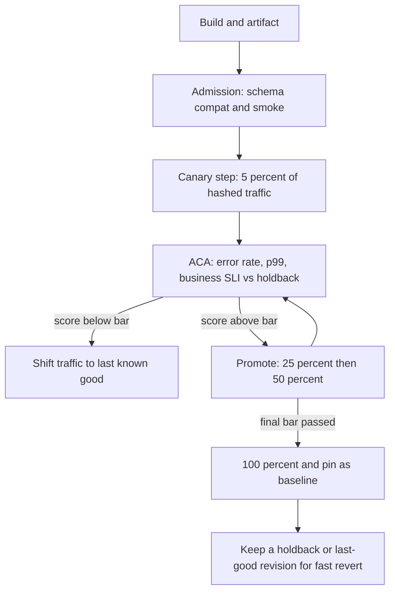

## Concept

A release is a change in production that users can feel. Binary, config, schema, and traffic policy are all releases. The question is not whether you ship. The question is how much of the fleet, and for how long, is allowed to run a version whose behavior you have not yet measured under real load. Blue-green, canary, and progressive delivery are three answers to that question. They are not synonyms, and treating them as a slider on a dashboard is how teams discover they had no experiment, only a slower outage.

### Blue-green is a cut, not a probe

Blue-green keeps two complete environments that can serve production. Blue is live. You deploy green, run smoke checks, then cut the edge — DNS, load balancer, or service mesh — from blue to green. Rollback is another cut. The unit of risk is the whole environment. You pay for two stacks, two databases or a shared database with careful dual-write rules, and a cut that is fast but binary.

Blue-green wins when the failure mode is "this build is unusable" and you can detect that before the cut: a crash loop, a missing migration, a broken TLS cert. It loses when the failure mode is statistical. A 2% error-rate regression or a tail-latency cliff on one tenant will not show up in a green environment that has never taken production mix.

The cut itself is an incident if sticky sessions, in-flight work, or a schema that only the new binary understands sit on the old stack. Blue-green is a traffic switch. It is not a compatibility protocol. If the two versions cannot coexist for the duration of the drain, you do not have blue-green. You have a flag day with extra hardware.

### Canary is a statistical experiment

A canary sends a small, representative slice of production traffic to the new version while the rest of the fleet stays on the last known good. The slice is the sample. Metrics on that slice are compared to the baseline — the rest of the fleet, or a holdback that is also production but pinned to the old version. Promotion happens because the comparison passed, not because a timer expired.

The design is the sample, the metrics, and the decision rule. A canary that only serves internal employees is a dogfood environment. A canary that only serves one region is a regional deploy. A canary that hashes 5% of request ids onto the new pods, then compares error rate, p99 latency, and a business counter such as checkout completion against the remaining 95%, is an experiment. The last of those is what the word is for.

Baselines matter more than the canary size. If you compare the canary to last week's Tuesday, you will page on a holiday and ship a regression on a sale. Compare contemporaneous traffic. Prefer a holdback over a historical window. Size the canary so that the metrics you care about have enough events in the bake window to tell a 2% regression from noise. A 1% canary on a service that does 20 requests per minute cannot answer a latency SLO in fifteen minutes. Either raise the sample, lengthen the window, or admit you are guessing.

### Progressive delivery is a control loop

Progressive delivery is canary plus automation plus a sequence of steps. Traffic or replica share moves 1% → 5% → 25% → 50% → 100%, and each step is gated on the same comparison. The controller — Flagger, Argo Rollouts, Spinnaker, or a mesh policy — is the thing that promotes, pauses, or rolls back. Humans set the policy. The loop executes it at 2 a.m.

The loop is only as good as the analysis. Automated canary analysis (ACA) scores the candidate against the baseline on a declared set of metrics, with thresholds and a bake time per step. A score below the bar rolls back. A score above it advances. Metrics you did not declare are invisible. A canary that watches HTTP 5xx and ignores a drop in a business counter will promote a build that cannot charge a card.

Progressive delivery also covers feature flags as a traffic axis. A binary can be 100% deployed while a flag still admits 5% of users to a new code path. That is a canary of behavior, not of pods. Use it when the expensive part is the product change, not the artifact. Do not use it as an excuse to skip artifact-level canaries: a flag cannot save you from a runtime crash in process startup, a bad native library, or a migration that runs on deploy.

### What must be identical besides the binary

The canary that lies is the one whose environment does not match production. Different CPU limits, a warmer cache, a missing sidecar, or a config flag that only exists on the baseline will green-light a bad build. Treat compute, mesh version, and runtime config as part of the candidate. If you cannot run the canary on the same instance class and config surface as the baseline, you are measuring the lab.

Schema and protocol compatibility are the other half. A canary that writes a new column the old binary cannot read cannot roll back by shifting traffic. Expand-and-contract the schema first. Canary the binary second. Feature flags third. That order is not taste. It is the only order in which a failed analysis leaves you with a cluster that still serves.

### Who is allowed to halt the rollout

Name the halt conditions before the first step. Error-rate delta, latency delta, saturation on the candidate, a failed synthetic, a drop in a named business metric, and a human abort. Wire the human abort to the same controller the metrics use. A Slack message that nobody is on call to read is not a halt condition. Record who overrode a halt, and treat an override as an incident input, not a convenience.

## Trade-offs

| Approach | When it wins | Cost / risk |
| -------- | ------------ | ----------- |
| Recreate / all-at-once | Tiny services, no user-facing SLO, or a change that cannot coexist | Full-fleet blast radius; rollback is another full deploy |
| Blue-green cut | Binary "this build is dead" failures; need instant rollback of all traffic | Double capacity; no statistical signal; schema and session traps on the cut |
| Manual canary | Low traffic, high judgment, or metrics that are not yet automated | Humans sleep; bake windows stretch; promotion by calendar |
| Automated progressive delivery | Steady traffic, declared SLIs, a controller you trust | Analysis gaps; flaky metrics halt good deploys; policy becomes load-bearing |
| Flag-gated behavior canary | Product risk in a path, artifact already proven | Flag debt; cannot catch process-level failure; eval in the request path |

Blue-green looks clean because the diagram has two boxes and one arrow. The cost sits in the database and in the cut. Shared storage means a bad migration is not isolated. Separate storage is a replication and cut-over problem harder than the deploy. I use blue-green for edge and for a new cell with a proven drain. I do not use it as a substitute for a canary on a shared microservice fleet.

Automated progressive delivery looks expensive because you must instrument SLIs, run a controller, and keep analysis configs next to the service. The alternative is an on-call engineer watching graphs for forty minutes, which does not happen at 2 a.m. across fifty services. Once a 5% sample is statistically meaningful in a bake window you can afford, automation is cheaper than heroics. Below that traffic, a manual canary with a checklist is more honest than a controller scoring noise.

Feature flags and pod canaries compose. They do not replace each other. A crash in `main()` is an artifact problem. A bad ranking model is a behavior problem. Gate the artifact on fleet health. Gate the model on a flag and a business metric. Mixing them into one "progressive" checkbox hides which axis failed.

## Diagram

## Failure modes

### Unrepresentative canary traffic

The candidate sees internal users, one region, one device class, or cache-warm GETs, while production is logged-out, mobile, and write-heavy. Analysis is green. Promotion is an incident. Detection is a comparison of canary request mix to fleet mix: path histogram, tenant tier, cache-hit ratio, and geo. A canary whose path histogram does not match the fleet is not a canary.

Mitigation is consistent hashing on a stable request id so that the same users, paths, and tenants land on the candidate in proportion, plus a mix check that fails the step when the distributions diverge beyond a bound. Do not pin the canary to a "safe" subset because you are nervous. Nervousness belongs in a smaller percentage, not in a biased sample.

### Analysis that cannot see the failure

The controller watches 5xx and CPU. The bug is a silent wrong answer, a dropped event, or a 10% drop in conversions. Detection is the absence of a business SLI in the analysis config, which you find after the incident, and a post-deploy dip in a dashboard nobody pages on.

Mitigation is to declare the canary metrics next to the SLO. At least one user-facing SLI and one business counter must be in the score. If you cannot compute that counter on a five-minute window, you are not ready to automate promotion. Keep a human gate on those services until the counter exists. Adding more infrastructure metrics to a score that already missed the outage does not help.

### Rollback that is slower than the blast

A failed step should shift traffic off the candidate in seconds. If rollback means a new pipeline, a Terraform apply, or a human approval at 3 a.m., the canary did not reduce blast radius. It delayed it. Detection is time-to-revert measured in the controller, not in the wiki. If p95 revert is longer than the bake window, the design is inverted.

Mitigation is to keep the last known good revision running and let the controller weight traffic back to it. Do not delete the old ReplicaSet until the new one is pinned. Schema must already be compatible with both. Practice the abort on a non-event so the path is not theoretical.

### Sticky sessions and long-lived connections

A 5% pod canary with session affinity sends 5% of new connections and then holds them. A bad build pins a set of users for the life of the socket. Analysis on request-level error rate can look fine while those users are stuck. Detection is connection age versus request mix, and user-level error rates that do not match request-level rates.

Mitigation is to canary at the request layer in the mesh when the protocol allows, drain connections on each step, and include user-level failure in the score for session-heavy services. For streaming and gRPC bidirectional calls, treat a step change as a drain, not as a weight edit.

## Real-world example

Netflix made automated canaries a production control loop rather than a checklist. Spinnaker runs the pipeline. Kayenta (and the ACA stacks that followed its model) scores a canary deployment against a baseline on metrics pulled from the telemetry backend. The canary is not "a couple of instances in us-east-1." It is a slice of production traffic, a bake interval, and a statistical comparison on error rates, latency, and service-specific metrics the owners declared.

The interesting operational choice is what happens when the score is ambiguous. Netflix's public writing is consistent: fail closed. A canary that cannot prove it is safe does not promote. That is the opposite of a timer that ships at 100% because the pipeline was green. Flaky metrics halt deploys. The platform response is not to lower the bar. It is to make the analysis config a reviewed artifact, keep a contemporaneous baseline, and give owners a standard metric set so that "we forgot to watch what users feel" is a platform gap.

Progressive delivery at that scale also shows the limit of pod weights. Some changes are flags, some are artifacts, some are streaming protocol changes that cannot be a 5% ReplicaSet. Netflix's lesson is not "always canary." It is "every change has a blast radius, a metric, and a revert path, and the controller executes the policy you wrote when you were calm." Copy the loop. If your traffic cannot fill a 5% sample in the bake window, you still need the comparison — you cannot invent statistical power.

## What to remember

- Blue-green is a fast cut of a whole environment; a canary is a measured sample against a contemporaneous baseline.
- Progressive delivery is a control loop: declared metrics, bake windows, and a revert that does not wait for a human pipeline.
- An unrepresentative sample, a missing business SLI, or a schema the old binary cannot read makes the canary a slower outage.
- Keep last-known-good running until the candidate is pinned; rollback is a traffic shift, not a rebuild.
