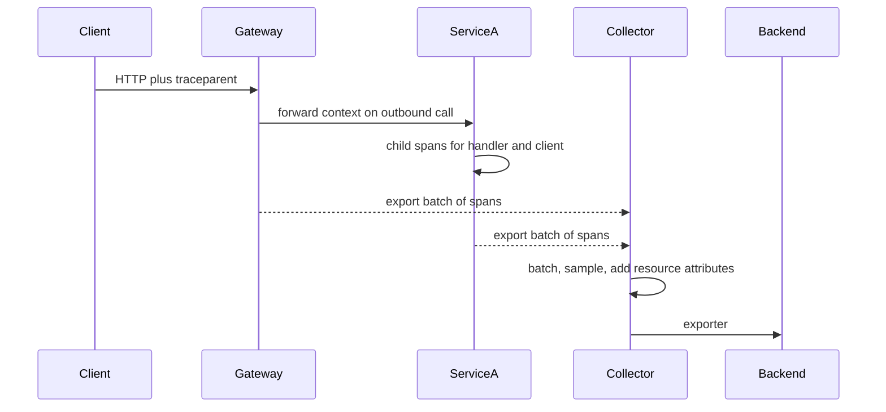

## Concept

A request in a production system is not a line in one process. It is a tree of work: an edge hop, a mesh sidecar, a handler, a client call, a queue publish, a consumer, a database round trip. Logs tell you what one process thought. Metrics tell you how a population behaved. Tracing is the signal that reconstructs one request as a causal tree so you can answer "where did this 2.4-second tail sample actually spend its time, and which service owned that span." OpenTelemetry (OTel) is the current contract for producing that tree without locking the application to a vendor's SDK.

### Traces, spans, and what a span is allowed to be

A trace is the full tree. It has a trace id that is constant for the request. A span is one unit of work inside that tree: a name, a start and end timestamp, a status, attributes, and a parent span id. The root span is the edge. Child spans are the hops and the internal work you chose to record. A span that covers "the entire monolith" is a trace with no joints. A span per function call is a trace nobody can store. The design is the granularity that matches how you debug: inbound RPC, outbound RPC, a queue produce/consume pair, a significant local operation (a cache fill, a render, a lock wait), and not much else.

Span status is not HTTP status. A 404 that the product intended is `Ok` with an attribute for the code. A 503 from a dependency is `Error` on the client span and, if the handler fails because of it, on the server span too. Mixing those conventions across languages is how you get a red trace for a correctly handled miss and a green trace for a timeout that returned a cached page. Write the convention down. Enforce it in a library, not in a wiki.

Attributes are the indexed fields you will filter on: `http.route`, `rpc.method`, `peer.service`, `messaging.destination`, tenant or shard if the cardinality is bounded. They are not a log dump. High-cardinality identifiers (raw user ids, full URLs with query strings, unbounded error messages) belong in span events or in logs correlated by trace id, or they belong nowhere. A trace backend that dies under unique attribute values is a tracing incident, not a "we need a bigger cluster."

### Context propagation is the contract

The tree only exists if every hop passes context. In OTel that context is a trace id, a parent span id, sampling flags, and baggage you explicitly chose to propagate. HTTP carries it in headers (`traceparent` and `tracestate` under W3C Trace Context). gRPC carries it in metadata. Messaging must put it in the payload or in broker headers and restore it on consume. A missing hop is a new root. A missing hop is the most common production failure of tracing, and it looks like "our traces are too short," which teams then "fix" by adding more spans in the process that already has context.

Language SDKs will instrument HTTP servers and clients if you install the instrumentation and you do not strip headers at the mesh, the gateway, or a homemade proxy. The usual strippers are a load balancer that drops unknown headers, a sidecar allow-list, a message serializer that copies only documented fields, and a worker that starts a span without extracting the parent. Treat propagation as a compatibility test: a synthetic with a known `traceparent` must arrive at the leaf with the same trace id. Put that test in CI for every new client and broker schema.

Baggage is optional key/value data that rides with the context. It is not a substitute for attributes on the local span. It is a way to pass a low-cardinality decision (experiment id, tenant tier) without a network round trip. Unbounded baggage becomes a header-amplification attack on your own fleet. Allow-list the keys. Cap the size. Never put secrets in baggage; it will be logged, exported, and copied into every child.

### Sampling is a reliability decision

You cannot store every span in a high-QPS fleet, and you should not try. Head sampling decides at the root, with the decision propagated so the whole tree is kept or dropped together. Tail sampling decides after the trace is complete, which lets you keep errors and slow traces at a higher rate than the happy path. Head sampling is cheap and statistically simple. Tail sampling needs a collector that can buffer a trace until it is done, which is a system with its own SLO.

A production policy I will sign is: always sample errors and traces above a latency threshold; sample a small fixed fraction of the rest at the root; raise the fraction on a named debug header or a sticky tenant for a bounded time. What I will not sign is 100% sampling "until we see if we need it" on a service that does fifty thousand QPS, or a random per-span sample that keeps a parent and drops the child. Broken trees are worse than fewer trees.

Sampling must be consistent across services. If service A samples at 1% and service B at 100% without honoring the parent decision, you get incomplete traces and a false picture of B's load. OTel's `TraceIdRatioBased` plus a parent-based sampler is the usual pattern: respect the parent; if you are the root, apply the ratio. Changing the ratio is a production change. Treat it like a flag, not like a collector restart.

### Collectors, exporters, and the application budget

Applications should export to a local or sidecar collector, not directly to a vendor over the public internet from every pod. The collector batches, retries, tailsamples, and fans out to the backend. The application SDK's job is to create spans cheaply and to shed load when the collector is down: a bounded queue, a drop counter, never a blocked request thread. If exporting a span can stall the handler, tracing has become a dependency of the user SLO, which is the wrong dependency.

Resource attributes (`service.name`, `service.version`, deployment environment, cluster) are how you join traces to deploys. Empty `service.name` is how you get a backend full of `unknown_service`. Set it in the collector or in the SDK from the same identity you use for metrics. Version is how you prove a canary is in the trace. Without it, you will argue from timestamps.

## Trade-offs

| Approach | When it wins | Cost / risk |
| -------- | ------------ | ----------- |
| Logs with a request id | Single process, low QPS, no fan-out | No causal tree; cannot see the hop that burned the budget |
| Vendor SDK only | One backend, small fleet, need speed to first dashboard | Lock-in; dual instrumentation when you add a second sink |
| OpenTelemetry SDK plus collector | Multi-language, multi-backend, platform standard | Collector is now production; config drift across languages |
| Head sampling only | High QPS, simple ops, acceptable to miss rare traces | Errors at low rate may never appear; debug campaigns need a flag |
| Tail sampling | Need errors and slow traces at high keep-rate | Buffering, completeness timeouts, collector SLO |

A vendor SDK will get you a flame graph this week. It will also put vendor types in every service and make the second backend a rewrite. OTel is the adapter. The cost is instrumentation work and a collector you page on, which is the right cost past a handful of services. For a monolith with one hop to a database, correlated logs may be enough.

Head versus tail sampling is a traffic and incident-shape decision. If your outages are total (everything 500s), head sampling at 1% still shows you the tree. If your outages are 0.2% of requests with a wrong answer, head sampling at 1% will not keep those traces often enough to debug them. Tail sample on status and latency, or pin 100% on a debug header, or you will keep debugging from logs while paying for a tracing bill.

Auto-instrumentation versus manual spans is the other fork. Auto-instrumentation of HTTP, gRPC, and official clients is the default I want. Manual spans are for the joints the library cannot see: an in-process pipeline, a custom executor, a stored procedure name. Manual spans on every internal function are how you pay 10% CPU for a picture nobody uses. Start with the joints. Add a manual span when a dashboard cannot answer "which of these three internal stages was slow."

## Diagram

## Failure modes

### Broken or forked context

A hop drops `traceparent`, a worker starts a new root, or two incoming headers disagree. You see many short traces instead of one tree. Detection is a trace-completeness check: fraction of traces that include the expected service set for a route, and a synthetic with a known trace id that must appear at the leaf.

Mitigation is header allow-lists that include W3C Trace Context, extraction at every consumer, and a library wrapper for brokers so producers cannot forget. Ban "create a new trace in the worker" except for truly root work (a timer, a poller). If a message has no context, record a span that says so; do not invent a pretty tree.

### Cardinality explosion

An attribute includes a user id, a full URL, or an exception message with a unique payload. The backend index melts, query latency climbs, and ingestion is dropped. Detection is a cardinality dashboard per attribute key, and an alert on unique-value count, not on byte volume alone.

Mitigation is an allow-list of attribute keys in the collector (`spanprocessor` / attribute filter), a deny-list for known bombs (`http.url` with query string, `exception.message`), and a review of custom attributes in the same change as the code that adds them. Trace backends are not warehouses. If you need the raw payload, ship it to logs with the trace id.

### Tracing stalls the request

The exporter queue fills, the SDK blocks, handlers wait on a vendor timeout. User latency moves with collector health. Detection is a comparison of handler time with and without export, a metric for dropped spans, and a correlation between collector saturation and application p99.

Mitigation is async export, a hard bound on the queue, drop-newest or drop-oldest with a counter, and a collector as a sidecar or DaemonSet so the network hop is local. The application SLO must not include the tracing backend. If the collector is down, traces drop. Requests do not.

### Inconsistent clocks and impossible timelines

Spans from different hosts show children starting before parents, or negative durations. You will waste an incident blaming a service that is merely NTP-skewed. Detection is a check for negative duration and for child-before-parent across services, plus host clock-offset metrics.

Mitigation is NTP or a similar sync on every node, recording skew, and teaching the UI to treat cross-service timestamps as approximate. Do not use span timestamps as a distributed lock or as a billing source of truth. They are a debugging picture.

## Real-world example

Google's Dapper paper is the reason this industry draws traces as trees of spans with a sampled subset of requests. The production lesson was not the UI. It was that a 1-in-N sample, propagated from the root, was enough to find the hop that dominated latency, and that the instrumentation had to be cheap enough that teams would leave it on. OpenCensus, then OpenTelemetry, is that idea made vendor-neutral. Google Cloud's own tracing products ingest OTel; SRE teams that run on GCP instrument once and export to Cloud Trace or to a second backend without a second SDK.

What a Google-style SRE organization actually enforces is the unglamorous part. `service.name` and version are mandatory resource attributes so a canary shows up in the trace. Propagation is a platform interceptor, not a per-service hobby. Sampling is a platform policy with an override header for a debug session. Collectors are monitored like any other in-cluster service: queue depth, export errors, drop rate. When a microservice owner asks "why don't I see my error," the first questions are whether the parent sampled, whether the worker extracted context from the queue, and whether the attribute they are searching was filtered for cardinality — not whether the UI needs a new feature.

Copy that operating model even if you never run Borg. A tracing install that is "we added the Java agent" without a collector SLO, a propagation test, and a sampling policy will produce pretty pictures of the happy path and silence during the incident. The incident is when you needed the tree.

## What to remember

- A trace is a propagated tree of spans; a request id in logs is not a substitute once you have more than one hop.
- Context propagation is a compatibility contract: W3C `traceparent` on HTTP, explicit headers on every broker, extraction on every consumer.
- Sample at the root, keep errors and slow traces, and never let the exporter block the user request.
- Bound attribute cardinality in the collector; unbounded keys will take the backend down before they help you debug.
