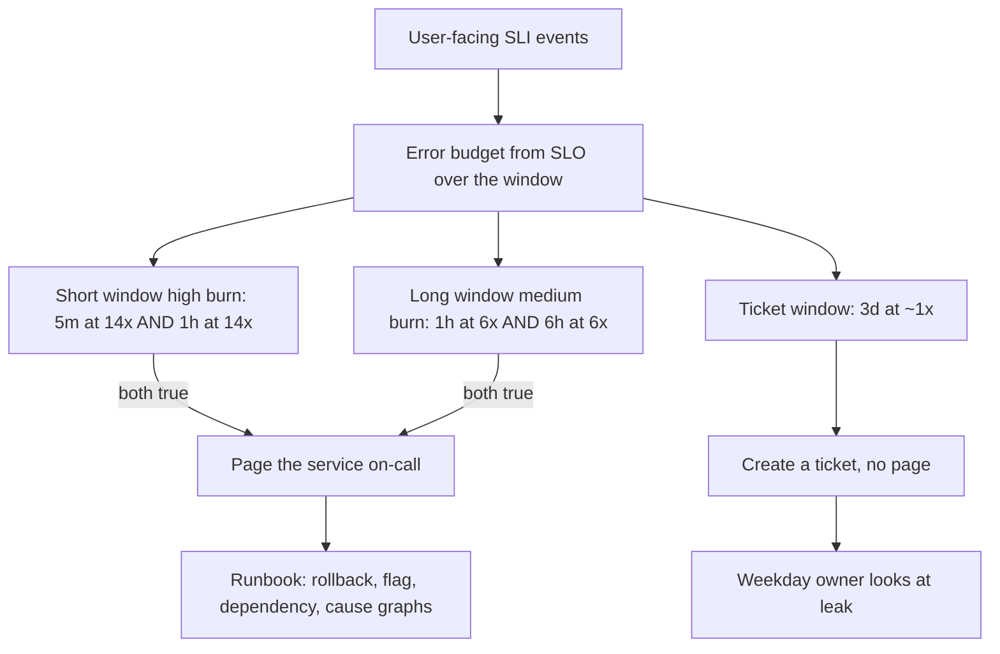

## Concept

An alert is a request for a human to interrupt what they are doing and change the state of the system. Everything else is a ticket, a dashboard, or a log. Alert fatigue is what happens when that request is issued for conditions the human cannot act on, cannot see in the product, or sees twenty times a week without a corresponding incident. SLO-based alerting is the practice of paging on a burn of the error budget — user-facing unreliability — instead of paging on every hardware, saturation, or error-rate graph that happens to be red.

### Page on user pain, not on every red graph

A disk at 70%, a replica restart, a 5xx blip on an internal admin route, a certificate that expires in thirty days: all of those can be true while users are fine. They can also be the early edge of an outage. The distinction is not "ignore infrastructure." The distinction is which of those conditions is allowed to wake someone. If the disk filling will take three days at the current growth rate, it is a ticket. If the error budget for the checkout SLO will be exhausted in thirty minutes at the current burn, it is a page.

Cause-based alerts (CPU, memory, restart count, queue depth) belong as diagnostics once you are already in the incident. They fire when the cause is present and users are not yet hurt, and they stay silent when users are hurt by a cause you did not instrument. Symptom-based alerts on SLIs fire when the user is already paying. That is the page. The runbook then uses the cause graphs.

The SLO is the contract that makes this honest. Without a numeric SLO, "user pain" is a vibe and every team pages on a different 5xx threshold. With an SLO, the alert is a statement: we promised 99.9% successful checkouts over 28 days, and the current error rate will consume that budget too fast. That statement is reviewable. A CPU page is not.

### Multi-window, multi-burn-rate alerts

A single threshold on a five-minute error rate will either page on noise or miss a slow leak. Google SRE's multi-window, multi-burn-rate construction is the standard I want on a user-facing SLO.

A burn rate is how fast you are spending the budget relative to the SLO. At a 99.9% SLO, a 100% error rate is a 1000× burn. A 0.1% error rate is a 1× burn, which is exactly the budget. You will not page at 1×; that is the promised unreliability. You page when the burn is high enough that waiting is more expensive than interrupting a human.

Two windows catch two shapes. A short window (five minutes) at a high burn (14×, for example) catches a total outage quickly. A long window (one hour) at a lower burn (6×) catches a partial degradation that would empty the budget in a few hours if nobody looked. Each page is the conjunction of the burn on the short window and a confirming burn on a longer window, so a one-minute blip does not page and a two-hour 5% error rate does. Ticket alerts use still longer windows (three days) at a burn just above 1×, so a slow leak becomes a weekday ticket, not a 3 a.m. page.

The numbers are not magic. They come from how much budget you will spend before a human looks, and from how long a false positive you will tolerate. A 14× burn on a 99.9% monthly SLO spends about 2% of the month's budget in five minutes, a reasonable price for a fast page on a total outage. A 99.99% SLO with sparse traffic may not have enough events in five minutes; lengthen the short window or pick a different SLI.

### Ticket alerts and the rest of the stack

Not every SLO burn is a page. A 3-day window at 1× to 2× burn is a ticket: the budget is leaking, someone should look this week, nobody should lose sleep. Certificate expiry, disk growth, saturation approaching a known cliff, and "the canary analysis has been failing for two deploys" are tickets. If you page on tickets, people will silence the page and you will lose the signal when the same alert is later used for a real outage.

Cause-based conditions still exist. They go to a diagnostic dashboard, to a ticket, or to an automated action (scale up, fail over, restart a sidecar) that does not need a human. A human page that says "CPU is high" trains the on-call to ignore pages. An automated scaler that says "CPU is high" is doing its job. Keep the human for the case where the symptom is user-facing and the next action is a judgment: rollback, feature flag, traffic shift, vendor escalation.

### What the SLO must look like before the alert is useful

Garbage SLIs produce garbage pages. The SLI must be an event that a user would recognize: a request that succeeded inside a deadline, a job that completed, a stream that stayed up. Implementation metrics (CPU, GC, thread pool) are not SLIs. Broad SLIs ("all HTTP 200s on the service") hide the one route that is on fire. Slice the SLI by the user journey you promised, not by the process name.

You also need enough events. A service with twenty requests an hour cannot support a five-minute 14× burn alert; three errors look like a catastrophe and are a retry storm. For sparse SLIs, lengthen windows, alert on a minimum event count AND a burn, or move the SLO to a synthetic that runs at a known rate. Do not pretend a ratio of 2/5 is a burn rate.

Finally, the alert must point at a runbook that names the SLI, the windows, the likely next graphs, and the first rollback or flag. A page with no runbook is how people learn to wait ten minutes "to see if it clears," which is how you spend the rest of the budget.

### Routing, inhibition, and who wakes up

One page per incident, not one page per replica. Inhibit child alerts when the parent SLO is already firing. Route by service owner, not by whoever imported the Grafana folder. A platform SLO (mesh, ingress, datastore) pages the platform on-call; a product SLO pages the product on-call; a dependency that is already in an incident should not also page every caller. That last rule requires a shared incident field or a dependency graph, which is operational work, not a PromQL trick.

## Trade-offs

| Approach | When it wins | Cost / risk |
| -------- | ------------ | ----------- |
| Cause-based pages (CPU, restarts, disk) | Tiny systems, one owner, no SLO yet | Fatigue; silence during user-facing failures you did not graph |
| Single short-window error-rate page | Total outages on high-QPS services | Noise on blips; misses slow burns |
| Multi-window multi-burn SLO pages | User-facing services with a numeric SLO and enough events | Needs a real SLI; mis-tuned burns still fatigue or arrive late |
| Ticket-only on long windows | Slow leaks, capacity, expiry | Never pages; a leak can still exhaust the budget if tickets stall |
| Synthetics as the only page | Sparse real traffic, external dependencies | Synthetics miss real-user paths; they also false-page on the probe |

Cause-based alerting feels responsible because you can point at a graph. It does not scale: each new cause is a new page, each missing cause is a silent user outage. Move the page to the SLO as soon as you can name the user event. Keep cause graphs for the incident.

Single-window error-rate pages work for "the site is down." They fail for "2% of checkouts have been failing since noon," which empties a monthly budget without a spike. Add the long window. The extra PromQL is cheaper than the missed incident.

Synthetics are a complement, not a replacement. They give you a known event rate and a path you control. They do not see a tenant-specific failure, a cache-bust on a real URL, or a payment-provider error that only hits real cards. Page on the real-user SLI when you have volume. Use synthetics as a second signal and as the primary only when real volume cannot support a window.

## Diagram

## Failure modes

### Paging on a blip, then silencing the alert

A five-minute error spike from a deploy, a retry storm, or a single noisy probe pages, the on-call sees a recovered graph, and after the third time they mute the route. The next total outage is silent. Detection is page volume per service per week, and a mute/silence duration metric. A service that pages more than a handful of times a week without a matching incident is mis-tuned.

Mitigation is the two-window conjunction, a minimum event count, and a post-incident review of every page that was not an incident. Lower the burn or lengthen the short window; do not add a "wait 10 minutes" in the runbook as a substitute for a better alert. If people wait, the alert is already wrong.

### Slow burn that never pages

A 2× leak over days empties the budget. No short window ever lights. Detection is a ticket alert on a 3-day 1×–2× burn, and a weekly budget report that a human is required to see. If you have no ticket path, you will discover the empty budget at the monthly review, after you have already shipped on top of it.

Mitigation is the long ticket window plus a hard policy: you do not spend an empty budget on features (see error budgets). The alert's job is to create the ticket early enough that the policy has something to enforce.

### SLI that does not match the user

You alert on HTTP 5xx of the service. The failure is HTTP 200 with an empty body, a 200 that took 20 seconds on a path with a 3-second UX budget, or a 4xx from a gateway that the service never saw. Detection is a comparison of the SLI to a user-reported incident: if users were down and the SLO graph was green, the SLI is wrong.

Mitigation is to define the SLI as the user event, including deadline and correctness, sliced by route. Gateway errors belong in the edge SLO. A cached 200 that hid a downstream timeout belongs in the service SLO if the user got an answer you would not ship on purpose.

### Alert storms from fan-out

One dependency fails. Twenty callers page. The on-call for each caller pages the dependency owner. Detection is concurrent pages that share a downstream, and incident timelines that start with "we got 40 pages."

Mitigation is inhibition: if the dependency SLO is firing, suppress caller pages or collapse them into the same incident. Page the owner of the broken hop first. Callers get a ticket or a secondary that says "you are degraded because of X." This requires naming dependencies in the alert labels, which is boring and load-bearing.

## Real-world example

Google SRE's public guidance on alerting from SLOs is the origin of multi-window, multi-burn-rate pages, and it is still the design I implement. The SRE books describe a world where paging on every cause had already failed at their scale: too many signals, too many false pages, and outages that did not match a cause they had chosen to watch. The replacement is a small number of pages tied to SLIs users feel, with burn rates chosen so that a total outage pages in minutes and a slow leak becomes a ticket before the month's budget is gone.

The operational detail teams skip is the conjunction of two windows. A single 5-minute burn page is not the design. The short window without confirmation pages on deploy blips. The long window without a short one notices an outage after twenty minutes. Both, ANDed, are how you get a page that is rare and still fast. Google SREs also separate tickets from pages as a cultural rule: if it can wait until morning, it is not a page. That is what keeps a page believable at 3 a.m. on the fourth week of a rotation.

When I copy this into a company that is not Google, I do not copy the 99.99% targets. I copy the structure: a real user SLI, a budget, a fast page, a slow page, a ticket, a runbook, and a weekly review of pages that were not incidents. The numbers follow the SLO you actually promised, and the traffic you actually have.

## What to remember

- A page is an interruption for user-facing budget burn; everything slower is a ticket or an automated action.
- Multi-window, multi-burn-rate alerts catch total outages fast and slow leaks before the month is gone, without paging on one-minute blips.
- If the SLI is not a user event with a deadline, the page will be green during the outage or red during noise.
- Inhibit caller pages when the dependency is already on fire; one incident, one page, a runbook that names the next graph.
