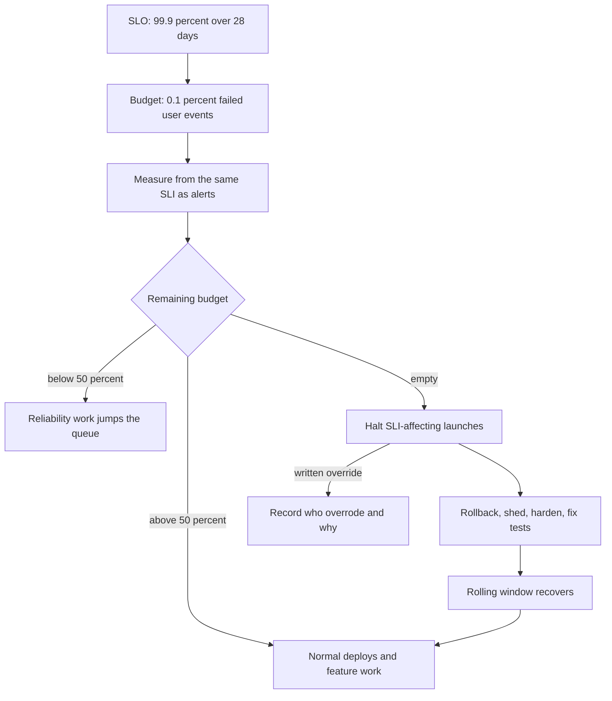

## Concept

An error budget is the unreliability you already promised. If the SLO is 99.9% successful user events over 28 days, the budget is 0.1% of those events. That quantity is not a motivational poster. It is the only honest way to decide whether the next week is for shipping or for hardening. Without a budget, product and SRE argue from anecdotes. With a budget, they argue from a number both sides agreed to when they were not in an incident.

### The budget is leftover unreliability, not a bonus

Teams treat the budget as extra headroom they should not "waste." That inverts the design. The SLO is the reliability users pay for. The budget is the remainder you are allowed to spend on change: deploys, experiments, migrations, planned maintenance, and the inevitable unplanned failure. A team that finishes the month at 99.99% against a 99.9% SLO did not "win." They refused risk that the product had already bought. Sometimes that is correct (a launch week, a regulatory period). As a standing practice it means you are slower than the SLO permits, and someone else will eventually ship the feature from a stack that pages less.

Spending the budget on purpose is a production skill. A canary that burns 5% of the month's budget to learn that a build is bad is a cheap lesson. A silent 2× leak that burns 80% of the budget on a misconfigured retry is a stolen lesson. The budget does not care about intent. The policy does.

The window matters. A 28-day rolling window is the usual production choice: long enough that a bad day does not freeze the fleet forever, short enough that a good quarter cannot hide a bad month. A calendar month is easier to report and has a cliff on the first. I prefer rolling. I will accept calendar if finance already lives on it, and I will then watch the cliff.

### Writing an error budget policy

A policy is a short document the org will actually follow when the graph is red. It names the SLO, the window, who owns the number, what happens at 50% consumed, what happens at 100% consumed, who can override, and how an override is recorded. If those sentences do not exist, you have a dashboard, not a budget.

A policy I will sign looks like this. Above 50% remaining: normal deploys, normal feature work, canaries as usual. Below 50%: new features need an explicit reliability review; flaky tests and noisy neighbors get priority; the next incident's action items jump the queue. At 0%: feature launches that can affect the SLI halt; work that reduces burn (rollback of a risky flag, load shedding, dependency hardening, test fixes that prevent bad deploys) continues; the halt lasts until the rolling window recovers or a named director overrides in writing. Planned maintenance that would consume budget is scheduled against remaining budget, not against hope.

The halt is the part people try to weasel. "This launch is small." "It is only config." "The SLO is too tight." Config is how a large fraction of outages ship. A tight SLO is a separate conversation, held at the monthly review, not in the launch meeting. If the SLO is wrong, change the SLO in the policy with the same people who consume the budget. Do not silently ignore the halt. A halt that is always overridden is not a policy. It is a dashboard with extra steps.

### Measuring consumption in a way that cannot be gamed

The budget is 1 minus the SLI over the window, times the event count, or equivalently the count of failed events allowed. Measure it from the same SLI the alerts use. Do not measure it from a prettier graph in a slide. Goodhart's law shows up immediately: if you exclude "known issues," the budget will be all exclusions. If you exclude third-party failures, you will discover that users do not exclude third-party failures. If you change the SLI definition whenever you are close to empty, you do not have a budget.

Legitimate exclusions exist. A scheduled, communicated maintenance window that the SLO document already named can be excluded. A load test against production that was approved and tagged can be excluded. A region you have not promised can be excluded from a global SLO — and then you need a regional SLO for the region you did promise. Exclusions are listed in the policy in advance. They are not invented in the incident review.

Event count in the denominator is the other game. A synthetic flood of cheap health checks inflates the denominator and makes a real-user outage look small. Health checks do not belong in a user SLO. Internal admin routes do not belong in a user SLO. If you need to know whether the process is up, that is a different SLI with a different budget, owned by the platform, not a way to dilute the product number.

### What happens when the budget is empty

Empty means the halt above, plus a concrete list of work. That list is not "try harder." It is ranked: freeze the risky pipeline, roll back the last change that moved the SLI, shed load, disable a flag, add a bulkhead, fix the test that would have caught the last three incidents, remove a flaky canary metric that is causing bad deploys to sneak through. The owners of the SLO pick from that list in public. Product does not get a private exemption because a date was on a slide.

Recovery of a rolling window is slow. After a 12-hour total outage, a 28-day 99.9% budget can be gone for weeks. That is the point. The system taught you, expensively, that a class of failure is not under control. Shipping more of the same class during those weeks is how you get the second outage. If the business cannot tolerate a multi-week halt, the SLO was a vanity number and should be renegotiated before the next quarter, not during the halt.

### Budgets at service boundaries

One company-wide budget is too coarse. One budget per binary is too fine; a user journey that hops six services will be green in five and red in one, and nobody will own the journey. The unit I want is the user-facing journey (checkout, login, stream start, job complete) plus a platform budget for the shared hops (edge, mesh, datastore). Product owns the journey. Platform owns the hop. A product halt because the datastore burned the platform budget is a platform incident with product impact, not a product "process failure."

Shared dependencies need an explicit rule. If payments is 40% of checkout failures, checkout's budget will always be a function of payments. Either payments is in the checkout SLO (and payments work is in the halt) or checkout's SLO is defined on the part of the path you control, with a separate dependency SLO. Mixing those silently is how two teams each think the other owns the number.

## Trade-offs

| Approach | When it wins | Cost / risk |
| -------- | ------------ | ----------- |
| No budget, SLO as a slide | Tiny team, one product, informal freeze when it hurts | Freeze is political; no memory across quarters |
| Informal "we stop if we have incidents" | Early product, unstable SLI | Incident count is not user impact; noisy weeks freeze the wrong work |
| Rolling error budget with a written policy | Multiple teams shipping into one user journey | Needs a real SLI, a halt people will honor, and a review |
| Calendar-month budget | Finance and board reporting | First-of-month cliff; a late-month outage has no recovery |
| Per-binary budgets only | Low-level platform components | User journeys have no owner; local greens hide a red path |

A written policy is heavier than a dashboard. It is also the only artifact that survives a reorg. The cost is the review meeting and the occasional halt that makes a date slip. That slip is the product. If dates cannot slip, you do not have an SLO. You have a wish.

Calendar months are tempting because everyone already reports on them. The cliff is real: a team that burned the budget on the 28th is "healthy" on the 1st with no engineering change. Rolling windows punish recent failure until it ages out, which is the incentive you want. If you must use calendar, add a rule that a halt in the last week of the month continues for a defined period into the next, so the cliff cannot be used as a release valve.

Per-binary budgets are how platform teams hide. They are necessary for the binaries, insufficient for the product. Always keep the journey budget. Use binary budgets as diagnostics and as the platform's own halt rule.

## Diagram

## Failure modes

### A budget nobody can halt a launch with

The graph exists. The date also exists. The date wins. Detection is a count of launches during periods of empty or near-empty budget, which you will find in the deploy log plus the budget time series. If that count is not zero, the policy is decorative.

Mitigation is a pipeline gate that reads the budget, a named override with a ticket, and a monthly public list of overrides. Shame is a terrible control unless it is attached to a gate. The gate is the control. The list is how you see that the SLO is too tight or that a particular director does not believe in it.

### Gaming the SLI to refill the budget

Routes disappear from the SLI. Timeouts are recoded as 200s. "Non-user" traffic is invented. Detection is a change log for the SLI definition, a comparison of excluded traffic over time, and user-reported incidents that did not consume budget.

Mitigation is to treat SLI definition changes as policy changes: same reviewers, recorded in the same doc, never in a dashboard variable. Synthetics and real-user monitoring that sit outside the team's edit path are a backstop, not the primary.

### Uneven consumption that the average hides

The month is green because 27 days were perfect and 8 hours were a total outage. The average SLO is met. Users in that window had a 0% experience. Detection is a burn-rate view and a "worst window" statistic, not only the 28-day ratio. Multi-window alerts exist for this.

Mitigation is to page on fast burn even when the long-window budget still looks healthy, and to count that incident against the policy (action items, maybe a temporary halt) even if the month might still close green. The budget is a planning tool. The fast burn is the user.

### Shared budget, unclear owner

Two teams consume one journey budget. Each thinks the other will halt. Detection is an incident in which both continue to ship, and a RACI that says "shared." Shared is not an owner.

Mitigation is one named owner per journey SLO, with platform budgets separate. If payments dominates checkout failures, payments is in the halt path for checkout, in writing. Dual ownership is how the budget dies.

## Real-world example

Google SRE's error budget is the mechanism that made "100% is the wrong target" operational. Availability SLOs below 100% are explicit: the remainder is the budget. Product management and SRE share that number. When the budget is healthy, the release throttle opens. When it is gone, feature work that can burn the SLI stops until reliability work catches up. The public SRE material is consistent on the cultural point: this only works if both sides agreed to the SLO in advance, and if leadership will back a halt against a launch date.

The part worth copying is not the 99.99% lore. It is the meeting. A regular review of budget remaining, pages that were incidents, pages that were not, SLO changes, and overrides. Google-scale SRE orgs treat that review as load-bearing as the code review. A company that installs a burn-rate graph and skips the review will still argue from anecdotes. A company that writes the policy, gates the pipeline, and reviews overrides will still have outages. They will not have outages and a simultaneous feature launch into the same SLI because a date was sacred. That is the entire product of the budget.

When I implement this outside Google, I start with one user journey, one rolling window, one halt rule, and one override path. I do not start with twenty SLOs and a slide. The first halt is the test of the org. If it does not hold, fix the governance before adding more graphs.

## What to remember

- The error budget is the unreliability the SLO already allows; spend it on change, do not hoard it as a trophy.
- A policy names the halt, the 50% tighten-up, the override, and the SLI; a dashboard without those sentences is not a budget.
- Measure from the same user SLI as the alerts, and treat SLI edits as policy edits.
- Empty budget stops SLI-affecting launches until the window recovers or a named human overrides in writing.
