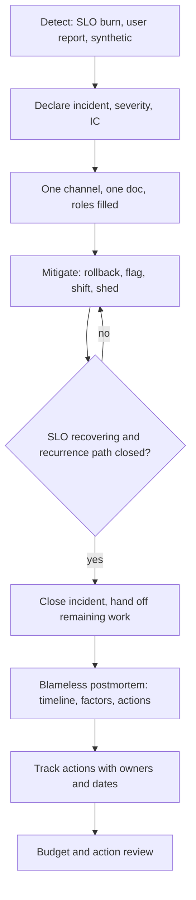

## Concept

An incident is a period when the system is outside its SLO, or about to be, and a human has to change something. Incident management is the operating procedure for that period: who decides, who talks, who changes production, and when it is over. A postmortem is the written account after it is over, whose only job is to change the system so the next similar failure is cheaper. Blame is a competing job. If the writeup does that competing job, people will hide facts, and the next similar failure will not be cheaper.

### Roles in the room

Three roles are enough for most incidents. The incident commander (IC) owns the clock, the severity, the decision to change production, and the decision that the incident is over. The operations lead (or technical lead) owns the investigation and the hands on the system: dashboards, rollbacks, failovers. The communications lead owns the message to users, to support, and to the rest of the company. On a small team one person may wear two of these. On a large incident you add a scribe and a specialist for a dependency. You do not add a crowd.

The IC is not the most senior engineer in the channel. Seniority is a resource the IC can call. If the principal engineer is also IC, they will debug instead of decide, and the channel will wait on their stack trace. Train more than one IC. Rotate. A role that only one person can fill is a single point of failure with a pager.

Handoff is a first-class action. Incidents that last past a shift must transfer IC with a spoken summary: severity, current theory, what was tried, what is forbidden (do not restart X, do not fail over Y), next check time. Written notes in the incident doc are the backup. A handoff that is "you're up" in Slack is how the second shift repeats the first hour.

Declare severity on a published scale (SEV-1 user-facing stop, SEV-2 major degradation, SEV-3 contained) in the first few minutes, then change it in public if you were wrong. Severity drives who is pulled in, whether executives get a message, and whether you page a vendor. Arguing about the number while the site is down is a failure of the scale, not of the IC. Keep the scale short.

### The timeline, the channel, and the freeze

One channel per incident. One document per incident, started when the incident is declared, with a timestamped log of theories, actions, and results. People who want to help ask the IC; they do not drop in with a hypothesis and a kubectl. The IC may freeze production changes that are not part of mitigation. A deploy that lands in the middle of an incident is a second incident, even if it was "already in the pipeline."

Mitigation beats root cause during the incident. Rollback, feature flag off, traffic shift, scale up, fail over, shed load. Finding the line of code is a post-mitigation activity unless you have no mitigation. The IC says which. A room full of people hunting a root cause while a one-line rollback is available is a management failure, not a technical one.

End the incident when the SLO is recovering and the immediate recurrence path is closed, not when you are sure why it happened. Then schedule the postmortem. "We'll write it if we have time" is how you get a second copy of the same outage. A severity threshold (SEV-2 and above always, SEV-3 if it burned a named budget or was a near miss you want to learn from) removes that discretion.

### Blameless writeups

A blameless postmortem states what happened, in what order, with what was known at each time, what the system allowed, and what you will change. It names systems, configs, and gaps. It does not name villains. "The deploy pipeline allowed a migration to run without an expand step" is a finding. "Alice forgot the expand step" is a firing document. Alice will not tell you the next time the pipeline almost did it again.

Blameless is not consequence-free. Recklessness, policy violations you already trained on, and willful bypass of a safety gate are HR matters, handled outside the postmortem. Mixing them into the learning document poisons the learning document. Keep the postmortem for the system. If you need a personnel process, use a personnel process, in a different room, with different people.

The body I want has a summary a busy person can read, a timeline with UTC timestamps, a section on impact (users, duration, budget spent), contributing factors (plural), what went well, what went poorly, and action items with owners and due dates. "Contributing factors" is plural on purpose. Single-cause stories are almost always incomplete. The deploy, the missing canary metric, the alert that did not fire, the runbook that was stale, and the dependency timeout that was longer than the user deadline can all be true.

Counterfactuals belong in contributing factors, not in a hall of shame. "If we had sampled this tenant at 100% we would have seen the error in five minutes" is a system gap. Write it as a change to sampling policy, not as a rebuke to whoever chose 1%.

### Action items that change the system

An action item is a change to code, config, capacity, a test, a gate, a runbook, or a training drill. "Be more careful" is not an action item. "Remind the team" is not an action item. If the same class of failure can happen tomorrow with a different careful person, you have not written an action item.

Every item has one owner, a due date, and a severity. The IC or a reliability owner tracks them in the same system as other work, not in a doc that archives. Review open items from past postmortems in the same meeting that reviews error budgets. Items that slip twice get escalated or dropped in public. A backlog of pious items is how engineers learn that postmortems are theater.

Near misses deserve the same writeup when the blast radius was luck. A canary that caught a migration because one person happened to watch a business dashboard is a near miss. Write it down. Put the business metric in the canary analysis. That is cheaper than waiting for the night the person did not watch.

## Trade-offs

| Approach | When it wins | Cost / risk |
| -------- | ------------ | ----------- |
| Heroic ad-hoc response | Tiny team, rare incidents, everyone in one room | No handoff, no timeline, learning dies with the hero |
| Strict IC / ops / comms roles | Any incident past one hour or past one team | Needs trained ICs; feels heavy on a SEV-3 |
| Blameless postmortem with tracked actions | Organizations that will keep shipping after a failure | Time cost; fails if leadership still hunts individuals |
| Root-cause hunt during the incident | No mitigation exists; you must change the failing line | Extends user pain; tunnel vision |
| Punitive writeups | Never, if you want facts next time | Hidden incidents; lying in the timeline |

Roles feel like process theater until the incident crosses a team boundary. Then they are how you avoid a fifty-person Zoom. Use a lighter form for a twenty-minute SEV-3: one IC, a short doc, a postmortem only if there is a durable action. Use the full form for SEV-1/2. The mistake is using no form for the large one because the small ones did not need it.

Blameless writing takes longer than a blame paragraph. It also produces factors you can actually fix. A punitive culture will still have postmortem meetings. The documents will be fiction. I would rather have an awkward, factual SEV-2 writeup than a polished story that ends with "human error."

Hunting root cause during mitigation is a temptation for good engineers. Give them a time box after mitigation, not instead of it. If you cannot mitigate, say so, and then hunt. Do not hunt by default.

## Diagram

## Failure modes

### No incident commander, or too many

Nobody is IC, so every strong engineer directs, or three people think they are IC and issue conflicting orders. Detection is a channel in which rollback and "don't rollback" appear within a minute, and a timeline that cannot say who decided.

Mitigation is a naming convention: the first on-call to declare is IC until they hand off. A bot can assign the role. Executives who join ask the IC where they help; they do not become a second IC. Practice this in game days so the first time is not a SEV-1.

### Blame leaking into the writeup

The document uses names in contributing factors, "should have known," or "failure to follow the runbook" as the end of analysis. Detection is a review of the writeup by someone who was not in the incident, looking for individual culpability where a gate or a test is missing.

Mitigation is an editor who is not the IC, a template that asks "what allowed this," and leadership that does not use postmortems in performance reviews. If a performance review needs facts, gather them separately. Engineers read incentives better than they read values slides.

### Action items that never close

Twenty items, all P2, none done by the next quarter. Detection is a simple count of open postmortem actions older than their due date, reported next to the error budget.

Mitigation is a cap: three to five items that would have changed this incident, severity-ranked, with dates that fit the halt policy. Drop or merge the rest. A short list that ships beats a complete list that rusts.

### War-room sprawl

Fifty people in a call, duplicated channels, side threads where the real decision happens. Detection is membership count, and decisions that do not appear in the incident doc.

Mitigation is the IC's job to keep the working set small, a read-only announce channel for everyone else, and a rule that a decision is not a decision until it is in the doc. Curiosity is not a role. Game days that punish sprawl teach faster than a wiki.

## Real-world example

Google SRE's incident management and blameless postmortem practice is the template most of the industry is copying, often by name and not by behavior. The public SRE material describes an IC, a clear severity, a written timeline, and a postmortem whose purpose is to find how the system produced the failure — including the tools, the incentives, and the missing automated checks — without treating the on-call as the defect.

The operational detail that makes it real at Google-scale is the follow-through. Postmortems are reviewed. Action items are real work with owners. Leadership is expected to reward surfacing near misses. An org that adopts the template and then uses the document to find who to blame will get Google's vocabulary and the opposite of Google's outcome: fewer honest writeups, more hidden SEV-3s, and a repeat SEV-1.

When I install this outside Google, I start with a one-page role card, a severity list, a postmortem template that forbids "human error" as a factor, and a monthly review of open actions next to the error budget. I run a game day in which the IC is not the person who knows the system best. If the game day collapses into a hero debug session, the org is not ready for a real SEV-1, and the work is training, not a nicer template.

## What to remember

- Name an IC, an ops lead, and a comms lead; mitigate first, hunt cause after the SLO is recovering.
- Blameless writeups describe what the system allowed, in time order, with plural contributing factors — not villains.
- Action items change gates, tests, config, or capacity; "be careful" is not an item, and untracked items are theater.
- Practice handoff and a small working set in game days, or the first long incident will invent its own, worse process.
