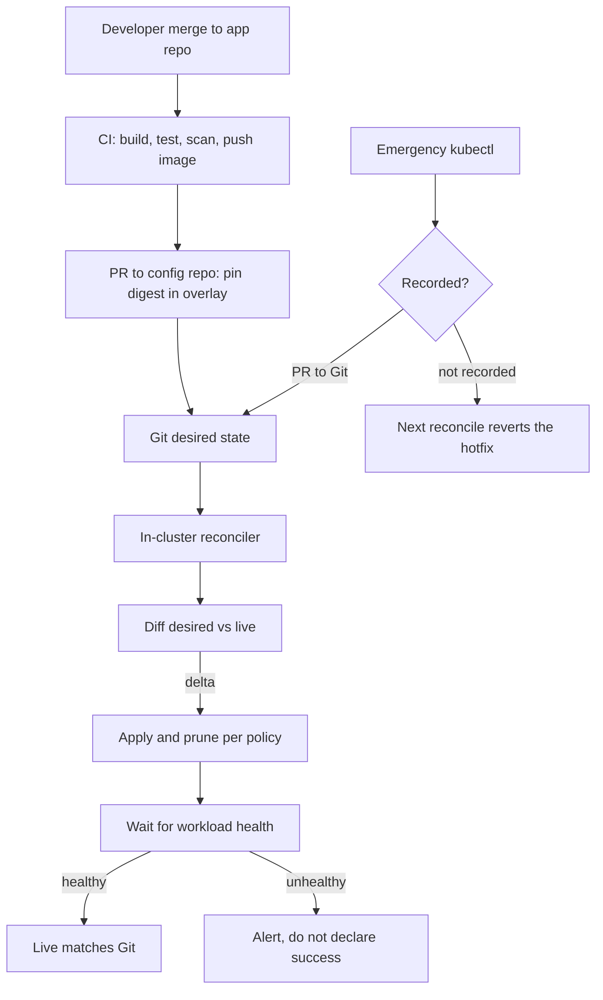

## Concept

GitOps is an operating model in which Git is the source of desired state for a cluster, and a reconciler inside the cluster makes actual state match that desired state, continuously. The pipeline's job is to update Git. The reconciler's job is to update the cluster. Humans do not kubectl-apply production as a habit. When they do, the reconciler either reverts them or the model is already broken.

### Desired state lives in Git

Desired state is the Kubernetes manifests, Helm values, Kustomize overlays, or another declarative description of what should run: image tags, replica counts, config, network policy, the list of cron jobs. It is versioned, reviewed, and attributable. A merge to the production branch is a production change. A Git revert is a production rollback for everything that is actually in that tree.

What does not belong in that tree is a secret in plaintext, a one-off imperative script, or a dashboard click that has no YAML. Encrypted secrets can live in Git (sealed secrets, SOPS). Live secrets should live in a vault the reconciler is allowed to read. Click-ops should be converted or banned. The test of GitOps is not whether you have Argo CD installed. It is whether a new replica count that someone typed into the cloud console is still there an hour later. If it is, Git is not the source of truth. The console is.

Environment promotion is a Git operation. Dev, staging, and production are directories, branches, or pull requests that copy a well-formed change forward. Image tags move with the change, not "latest." A production tag that is not in Git is an emergency, not a process. Pin by digest when you can. Tags move. Digests do not.

### The reconciler, not the pipeline, is the actor

A CI pipeline that kubectl-applies at the end of a build is CD. It is not GitOps. In GitOps, CI builds an artifact, runs tests, and opens or updates a PR that changes the desired image tag (or waits for an automated bot to do that). The cluster agent — Argo CD, Flux, or equivalent — watches the Git revision it is allowed to follow, diffs desired against live, and applies the delta. If someone applies a conflicting live change, the agent reapplies Git. That reapplication is the point. Drift is not a report you read on Friday. Drift is a condition the agent is always correcting.

Reconciliation needs a contract: which Git repo, which path, which revision (branch, tag, or pinned SHA), how often, and what "healthy" means before a sync is considered successful. Argo CD Applications and Flux Kustomizations are that contract. They should themselves be declared in Git (app-of-apps, or a root Kustomization that points at the rest). A reconciler configured only in a UI will drift from the model it is supposed to enforce.

Sync policy is a production decision. Auto-sync with prune is how you get a cluster that matches Git, including deletions. Auto-sync without prune leaves orphans. Manual sync is how you get a staging cluster that waits for a human. Production auto-sync is viable when the Git path is protected, the image is pinned, and the health check will fail a bad rollout. Production auto-sync is reckless when the branch is writable by every developer and prune is on. Protect the branch. Then auto-sync.

### App-of-apps, environments, and promotion

A single Application that points at a monorepo root will eventually become a blast radius. Split by product and by environment. An app-of-apps (or a Flux root) holds the list of child applications. Children hold the workload. Promoting a service is a PR that changes the child's image pin in the production overlay, not a new pipeline that talks to the cluster.

Multi-cluster is the same idea with a cluster selector. Each cluster's agent reads the path that describes that cluster. You do not have a central pipeline with twenty kubeconfigs if you can avoid it. You have twenty agents, each with least privilege, each following Git. A central pipeline with kubeconfigs is how a stolen CI secret becomes every cluster. An agent with a narrow role in one cluster is a contained failure.

Bootstrap is the remaining imperative step. Someone must install the agent and point it at the root. After that, the root describes the rest. Document the bootstrap as a rare, reviewed procedure. If you are still bootstrapping weekly, you do not have GitOps. You have a snowflake with extra YAML.

### Secrets, drift, and the human exception

GitOps does not magically solve secrets. Encrypted blobs in Git work until rotation and until a key lives on every laptop. External secrets operators pull from a vault at reconcile time. Pick one, and make the reconciler fail if the secret cannot be rendered. A successful sync of a Deployment that cannot start because the secret is missing is a green GitOps and a red service. Health checks must include "the pod is ready," not only "the manifest applied."

The human exception is the incident. kubectl is allowed in a SEV-1 to mitigate, with the IC's say-so, and the exception is either reverted by the reconciler (if Git was not updated) or recorded as a PR immediately after (if Git must change). A hotfix that lives only in the cluster will be undone by the next reconcile, which is correct, and will surprise the person who thought they saved the site. During an incident, either disable auto-sync with a recorded reason, or push the hotfix to Git first. Those are the two legal moves. A third move — live change and hope — is how GitOps causes the next incident.

### What GitOps is not

GitOps is not "we store YAML in Git." Most teams already did that. GitOps is not "we use Helm." Helm is a packager. GitOps is not a replacement for CI. You still build, test, and scan. GitOps is not a replacement for progressive delivery. The reconciler can apply a Rollout object; it does not, by itself, decide that 5% of traffic is healthy. Compose them: Git holds the Rollout spec; the rollout controller runs the experiment; the GitOps agent keeps the spec from drifting.

## Trade-offs

| Approach | When it wins | Cost / risk |
| -------- | ------------ | ----------- |
| CI kubectl-apply (push CD) | Few clusters, simple RBAC, fast first deploy | Cluster credentials in CI; drift; apply order bugs |
| GitOps pull reconcile (Argo CD / Flux) | Many clusters, need drift correction, audit in Git | Agent is production; bad merge auto-propagates; secrets design |
| Manual sync in production | High-ceremony changes, regulated apply windows | Humans sleep; Git and cluster diverge by hours |
| Auto-sync with prune | Want Git to be literal truth, including deletions | A bad PR deletes production objects; needs branch protection |
| Click-ops / console edits | Emergencies only | Silent drift; reconciler fights the human |

Push CD is easier to explain: the pipeline that built the image also deploys it. The cost is a kubeconfig in CI, a missed apply, and no continuous correction. I will use push CD for a single playground cluster. I will not use it as the production model once more than one team can change the cluster.

Auto-sync with prune is the GitOps default I want once branch protection, CODEOWNERS, and a staging environment exist. Until then, auto-sync without prune, or manual sync, is a training-wheel that you should schedule to remove. Permanent manual sync is CD with extra YAML.

The reconciler is now an availability dependency. It needs an SLO, a dashboard, and a page if it cannot talk to Git or to the API server. An agent that is quietly stuck for two days is a deferred outage: every "deploy" is a Git merge that did not land.

## Diagram

## Failure modes

### Drift from live changes that Git never saw

Someone scaled a Deployment in the console, patched a ConfigMap, or applied a CRD from a laptop. The next reconcile overwrites it, or never notices if the object is not in Git. Detection is a drift report (Argo CD out-of-sync, Flux ready=false with a diff), and an admission policy that warns on objects without a Git origin label.

Mitigation is auto-sync for objects that Git owns, a clear escape hatch for incidents, and RBAC that makes casual kubectl-apply in production hard. Label every GitOps-managed object. Teach the console as read-only. If drift is routine, Git is not the source of truth and you should stop calling it GitOps until it is.

### A bad merge that auto-syncs everywhere

A values change, a prune of the wrong path, or an image pin to a broken digest lands on main and twenty clusters follow. Detection is a burst of unhealthy Applications after a merge, and a missing staging promotion.

Mitigation is branch protection, required reviews, a staging cluster that follows main (or a staging overlay) before production, and progressive delivery on the workload, not only on the Git merge. Pin production to a Git SHA or a tag you promote, rather than to a hot main, if the org cannot protect main well enough. Revert in Git is the rollback of the desired state. Keep the reconciler healthy enough to apply that revert.

### Reconciler fighting a hotfix

Auto-sync reverts a SEV-1 kubectl mitigation before Git is updated. The incident returns. Detection is a timeline in which the fix disappears a few minutes after it was applied, coinciding with a sync.

Mitigation is a documented incident move: pause auto-sync or push Git first. Make pause a first-class, audited action. Alert when auto-sync is paused longer than a bound, so the pause cannot become the new source of truth.

### Secrets and render failures that look like success

Manifests apply. Pods crash-loop on missing env. Git is in sync. Detection is health that includes workload readiness, not only apply status, and a page on crash-loop after a sync.

Mitigation is health checks on the Application, a secrets operator that fails the render, and a staging apply of the same overlays. Never treat "sync succeeded" as "users are fine." That is the same mistake as treating "pipeline green" as an SLO.

## Real-world example

Kubernetes platform teams that standardized on Argo CD or Flux — Intuit's public Argo CD story is the usual citation, and many platform orgs now look like it — treat Git as the interface to the cluster. Application teams do not receive kubeconfigs for production. They receive a path in a config repo, a pipeline that opens a pin PR, and a set of overlays. The platform team runs the agents, the root applications, the RBAC, and the drift alerts.

The production lesson is not the pretty UI. It is that promotion became a reviewed Git change, that a stolen laptop no longer held a cluster-admin kubeconfig, and that a console edit stopped being a durable way to run production. The cost showed up too: the config repo became a bottleneck, a bad overlay could fan out, and secrets needed a real design. Teams that skipped the secrets design put ciphertext they could not rotate into Git and called it done. Teams that skipped staging auto-synced main to production and learned about prune the hard way.

Copy the operating model: an in-cluster agent, Git as desired state, promotion as a PR, health that includes pods, an incident rule for live changes. Do not copy a monorepo layout from a blog post without CODEOWNERS and a staging cluster that actually follows the same mechanism as production. GitOps that only exists in production is a delayed CI apply.

## What to remember

- Git holds desired state; an in-cluster reconciler makes live state match it; CI should not be the thing with cluster-admin.
- Auto-sync with prune is truth only when the branch is protected and health includes workload readiness.
- A live hotfix is either in Git immediately or it will be reverted; pause auto-sync on purpose during a SEV-1, then unpause.
- Drift, fan-out from a bad merge, and green syncs of crashing pods are the failure modes to instrument first.
