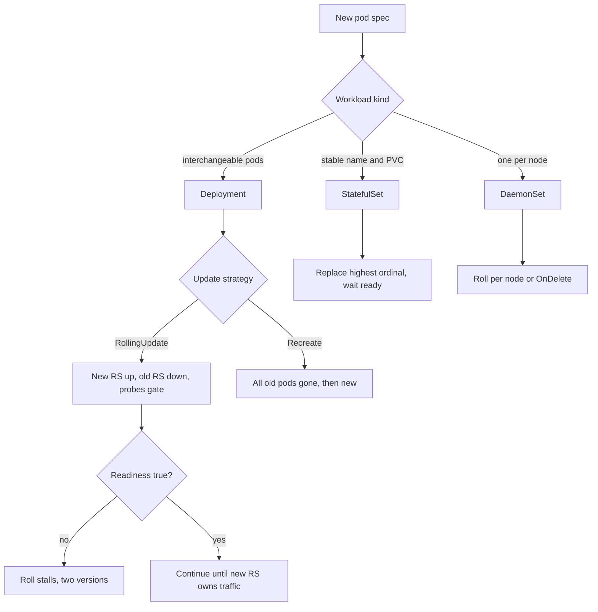

## Concept

Kubernetes offers more than one way to run a process. The workload API you pick — Deployment, StatefulSet, DaemonSet, Job, and the update strategy on top of them — is a statement about identity, storage, and how a new spec is allowed to replace an old one. Using Deployment for everything is the most common platform mistake I review. Using StatefulSet for a stateless API is the second.

### Deployment is for stateless replicas

A Deployment owns a ReplicaSet, which owns Pods that are interchangeable. Any pod can die. The controller will create another with the same spec and a new name. There is no stable network identity and no stable storage. That is the contract for an API server, a worker that pulls from a queue, a cache that can cold-start, and most of the fleet.

The default update strategy is RollingUpdate. The controller raises a new ReplicaSet and scales it up while scaling the old one down, honoring `maxUnavailable` and `maxSurge`. Readiness probes gate whether a new pod is a usable replacement. If the probe is wrong, the roll continues into a fleet of pods that are "ready" and cannot serve. If the probe is too strict, the roll stalls and you have two versions forever. The probe is the deploy.

Recreate is the other Deployment strategy: kill everything, then start the new spec. It is a flag day. Use it when two versions cannot coexist — a daemon that binds a host port the new version also needs, a leader-elected process that will split if both generations vote, a schema the old binary cannot see. Do not use Recreate because it is simpler to reason about. Downtime is the cost, and you will pay it on every spec change, including a label edit.

A Deployment is the wrong API when the process needs a stable DNS name per replica, a volume that must follow the replica, or a start order. You can fake some of that with a Deployment and a lot of operator code. You should not.

### StatefulSet is for identity and storage

A StatefulSet gives each pod a stable ordinal (`web-0`, `web-1`), a stable DNS name, and a PersistentVolumeClaim that follows the ordinal. Updates are ordered. By default, Kubernetes replaces the highest ordinal first and waits for it to be ready before moving on. You can relax that (`Parallel` pod management, `partition` for canaries), but the identity contract remains.

This is the API for a datastore, a queue that stores to disk, a broker, anything that will be wrong if `web-0`'s disk is attached to a new pod named `web-7`. It is not "Deployment but safer." It is slower to scale, slower to roll, and easy to misuse: a partition left at `1` forever, a PVC that is too small, an ordinal that still points at a dead node's disk after you thought you replaced the machine.

Peer discovery must use the stable identity, not the pod IP. Headless Services exist for that. If your process writes the pod IP into a membership list, a rolling update is a membership incident on every replica. Hash a logical member id (the ordinal, or a name you own) and map it to the current address.

### DaemonSet is for every node

A DaemonSet ensures a pod on each selected node: log shippers, mesh sidecars that are not injected, node exporters, CSI node plugins. Update strategy is RollingUpdate or OnDelete. RollingUpdate here means a node at a time (or `maxUnavailable` nodes), not a percentage of a ReplicaSet. A bad DaemonSet roll is a cluster-wide incident: every node gets the bad agent. Canary a DaemonSet with node selectors or affinity to a labeled pool first. Do not 100% a node agent because the image built.

Taints and tolerations are part of the spec. A DaemonSet that does not tolerate the taints on your GPU or control-plane nodes will silently not run there. That is sometimes what you want. It is an outage when the thing that does not run is the log shipper or the disk-pressure eviction helper.

### Rolling versus recreate versus canary on top

RollingUpdate is the default for Deployments and a careful ordinal walk for StatefulSets. Recreate is a cut. Canary and progressive delivery are not a native strategy on Deployment; they are another controller (Argo Rollouts, Flagger, a mesh traffic split) that owns the traffic or the replica share while the old and new ReplicaSets coexist. Use the native rolling update when the failure mode is "a pod that is not Ready should not take traffic" and the readiness probe is a real user check. Use a rollout controller when you need a 5% traffic sample, a metric comparison, and an automatic abort. Do not pretend `maxSurge: 25%` is a canary. It is a capacity knob. It does not compare SLIs.

Jobs and CronJobs are for work that should finish. A Job that you run as a long-lived server is a Deployment with worse restart semantics. A CronJob whose concurrency policy is `Allow` on a job that cannot overlap is a double-write incident waiting for a slow run. Set `Forbid` or `Replace` on purpose.

### Probes, surge, and the update budget

Liveness restarts a pod that is deadlocked. Readiness removes a pod from endpoints until it can serve. Startup probes give a slow process time to boot without a liveness kill. Mixing them up is a production incident: a liveness probe on a dependency timeout will restart a healthy process during a downstream blip, which is a self-inflicted outage. A readiness probe that only checks `GET /` on the process, not the critical dependency you need to serve, will take traffic and then fail the user.

`maxUnavailable` and `maxSurge` are the update budget. At 1 replica, `maxUnavailable: 25%` rounds down to 0 in some versions and blocks the roll, or rounds in a way you did not expect. Set integers for small replica counts. For a StatefulSet, the budget is "one ordinal at a time" unless you change it; respect that for data stores. Surge needs spare capacity. A cluster that is packed to 90% CPU cannot surge, and the roll will stall or evict something else. Capacity for the roll is part of the deploy.

PodDisruptionBudgets are the other budget. A PDB that forbids any voluntary disruption will block drains, cluster upgrades, and some rolls. A PDB that allows all will let a drain take the last replica. Align PDB, replica count, and `maxUnavailable` or you will fight yourself during the first node upgrade.

## Trade-offs

| Approach | When it wins | Cost / risk |
| -------- | ------------ | ----------- |
| Deployment + RollingUpdate | Stateless APIs and workers, interchangeable pods | Bad probes roll out widely; not a statistical canary |
| Deployment + Recreate | Two versions cannot coexist | Full downtime; no gradual signal |
| StatefulSet | Stable identity and per-replica disks | Slow rolls; ordinal and PVC traps; wrong for stateless APIs |
| DaemonSet | One agent per node | Cluster-wide blast; taints hide missing coverage |
| Rollout controller on top of Deployment | Need traffic canary and SLI abort | Extra CRD; two controllers if miswired |

StatefulSet looks like "the serious choice." It is the right choice when identity and disk are real. It is an operational tax when they are not: you will debug ordinals, you will resize PVCs by hand, and you will gain nothing a Deployment would not have given you. I push back on StatefulSet for a stateless service that "might need disk later." Add the disk when you need the disk.

Recreate is honest when coexistence is impossible. Hiding a coexistence bug behind a rolling update produces split-brain that is worse than a planned blip. Prefer expand-and-contract so you can roll. Use Recreate when you cannot.

DaemonSets should be boring and rare. Every DaemonSet is a fleet-wide dependency. Platform teams should own them, canary them on a node pool, and watch node-level SLOs, not only pod restarts.

## Diagram

## Failure modes

### Rolling update that never finishes

New pods fail readiness, `maxUnavailable` is 0, or a PDB blocks the old pods from leaving. The Deployment is stuck at 50/50. Detection is `progressDeadlineSeconds` and a controller condition `Progressing=False`, plus an alert on a Deployment that has not reached complete in a bound.

Mitigation is a real readiness probe, integers for small replica counts, a PDB that allows at least one voluntary disruption, and a progress deadline that pages. Do not raise `progressDeadlineSeconds` to silence the alert. Fix the probe or the budget.

### Readiness that lies, liveness that kills

Ready pods cannot serve. Live pods are killed because a dependency timed out. Detection is a roll that completes while the SLO burns, or a restart storm correlated with a downstream blip.

Mitigation is readiness that checks "this process can do the user event," including a cheap check of the local critical path, and liveness that checks "this process is deadlocked," not "the world is healthy." Never point liveness at a remote dependency. During a database outage you want to stop taking traffic (readiness), not to restart every API pod (liveness).

### StatefulSet ordinal and volume traps

A pod is rescheduled to a new node; the PVC is zone-bound and cannot follow; the ordinal stays Pending. Or an update partition is left in place and half the set never moves. Detection is Pending pods with volume-affinity events, and a `currentRevision` that does not match `updateRevision` for longer than a roll should take.

Mitigation is storage that can attach where the pod can run (or topology that you actually provision), a runbook for shrinking and replacing ordinals, and an alert on partition and revision mismatch. Do not delete PVCs to "unstick" a pod unless you intend to delete the data.

### DaemonSet gap or DaemonSet stampede

Agents missing on tainted nodes, or a bad agent image on every node at once. Detection is a node-count versus DaemonSet-ready-count check, and a canary node pool whose SLI you look at before lifting the selector.

Mitigation is tolerations you meant, a labeled canary pool, `maxUnavailable` that is not "all nodes," and OnDelete only when you have another controller that will actually delete. OnDelete with no follow-up is a freeze, not a strategy.

## Real-world example

A Kubernetes platform team at a company running mixed stateless APIs, a few datastores, and node agents — the shape Intuit, Datadog, and many public platform blogs describe — standardizes on Deployment plus a rollout controller for user-facing services, StatefulSet only for the systems that own disks, and DaemonSet for logging and mesh node components. The platform's job is to make the wrong choice hard: a golden path that scaffolds a Deployment with probes, PDB, and resource requests; a review for StatefulSet that asks "what is the identity"; a separate pipeline for DaemonSets that canaries a node pool.

The production lesson is that native RollingUpdate is necessary and not sufficient. Probes and PDBs are what make a roll safe at 100% of pods. Progressive delivery is what makes a roll safe at 5% of traffic. Platform teams that only wrap `kubectl apply -f deployment.yaml` still have 3 a.m. rolls that complete while users fail. Platform teams that treat the workload kind as an architecture decision, and the update strategy as an SLO decision, have fewer of those. They still have StatefulSet tickets about PVCs. That is the correct remaining pain.

## What to remember

- Deployment is interchangeable replicas; StatefulSet is identity and disks; DaemonSet is per-node — pick the contract, not the prestige.
- RollingUpdate is gated by readiness; Recreate is downtime; neither is a statistical canary without another controller.
- Liveness is for deadlocks, readiness is for user-serving, PDB and surge are the rest of the update budget.
- Alert on stalled progress, revision mismatch, and DaemonSet coverage; a completed roll with a lying probe is an incident, not a success.
