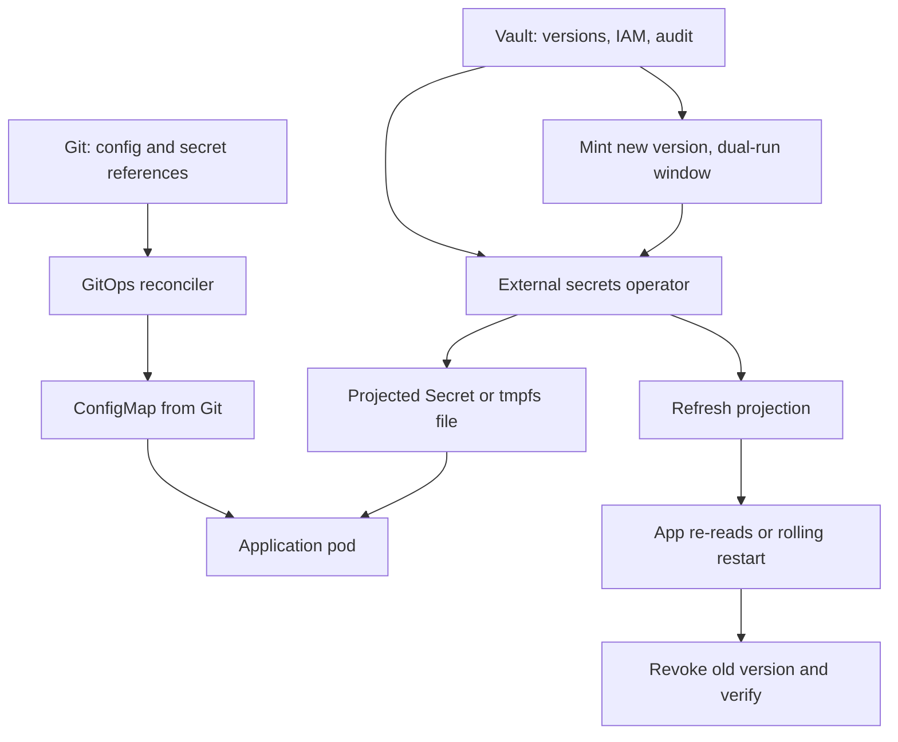

## Concept

Config is the non-secret data a process needs to start and to behave: feature flags, connection names, replica counts, timeouts, log levels. A secret is a credential the process needs to prove identity: passwords, tokens, private keys, encryption keys. Mixing them is the original sin of production. Putting both in the same ConfigMap, the same Git file, or the same "environment variables in the Deployment" blob is how you get a leaked database password in a support ticket and a feature flag that needs a cluster-admin to change.

At scale the problems are not "how do I kubectl create secret." They are blast radius, rotation, audit, and the fact that a hundred services cannot each invent a scheme. The platform owes one story for config, one story for secrets, and a rotation path that does not require a human to paste a value into a ticket.

### Config is not a secret, and a secret is not config

Config belongs in Git, reviewed, promoted with the same GitOps path as the workload. ConfigMaps, Helm values, and flag services are all valid backends. The rule is that a config change is attributable and reversible. Live-edit of a ConfigMap in production is a GitOps incident; it is also how you get a value that nobody can find when the pod restarts on another node.

Secrets do not belong in Git in plaintext. They also do not belong in ConfigMaps, which are readable by anyone who can get the object, appear in process lists when mounted as env, and are routinely dumped into incident docs. Kubernetes Secret objects are encoded, not encrypted at rest, unless you turned on encryption at rest and a KMS provider. Treat a vanilla Secret as a better ConfigMap, not as a vault.

The runtime view matters. Env vars are inherited, dumped in crash reports, and visible to every sidecar in the pid namespace depending on your isolation. File mounts with a restricted mode are easier to rotate (replace the file, send a signal or wait for a re-read) and harder to leak into logs if the application does not print its env. Default to files for secrets. Use env only when a runtime cannot read a file, and then accept the leak surface.

### Sealed secrets

Sealed Secrets (the Bitnami controller and its cousins) encrypt a secret with a cluster-side public key so the ciphertext can live in Git. Only the controller in that cluster can decrypt. This is a genuine improvement over plaintext in Git. It is also a key-management system of its own: the sealing key is the crown jewel, backup of that key is a disaster-recovery item, and a key rotation that you have not practiced will lock you out of every sealed blob.

Sealed Secrets win when you want Git to be the desired state for a small set of secrets, you can protect the sealing key, and you can live with per-cluster ciphertext (a blob sealed for staging will not unseal in production unless you sealed it twice). They lose when you need centralized rotation, a human IAM workflow, or one secret consumed by twenty clusters without twenty sealing operations. They also lose if developers seal with the wrong cluster key and the controller silently cannot decrypt — you wanted a render failure, not a missing env at runtime.

### External secrets

An external secrets operator (External Secrets Operator, Secrets Store CSI driver, a vault agent) treats the cluster as a cache. The source of truth is a vault: AWS Secrets Manager, GCP Secret Manager, Azure Key Vault, HashiCorp Vault, or an HSM-backed service. Git holds a reference (secret name, version, refresh interval), not the value. The operator writes a Kubernetes Secret or a tmpfs mount. Rotation in the vault becomes a new value in the cluster on the next refresh, if the application re-reads.

This is the pattern I want at scale. The vault has IAM, audit, versioning, and a rotation API. The cluster has a short-lived projection. The cost is a new availability dependency: if the operator cannot reach the vault, you must decide whether to keep the last cached value (stale credentials after a revoke) or fail closed (outage). Fail closed for credentials that were revoked. Fail open with a bound TTL for credentials that are still valid and a vault blip. Write that down. The default of many operators is "keep serving the last value forever," which is how a fired contractor's token lives in the cluster for six weeks.

CSI driver mounts can skip the Kubernetes Secret object entirely and put the file on a tmpfs. That reduces API-server visibility. It does not reduce the need for the application to re-read on rotation. A secret that is read once at process start will not rotate until you restart. Plan the restart or the re-read. A rolling restart of a thousand pods on every rotation is a load incident if you did not budget it.

### Rotation as a system, not a calendar reminder

Rotation is a control loop. A new version is minted, consumers are updated, the old version is revoked, and the revoke is verified. Calendar reminders in a spreadsheet produce expired certs and a SEV-1. Static passwords that "cannot rotate because twenty jobs hardcode them" are a backlog item that will become an incident when they leak.

Design consumers for two valid versions at once: a dual-key window for signing keys, a dual-password window for databases (create new user or new password, migrate, drop old). Kubernetes deployments then roll into the new value while the old still works. After the roll, revoke. If you revoke first, you have a flag day. Certificates need the same overlap: issue new, deploy, then let the old expire. Short TTLs only help if the issue-and-deploy path is automated. A 24-hour cert with a weekly pipeline is an outage on a timer.

Bootstrap secrets (the vault token the operator itself uses, the sealing key, the cluster identity) rotate too. They are easy to forget because they are "infrastructure." Put them on the same rotation machinery, with a break-glass that is itself a short-lived credential, not a password in a password manager that four people share.

### Ownership, blast radius, and the runtime view

Every secret has an owner, a consumer list, and a blast radius (what a leak allows). A shared "prod-db" password used by forty services is one leak away from forty services. Per-service credentials, scoped IAM roles, and short-lived tokens (IRSA, workload identity, SPIFFE) shrink that radius. Static, shared, long-lived is the anti-pattern the vault exists to replace. If you install a vault and then mint one password per environment, you have a more expensive ConfigMap.

Config blast radius is real too. A global ConfigMap that every namespace mounts will take the fleet down with one bad value. Scope config to the service, promote it like code, and canary config changes the same way you canary binaries. A timeout of 30s shipped to 100% is a binary-grade incident with no image change.

## Trade-offs

| Approach | When it wins | Cost / risk |
| -------- | ------------ | ----------- |
| ConfigMap plus plaintext Secret in cluster | Tiny clusters, no GitOps yet | No audit; env leaks; Git copies; no rotation |
| Sealed Secrets in Git | Few clusters, GitOps desired state, simple values | Sealing-key DR; per-cluster blobs; weak rotation story |
| External secrets from a vault | Many services, IAM, audit, rotation API | Operator and vault are production; stale-cache vs fail-closed |
| Workload identity / short-lived tokens | Cloud APIs, service-to-service, you can avoid static secrets | Not everything speaks it; bootstrap still exists |
| Env vars for secrets | Runtimes that cannot read files | Crash dumps, child processes, sidecars, hard to rotate live |

Sealed Secrets are a local maximum. I will use them for a small GitOps shop that is not ready for a vault, with a documented key backup and a plan to graduate. I will not use them as the forever design for a multi-cluster platform.

Vault-backed external secrets are the default at scale. The cost is operational: the operator's SLO, the vault's SLO, network policies, and an application contract for re-read. That cost is less than the incident in which a Git history contains every password you ever shipped.

Workload identity should eat as many static secrets as the cloud and your mesh allow. Database passwords and third-party API keys will remain. Do not wait for a perfect identity world to start rotating those.

## Diagram

## Failure modes

### Secrets in ConfigMaps, images, or Git history

A password in an image layer, a `.env` committed once, a ConfigMap that "was only for staging." Detection is secret scanning in CI, a linter that forbids Secret-looking keys in ConfigMaps, and a periodic scan of Git history. Assume anything that was ever committed is compromised until rotated.

Mitigation is block on scan, rotate the value, purge from runtime, and treat Git rewrite as optional theater: copies exist. Rotation is the fix. History rewrite is hygiene.

### Rotation that the application never sees

The vault has a new version. The cluster still has the old. The app still has the old in memory. You revoke. The app dies. Detection is a metric for projected version versus vault version, and an application metric for "last successful secret refresh."

Mitigation is a dual-validity window, a refresh interval shorter than the TTL, a re-read or a controlled roll, and a revoke that waits on a consumer count or a time bound you measured. Do not revoke in the same pipeline step that mints unless the consumer is known to pick up in seconds.

### Operator or vault outage

The operator cannot fetch. Pods restart and cannot start, or they start with empty env. Detection is operator health, vault latency, and pod crash-loop after a deploy that coincided with a vault blip.

Mitigation is cache with a TTL, fail-closed on explicit revoke, fail-open on fetch errors inside that TTL, and not restarting the whole fleet during a vault incident. Bootstrap the operator's own credential with a path that does not depend on the operator.

### Sealing-key loss or cluster clone

The Sealed Secrets key is unbacked-up, or a cloned cluster decrypts production blobs. Detection is a DR test that restores a cluster and unseals, and a policy that sealing keys are per environment.

Mitigation is backup of the key in a vault, per-cluster keys, and not using Sealed Secrets for the highest-value credentials if you cannot run that DR test. Move those to external secrets.

## Real-world example

Kubernetes platform teams at companies that have talked publicly about External Secrets Operator, Secrets Store CSI, and sealed-secrets-as-a-bridge — the usual large SaaS platform org — end up with a split that looks like this. Config lives in Git and is promoted as GitOps. Static secrets live in a cloud secret manager. The operator projects them into namespaces. Workload identity replaces cloud API keys wherever the SDK supports it. Sealed Secrets remain only for a few bootstrap values or for clusters that cannot reach the vault.

The production lesson is rotation. Teams that "installed ESO" and never dual-keyed a database password still have a flag-day rotate. Teams that made re-read a library default, put version ids in logs (not the secret), and paced rolling restarts through the same surge budget as a deploy, can rotate a leaked credential in a working day without a second outage. The platform's job is that library, that operator SLO, and a lint that keeps passwords out of ConfigMaps. The application's job is to not print the file, and to not require a unique human ritual per service to pick up a new value.

Copy the split: Git for config, vault for secrets, identity where you can, dual-version rotation, files over env. Do not copy a blog that puts every secret in Git because "GitOps." GitOps for secrets is a reference in Git, not a value in Git.

## What to remember

- Config is reviewed in Git; secrets are references to a vault (or sealed ciphertext as a stepping stone), never plaintext in Git or ConfigMaps.
- Prefer file mounts and re-read over env vars; prefer short-lived workload identity over static shared passwords.
- Rotation is mint, dual-run, consume, revoke, verify — a calendar reminder is not a control loop.
- The operator and the vault need SLOs, a cache TTL, and a fail-closed rule for revoked credentials; a green sync of empty secrets is an outage.
