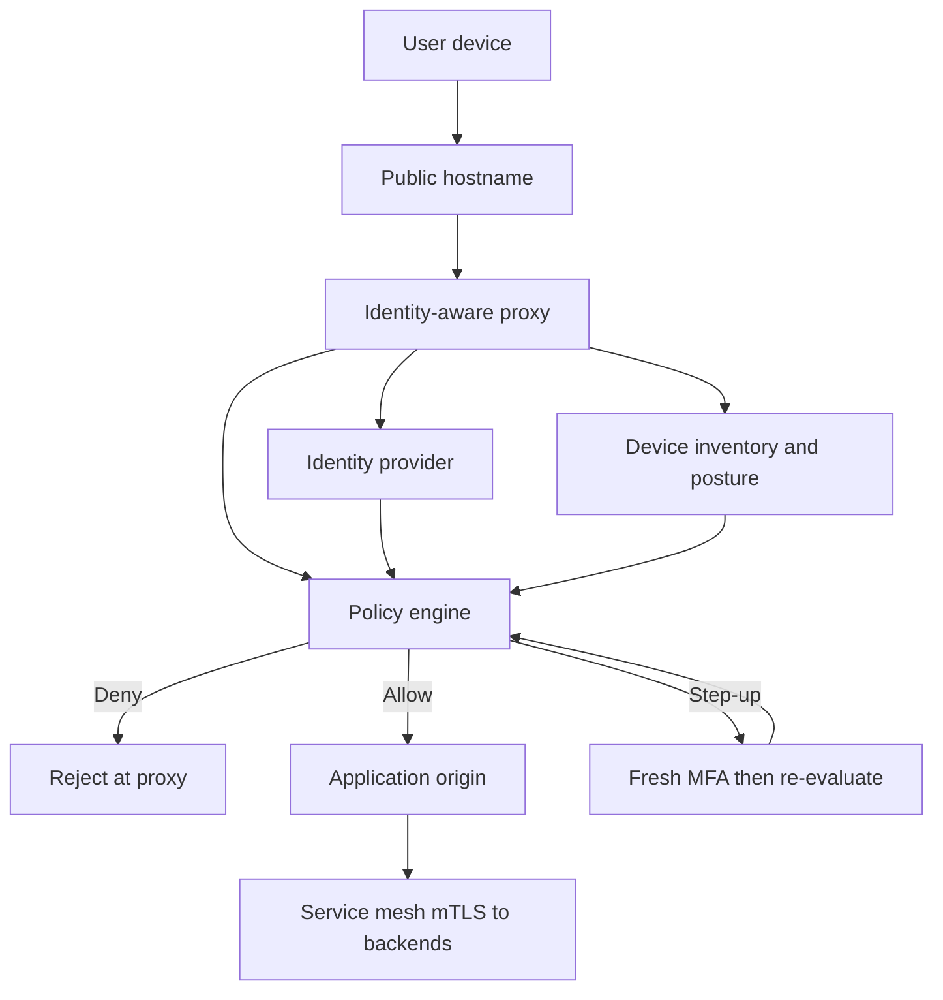

## Concept

Zero trust is a decision architecture, not a product you buy and park in front of the network. The decision is: every request is untrusted until an identity, a device, a resource, and a context have been evaluated against a policy you can name. The corporate LAN, the VPN pool, and the "internal" Kubernetes CIDR stop being a permit. They become unprivileged transport. If a packet arrived from a private address, that fact is a hint at most. It is never an authorization.

I treat that sentence as a constraint on how traffic is admitted, how it is re-checked, and how it is logged. Teams that skip those three layers ship a new perimeter with a fashionable name.

### Identity-aware proxy as the north-south gate

The identity-aware proxy (IAP) is the component that makes zero trust concrete for human-to-service traffic. A browser or CLI hits a public hostname. The proxy interrupts before any origin byte is read. It demands an authentication session from the identity provider, binds that session to a device posture record, and only then asks a policy engine whether this principal may reach this resource under this context. If the answer is deny, the origin never sees the request. If the answer is allow, the proxy forwards, typically with a signed identity header or a short-lived token the origin can re-verify.

The origin's security group or mesh policy should still refuse traffic that did not come through the proxy. Zero trust fails open the moment a developer publishes a second hostname that bypasses the gate "just for debugging." The IAP is only as strong as the guarantee that it is on the only path.

Policy at this gate is resource-scoped, not network-scoped. "Engineers in group payments-oncall, on a company-owned laptop that is patched and disk-encrypted, may reach the payments admin UI from a managed country, during an on-call shift" is a policy. "Anyone on the 10.0.0.0/8 VPN" is a network story pretending to be a policy. The first one survives a stolen password. The second one grants the thief the whole campus.

### Device, user, and context are separate signals

A user identity that passed MFA last Tuesday is not a device that is still healthy this afternoon. Split the signals. The identity provider asserts who the human is and how recently they proved it. A device inventory asserts hardware identity, disk encryption, OS patch age, and whether the endpoint management agent is live. A context layer asserts network reputation, geo, time, and sometimes the sensitivity of the resource being touched.

The proxy must be able to fail closed on a missing signal. "Device unknown" is not "device healthy." A BYOD exception is an explicit policy with a reduced resource set, not a skipped check. If you cannot distinguish a managed laptop from a personal phone, you do not have a device signal. You have a checkbox.

Re-evaluation is part of the design. A session that was allowed at 09:00 can be revoked at 09:12 when the laptop falls out of compliance or the user is disabled. That requires the proxy to consult a near-real-time source of truth, not a JWT that was minted at login and trusted until expiry. Short-lived assertions plus a revocation channel are the usual pair. Long-lived cookies that only the identity provider can kill, with the proxy polling or receiving a push, also work. A twelve-hour access token with no revocation path does not.

### Policy engines replace the perimeter diagram

The interesting software is the policy engine, not the TLS terminator. It consumes tuples of principal, device, resource, action, and context, and returns allow, deny, or allow-with-step-up. Step-up is how you keep daily work cheap and high-risk work expensive: a code review is allowed on a healthy laptop; a production data export demands a fresh MFA and a ticket id in the request.

Write policies as data, review them as code, and test them as code. A YAML file that only the security team can read will drift from the services that actually exist. A unit test that says "a contractor device cannot read the payroll admin API" will catch the next well-meant exception. I want the resource catalog to be generated from the same source that publishes hostnames, so a new internal tool is denied by default until someone writes a policy for it.

Coarse policies recreate the old VPN. "All employees can reach all internal apps" is a perimeter with extra login screens. Start from deny, group people by the job they do, and bind groups to resources, not to CIDR blocks. When a team is acquired, you add a group and a set of resources. You do not punch a hole in a firewall and hope the hole is temporary.

### East-west traffic still needs an identity

Zero trust that stops at the human-facing proxy is incomplete. Once a request is inside the mesh, service-to-service calls are the next perimeter people invent: "it came from the cluster, so it is fine." It is not fine. A compromised pod, a developer kube-port-forward, and a CI job with a broad service account all sit on that network.

The same rule applies: authenticate the caller as a workload identity, authorize the call against a policy for that identity and that method, encrypt on the wire. Mutual TLS with a SPIFFE identity, which the next essay in this set covers, is the usual east-west mechanism. The IAP does not replace it. The IAP is how humans enter. Workload identity is how services speak. Confusing the two produces systems where a stolen pod token is as powerful as a stolen VPN credential used to be.

## Trade-offs

| Approach | When it wins | Cost / risk |
| -------- | ------------ | ----------- |
| Castle-and-moat VPN plus network ACL | Small, static offices where every client is managed and the app count is tiny | Credential theft equals campus access; lateral movement is free once inside |
| Identity-aware proxy in front of each app | Workforce access to internal web and SSH from untrusted networks | Every origin must be unreachable except through the proxy; device inventory becomes a production dependency |
| Mesh mTLS and workload policy for east-west | Service-to-service calls inside the platform | Identity issuance, rotation, and policy sprawl; a mesh outage is an auth outage |
| Hybrid: IAP north-south, mesh east-west, VPN only for break-glass | Most companies that already have a private network and a public IdP | Two control planes to operate; break-glass paths become the real perimeter if left open |
| Coarse "all employees" policies | First week of a migration, to prove login works | Recreates the VPN with extra steps; a phished account still reaches everything |

The cost that surprises teams is operational, not cryptographic. Device inventory, identity provider availability, and policy review now sit on the request path. An outage of any of those is an access outage. Design the failure mode before you cut over: cached allows with a short TTL for already-evaluated sessions, hard deny for new sessions, and a break-glass path that is named, logged, and time-boxed.

The cost that surprises security teams is product friction. If the proxy adds two seconds and a second MFA to every admin click, people will invent shadow hostnames. Measure login time and policy-evaluation time the way you measure p99 of the app. A zero-trust program that users route around is a perimeter again, just undocumented.

## Diagram

The path below is the one I want in a design review for workforce access. The origin is not on the public internet. The proxy is. Nothing after the proxy is trusted because of its address.

## Failure modes

### Stale or missing device posture

**Detection.** Access logs show allows for device ids that the inventory last saw days ago, or for devices with no record at all. A lost laptop still reaches internal apps until someone remembers to revoke it. Endpoint management dashboards and the proxy's allow metrics disagree.

**Mitigation.** Treat "last seen" as a first-class signal with a hard TTL. If the agent has not checked in inside that window, the device is non-compliant and the proxy denies or forces a reduced policy. Lost and stolen flow must hit the same inventory the proxy reads, not a separate spreadsheet. Test the lost-laptop path the way you test a deploy.

### Policy that is secretly a perimeter

**Detection.** A handful of groups appear in almost every allow rule. New apps are published with "all staff" because that is the template. Incident reviews after account takeover show the attacker moved laterally across unrelated tools with one phished session.

**Mitigation.** Default deny for new resources. Require an owner and a named group per application. Alert when a policy grants a broad group to a high-sensitivity resource. Run an access review that asks "who actually used this in ninety days" and drop the rest. Coarse policy is a migration tactic, not an end state.

### Break-glass paths left standing

**Detection.** A bastion, a VPN profile, a kubecontext, or a "debug" load balancer still accepts traffic that never hit the IAP. Use counts on those paths stay non-zero after the cutover date. The break-glass runbook has no ticket requirement and no expiry.

**Mitigation.** Put break-glass behind the same IAP with a step-up policy, or behind a just-in-time vendor that mints a short-lived credential into a logged session. Time-box every exception. Page someone when break-glass is used. If you cannot see it, it is your real perimeter.

### Identity provider or policy engine outage

**Detection.** Proxy error rates jump while origins are healthy. Users cannot log in. Existing sessions may still work if you cached decisions, or everyone is locked out if you did not. On-call for the IdP and on-call for the app page at the same time.

**Mitigation.** Cache positive decisions for a short, explicit TTL, and fail new authentications closed. Keep a second IdP or a degraded read-only replica only if you have tested failover, including group membership freshness. Do not fail open to "allow because the policy service is down." That is the old network, with worse logging.

## Real-world example

Google's BeyondCorp is the public system that moved this from a slide to a production access path. The problem was familiar: a global workforce, a VPN that had become a broad permit, and a growing set of internal applications that should not be on the public internet. The response was to take the VPN off the critical path and put an access proxy in front of those applications.

A request to an internal tool hit a frontend that Google controlled. The frontend did not trust the source network. It asked who the user was, using the corporate identity system, and it asked what the device was, using an inventory that knew whether the endpoint was company-managed, encrypted, and healthy. A policy layer combined those signals with the resource being requested. Only then did the request reach the origin. Device trust was not a one-time enroll. A machine that fell out of patch policy lost access without waiting for a human to revoke a VPN account.

Two design choices in that program are the ones I still copy. First, the applications were made unreachable except through the proxy. BeyondCorp would have been a second login screen in front of a still-flat network if engineers could still dial a private address. Second, access decisions were specific. An employee did not receive "the internal network." They received a set of applications their role and device justified. Phishing still happened. The blast radius of a stolen password shrank to what that user's policy allowed on that device, which is a different incident from "the attacker is on the campus LAN."

Google later described the companion problem for production service-to-service traffic as BeyondProd. That split is the architecture: humans through an identity-aware proxy, workloads through mutual authentication and a policy that names services, not subnets. Most companies I review are trying to buy the first half and postpone the second. The second half is where a compromised job becomes a data dump. BeyondCorp is the north-south pattern. It is not a substitute for service identity.

## What to remember

- Treat every request as untrusted until user, device, resource, and context have been evaluated; a private IP is not an authorization.
- Put an identity-aware proxy on the only path to internal apps, and keep service-to-service calls on workload identity rather than cluster membership.
- Write deny-by-default policies as tested data, and re-evaluate sessions when posture or identity changes.
- Design IdP and inventory outages, and time-boxed break-glass, before you turn the VPN off; a path you cannot see is still a perimeter.
