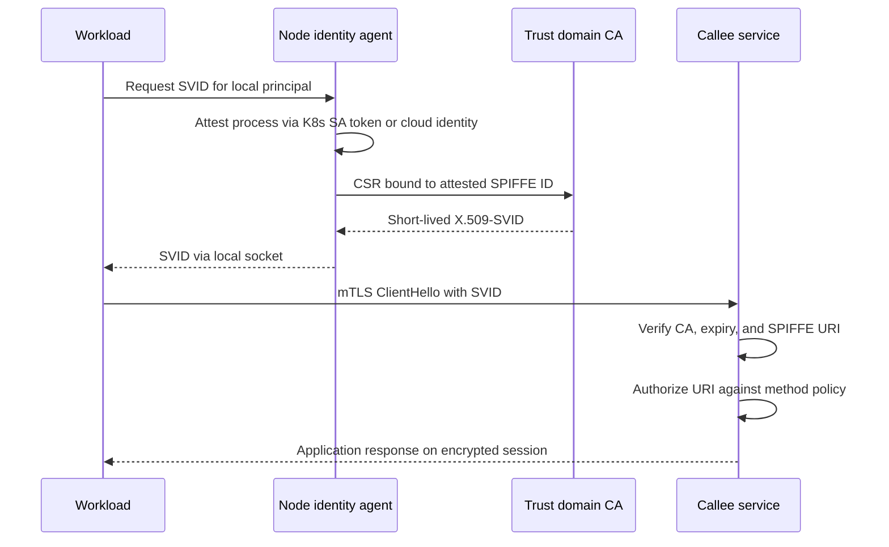

## Concept

Mutual TLS is how two processes prove who they are to each other and then encrypt the conversation. One-way TLS proves the server. Mutual TLS proves both. The certificate is not "the pod IP with extra steps." It is a bearer of a stable workload identity that policy can name: this billing service, in this trust domain, is allowed to call this method on this ledger service. If your authorization still keys on source IP or on a Kubernetes namespace annotation that anyone in the namespace can mint, you have encryption without identity.

I want three artifacts in the design: an identity document, a short-lived proof of that identity, and a handshake that both sides verify before application bytes move.

### SPIFFE IDs as the name you authorize

SPIFFE, the Secure Production Identity Framework for Everyone, gives you a URI as the canonical name of a workload. A typical ID looks like `spiffe://payments.example.com/ns/prod/sa/ledger`. The trust domain (`payments.example.com`) is the CA and policy universe. The path is whatever you choose to make unique and stable: environment, namespace, service account, or a purpose-built workload name.

That URI is what ACL and authorization policy should mention. Do not authorize `10.8.3.14` and do not authorize `CN=ledger-7d9f`. IPs churn. Common names get copied into the next microservice. A SPIFFE ID is intended to survive reschedules, new replica sets, and language changes. When a human asks "who can debit the ledger," the answer should be a list of SPIFFE IDs, not a CIDR.

Keep the path conservative. Encoding a git SHA or a pod name in the identity makes every deploy a new principal and every policy a wild-card. Encode the security principal: the service account, the job name, the customer-facing API. Put version and instance in telemetry, not in the name you authorize.

### SVIDs: the document you actually present

An SVID, a SPIFFE Verifiable Identity Document, is how a workload proves it owns that URI. In production the usual SVID is an X.509 certificate whose SAN contains the SPIFFE ID, issued by the trust domain's CA, with a lifetime measured in hours. A JWT-SVID is the same identity as a signed JWT, useful when you must cross a hop that cannot terminate TLS, such as a message you will verify later. Prefer X.509-SVID for live RPC. Prefer JWT-SVID for async work that needs to carry identity after the socket is gone.

Issuance is the hard part. A node agent (SPIRE agent, or a mesh equivalent) attests the process: Kubernetes service account token, AWS instance identity document, a TPM, a joined node that already has a parent SVID. Only after attestation does the agent mint or fetch an SVID into a local socket or a mounted file that only that workload can read. The workload never holds the CA key. The CA never trusts a CSR that arrived from an unauthenticated pod IP.

Rotate aggressively. A four-hour certificate with overlap, so the new one is in place before the old one dies, is the default I want. A year-long certificate is a stolen-secret incident waiting for a calendar. Rotation is a control-plane SLO: if issuance stalls, handshakes start failing when the last valid cert expires. Watch time-to-expiry on every identity, not only CA expiry.

### The mTLS handshake, practically

The client presents its certificate. The server presents its certificate. Each side verifies: trusted CA or an intermediate you actually pin, unexpired, correct key usage, and a SAN SPIFFE ID that matches the peer you intended to call. Intended-to-call is the step teams skip. A valid cert from the same CA for a different SPIFFE ID is a successful cryptographic handshake and a failed authorization. TLS libraries will accept it unless you check the URI.

After the handshake, encrypt as usual. Then authorize. Authorization is not "the cert was valid." Authorization is "this SPIFFE ID may invoke `POST /debits` on this service." Put that rule in the mesh (Istio AuthorizationPolicy, Linkerd ServerAuthorization) or in application middleware that reads the verified URI from the connection, not from an untrusted header. Headers can be added by anyone on the path. The peer certificate cannot, once you have terminated TLS in a place you trust.

Where you terminate matters. Sidecar-to-sidecar mTLS gives you identity at the pod edge and leaves the app speaking plaintext on localhost. That is acceptable if localhost is really local and the app is not shared. Terminate in the app when you do not trust the sidecar boundary, or when you must make authorization decisions on request fields the sidecar cannot see. Do not terminate at a load balancer and then trust `X-Forwarded-Client-Cert` unless that header is stripped at the edge and rewritten by a component you control.

### Workload identity is not network identity

Network identity says "this packet came from a CIDR we assigned." Workload identity says "this process proved it is this principal." They diverge the moment two workloads share a node, the moment a debug container joins the pod, and the moment a job is rescheduled onto a new IP. Network policy is still useful as defense in depth: limit who can open a TCP connection. It is a terrible primary authorization mechanism in an orchestrator that hands out IPs from a pool.

Bind identity to the orchestrator's notion of a principal (Kubernetes service account, Cloud IAM service identity) and let the attestation plugin check that binding. A SPIRE Kubernetes workload registrar that maps `serviceAccount:ledger` in `namespace:prod` to `spiffe://.../ns/prod/sa/ledger` is the practical join. If a developer can create a service account in that namespace, they can obtain that identity. Namespace RBAC is therefore part of the identity design, not a separate conversation.

## Trade-offs

| Approach | When it wins | Cost / risk |
| -------- | ------------ | ----------- |
| One-way TLS plus network ACL | Small static fleets, few callers, IPs that almost never change | IP reuse and shared nodes impersonate callers; no cryptographic caller name |
| Long-lived certs on disk, rotated by humans | Air-gapped boxes with rare deploys | Stolen files stay valid; forgotten rotation is an outage or a compromise |
| Mesh-issued short-lived X.509-SVIDs | Polyglot RPC inside one cluster or trust domain | Sidecar cost; mesh control plane is now on the auth path |
| SPIRE or equivalent with attested issuance | Multiple runtimes, clouds, and a need to name identities outside one mesh | Attestation plugins to operate; node agent becomes critical |
| JWT-SVID on messages, mTLS on live calls | Queues and callbacks that must carry identity after the socket | JWT validation bugs; replay unless `jti` and audience are enforced |

The operational cost is issuance and failure domains. A CA or SPIRE server outage does not take down existing connections until certificates expire, which is why short TTL without a highly available issuer is a time bomb. Run the issuer like a database: multi-instance, backed-up keys in an HSM or cloud KMS, and an alert on issuance latency.

The security cost of convenience is identity granularity. One SPIFFE ID for an entire namespace means every job in that namespace is the payments API. One ID per replica means policy cannot be written. Service-account granularity is the default that survives contact with RBAC.

## Diagram

Issuance and the first RPC are different protocols. The sequence below is the one I walk in a review: attest, mint, present, verify URI, then authorize the method.

## Failure modes

### Clock skew and expiry cliffs

**Detection.** Handshakes fail with certificate-expired or not-yet-valid errors in a slice of the fleet. Nodes with drifted clocks cluster in the same failure domain. A rotation job that issues certs valid "from now" rejects clients that are two minutes fast.

**Mitigation.** NTP or chrony as a production dependency, with alerts on offset. Issue certificates with a small not-before skew allowance, and rotate well before not-after. Never set TTL so short that a ten-minute issuer incident expires every identity. Watch the histogram of remaining lifetime.

### CA or intermediate compromise

**Detection.** Unexpected issuers in peer certificates, or a spike in identities that do not match registered workloads. After an incident, you cannot be sure which SVIDs were minted by an attacker.

**Mitigation.** Keep CA keys in an HSM or KMS with dual control. Use intermediates so a leaf incident does not force a root ceremony. Publish and rotate trust bundles through the same control plane that issues SVIDs. Have a tested distrust procedure: new intermediate, bundle push, and a deadline after which the old intermediate is rejected. That deadline is an availability event. Rehearse it.

### Identity too coarse or too easy to mint

**Detection.** Authorization policies list one ID that covers many binaries. A debug pod using the same service account can call production mutators. Cluster RBAC allows developers to create service accounts in prod namespaces.

**Mitigation.** Map one service account to one SPIFFE ID to one binary. Split read and write principals if the blast radius demands it. Lock who can bind the service account to a workload. Treat namespace admin as identity admin.

### Rotation storms and thundering herds

**Detection.** Issuer CPU and signing latency spike on the hour. New pods wait on SVID fetch and fail readiness. A fleet-wide restart after an outage repeats the spike.

**Mitigation.** Jitter rotation. Prefetch the next SVID. Cache on the agent so a new container on a healthy node is a local issue, not a CA issue. Load-test issuance at the rate of a region failover, not at the rate of a quiet afternoon.

## Real-world example

Istio's workload identity is the public system most platform teams actually run. Each service account in a mesh namespace is projected to a SPIFFE ID of the form `spiffe://<trust-domain>/ns/<namespace>/sa/<serviceaccount>`. Citadel, or a cert-manager integration, issues short-lived certificates into the sidecar. Envoy on each pod performs mTLS. Peer Authentication can require mutual TLS so a plaintext caller is dropped. AuthorizationPolicy then allows or denies based on the source SPIFFE ID and the HTTP method or gRPC service.

The useful lesson is the split between cryptography and authorization. Turning on mTLS in Istio encrypts the mesh and proves membership in the trust domain. It does not prove that `checkout` may call `charge`. Until you write that policy, every identity the CA will mint is a valid caller. Teams enable STRICT mTLS, celebrate the dashboard, and leave AuthorizationPolicy at allow-all. That is a VPN made of certificates.

The second lesson is attestation. Istio trusts the Kubernetes control plane to bind a service account to a pod. If an attacker can create a pod with `serviceAccountName: checkout` in the right namespace, they receive checkout's SVID. Mesh identity does not replace RBAC. It concentrates RBAC into "who can assume this service account." Reviews that skip that question are reviewing TLS, not identity.

SPIRE shows the same pattern off the mesh: agents attest, the server issues SVIDs, workloads fetch from a local API, and applications or proxies present X.509 or JWT. Google's ALTS is the internal cousin, with workload identity baked into the RPC stack rather than a sidecar. The architecture does not change: a name, a short-lived proof, a handshake that checks the name, a policy that names callers.

## What to remember

- Authorize SPIFFE IDs, not IPs or certificate common names; mTLS without a URI check is encryption plus an anonymous peer.
- Issue short-lived SVIDs from an attested agent; the workload never holds the CA, and year-long files on disk are stolen-secret incidents.
- Terminate mTLS where you trust the identity, then authorize the method; a valid cert for the wrong principal is a failed authorization.
- Treat CA availability, clock sync, and Kubernetes RBAC on service accounts as part of the identity system, because they are.
