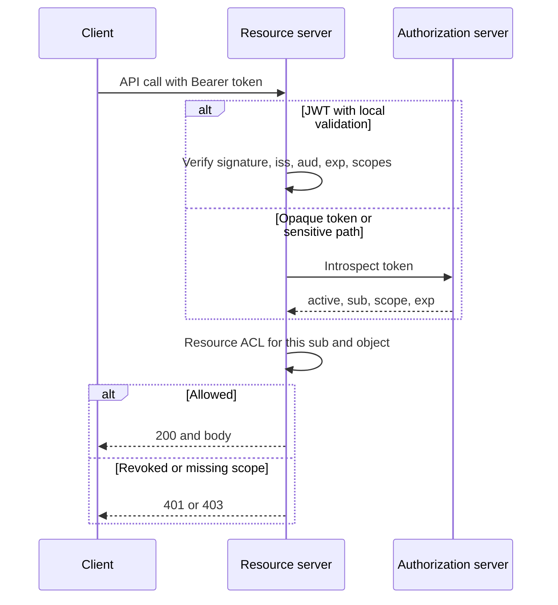

## Concept

An access token is a capability. The authorization server mints it after a grant. The resource server must decide, on every call, whether that capability is still valid, still belongs to this caller, and is enough for this method. OAuth scopes, local JWT validation, and token introspection are three different ways to answer that question. Mixing them without a rule produces APIs that accept revoked tokens, or APIs that round-trip the authorization server on every read.

I design the token as a contract between three parties: the client that requested a grant, the authorization server that remembers the grant, and the resource server that must not invent authority.

### Scopes are coarse, named capabilities

A scope is a string the authorization server places on the token, such as `orders:read`, `orders:write`, or `payments:refund`. The client asks for scopes. The user or the policy may grant a subset. The resource server checks that the required scope is present before it runs the handler.

Scopes are not a complete authorization model. They do not say which order, which tenant, or which amount. After the scope check you still need resource-level rules: this subject may refund payments for merchant `acct_123` up to the role's limit. If you try to encode every object id in a scope, you mint a new token per object and you cannot revoke a single grant without a zoo of strings. If you skip the object check, a token with `orders:write` can mutate any order the API can see.

Name scopes after capabilities the product understands, not after microservices. `inventory-service.internal` is a network name leaking into OAuth. `inventory:adjust` is a capability you can grant to a partner and deny to a storefront. Keep the set small. A dozen well-named scopes beat a hundred that nobody can review. Map HTTP methods to scopes in one table so two handlers cannot disagree.

Consent and least privilege start at request time. A first-party SPA should not request `admin:all` because it is easier. A third-party integration should receive the smallest set that makes the integration work, and the consent screen should list those strings in human language. Scope inflation is how a calendar plugin receives mail read.

### Local JWT validation

When the access token is a JWT, the resource server can verify it without calling home: signature against the authorization server's JWKS, `iss` and `aud` match, `exp` is in the future, and the `scope` claim contains what the handler needs. That is fast, cacheable, and works in a mesh sidecar.

It is also eventually consistent with revocation. A JWT is a letter the bearer can keep presenting until `exp`. If you disable a user, rotate a client secret, or the user clicks revoke, every already-issued JWT remains valid until it dies. The mitigation is a short lifetime, often five minutes, plus a refresh token that the authorization server can revoke. The resource server still will not know about the revoke until the access token expires, unless you add a denylist or you stop using JWT as the only signal.

Validate claims explicitly. Libraries that only check the signature will accept a token with the wrong `aud`, which is how a token minted for the public API is replayed against the admin API. Pin `iss` to the authorization server you deploy, not to "any issuer in the JWT." Reject `alg=none` and unexpected algorithms. Fetch JWKS over TLS, cache them, and have a path to rotate keys without an outage: publish the new key, sign with it, then retire the old one.

Do not stuff authorization decisions you will regret into the JWT. A list of every tenant the user can access, snapshotted at login, goes stale when they lose a tenant. A role string that the resource server trusts without a local check becomes a confused-deputy gift if any other service blindly copies claims into a header.

### Token introspection

RFC 7662 introspection is the opposite shape. The access token can be opaque. The resource server sends it to the authorization server's introspection endpoint, authenticates as a resource server, and receives JSON: `active`, `sub`, `scope`, `exp`, and whatever else you agreed. If `active` is false, the token is expired, revoked, or unknown. That is the point. Revocation is immediate, from the resource server's perspective, as soon as introspection reflects the authorization server's store.

The cost is a network hop on the request path, a new dependency, and a new failure mode. Cache introspection results briefly, keyed by a hash of the token, with a TTL much shorter than the token lifetime. A sixty-second cache is a sixty-second revocation delay, which is usually acceptable and saves the authorization server from becoming the rate limiter of every API. Do not cache `active: false` for a long time if you might have had a transient error; fail closed on introspection outages unless you have a documented degraded mode.

Protect the introspection endpoint. It answers "what can this token do" and can be used as an oracle. Require mTLS or a resource-server credential. Rate-limit it. Never log the raw token. Hash it if you must log a correlation id.

### Combining scopes, JWT, and introspection

A pattern that holds up: mint a JWT access token with a short lifetime and the scopes you need at the edge; use introspection or a denylist only for the few operations where a five-minute revoke window is too long (payments, session kill, admin impersonation); always apply resource-level authorization after the scope check. First-party service-to-service calls can use JWT with a tight `aud` and a SPIFFE-backed client credential. Third-party user grants can use opaque tokens and introspection so a partner revoke is not a JWT waiting game.

The resource server should have one function: `authenticate(request) -> principal, scopes, token_id`. Handlers consume that object. They should not parse JWTs in three different middleware stacks with three different libraries.

## Trade-offs

| Approach | When it wins | Cost / risk |
| -------- | ------------ | ----------- |
| Local JWT validation | High QPS APIs, mesh sidecars, tokens with five-minute lives | Revocation lags until expiry; claim bloat; `aud` mistakes |
| Opaque token plus introspection | Third-party grants, admin actions, any revoke-must-be-now path | Auth server is on the hot path; cache vs freshness; outage is an auth outage |
| JWT plus short denylist of `jti` | Mostly local validation with an emergency kill switch | Denylist distribution; every resource server must consult it |
| Fat scopes that encode object ids | Tiny APIs with a handful of objects | Token sprawl; impossible reviews; still misses attributes |
| Thin scopes plus local resource ACLs | Almost every product API | Two layers to implement; easy to forget the second |

The latency budget decides more than the RFC does. Introspection cached for a few seconds is fine behind a gateway that already spends milliseconds on TLS. Uncached introspection from every sidecar in a 50-service call graph is how you DDoS your own Okta tenant. Push validation to the edge gateway when you can, pass a verified internal identity downstream, and do not re-parse the user token in every hop.

The security budget decides the rest. If a stolen token in a HAR file should die when the user clicks revoke, you need introspection or a denylist. If the token lives five minutes and cannot call money-moving endpoints, JWT is enough. Do not pick JWT because it is "stateless" and then put twenty minutes of admin power in it.

## Diagram

The sequence is the resource server's job, not the client's. Clients obtain tokens. Resource servers decide.

## Failure modes

### Overbroad scopes and missing object checks

**Detection.** A partner integration with `orders:write` can PATCH another customer's order. Audit logs show object ids the client never owned. Scope middleware returned 200 because the string was present.

**Mitigation.** Keep scopes as verbs on a type, then load the object and check tenant and owner. Add authorization tests that use a valid token for tenant A against tenant B's ids. Treat a missing object ACL as a vulnerability, not a backlog item.

### Revoked JWT still accepted

**Detection.** After a user reset, a stolen access token still works until `exp`. Security asks when revoke takes effect and the honest answer is "up to fifteen minutes." Admin impersonation tokens outlive the ticket.

**Mitigation.** Shorten access-token TTL. Put high-risk routes on introspection or a `jti` denylist. Revoke refresh tokens immediately so the attacker cannot mint the next access token. Measure revoke-to-deny time as an SLO for those routes.

### Introspection bottleneck or fail-open

**Detection.** Authorization-server latency becomes API latency. Timeouts cause either a brownout or, worse, middleware that treats a failed introspection as active. Cache stampedes after an auth-server restart.

**Mitigation.** Fail closed on errors. Cache by token hash with a small TTL and jitter. Bulkhead and circuit-break the introspection client so a sick auth server degrades to 503, not to allow. Scale the auth tenant for introspection QPS, not only for login QPS.

### Confused deputy and audience mistakes

**Detection.** A token minted for the public API is accepted by an internal admin API. A backend forwards the caller's bearer token to a more powerful service. That service trusts the token because the signature is valid.

**Mitigation.** Require `aud` to match the resource server. Do not forward user tokens hop to hop. Exchange for a constrained token or use service identity for the downstream call, carrying the user as a signed, audience-bound claim if you must. Each hop names its caller.

## Real-world example

Auth0 is a public authorization server that forces this design into the open because it supports both JWT access tokens and opaque tokens with introspection. A typical API is registered as an audience. Clients request that audience and a list of scopes you defined on the API. Auth0 mints an access token. If you chose JWT, the API validates RS256 against the tenant JWKS, checks `aud`, and looks at the `scope` string. If you chose opaque, the API calls the tenant's introspection endpoint with its own credential and trusts `active` and `scope` from the response.

The product lessons I take from running that pattern in earnest are mundane and expensive when skipped. First, custom APIs need an explicit audience. A token with no `aud` or with the `/userinfo` audience will be presented to your API by a confused client, and a sloppy validator will accept it. Second, RBAC in Auth0 (roles to permissions) is still a scope-shaped signal. It does not know your `order_id`. The API still loads the order and checks the org. Third, revocation of a JWT access token is not instant. Password change, session revoke, and user block update the authorization server. Resource servers that only check signatures learn later. Teams that put a logout button on a fifteen-minute JWT and tell customers the session is dead are describing refresh-token revoke, not access-token death.

GitHub's OAuth scopes are the other public textbook: `repo` versus `public_repo` versus fine-grained repository permissions. The coarse scopes became a standing lesson in blast radius. A token with `repo` is a skeleton key for private code. GitHub spent years shrinking that. Your API will follow the same curve if you start with `full_access` because the first partner asked for it.

## What to remember

- Scopes name coarse capabilities; they never replace a check that this subject may touch this object in this tenant.
- JWT validation is fast and revocation-lagged; introspection is fresh and puts the authorization server on the request path.
- Always verify issuer, audience, expiry, and algorithm; a signed token for the wrong API is still a failed authentication.
- Fail closed when introspection is down, cache briefly by token hash, and keep high-risk routes on a revoke path that meets a measured SLO.
