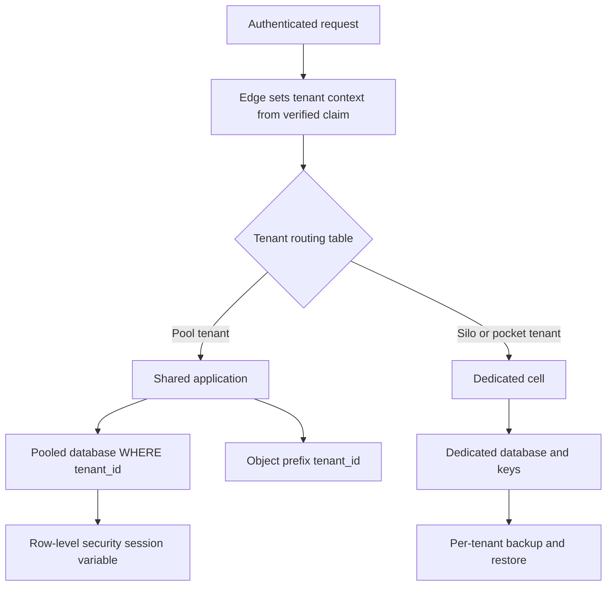

## Concept

A tenant is the isolation boundary a customer thinks they bought: their users, their data, their encryption context, their noisy-neighbor fate. Multi-tenancy is how you pack those boundaries onto shared computers without lying about the packing. The three models that keep showing up in design reviews are silo, pool, and bridge. They are not brand names. They are answers to how much of the stack is shared, and therefore how a bug, a restore, and a noisy query propagate.

Pick the model per layer if you must, but name the tenant id once and thread it through every layer. A pool database with a silo-shaped object store and a forgotten `tenant_id` in one query is a single model: leaky.

### Silo: one stack per tenant

In a silo, the tenant receives a dedicated application instance, a dedicated database, or both. The isolation primitive is the one the platform already knows: a separate cluster, a separate schema with separate credentials, a separate encryption key, a separate deployment. Cross-tenant queries cannot happen in SQL because there is no other tenant in the catalog. Restore is a restore of that tenant. Noisy neighbors are someone else's problem until they share a hypervisor.

Silo wins when a contract, a regulator, or a data-residency rule says "this customer's data shall not sit in the same database as anyone else's," or when one customer is large enough to pay for the waste. It loses on unit economics and on the release tax: N databases means N migrations, N connection pools, N backup jobs, and a control plane that must not forget a tenant. Teams that silo "just the database" and share the app still have a pool at the app layer. That is valid. Call it that.

The control plane is the real product. Provisioning a silo is a workflow: allocate, migrate schema, mint credentials, attach to a router that maps `customer.example.com` or a tenant header to that instance. Deprovisioning is a workflow with a retention hold. If those workflows are tickets in a wiki, you do not have silo tenancy. You have a professional-services farm.

### Pool: shared stack, tenant column, tenant context

In a pool, every tenant shares the application and the database. Every row that can belong to a customer carries `tenant_id`. Every query, every object-store prefix, every cache key, every queue message, and every log line includes it. Authorization is "this principal belongs to this tenant, and this row's tenant matches." The isolation primitive is application discipline plus tests, with optional database features (row-level security, session `SET tenant`) as a second fence.

Pool wins on density and on one-release-to-all. It loses on blast radius. A missing `WHERE tenant_id = ?` is a data leak. A hot tenant burns the shared CPU. A restore of yesterday's backup restores everyone, which is a gift and a disaster depending on who asked. Encryption at rest is usually one key per cluster unless you add per-tenant keys and envelope encryption, which you should once a customer asks for key control.

The practical mechanics I insist on: a request-scoped tenant context set at the edge from a verified claim, never from an untrusted header the client can edit; query builders that take that context as a required argument; foreign keys that cannot point across tenants; unique indexes that include `tenant_id` so two tenants can both have `sku=RED-1`. Cache keys start with the tenant. Search indexes filter on tenant as a mandatory clause. Background jobs deserialize a tenant id and re-establish context before they touch storage.

Row-level security in Postgres is a useful second fence, not a substitute for the first. A table policy of `tenant_id = current_setting('app.tenant_id')` will catch a forgotten WHERE. It will not catch a connection that never set the variable, or a migration job that runs as a superuser. Force the session variable in the connection checkout. Fail the request if it is missing.

### Bridge: shared platform, dedicated pockets

Bridge is the hybrid that most B2B SaaS actually run after year three. The control plane, identity, billing, and a lot of stateless compute are pooled. The data plane for a subset of tenants is siloed: a dedicated database, a dedicated Kafka cluster, a dedicated search index, sometimes a dedicated cell in a region the customer named. A routing layer maps tenant to pocket.

Bridge wins when you have a thousand small tenants and twenty who will not sign without isolation, or when you need a data-residency cell without forking the product. It loses on conceptual overhead. Every feature now has a "does this tenant's pocket support it" question. Migrations run against many shapes. A bug in the router is a cross-tenant event even if the databases are separate.

The routing table is as important as the schema. Store `tenant -> cell` as authoritative data, cache it, and make moves a first-class operation: dual-write or dual-read while you copy, then cut the pointer. Do not encode cell in the tenant id unless you are willing to renumber customers.

### Isolation is layered, not a slogan

Compute isolation, data isolation, encryption isolation, and performance isolation are independent sliders. You can pool Postgres and still pin a noisy tenant to a dedicated node pool. You can silo the database and still share a Redis with unprefixed keys, which is a pool with worse excuses. Write a grid: for each layer, silo, pool, or bridge, and what the proof of isolation is (separate credentials, RLS, key id, cgroup). Reviews that say "we are multi-tenant" without that grid are not reviews.

## Trade-offs

| Approach | When it wins | Cost / risk |
| -------- | ------------ | ----------- |
| Full silo per tenant | Regulated customers, huge tenants, strict residency | Cost, migration fan-out, slow provisioning |
| Pooled app and data with `tenant_id` | Large numbers of similar tenants, one product version | Cross-tenant query bugs; noisy neighbors; shared restore |
| Bridge: pool default, silo pockets for some | Mixed enterprise and self-serve; staged isolation sales | Router complexity; feature parity across pockets |
| Database-per-tenant, shared app | Data isolation without N copies of the binary | Connection explosion; schema drift; app still a shared failure domain |
| RLS plus required tenant context | Pool model that needs a second fence | Superuser paths; forgotten SET; false confidence |

The economic argument is usually overstated in year one and understated in year five. Pool until a customer or a regulation pays for a pocket, then make pocket assignment a product feature, not a bespoke deploy. The security argument goes the other way: if your test suite cannot prove that tenant A cannot read tenant B, you are not ready to pool, no matter how cheap the RDS instance looks.

Operationally, pool is easier until the first restore request from one customer, the first "right to erasure" that must not erase anyone else, and the first tenant whose analytics job saturates IOPS. Design those three before you celebrate the single schema.

## Diagram

Routing is the whole model in one picture. Everything after the tenant context is either a shared store with a required key or a dedicated pocket.

## Failure modes

### Cross-tenant data leak

**Detection.** A support ticket shows another customer's records. An integration test with two tenants was never written. Search, metrics, or a CSV export omitted the tenant filter. Logs contain another tenant's payloads because a debug endpoint dumped a row.

**Mitigation.** Mandatory tenant context in the data access layer. Automated tests that create two tenants and assert isolation on every list, get, search, and export path. RLS as a backstop. Ban raw SQL in application code unless it goes through the same helper. Review object-store prefixes and cache keys with the same severity as SQL.

### Noisy neighbor

**Detection.** One tenant's report job moves p99 for everyone. Database CPU tracks that tenant's working hours. Rate limits are global, so they punish the fleet instead of the offender.

**Mitigation.** Per-tenant rate limits, query timeouts, and concurrency caps. Isolate extract-transform jobs onto separate pools. Move the offender to a bridge pocket if they have outgrown the pool. Measure per-tenant resource use or you cannot bill or evict.

### Restore and erasure that ignore the boundary

**Detection.** A customer asks to rewind one workspace and you offer a cluster-wide PITR. GDPR deletion sets `deleted_at` but leaves files in a shared bucket under a guessable key. A siloed tenant is easy to restore; a pooled tenant is a surgical nightmare you discover on the call.

**Mitigation.** For pool, implement tenant-scoped backup or logical export as a product, not an emergency script. For erasure, enumerate every store in the grid and delete by tenant id, then prove it with a search. For silo, restore is a documented workflow with a credential check.

### Tenant context lost in async work

**Detection.** A queue consumer processes a message and writes to the default tenant or to tenant 0. Outbox events lack `tenant_id`. A cron job iterates all rows without setting RLS.

**Mitigation.** Messages carry tenant id as a required field. Consumers refuse to run without setting context. Cron jobs set a superuser path that is reviewed, or they iterate tenants explicitly. Trace ids include tenant so a leak is greppable.

## Real-world example

Salesforce is the public SaaS that made pooled multi-tenancy a serious architecture rather than a spreadsheet of customer databases. Orgs are tenants. The application and the data store are shared. Org id sits on the data, and the runtime is built to keep queries inside that org. Metadata, not only rows, is per-org: custom objects, fields, and automation live as data that the same binary interprets, which is how one codebase serves a million different shapes without a silo per customer.

That design is why Salesforce can ship one release train and why a platform bug is everyone's bug. It is also why their isolation story is a product: login to an org, API credentials bound to that org, and an architecture that assumes the next query will try to forget the org id unless the platform prevents it. Enterprise customers who need more isolation buy more of it (separate instances, specific pods, encryption features), which is bridge tenancy with a sales motion. The default remains a pool with a hard tenant context.

When I review a B2B product that wants to be "like Salesforce," I look for the pieces they actually copied: a single tenant id, a data layer that requires it, metadata that does not fork the binary, and a path to park a loud or regulated customer in a pocket without rewriting the app. A schema with `tenant_id` on half the tables and a spreadsheet of VIP databases is not that architecture. It is two models in a trench coat, and the leak will be in the half that was supposed to be obvious.

## What to remember

- Name silo, pool, or bridge per layer, and thread one tenant id through queries, caches, files, queues, and logs.
- Pool isolation is proven by tests and a data layer that cannot forget `tenant_id`; RLS is a fence, not the design.
- Plan noisy neighbors, single-tenant restore, and erasure before the first large customer asks.
- Async jobs and search indexes are where tenant context dies; refuse to run without it.
