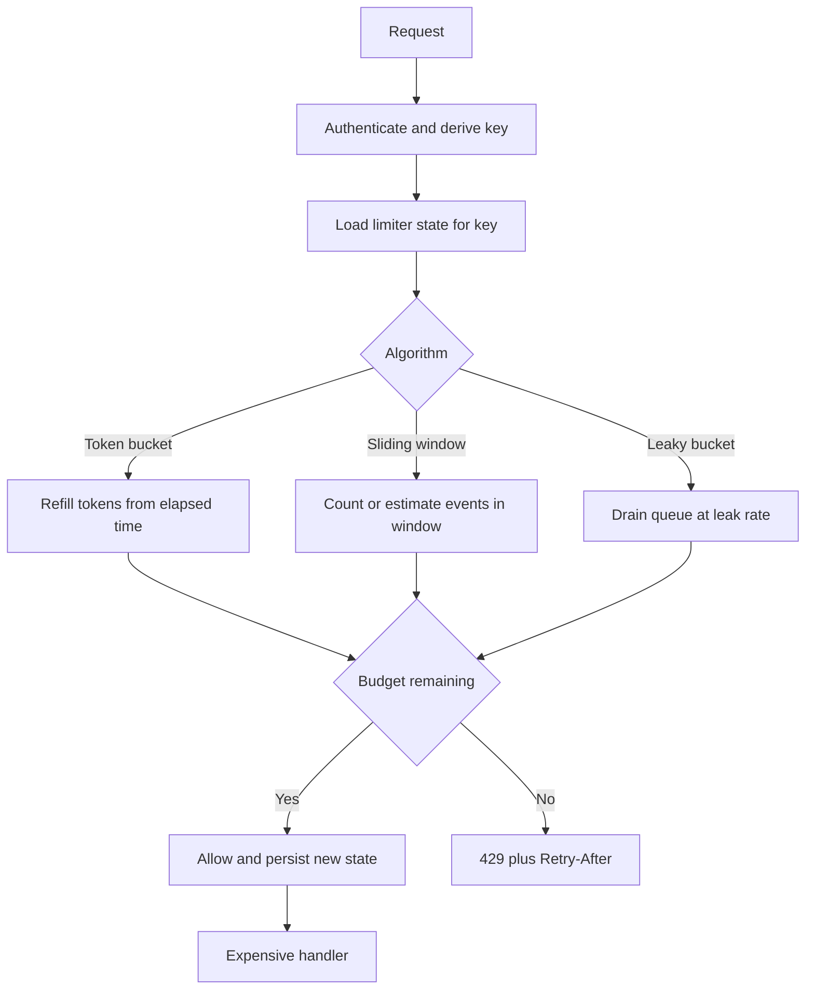

## Concept

A rate limiter is a policy that turns arrival time into allow or deny before the expensive work runs. The policy has a key (API token, IP, user, tenant, route), a budget, and an algorithm that defines what "too fast" means. Algorithms are not interchangeable decorations. Token bucket, leaky bucket, and sliding window answer different questions about bursts, smoothness, and fairness. Pick the algorithm from the traffic you want to allow, then pick the store from the consistency you need.

I want the limiter on the path that already authenticates, with a key you can explain in an incident, and a response that tells an honest client how to back off.

### Token bucket: bursts with a ceiling

A token bucket holds up to `capacity` tokens and refills at `rate` tokens per second. Each allowed request spends one token, or N tokens if you price heavy endpoints higher. If the bucket is empty, the request is denied. If the client waits, tokens return. A client who has been idle can burst up to `capacity` immediately, then they are paced at `rate`.

This is the algorithm I default to for public HTTP APIs. Humans and mobile apps arrive in bursts: a page load fires twenty calls. A pure average of ten per second would punish that page even though the daily budget is fine. Capacity is the burst you will absorb. Rate is the sustained budget you will bill or protect. Set capacity from a real page or batch size, not from a round number on a slide.

Implementation is a stored tuple `(tokens, last_refill_time)` per key. On each request, add `rate * elapsed`, cap at `capacity`, then try to subtract. In Redis this is a Lua script so the read-modify-write is atomic. In memory it is a map with a mutex per stripe. Do not do GET, compute, SET from the application: two nodes will both see three tokens and both allow.

### Leaky bucket: smooth the outflow

A leaky bucket is a queue that drains at a constant rate. Arrivals that would overflow the queue are dropped (or rejected). The outflow is smooth even if arrivals are spiky. That is the point: you are protecting a downstream that hates bursts more than it hates delay.

There are two practical forms. The queue form actually buffers: requests wait until a leak slot exists. That absorbs bursts as latency. The counter form does not queue; it rejects when the implied queue would overflow, which behaves like a token bucket with capacity equal to the queue length and a refill equal to the leak rate. People say "leaky bucket" and mean either. Name which one you are shipping. A gateway that queues will hold connections and memory. A gateway that rejects will return 429 and need a Retry-After.

Use leaky-bucket-as-queue when you own both sides and a small wait is better than a retry storm: internal RPC to a database proxy, a log shipper, a webhook delivery worker. Do not use it on a public API unless you have a budget for held connections. Users prefer a fast 429 to a two-second pause that still might fail.

### Sliding window log and sliding window counter

A fixed window ("100 requests per minute, reset at :00") is simple and wrong at the boundary. A client can send 100 at 10:00:59 and 100 at 10:01:00, doubling the intended rate. Attackers know this. Sliding windows close that seam.

The sliding window log stores a timestamp for each request in the window. Allow if the count of timestamps newer than `now - window` is under the limit, then append. Accurate, expensive. Cardinality is one entry per request per key. A 10,000 QPS key with a one-minute window is 600,000 timestamps. You will feel it.

The sliding window counter approximates. Keep a count for the previous window and the current window, then estimate `previous * (overlap fraction) + current`. At 10:00:45 with one-minute windows, that is `0.25 * previous + current`. Cheap: two integers per key. Slightly inaccurate: it can allow a bit more or a bit less than the true sliding count. For API rate limits the approximation is almost always the right trade.

I use sliding window counters when I must advertise "N per rolling minute" and cannot tolerate fixed-window boundary doubling. I use token bucket when I want an explicit burst distinct from the sustained rate. I almost never store a log at API scale.

### Keys, cost, and the 429

The algorithm is wasted if the key is wrong. IP keys collapse behind NAT and punish a whole office for one user. User keys miss unauthenticated abuse. Token keys miss stolen-token sharing unless you also cap per IP. Route keys must distinguish cheap GETs from expensive searches. A good default is a composite: `tenant + principal + route class`, with a coarser IP limit on the unauthenticated edge.

Price requests. A search that scans three seconds should cost more tokens than a health check. If everything costs one, the expensive endpoint is the attack. Return `429` with `Retry-After` and, for APIs, headers such as remaining budget and reset time so clients can pace. A limiter that returns `500` or closes the connection trains clients to retry immediately.

Distributed limiters need a shared store or a sharded keyspace. Per-node limiters are a multiple of the fleet size: twenty pods with a limit of 100 is 2,000. That is fine for coarse abuse control and a lie if you promised 100. If you shard by key, each key has one owner and the limit is exact. If you use Redis, treat Redis like a production dependency: timeouts, fail policy, and a decision whether Redis down means allow (fail open, abuse) or deny (fail closed, outage). Pick it in writing.

## Trade-offs

| Approach | When it wins | Cost / risk |
| -------- | ------------ | ----------- |
| Token bucket | Public APIs that must allow short bursts then settle | Burst size is a load spike you must actually survive |
| Leaky bucket as queue | Internal pipelines that prefer delay to drop | Held connections, memory, head-of-line blocking |
| Leaky bucket as reject | Smoothing without a queue | Looks like token bucket; name it clearly |
| Fixed window counter | Crude, cheap, low-stakes caps | Boundary doubling; easy to game |
| Sliding window log | Accurate rolling counts at low volume | Memory and write amplification |
| Sliding window counter | Rolling "N per minute" at API scale | Approximation error; still needs atomic updates |
| Local per-pod limiter | Best-effort abuse control, no Redis | Limit scales with replicas; unfairness across pods |

The product choice is burst versus smoothness. Token bucket says a well-behaved idle client may sprint. Leaky bucket says nobody sprints; they wait or they bounce. Sliding window says you care about a rolling budget more than about a burst parameter. Combining them is allowed: a token bucket for the user, a coarser sliding window for the tenant, a leaky bucket in front of a fragile search cluster.

Fail-open versus fail-closed is a security choice hiding in an availability choice. Edge abuse limiters often fail open so a Redis blip does not take the site down. Payment and login limiters should fail closed or at least fail to a tight local limit. One Redis outage should not become an unbounded password-guessing window.

## Diagram

A request should hit authentication, then the limiter, then the handler. The algorithm is an implementation detail of the "take tokens" step.

## Failure modes

### Boundary bursts and synchronized clients

**Detection.** Traffic charts show a spike on the minute. Fixed windows reset and every SDK retries at once. Downstream latency follows the limiter's reset, not the user's demand.

**Mitigation.** Prefer token bucket or sliding window. Jitter `Retry-After`. Do not document "reset at UTC :00" if you can document a remaining-budget header instead. Load-test clients against 429s.

### Distributed inconsistency

**Detection.** Customers still exceed the advertised limit. Fleet scaled out and each replica had a full bucket. Two Redis keys for the same user because of a key-serialization bug.

**Mitigation.** Centralize state per key or shard by key. Atomic updates. One canonical key function with tests. If you keep local limiters, advertise the limit as approximate or multiply it on purpose and say so.

### Cardinality explosion

**Detection.** Redis memory grows with unique IPs or unique unauthorized tokens. A botnet makes a new key per request. Eviction starts dropping honest users' buckets, which looks like a reset of their budget.

**Mitigation.** Cap the keyspace. Use a cheaper pre-filter (IP at the CDN) before an expensive per-user key. TTL every state entry. Sample or hash keys for unauthenticated traffic. Alert on unique-key count, not only on 429 count.

### Fail-open on store outage

**Detection.** Redis timeout metrics rise and 429s fall to zero while abuse or credential stuffing rises. The limiter client caught an exception and returned allow.

**Mitigation.** Explicit fail policy per limiter class. Local fallback with a tight in-process cap. Circuit-break Redis so you do not wait the full timeout on every request while it is dead. For login, deny or CAPTCHA when the limiter store is gone.

## Real-world example

Cloudflare's rate limiting is the public system that pushed these algorithms out of academic slides and into an edge that sees a large fraction of the web. A rule is a match (path, method, country, JA3, cookie) plus a threshold over a period, enforced close to the client so origin CPU is not the sensor. The product has to choose an algorithm that is cheap enough to run on every request and strict enough that a fixed-window seam is not an attack plan.

Their published engineering on counting at the edge is the part I reuse in reviews. A precise log of every request per key does not survive global QPS. Approximate counting, sliding windows, and sometimes a token-bucket-shaped burst control are the tools that fit. They also separate mitigation (block, challenge, throttle) from detection, which is a design most application teams skip: a 429 is one mitigation; a managed challenge is another; logging-only is how you validate a rule before you enforce it.

The same ideas show up in API gateways. Stripe publishes per-resource rate limits and returns `Retry-After`. GitHub documents distinct limits for authenticated versus unauthenticated callers and for expensive search. Those products are token-bucket or sliding-window in spirit: a burst of UI calls is allowed, a sustained scrape is not, and the client is told when to try again. When I add a limiter to a service, I copy that external contract first: which key, which budget, which headers, which algorithm, and what happens when Redis is down. The Lua script is the easy part.

## What to remember

- Token bucket allows a defined burst then a sustained rate; leaky bucket smooths outflow; sliding windows stop fixed-window doubling.
- Key on tenant, principal, and route class; price expensive endpoints; return 429 with Retry-After, not a connection drop.
- Atomic shared state per key, or admit that a per-pod limiter is a multiple of the fleet.
- Decide fail-open versus fail-closed before the store outage, and cap key cardinality so a botnet cannot become your Redis memory limit.
