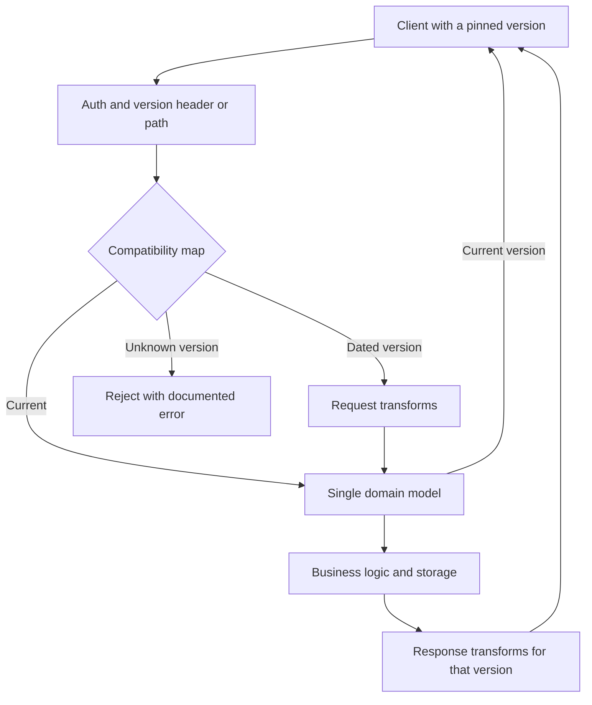

## Concept

An evolvable API is one you can change without breaking honest clients you do not control. That is a compatibility contract, not a version number in the URL. Version numbers are one tool. The contract is the set of changes you promise never to make, the set you promise to make only with notice, and the tests that keep both promises. Teams that skip the contract ship `/v2` as a fork of the codebase and then maintain two products.

I design public HTTP and RPC APIs as if the oldest supported client will live for years, because in B2B it will. Internal APIs can be stricter if you own every caller and can lockstep deploy. Pretending an internal API is public, or the reverse, is how you get either paralysis or weekend breakages.

### Compatibility rules that actually hold

Additive changes are the default. You may add an optional field, a new endpoint, a new enum value that old clients can ignore, and a new error code that old clients treat as generic failure. You may not remove a field, rename a field, change a field's type or meaning, make an optional field required, or reuse a field for a different concept. Meaning changes are the silent killers: `amount` was major units and is now minor units; `status=closed` used to mean cancelled and now means settled. The JSON still parses. The ledger is wrong.

Lists and maps need explicit merge rules. Adding a member is additive. Reordering a list that clients treat as positional is breaking. Turning a scalar into an object is breaking even if you keep the old key as a convenience for a while, unless you keep both and document the overlap period.

Null versus absent is part of the contract. If clients treat missing `tax` as "not calculated" and `tax: null` as "zero," you cannot start emitting null for "not calculated." Pick one, document it, and test it. Same for empty arrays versus omitted arrays.

Errors are part of the schema. A 404 that becomes a 400, or a structured error body that loses a `code` field, will break client branches. Stabilize `type` or `code`, keep the HTTP status class stable, and add fields to the error object instead of replacing it.

### Versioning strategies

URL versioning (`/v1/charges`) is obvious to humans and caches. It encourages forking. If `/v2` is a copy of the service, you doubled your bugs. If `/v2` is a translation layer over the same domain model, you have a compatibility shim, which is the right idea, but you must not let the shim rot.

Header versioning (`Stripe-Version: 2024-06-20`, or `Accept: application/vnd.example.v2+json`) keeps one URL and selects a compatibility calendar. Dated versions, as Stripe popularized, are a map from a request version to a set of transformations: rename a field, hide a new required behavior, compute a derived value the old client expected. The current version is what new integration docs show. Old versions stay until you sunset them.

Additive-only, unversioned APIs work when you are disciplined and the API is young. They fail when you need a meaning change. Then you add `amount_decimal` and keep `amount` until the sun sets, which is versioning by field name. That is valid. It is also how objects become junk drawers. At some point a dated version that drops the old field is kinder.

For gRPC and other protobuf APIs, follow the proto rules: new field numbers, never reuse numbers, reserve deleted numbers, do not change types. Compatibility is the schema language's job if you do not fight it. JSON over HTTP has no such referee. You are the referee.

### Deprecation is a program, not a comment

A `deprecated` flag in OpenAPI is a hint. A deprecation program is a date, a metric, a communication channel, and a translator. Announce, measure who still calls the old shape, write to those owners, keep a compatibility layer, then remove. If you cannot name the callers, you cannot sunset. That is an argument for authentication and for telemetry that includes client id and version.

Give time in calendar months, not in sprints. External developers have roadmaps too. For a meaning change, ship the new field, dual-write, wait until old-field usage is a rounding error, then stop documenting the old field, then reject it. Skipping to reject is a break.

Internal APIs can be faster if CI breaks when a caller uses a removed field. That is still a program: the owners of those callers are in the same org chart. If they are not, treat the API as public.

### Compatibility testing and contract fixtures

The cheapest test is a corpus of old responses and old requests. Freeze a golden JSON from version N. For every change, replay it through the compatibility layer and assert the old client still sees what it saw. Replay old requests against the new service and assert they still succeed. Pact-style consumer contracts help when you know the consumers. They do not help with the unknown script a customer wrote in 2019.

Semantic diff on the OpenAPI or proto is a gate: a removed path, a new required property, a narrowed enum, a changed type is a breaking change and must bump a version or fail CI. Humans will miss these in review. Machines will not.

Idempotency and pagination are compatibility landmines. Changing a cursor from opaque to an offset, or changing default page size, breaks clients that "just worked." Changing whether a retry with the same body creates a second resource is a break even if the JSON schema is identical. Evolvability includes behavior, not only shapes.

## Trade-offs

| Approach | When it wins | Cost / risk |
| -------- | ------------ | ----------- |
| Additive-only, no versions | Early APIs, internal lockstep callers | Frozen mistakes; junk-drawer objects |
| URL path versions `/v1` `/v2` | Simple mental model, CDN-friendly | Forked implementations; slow sunsets |
| Dated request header, one URL | Long-lived public APIs with many clients | Transformation layer to maintain; version explosion |
| Field-level dual running | One meaning change without a global version | Objects accumulate aliases; easy to forget the old field |
| Break and bump major, no shim | Tiny caller set you can update in a day | Any unknown client is an incident |

The transformation layer is where evolvability lives or dies. If each dated version is a branch of business logic, you will never sunset. If each dated version is a list of request and response transforms over one domain model, sunsetting is deleting a transform. Invest in that shape early. It is boring software and it is the reason Stripe-style APIs survive.

Do not version for vanity. A new optional field does not need `/v2`. Version when you must change meaning or remove. Over-versioning trains clients to pin forever and never read the changelog.

## Diagram

Compatibility is a pipeline in front of one domain model, not a second product.

## Failure modes

### Silent meaning change

**Detection.** Schema tests pass. Customer ledgers disagree. `status` or `amount` changed interpretation in a release note nobody's SDK parsed. Support hears "the API started lying on Tuesday."

**Mitigation.** Treat meaning as schema. Require a version bump or a new field for any reinterpretation. Add contract tests that assert example values, not only types. Review enums and units with the same severity as removed properties.

### New required fields and tightened validation

**Detection.** Old clients get 400 after a deploy. You added `currency` as required, or you started rejecting extra properties, or you shortened a string max. The OpenAPI diff was not in CI.

**Mitigation.** New fields optional until a new version. Extra properties ignored unless you already promised otherwise. Validation tightening is a break. Put breaking-change detection on the spec in CI.

### Compatibility layer drift

**Detection.** `/v1` and `/v2` call different services. A bug is fixed in one. A new feature exists only in the other. Dated transforms accidentally invoke old business rules instead of shaping JSON.

**Mitigation.** One domain, many transforms. Forbid business logic in the shim. Sunset with metrics. Staff the compatibility layer as part of the API, not as a graveyard.

### Pagination, errors, and defaults that move

**Detection.** Clients skip or duplicate items after a sort change. Default page size dropped and they now see partial lists. Error `code` strings changed from `card_error` to `CARD_DECLINED`.

**Mitigation.** Freeze default sort and page size or version them. Keep error codes stable; add new ones. Document cursor opacity and never parse it in a client you ship.

## Real-world example

Stripe's API versioning is the public system I point to when a team wants to "just ship v2." Every account has an API version. Requests can override it with a header. New accounts get the current version. Old accounts keep the version they started with until they opt in. The documentation shows the current shape. The compatibility layer rewrites requests and responses so a client pinned to `2017-05-25` still sees `card` where a modern integration sees `payment_method`.

That design has two consequences that matter more than the header name. First, Stripe can change the API's meaning for new integrations without taking the internet's checkout pages down on a Tuesday. Second, they must actually maintain the transforms. The version list is long because customers are long-lived. They sunset very slowly, with notice, because they can count requests per version.

The other lesson is additive discipline inside a version. They still add fields without bumping everyone. The dated version exists for the changes that cannot be additive. Teams copy the header and then make every small add a new date, which trains clients to pin and never move. Or they copy `/v1` and fork the service. Stripe's trick is the combination: additive when you can, dated transforms when you must, one platform underneath.

Twilio's versioned URLs and GitHub's preview headers are cousins. The product pattern is the same. Evolvability is a promise plus a machine that keeps it. A changelog is not the machine.

## What to remember

- Additive optional fields are free; removals, renames, type changes, and meaning changes are breaks and need a version or a new field.
- Prefer one domain model with request and response transforms over forked `/v2` implementations.
- Deprecation is dates, client metrics, and a shim you can delete; a comment in OpenAPI is not a program.
- Put spec diffs and golden old-request/old-response tests in CI, including pagination, errors, and defaults.
