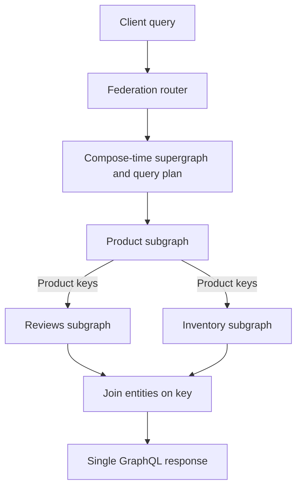

## Concept

Federation is how you present one GraphQL graph while many teams own pieces of it. A gateway, or router, composes subgraph schemas into a supergraph and, at request time, plans a query into a sequence of subgraph fetches. Clients see types that span services: a `Product` with `reviews` and `inventory` as if one process held them. No process holds them. The composition contract is the architecture.

Apollo-style federation is the design most production systems mean. It is not "stitch a bunch of endpoints in a BFF." It is a typed ownership model with entity keys, explicit contribution of fields, and a query planner that can fail at compose time instead of at 2 a.m.

### Supergraph and subgraph contracts

Each subgraph publishes a schema. One subgraph might own `Product { id name }` and declare `Product` as an entity with key `id`. Another subgraph extends `Product` with `reviews`. A third extends it with `inStock`. Composition merges those contributions. Conflicts fail composition: two subgraphs cannot both originate the same field, value types must match, and keys must agree.

The supergraph is an artifact. You generate it in CI from subgraph schemas, you test it, you deploy it to the router. A subgraph that ships a breaking change should fail the composition pipeline before it fails the client. That pipeline is the product. A shared Google Doc of types is not federation.

Ownership is the point. The reviews team does not file tickets with the product team to add a field. They extend the entity they can key. The product team does not import reviews into their monolith to keep the graph pretty. If a field has no owner, it will have two, and composition will catch it or production will.

### Entity keys and the `_entities` dance

An entity is a type that can be referenced across subgraphs by a key, typically `id` or a composite. When the planner needs `Product.reviews`, it fetches `Product.id` from the product subgraph, then asks the reviews subgraph to resolve those products via the `_entities` query: here are representations `{ __typename, id }`, return the fields this subgraph owns.

That fetch is a join. It is also an N+1 magnet if the subgraph implements `_entities` as a loop of per-id queries. The subgraph must batch: one SQL `WHERE id IN (...)`, one cache fill, one downstream call with a list. DataLoader is not optional on entity resolvers. Neither is a cap on the inbound representation list.

Choose keys that are stable and actually unique. A `sku` that two brands share is not a key. A composite `(tenantId, id)` is required in a multi-tenant graph and forgotten in the first schema. If two subgraphs key `User` on different fields, composition fails or, worse, you force a `@key` that only one side can honor and entity resolution returns holes.

Do not put every type in the graph as an entity. Value types (a `Money` object, an address) are shared definitions, not join points. Over-entitying creates join traffic for data that should have been a nested object in the owning subgraph.

### Query planning and execution

The router receives a client query, validates it against the supergraph, and produces a plan: fetch this set of fields from subgraph A, then using keys, fetch from B and C, perhaps in parallel. Sequential steps exist when one subgraph needs a field another must supply first. Those sequences are latency. A plan with five sequential hops is a five-hop p99 even if each subgraph is fast.

Expose plans in a way on-call can read. Apollo Router and similar tools can dump the plan. If you cannot explain why a page query hit six subgraphs, you cannot budget the SLO. Clients will write queries that are legal and ruinous: ask for a list of products and, per product, a nested tree that fans out. Depth limits, breadth limits, cost analysis, persisted queries, and timeouts are part of the federation design, not extras.

Caching is harder than in REST. The unit of cache is a fetch to a subgraph or a whole operation, not a URL. APQ (automatic persisted queries) reduce parse cost. Entity-level caching needs a key and a TTL per subgraph. Do not cache personalized fields under a shared key. Do not skip auth because a cached entity "already looked public."

### Authz at the gateway and in every subgraph

The gateway authenticates the client and may propagate identity to subgraphs. Subgraphs must still authorize. A reviews subgraph that returns any review by product id, because the gateway already checked the user, will leak when a second client of that subgraph appears, or when the plan fetches a product the user should not see. Defense in depth: gateway enforces coarse rules and query cost; subgraphs enforce object-level rules with the forwarded identity.

Forward identity as a signed internal token or mTLS plus a header the mesh strips at the edge. Do not forward the user's raw bearer token to every subgraph unless those subgraphs are the audience. Service-to-service identity and user identity are different claims on the same hop.

Schema-level `@authenticated` and `@requiresScopes` directives help, and they do not replace a check that this user may see this tenant's product. Federation makes it easier to forget that check because the field lives "somewhere else."

## Trade-offs

| Approach | When it wins | Cost / risk |
| -------- | ------------ | ----------- |
| Single GraphQL monolith | One team, one database, rapid product iteration | Ownership bottlenecks; deploy coupling |
| Apollo-style federation | Many teams, clear entity boundaries, one client graph | Planner latency; composition ops; N+1 in `_entities` |
| Schema stitching / custom BFF | Few services, odd legacy shapes, short-lived BFF | Ad hoc joins; no compose-time guarantee |
| Separate REST plus client joins | Simple clients, cacheable GETs, few round trips needed | Chatty clients; inconsistent types |
| Federated graph without query cost limits | Looks fine in demos | One nested query becomes an incident |

Federation's cost is a platform. You need a schema registry, a composition gate, a router with SLOs, subgraph onboarding docs, and someone who owns the supergraph when a compose fails on Friday. If you have two services and three developers, a monolith graph or a BFF is cheaper. If you have thirty teams shipping independently and a mobile client that cannot wait for a BFF squad, federation pays for itself.

The other cost is operational coupling you thought you deleted. A subgraph outage still blanks fields in the supergraph. Partial data versus hard fail is a policy: null with errors, or fail the operation. Pick it per field. A checkout mutation should not succeed with a null price because inventory was down.

## Diagram

The join is the architecture. Clients never see subgraph URLs.

## Failure modes

### Entity resolver N+1 and unbounded lists

**Detection.** Subgraph SQL counts track inbound `_entities` size linearly. A client query for 100 products produces 100 review queries. p99 of the supergraph is the sum of those calls.

**Mitigation.** Batch `_entities`. Cap list sizes in the schema. Cost-analyze nested list fields. Load-test the worst legal query, not the homepage query you like.

### Composition and key mismatch

**Detection.** CI fails on compose, or worse, compose succeeds and runtime entity resolution returns nulls because a key field is missing from a fetch. Two subgraphs disagree on nullability.

**Mitigation.** Composition in CI against the registry. Contract tests that fetch an entity across subgraphs. Treat key fields as required API. Do not hand-edit the supergraph.

### Partial failure and confusing errors

**Detection.** The client receives `data` with holes and `errors` that name a subgraph the app team does not own. Mobile treats any error as a hard fail and blanks the screen. Or the opposite: a mutation reports success with null critical fields.

**Mitigation.** Error policy per operation type. Surface subgraph name only internally. SLO on error rate per subgraph field. Mutations fail closed on missing critical extensions.

### Authorization gaps on entity fetches

**Detection.** An `_entities` call with guessed ids returns private objects. A field added by another team is visible in the graph without the original ACL. Gateway auth is "logged in" and subgraphs trust it.

**Mitigation.** Authorize in every subgraph. Pass a verified identity. Test IDOR on entity resolvers specifically. Review new fields for sensitivity before they land on the supergraph.

## Real-world example

Netflix's federated GraphQL platform, built around the DGS framework and a federated gateway, is the public large-scale example I use. Studio and device clients need a single graph. The data lives in many services owned by many teams. A monolith schema would have made every field a cross-team release. REST-plus-BFF would have made every new screen a BFF change. Federation let teams publish subgraphs, contribute fields to shared entities, and keep the client contract unified.

The lessons they have been public about match the failure modes above. Query planning and entity resolution have to be fast enough for living-room devices. Subgraphs that do not batch become outages with a GraphQL face. A schema registry and compatibility checks are mandatory once many teams publish. Authorization cannot sit only at the gateway when entity resolvers accept lists of ids.

Apollo's own federation reference, and companies such as Expedia that published supergraph work, tell the same story at a smaller print: composition is a build artifact, the router is on the critical path, and ownership of types is a social contract enforced by the schema. If your org cannot agree who owns `User`, federation will not decide it. It will fail compose until someone does.

When I review a "we should federate" proposal, I ask for the entity list, the keys, the registry, the query-cost policy, and the subgraph auth story. If those are blank, the team wants a single URL, not a federated architecture. Give them a BFF until the ownership problem is real.

## What to remember

- Federation is compose-time ownership of a supergraph, not a BFF that calls a few services and prints GraphQL.
- Entity keys drive joins; `_entities` must batch, cap, and authorize, or the graph becomes an N+1 and IDOR engine.
- The router and schema registry are production dependencies; query cost limits are part of the design.
- Authenticate at the gateway and still authorize in every subgraph; a typed join is still a data access path.
