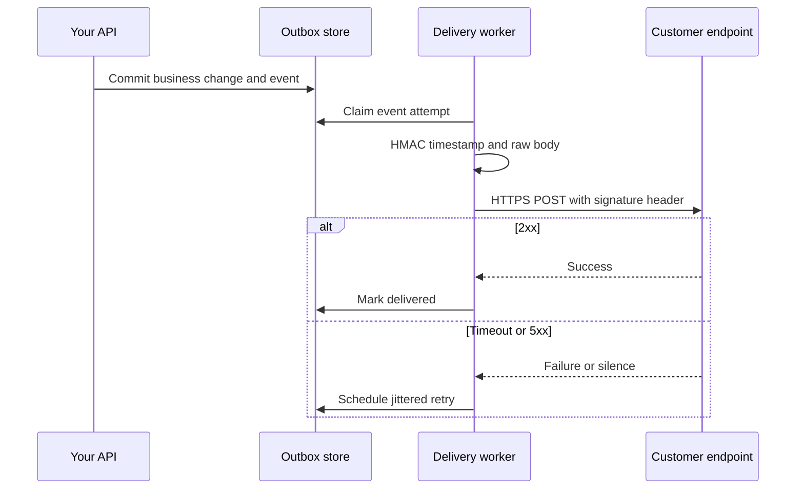

## Concept

A webhook is an HTTP callback you owe a customer when something in your system became true. You do not control their availability, their clock, or their idea of a successful handler. Reliability is therefore your problem: sign the payload so they can trust it, deliver at least once with retries they can predict, and make the event identifiable so they can ignore duplicates. A fire-and-forget POST from the request thread of your API is not a webhook system. It is a way to couple your p99 to a stranger's laptop.

I treat outbound webhooks as a delivery product with a queue, a worker, a signature scheme, an attempt log, and an operator UI. The event payload is the easy part.

### Signatures, timestamps, and the secret

The receiver must distinguish your events from anyone on the internet who can POST to a public URL. The standard mechanism is an HMAC over a string that includes a timestamp and the raw body, using a per-endpoint secret you issued when the customer registered the URL. Stripe-style `t=timestamp,v1=signature` in a header is the pattern to copy. The receiver computes the same HMAC, compares in constant time, and rejects if the timestamp is older than a few minutes. That last check is replay defense. Without it, a captured request is valid forever.

Rotate secrets without downtime. Support two `v1` values during rotation, or a `v1` and `v2` scheme, so the receiver can verify either. Never put the secret in query parameters. Never sign a parsed-then-reserialized JSON body; whitespace and key order will fail honest customers. Sign the bytes you send.

TLS to the receiver is required. Pinning is usually too brittle for customer URLs. SSRF is your problem on the send side: refuse RFC1918, link-local, metadata IPs, and redirects to those. A webhook URL of `http://169.254.169.254/` is not a customer integration. It is an attack on your worker.

### Retries, backoff, and what success means

Deliver from a worker, not from the transaction that created the event. Write the event to storage in the same transaction as the business change (transactional outbox), or write it after commit with a checker that repairs gaps. The worker POSTs, waits for a short timeout (a few seconds, not sixty), and treats 2xx as success. 3xx should not be followed blindly. 4xx is usually a poison message except 410 or 404 on a dedicated endpoint, which may mean "stop, the URL is dead." 5xx and timeouts retry.

Backoff must be exponential with jitter, capped, with a dead-letter after N attempts or T hours. Publish the schedule. Receivers will use it to size queues. Retry-After on 429 should be honored within a bound. A retry storm at a fixed 1 second interval will finish a customer's app and then your worker pool.

Timeouts create duplicates. You POST, they process, their 200 is lost on the network, you retry. That is at-least-once delivery. It is not optional. Design for it: stable event ids, and a receiver contract that says "handle this id once." You cannot make the network honest. You can make the payload idempotent to consume.

### At-least-once, ordering, and event shape

Each delivery carries a unique `event_id`, a type, a created timestamp, and a payload that is a snapshot or a thin id plus a fetch URL. Snapshots are easier for receivers and harder for PII retention. Thin events force a pull, which is easier to authorize and version. Many systems send a snapshot of the object at event time plus the id so a missed field does not require an extra call.

Ordering is best-effort per resource, not a global FIFO. If you need "authorization then capture" in order, include a sequence number per `payment_id` and tell receivers to buffer, or make each event a full snapshot so order of application does not matter. A single worker per destination preserves per-URL order at the cost of head-of-line blocking. Concurrent workers per URL increase throughput and shuffle order. Document which you provide.

Do not reuse HTTP as an RPC that waits for the customer's business logic to finish a five-minute job. If they need to do heavy work, they should 2xx quickly and process async, using the event id as their idempotency key. Your timeout will otherwise manufacture retries.

### Endpoint lifecycle

Registration, verification, rotation, pause, and delete are features. Verification: at insert time, send a challenge or require them to echo a token, so you do not become a spam cannon aimed at a victim URL. Pause: let operators and customers stop delivery without deleting history. Disable after a streak of 410s or a week of failures, and notify. Show recent attempts, response codes, and the next retry. A webhook product without that UI becomes a support queue.

Version the event payload the same way you version APIs. Additive fields are fine. Meaning changes need a new event type (`invoice.paid.v2`) or a version header the receiver opted into. You will have receivers on the old shape for years.

## Trade-offs

| Approach | When it wins | Cost / risk |
| -------- | ------------ | ----------- |
| In-request POST to customer URL | Prototypes, internal callbacks you control | Your latency and availability become theirs; no retry |
| Outbox plus async workers | Every public webhook worth the name | Infra to run; at-least-once duplicates |
| Snapshot payload | Receivers that should not call back | PII in logs; large bodies; versioning pain |
| Thin event plus retrieve API | Sensitive data, evolving objects | Extra auth; receiver down means they miss the fetch |
| Strict per-URL ordering | State machines that cannot reorder | Head-of-line blocking; lower throughput |
| Concurrent delivery | High volume, snapshot events | Receivers must be idempotent and order-tolerant |

Signature scheme versus mutual TLS is a related choice. HMAC secrets are what you can deploy to a customer's PHP app on a Tuesday. mTLS is better when the receiver is a platform you both operate. For a public SaaS, HMAC plus timestamp plus HTTPS is the interoperable bar. IP allowlists are a bonus some enterprises demand and a burden when your egress NATs change; offer them, do not rely on them as the only authenticator.

Pull-based event APIs (list events since cursor) are a complement, not a replacement. They let a receiver recover from a bug in their handler without asking you to replay from a UI. If you only have push, you will build replay anyway. Build list-and-replay on day one.

## Diagram

The outbox and the signed retry loop are the system. The origin API request is not on the customer's critical path.

## Failure modes

### Replay and unsigned or badly signed bodies

**Detection.** Attackers POST to a customer URL or to your own registered endpoints. Receivers that skip timestamp checks accept old captures. You signed `JSON.stringify(obj)` and a Ruby receiver hashed the raw rack body; honest traffic fails.

**Mitigation.** HMAC over timestamp plus raw bytes. Constant-time compare. Reject skew beyond five minutes. Provide official verifiers in a few languages. Rotate secrets. Test with the exact bytes on the wire.

### Timeout-success duplicates

**Detection.** Customer creates two records per order. Your attempt log shows a timeout followed by a 200 on retry. They did not key on `event_id`.

**Mitigation.** Document at-least-once as a guarantee. Put `event_id` at the top of the payload and in a header. Offer an idempotent retrieve. Shorten your client timeout only if you also keep retries; a long timeout reduces duplicates and ties up workers.

### SSRF and open relays

**Detection.** A tenant registers a URL in your cloud metadata range or an internal admin hostname. Workers' logs show 200 from `169.254.169.254`. Redirects hop from a public URL to a private one.

**Mitigation.** Allowlist schemes and ports. Block private and link-local ranges at each hop, including after redirects, or disable redirects. DNS-rebinding defenses: resolve, check, connect to the same address. Treat URL registration as untrusted input.

### Retry storms and poison endpoints

**Detection.** Worker latency explodes. One slow customer holds the fleet. A 400 that will never succeed is retried for hours.

**Mitigation.** Per-destination concurrency limits and circuit breakers. Classify 4xx as dead except 408/429. Cap attempts. Auto-disable and notify. Isolate destinations so one URL cannot consume the global worker pool.

## Real-world example

Stripe's webhooks are the public system to copy. Events are first-class objects with ids. You register an endpoint, receive a signing secret, and verify `Stripe-Signature` covering a timestamp and the raw body. Stripe retries on failure with a documented backoff, eventually marks the endpoint as failing, and gives you a dashboard of attempts and a way to resend. They tell you, in bold, to handle duplicates. Their own libraries verify signatures and reject old timestamps.

Two details are why this works at checkout volume. First, delivery is asynchronous. Completing a payment does not wait on a customer's CRM. The event is stored and shipped by a pipeline whose SLO is "soon," not "in this request." Second, the signature is a product: versioned, rotatable, and boring enough that every tutorial uses it. Teams that invent a custom JWT in a query string, or that send unsigned JSON because "the URL is secret," discover that URLs leak into logs.

When I review a webhook design, I ask to see the outbox, the HMAC string, the retry table, the SSRF rules, and the duplicate story. If any of those is "the API handler will POST," we are not done. Stripe's documentation is a checklist. Use it as one.

## What to remember

- Deliver from an outbox and workers, never from the request that created the event; treat delivery as at-least-once.
- Sign the raw body with a timestamped HMAC, reject replays, and rotate secrets without downtime.
- Back off with jitter, isolate destinations, and define which status codes are poison versus retryable.
- Give receivers an event id, a dashboard, and a pull/replay path; duplicates and late handlers are normal operation.
