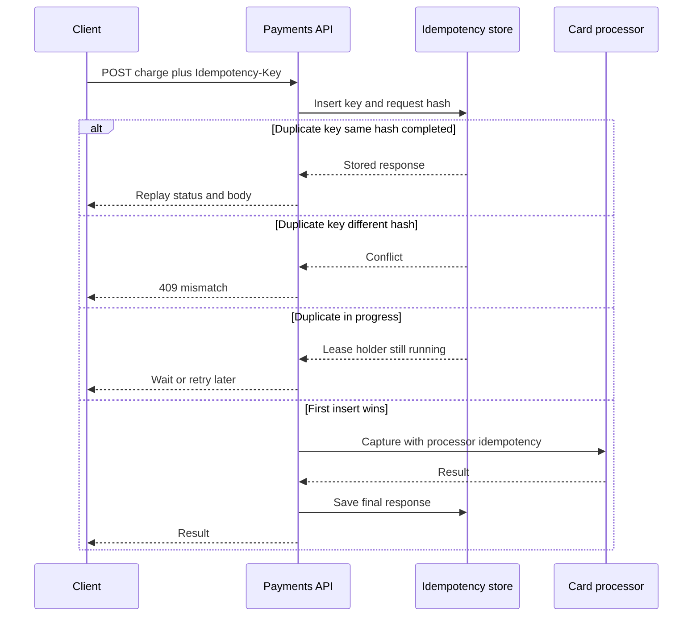

## Concept

Networks lie about completion. A client sends `POST /charges`, the server captures the card, and the 200 is lost. The client retries. Without an idempotency key you have two captures. With one, the second request is the first request's result, or it is a conflict if the body does not match. Payments, refunds, payouts, and any transfer of money or inventory need that contract. Timeouts are not rare. They are the reason the key exists.

I treat the idempotency key as part of the resource, not as a cache optimization. Storage, hashing, concurrency, and TTL are the design. The header name is the easy part.

### Client-generated keys and the request contract

The client mints a unique key per logical operation, typically a UUID or a ULID, and sends it in `Idempotency-Key`. The key's uniqueness scope is the combination of account (or API key) and the key string, not the globe. Two merchants may both send `order-123`. They must not collide. Bind the key to the authenticated principal.

The client must reuse the same key only when retrying the same operation. A new cart, a new amount, or a user clicking pay again after a true failure that was already returned as 4xx is a new key. SDKs should generate the key at the start of the operation and hold it for retries, not on every HTTP attempt in a naive loop that also rebuilds the body.

Document the header as required for money-moving POSTs. Optional keys on GET are a confusion. Optional keys on POST mean some clients will double-charge. Make it required, reject missing keys, and you will still get duplicates from clients that mint a new UUID on every retry. That is a client bug you cannot fully prevent; telemetry on unique keys per charge intent helps you find it.

### What you store: hash, response, and state

On first sight of a key, persist a row: principal, key, request fingerprint, state, response, created_at. The fingerprint is a hash of the canonical request: method, path, and body (and any headers that change meaning). If a retry arrives with the same key and a different fingerprint, return `409` with a clear error. Silent acceptance of a different amount under the same key is how you create support nightmares and, worse, how an attacker with a leaked key might try to swap a body. Usually it is a buggy client. Fail it.

State is at least `in_progress`, `succeeded`, `failed`. The stored response is the status code and body you already sent, so a retry can replay it byte-for-byte enough that the client cannot tell. Replaying a 200 with a `charge_id` is the success path. Replaying a 402 card_declined is also success for idempotency: the logical operation completed, it just did not move money. Do not retry the processor on that key.

Canonicalization matters. JSON `{"a":1,"b":2}` and `{"b":2,"a":1}` should usually be the same fingerprint, unless you have a reason to be strict. Whitespace should not 409. Changing a header that you ignore should not 409. Changing `amount` must 409. Hash the parsed, ordered representation of fields that affect the operation.

### Concurrent first requests

Two retries in flight before either row commits is the hard case. If both pass the "no row" check, both will capture. The store must make the insert of `(principal, key)` unique. The winner proceeds. The loser waits or reads the in-progress state.

While state is `in_progress`, a concurrent request should not start a second capture. Options: block with a timeout until the first finishes and then replay the response; return `409` or `425` with retry-after so the client tries again shortly; return `200` only when you have a result. Blocking is kinder to simple clients and dangerous if the first worker died without clearing the lock. Always put a lease on `in_progress`. If the lease expires, you must know whether the processor might have captured. That is why the processor's own idempotency, or a retrieve-before-retry against the processor, exists. If you cannot ask the processor "did I already send this key," you cannot safely recover a crashed in_progress row. Design that recovery before you ship.

A unique constraint in Postgres on `(account_id, idempotency_key)` plus a row lock is the boring, correct core. Redis `SET key NX EX` is fast and loses the request hash unless you store it too; it also needs a durability story. I want the idempotency record in the same database as the charge when I can, in the same transaction that inserts the charge after the processor returns, so a commit includes both.

### TTL, replay window, and storage

Keys live long enough to cover client retries and short enough that the table does not grow without bound. Stripe's documented 24-hour window is a reasonable public default. Some payment operations need longer because a batch job retries the next day. Set TTL from the longest honest retry, then expire. After expiry, the same key is a new operation. Clients that reuse keys a week later will double-charge. Document the window.

Store only what you need to replay. Do not store raw card numbers in the idempotency table. The fingerprint should not include secrets you would not log. Response bodies may contain PANs if you made a mistake elsewhere; keep the idempotency store in the same PCI scope as the API, encrypted at rest, access-logged.

Purge in batches. The unique index is the hot path. A bloated table with no TTL is a latency incident that looks like a payments outage.

## Trade-offs

| Approach | When it wins | Cost / risk |
| -------- | ------------ | ----------- |
| Required Idempotency-Key on money POSTs | Any capture, refund, payout | Clients must store the key; support for 409 mismatches |
| DB unique row plus request hash | Strong consistency with the charge record | Write latency; schema to operate |
| Redis NX lock only | High QPS, short retries, you accept more risk | Durability; hash mismatch handling; split brain on failover |
| Replay stored HTTP response | Clients that retry blindly | Storage; must not replay a mid-flight error as final |
| Processor-side idempotency only | When you fully own the processor API | Your API still double-calls if you mint new processor ids |
| 24-hour TTL | Interactive checkouts | Overnight batch retries need a longer window or a new key policy |

The worst hybrid is an idempotency cache that expires in five minutes while the client's timeout-and-retry loop can run for thirty. Align TTL with the client contract. The second worst is storing success only, so a retried 500 after a capture starts a second capture because the first attempt "failed" in your table. Persist in_progress before you talk to the processor.

## Diagram

The unique insert is the mutex. The processor sits behind it.

## Failure modes

### Key reused with a different body

**Detection.** `409` spikes after a client release. Amount in the body changed between retries because the UI recomputed tax. Support sees "conflict" and tells them to send a new key, which then double-charges.

**Mitigation.** Teach clients to freeze the body with the key. Return a body in the 409 that names the mismatched fields. For your own SDKs, bind key generation to the operation object, not to the HTTP layer. Do not tell customers "just make a new key" without checking whether the first charge succeeded.

### In-progress crash and double capture

**Detection.** A worker dies after the processor captured and before the row is succeeded. Lease expires. A retry captures again. Two `charge_id`s, one key.

**Mitigation.** Send your idempotency key through to the processor. On crash recovery, retrieve by that key before a new capture. Keep the lease longer than the processor timeout. Never delete an in_progress row to "unstick" a customer without that retrieve.

### TTL too short or keys too guessable

**Detection.** Overnight retries create second charges. Keys are sequential order ids an attacker can replay with a different session if you scoped poorly. Keys leak in URLs and logs.

**Mitigation.** TTL from real retry behavior. Scope keys to the principal. Use high-entropy keys. Do not log the key next to a PAN. Do not accept keys from query strings.

### Storing failures that should retry versus failures that should replay

**Detection.** A 503 from your API is stored and replayed, so the client never succeeds even though the processor was never called. Or a 402 is not stored, and a retry hits the processor again, which may be correct for "try another card" if the body changed, and incorrect if it did not.

**Mitigation.** Classify: processor-final results (success, decline, hard fraud) are stored and replayed. Infrastructure failures (your 503, timeouts before send) leave the key in a state that allows a retry of the processor only after retrieve-or-lease recovery. Document this; it is the subtle half of the feature.

## Real-world example

Stripe's idempotency keys are the public contract the industry copies. You send `Idempotency-Key` on POST. Stripe stores the parameters and the result for twenty-four hours. Retries with the same key and the same parameters receive the original response. Different parameters with the same key receive an error. Concurrent requests with the same key are serialized so only one executes.

That contract is why a mobile app can treat timeout as retry rather than as "unknown money." The app does not need to know whether the 200 was lost. It needs to hold the key. Stripe's docs also admit the remaining gap: if you generate a new key, they cannot help you. Their SDKs generate and reuse keys for retries. Integrations that wrap HTTP themselves often forget.

The storage lessons are visible in the behavior. Twenty-four hours is a product choice, not a law. The mismatch error is the request hash. The original response replay includes errors, so a declined charge is not reattempted under that key. When I implement this, I copy those three behaviors first, then I add the processor-side key and the in_progress lease, which Stripe also has to do internally even if the public doc does not show the table.

If your payments API is "we have a unique order_id," you are halfway there. Order id as the key works until the client needs two charges for one order or retries with a corrected amount. A dedicated idempotency key, hashed body, and stored response still win. Use order id as a secondary uniqueness on the charge if the product requires one capture per order, and still require the header for the HTTP contract.

## What to remember

- Require a principal-scoped Idempotency-Key on money POSTs, fingerprint the body, and replay or 409; never start a second capture because a 200 was lost.
- Insert a unique in_progress row before calling the processor, and recover crashes by asking the processor about that key.
- Store final processor results, including declines, and do not treat your own 503 as a final result.
- Set TTL from real retry windows, keep keys high-entropy, and teach SDKs to reuse the key with a frozen body.
