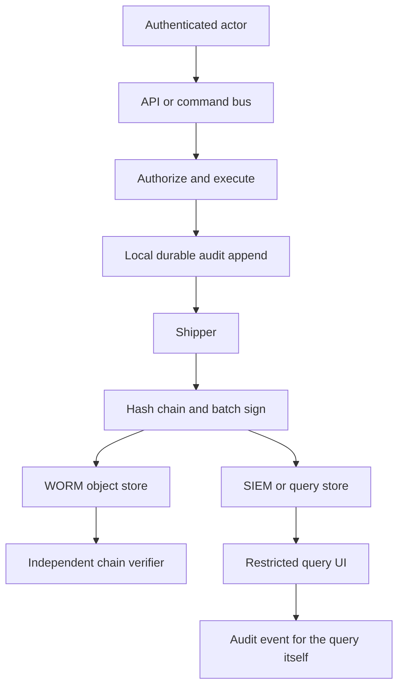

## Concept

An audit log is the story of who did what, to which object, under which authority, when, and from where, in a form you can still believe after someone with production access tries to edit the past. Application logs are for debugging. Metrics are for SLOs. Audit is for investigations, compliance, and the day you must prove a control worked. If the same pipeline is used for all three, you will drop audit events under load, or you will let operators truncate the table that a regulator later asks for.

I design audit as a first-class stream: emitted at the authorization boundary, shipped on a path the app cannot silently skip, stored in a system that detects tampering, and read through a narrow, logged interface.

### What to log, and what never to log

Each event needs an actor, an action, a resource, a result, a timestamp, a request or trace id, and the tenant. Actor is the human or workload after authentication, plus the impersonator if a support session is in play. Action is a stable verb (`iam.user.delete`, `payment.refund.create`), not an HTTP method and path that will change in a rewrite. Resource is type plus id, and the tenant that owns it. Result is success or the authorization denial. Denies belong in the audit. Attacks live in the 403s.

Before and after snapshots are useful for config and IAM changes and expensive for high-volume reads. Log diffs for security-sensitive writes. Do not log every GET of a product page as an audit event unless you are in a domain that requires it; you will drown the signal and store PII you cannot justify. Do log every export, every decrypt, every access to a break-glass role, and every change to audit configuration itself.

Never write secrets, passwords, session tokens, raw PANs, or medical payloads into the audit record. Hash or tokenize identifiers if the id itself is sensitive. Audit stores become the highest-value dump in the company if you treat them like debug logs.

### Tamper-evident storage

"Append-only" as a SQL privilege is a start. A determined admin with the RDS master password is not impressed. Tamper-evidence means a verifier can tell if history was rewritten. The usual mechanics: hash chaining (each record contains `H(prev_hash || payload)`), periodic checkpoints signed by a key the operators of the app do not hold, and copies in a store with object lock or WORM.

A hash chain in a database still lives in that database. Pair it with an export: every N minutes, write a batch of events plus the tip hash to an object store with legal hold, or to a third-party SIEM that your app role cannot delete from. Verify the chain in a job that pages if a gap or a hash mismatch appears. If nobody verifies, you have a linked list, not evidence.

Clock source matters. Use a consistent timestamp (the log collector's receipt time and the app's event time, both stored). Ordering inside a single node is easy. Ordering across a fleet is not. Do not pretend a global total order unless you have a sequencer. For investigations, "happened-before" via trace id and per-actor sequence numbers is usually enough. For a ledger of admin actions, a per-tenant sequence assigned at the audit service is worth it.

### Emission path: interceptor versus explicit

The reliable pattern is an interceptor at the API or command bus: after authentication, after the handler, write an audit event from the command name, the principal, and the resource ids the handler touched. Explicit `audit.log()` calls in business code will be forgotten on the new endpoint. Interceptors miss what they cannot see: a worker that mutates data without going through the bus, a direct SQL console, a cloud console change.

Cover those gaps with the same stream. CloudTrail-style logs for infrastructure. Database audit for superuser sessions. The application interceptor for product actions. One schema so a query can join "who deleted this customer" across those sources, even if the raw pipes differ.

Write the event after authorization is decided, including denials, and do not make the user's request fail because the audit collector was slow. That last sentence is a trap. Fail-open on audit means an attacker who fills the disk stops being recorded. Fail-closed on audit means an SIEM blip takes down checkout. Split the paths: money-moving and IAM changes wait for a local durable append (disk, outbox) and then ship async; high-volume reads are best-effort with a loss metric that pages. Always have a local durable buffer. Direct UDP to a SIEM from the request thread is how you lose the incident.

### Access, retention, and the audit of audit

Who can read audit logs is itself an audit event. Restrict to a security role, require a ticket id for broad queries, and never grant the application deploy role `s3:DeleteObject` on the WORM bucket. Retention follows the strictest regulation you actually have, with legal hold for investigations. Deletion of audit data is a controlled procedure, not a TTL that silently drops year one because someone set seven days to save money.

Alert on gaps: event volume dropping to zero for a service that is still serving traffic, chain verification failures, collector lag, and attempts to modify the audit configuration. Those alerts are the control. A perfect schema with no monitors is a diary.

## Trade-offs

| Approach | When it wins | Cost / risk |
| -------- | ------------ | ----------- |
| App debug logs as "audit" | Never, except a prototype | Lossy, mutable, full of secrets, no actor model |
| Interceptor plus durable outbox | Product actions on a command API | Misses console and workers unless they share the bus |
| Cloud provider audit (CloudTrail, Cloud Audit Logs) | Infrastructure, IAM, data-plane cloud APIs | Not your domain verbs; cost at volume; delay |
| Hash chain plus WORM export | Any environment where insiders are in the threat model | Verification jobs; key custody; restore complexity |
| Fail-open async ship | High-volume, low-sensitivity events | Silent loss under load |
| Fail-closed local append | IAM, payments, break-glass | Availability coupling; disk full is an incident |

The cost people underestimate is query design. An audit store that cannot answer "all actions by this actor on this tenant in this week" in a reasonable time will be bypassed, and people will `SELECT` production again. Index actor, tenant, resource, time. Do not keep audit only in a huge JSON pile in a SIEM with a twenty-minute search timeout if investigators live in that tool daily.

The other cost is PII. Minimization up front is cheaper than a purge program later. If you ship full request bodies "just in case," you will one day be asked to erase a person from an immutable store. Immutable and erasable are in tension; resolve it with tokenized identifiers and a separate, locked mapping, or with a documented legal exception.

## Diagram

Emission, durable buffer, evidence store, and a verified read path are four different components. Drawing them as one logging library is the mistake.

## Failure modes

### Missing actor, tenant, or impersonation

**Detection.** Events show `system` or empty user for support actions. A deleted customer's records cannot be attributed. Impersonation looks like the customer did it.

**Mitigation.** Force actor context in the interceptor. Record `actor`, `on_behalf_of`, and `tenant` as required fields; drop or fail the event builder if they are missing on sensitive paths. Test impersonation in CI.

### Log injection and secret leakage

**Detection.** User-controlled names contain newlines or JSON that break parsers and fake extra events. Tokens and PANs appear in `before` snapshots. A SIEM dashboard shows a password reset body.

**Mitigation.** Structured events only, never string-concatenated lines. Allowlist fields. Redact known secret shapes. Treat audit schemas like APIs: no free-form request dumps.

### Volume drowning and silent drop

**Detection.** Collector lag grows, then drops. Disk on the app host fills and the process truncates. A noisy tenant's read events bury a single IAM change. Loss counters exist and nobody pages.

**Mitigation.** Separate streams by sensitivity. Sample or exclude boring reads. Buffer with backpressure. Page on loss and on zero-volume. Load-test the audit path with production-shaped QPS.

### Tampering and unverified chains

**Detection.** An investigation finds a gap in ids. Nobody has run the verifier in months. The app role can delete S3 objects. A database restore rewound the audit table with the app data.

**Mitigation.** Keys for signing checkpoints live outside the app account. Object lock. Verifier on a schedule with an alert. Restore runbooks that do not rewind the evidence store. Practice an integrity failure.

## Real-world example

AWS CloudTrail is the public audit architecture most teams already depend on, even when their application audit is a table named `logs`. CloudTrail records AWS API activity: who, using which identity, called which API, on which resource, from which source IP, with a result, at a time. Trails can be organized across accounts, delivered to S3, integrity-checked with digest files, and locked down so the producing account cannot quietly delete history.

The digest-file mechanism is the tamper-evident piece people skip in homemade versions. Periodically CloudTrail writes a digest that hashes the log files for that window. If someone removes or edits an object, the digest no longer matches. Combined with S3 object lock and a separate security account that owns the bucket, you have a design that assumes the application operators are not fully trusted. That assumption is the point of audit.

Application audit should look like that, for your verbs. Actor, action, resource, result, a delivery path that is not the debug log, integrity, and a reader that is not `SELECT * FROM events`. Google Cloud Audit Logs make the same split: admin activity versus data access, different reliability and cost, both tied to IAM identities. When I review a SaaS, I want CloudTrail (or equivalent) for the cloud, and a CloudTrail-shaped pipeline for the product. The second one is where "who exported this tenant's customers" is answered. If the answer is "we might have it in Kibana if the index did not roll," that is not an audit architecture yet.

## What to remember

- Audit events need actor, action, resource, tenant, result, and time; denials and impersonation count, secrets never do.
- Emit from an interceptor into a durable buffer, then ship; do not use debug logs or a best-effort UDP send as the control.
- Make storage tamper-evident with hash chains or signed digests plus WORM copies, and actually run the verifier.
- Separate high-volume and high-sensitivity streams, index for investigations, and audit the act of reading the audit.
