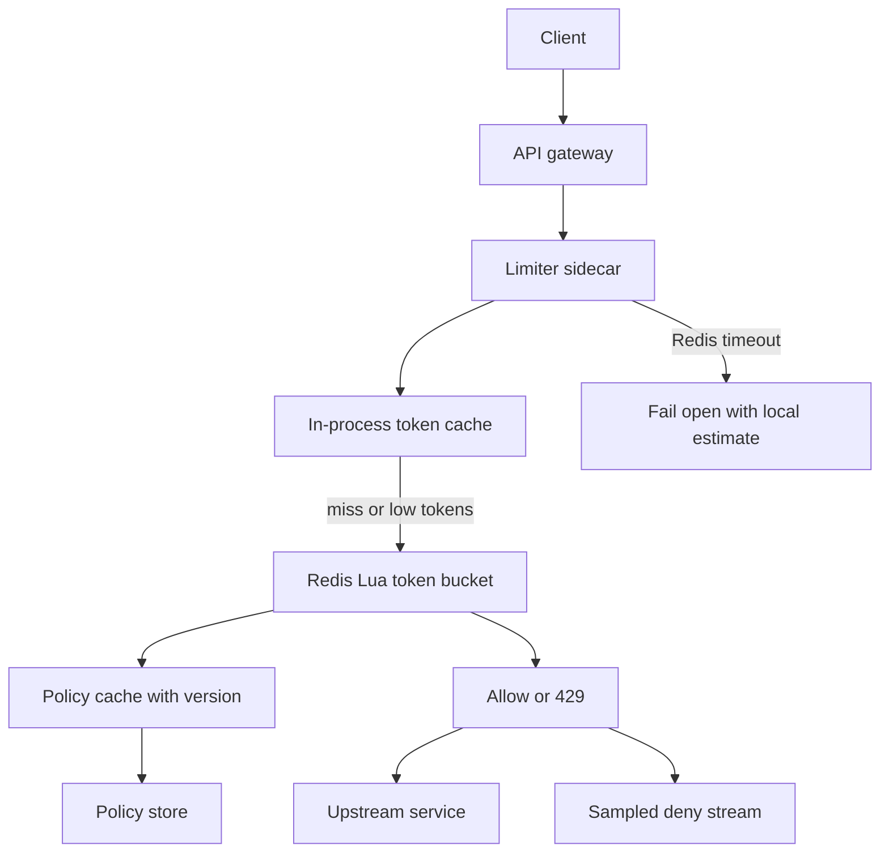

## Concept

A rate limiter is not a counter with an HTTP 429. It is a policy engine that decides, for a named subject and a named quota, whether this request may proceed, how long the subject must wait if it may not, and how that decision stays correct when several machines try to spend the same budget at the same time. I treat it as a control plane sitting on the request path: every other reliability pattern in the stack will either honor this decision or accidentally punch a hole through it.

The design I would ship is a **token-bucket limiter at the edge, backed by a sharded Redis cluster, with a short in-process cache of recently seen buckets**. Token bucket matches how product actually talks about quotas: you may burst a little, then you settle to a sustained rate. Fixed windows are simpler to explain in a slide and worse at the boundary, where a client that waits for the clock to roll over doubles its spend. Sliding-window logs are accurate and too expensive at the QPS this component sees. I keep the algorithm boring so the distributed part can be the thing we argue about.

### Requirements

Functional: enforce per-subject quotas (API key, user id, IP, tenant, route). Support at least two limit classes on the same request, for example "100 requests per second per key" and "1 million per day per tenant." Return a clear allow or deny plus standard headers (`X-RateLimit-Limit`, `X-RateLimit-Remaining`, `X-RateLimit-Reset`) so clients can back off without guessing. Allow operators to change a quota without a deploy. Support a small allow-list and a deny-list. Emit an audit event on deny storms, not on every allow.

Non-functional: the limiter sits on every request, so it must fail in a declared way. I want allow/deny p99 well inside the API's latency budget, typically a handful of milliseconds added, not tens. Availability of the limiter should be higher than the APIs it protects; if Redis is unhappy I would rather shed using a stale local estimate than take the whole edge down. Correctness is "approximately right under partition," not "linearizable remaining count." Multi-region: each region enforces its own buckets unless the product sold a global daily cap, in which case that cap is a separate, slower counter.

Out of scope for this design: bot scoring, WAF signatures, and payment-idempotency keys. Those are adjacent systems. If you fold them into the limiter you will ship neither well.

### Capacity sketch

Assumptions, stated so they can be attacked: 50 million registered keys, 200 thousand requests per second at the edge at peak, 20 thousand distinct keys active in any one second, a default of three limit rules evaluated per request, average key string under 64 bytes, bucket state under 128 bytes. That is about 20 thousand Redis keys hot, not 50 million. Memory for hot state is tens of megabytes plus Redis overhead, which is not the constraint. The constraint is Lua-eval or MULTI/EXEC QPS against the hot shard, and the network RTT from the edge process to Redis.

I would provision Redis so the hot keyspace fits in memory with headroom, with replicas for failover, and I would not put daily-cap counters on the same nodes as the per-second buckets. Daily counters are large-cardinality and write-once-per-request; per-second buckets are tiny and extremely hot. Split them. Disk is irrelevant. CPU on the edge is the Lua script plus JSON. Network is one RTT on a cache miss of the local bucket view, and zero extra RTT when the in-process view still has tokens.

If the product is "protect a handful of public endpoints from scrape," this sketch is oversized and a gateway plugin with in-memory token buckets is enough. If the product is "sell API access with contractual quotas," you need the shared store.

### API shape

The limiter is an internal RPC, not a public resource. The gateway or sidecar calls:

`Allow(subject, rules[], cost) -> { allowed, remaining, retry_after_ms, limit_id }`

`subject` is a tuple `(kind, id)`, for example `("api_key", "key_abc")`. `rules` names the policies to apply, not the numbers; numbers live in the policy store so a support tool can raise a customer's cap. `cost` is usually 1; batch endpoints pass the batch size. Deny is a first-class result, not an exception. I would not expose Increment/Decrement to product services. If they can mutate remaining, they will, and the quota becomes a suggestion.

Admin APIs sit elsewhere: `PutPolicy`, `GetPolicy`, `Override(subject, policy, until)`. Overrides are records with expiry, not special cases in application code.

### Core data model

Policy: `{ policy_id, algorithm: token_bucket, capacity, refill_per_sec, burst, keys: [subject_kind, route], updated_at }`. Stored in a small strongly-consistent store (SQL or etcd). Cached at the edge with a version. A policy bump increments the version; edge processes watch or poll.

Bucket: Redis hash or string per `(policy_id, subject)`, value `{ tokens, last_refill_unix_ms }`. Updated by a Lua script that refills based on elapsed time, subtracts `cost`, and returns allow/deny plus remaining. TTL on the key slightly longer than the time to refill from empty so idle subjects disappear.

Local shadow: in-process map of the same key to `{ tokens, expiry_monotonic }`. Used only as a negative cache for recently denied subjects and as a positive cache for a few milliseconds of remaining tokens when we are willing to over-allow slightly. I would rather over-allow a few requests during a Redis blip than block the site.

Decision log: sampled denies to a stream, keyed by subject, for abuse review. Not a source of truth.

## Trade-offs

| Approach | When it wins | Cost / risk |
| -------- | ------------ | ----------- |
| Fixed window counter | Tiny services, quotas that are "per calendar day" and already understood as such | Boundary burst: two windows back-to-back can admit twice the cap |
| Sliding window log | Accuracy on small QPS, audit of every timestamp | Memory and write amp; collapses at edge QPS |
| Sliding window counters (two buckets) | Good approximation without per-request timestamps | Still a window, not a burst-then-sustain model |
| Token bucket (proposed) | Product language is burst + sustained rate; cheap in Redis Lua | Clock dependence; clients must understand burst |
| Leaky bucket | Smoothing traffic into a downstream that cannot burst | Feels like extra latency; poor fit for user-facing APIs |
| Local in-memory only | Single-process services, or per-instance fairness is enough | No cluster-wide cap; rolling deploys reset buckets |
| Central Redis / Memorystore | Multi-instance APIs with contractual quotas | Extra hop; hot keys; limiter availability becomes the site's availability |
| Gateway plugin (nginx, Envoy, Cloudflare) | Coarse IP or route limits, no app change | Weak per-customer identity; policy model is whoever owns the gateway |
| Per-region buckets vs global | Regional user traffic; most "per second" caps | A client that fans out across regions multiplies the cap |

I pick token bucket plus Redis because the callers are many and the contract is a rate, not a calendar. I keep a local shadow so a Redis timeout does not become a site outage. The shadow must be bounded: a few seconds of independent spending is a stated over-allow, not an accident. Global daily caps, if the business insists, are a second limiter with a much looser latency SLO and a reconciliation job, not the same Lua path.

Leaky bucket is the right shape when the thing you protect is a downstream queue with a hard ingest rate. It is the wrong shape for an HTTP API where a mobile client waking from sleep should be allowed a short burst.

## Diagram

## Failure modes

### Hot keys

A single API key or a single `/login` IP will dominate a Redis shard. Token-bucket state for that subject cannot be split without changing the meaning of the cap. Detection is shard CPU and a per-key QPS histogram, not cluster-average memory. Mitigation: isolate celebrity keys onto a dedicated Redis db or a local limiter in the gateway with a hard cap, cache negative decisions for a few tens of milliseconds so the same key cannot stampede Lua, and refuse to sell an unbounded burst even to enterprise keys. If one tenant is the business, give them a dedicated limiter pool rather than pretending the shared cluster is fair.

### Clock skew and refill

Token bucket refills from elapsed time. If two edge pods disagree about wall time by a second, they disagree about remaining tokens. NTP step changes look like a burst grant or a freeze. Mitigation: store `last_refill` in Redis as the authority, use Redis TIME inside the Lua script rather than the client's clock, and clamp elapsed time so a backward clock cannot mint a full bucket. Monotonic clocks are for local shadows only; they are not comparable across hosts.

### Thundering herd on 429

Clients that retry a 429 with the same jitter-free backoff will reconverge on the reset boundary and recreate the overload the limiter exists to prevent. Mitigation: return `retry_after` with jitter, prefer `Retry-After` as a duration not a wall clock, and document that clients must honor it. Internally, the local negative cache stops our own mesh from amplifying the same deny.

### Fail-open versus fail-closed

If Redis is down and you fail closed, you have turned a cache outage into an API outage. If you fail open with no bound, you have turned the limiter off. I fail open for a short, measured local budget per process, emit a high-severity signal, and trip a coarser Envoy local rate limit as a backstop. The backstop is "protect the site," not "honor the customer's contract." Those are different SLOs and should not share a dashboard title.

### Policy version split

A rolling deploy leaves half the fleet on policy v12 and half on v13. For a lowered cap that is a window of over-allow; for a raised cap it is extra 429s. Mitigation: version the policy in the Allow request, or watch a single policy version and only switch on all pods after the store reads consistent. Do not embed numbers in YAML on the app servers.

## Real-world example

Cloudflare's edge rate limiting is the version of this design I would copy for internet-facing abuse: decision as close to the client as possible, cheap keys (IP, JA3, path), fail in a way that still sheds, and a dashboard that shows who is being throttled. Stripe's API rate limits are the version I would copy for product quotas: identity is the API key, limits are part of the customer contract, response headers are a documented protocol, and the limiter is allowed to be slightly conservative so billing and fairness stay explainable.

What I would copy from Cloudflare: run the hot path at the edge, keep the algorithm simple, treat the limiter as production-critical infrastructure, and combine it with a coarser emergency brake. What I would not copy: using IP as the primary subject for a logged-in product API, and coupling bot management scores into the same counter that enforces a paid quota. Abuse scoring and contractual quotas have different false-positive costs.

What I would copy from Stripe: explicit per-key and per-endpoint budgets, headers as the client contract, and a support path to raise a cap without a deploy. What I would not copy into a first system: a global, perfectly synchronized remaining count across all regions. Stripe can afford a sophisticated control plane. A first limiter should be per-region token buckets plus a daily counter that is allowed to be a few percent sloppy. Perfect global remaining is how this project misses its launch date.

## What to remember

- A rate limiter is a policy plus a shared bucket; the algorithm is the easy part and the failure mode of the store is the design.
- Token bucket matches burst-then-sustain quotas; fixed windows invite boundary stampedes.
- Hot keys cannot be hashed away; isolate them and cache denies.
- Decide fail-open versus fail-closed in writing, with a local bound and a coarser backstop, before Redis has a bad day.
