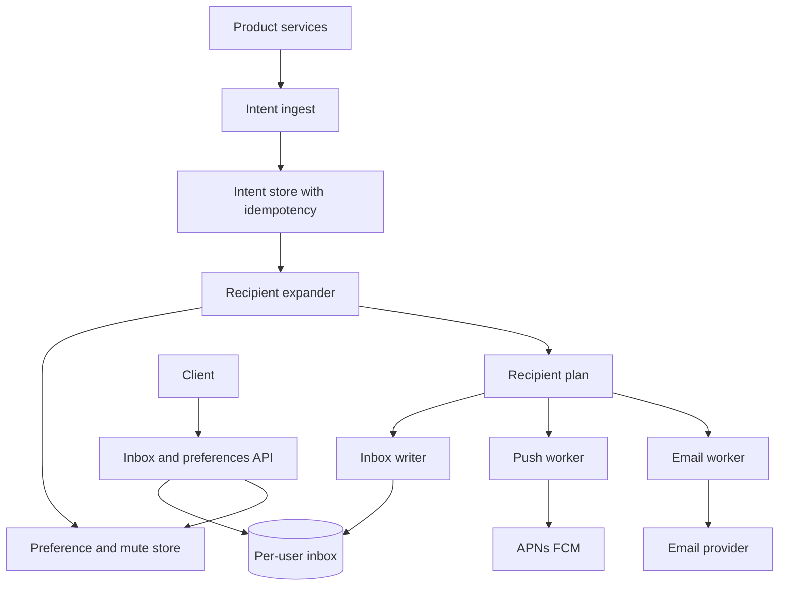

## Concept

A notification system turns domain events into messages a human might actually read, on a channel they consented to, at a time that will not get you one-star reviews. The hard part is not "call APNs." The hard part is fan-out, preference, deduplication, and the fact that every channel has a different reliability and a different cost of being wrong. I would not build this as a function that loops over users inside the originating service. That service will timeout, retry, and double-send.

The design I would ship is an **ingestion pipeline that accepts intent, a preference and routing layer that decides whether and how to send, and per-channel workers that talk to providers**. In-app and push are near-real-time. Email and SMS are queued and rate-limited per destination. Digest and quiet hours are first-class, not a cron someone adds after the first complaint.

### Requirements

Functional: accept a notification intent from internal services (`user_commented`, `invoice_ready`, `mention_in_channel`). Resolve recipients, including expanding a channel or a team. Honor per-user preferences: channel, frequency, quiet hours, thread mute. Render a template with a small, versioned context payload. Deliver to at least in-app inbox, mobile push, email, and webhook. Support a user-facing inbox with read/unread. Support unsubscribe and legal opt-out that actually stops the next send, not the one after next. Idempotency on the producer intent so retries do not create two emails.

Non-functional: end-to-end for interactive notifications (mention, DM) should feel immediate, which I would budget as a couple of seconds at p99 under healthy providers, not as a fiction of "50 ms to APNs." Bulk product announcements may take minutes. At-least-once delivery to the provider, exactly-once as seen by the user, which you only get with idempotency keys and an inbox unique constraint. Providers will fail; we need retries with backoff, a dead-letter, and a circuit so one bad SMS vendor does not stall mentions. Multi-tenant isolation so one customer's campaign cannot starve another customer's DMs.

Out of scope: marketing attribution, in-body analytics pixels as a product, and "smart send time" machine learning. Those can sit on top later. Also out of scope: using the notification path as an integration bus for other services. If a system needs a reliable event, give it the event log, not a push notification.

### Capacity sketch

Assumptions: 20 million monthly actives, 5 million with push tokens, average 20 notification-worthy events per active user per day, of which preferences drop half, so about 200 million intents per day and on the order of a few thousand fan-out operations per second at peak, with spikes when a popular workspace posts. In-app writes are the bulk. Push is a subset. Email is a small percent and must stay that way or you will be a spammer.

Payloads are small: a template id plus a JSON context of a few kilobytes, not an embedded video. Storage is the inbox: if we keep 90 days of in-app notifications at a few hundred bytes each, we are in the low tens of terabytes before indexes, which is a partitioned store problem, not a laptop problem. The dangerous dimension is fan-out of a single event to a large audience: a workspace of 50 thousand members is a thundering herd, not "one insert."

Provider quotas are part of capacity. APNs and FCM will accept high QPS if you use their HTTP/2 APIs correctly; SMS and email vendors will not. I would rate-limit egress per provider and per destination address independently of ingest.

### API shape

Internal, authenticated as a service:

`POST /intents` `{ idempotency_key, event_type, actor_id, target: { type, id }, template_id, context, priority: interactive | bulk, expires_at }`

`target` is a user, a channel, a role, or a topic subscription. Expansion happens inside the notification service. Producers must not send a list of a million user ids.

User-facing:

`GET /inbox?cursor=` returns the in-app feed. `POST /inbox/{id}/read`. `GET /preferences` and `PUT /preferences`. `POST /devices` to register a push token. `DELETE /devices/{token}`. Unsubscribe links on email hit `POST /unsubscribe` with a signed token, not a session.

Admin: template publish, provider credentials, a preview endpoint that renders without sending.

### Core data model

`intent(id, idempotency_key unique, event_type, target, payload, priority, created_at, status)`. Status moves received → expanded → completed, with a cursor of how far expansion has gotten so a crash can resume.

`recipient_plan(intent_id, user_id, channels[], reason)`. Materialized during expansion after preference evaluation. This is what workers consume.

`inbox_item(user_id, item_id, intent_id, template_id, rendered_summary, created_at, read_at)`. Primary key `(user_id, item_id)` so the inbox is a per-user partition. Unique `(user_id, dedupe_key)` where `dedupe_key` is often `(event_type, object_id)`.

`preference(user_id, event_type, channel, enabled, quiet_hours)`. Overrides on mute of a thread or a channel live in `mute(user_id, resource)`.

`device_token(user_id, token, platform, last_seen)`. Invalid tokens are marked from provider feedback, not deleted in a panic so we can debug.

`delivery_attempt(recipient_plan_id, channel, provider_message_id, status, attempt, last_error)`. This is how we reason about "did APNs get it" versus "did the user see it."

Templates are versioned records. Rendering is pure: template plus context in, strings out. No network in the renderer.

## Trade-offs

| Approach | When it wins | Cost / risk |
| -------- | ------------ | ----------- |
| Inline send from the product service | Tiny apps, one channel, no fan-out | Timeouts, double-sends, product outages become notification outages |
| Push fan-out (write inbox at send time) | Interactive mentions, small audiences, read-time is a simple query | Celebrity / large-channel events explode write amp |
| Pull fan-out (store event, merge at read) | Huge audiences, product announcements | Read path is slower and ranking is harder; unread badges lag |
| Hybrid: push for small, pull for large | Real products with both DMs and org-wide posts | Two code paths; you must pick a threshold and live with it |
| Per-channel queues | Independent retry and rate limits; SMS cannot block push | More moving parts; ordering across channels is gone |
| Single queue, many consumers | Operational simplicity at low volume | One poison SMS payload stalls mentions |
| Direct provider APIs | Full control, better observability | You own token hygiene, retries, and every vendor quirk |
| Email/SMS ESP only | Fast to market for outbound | Weak in-app; easy to violate preference if ESP is the source of truth |

I would implement hybrid fan-out. A mention to one user or a thread of tens is push: write inbox rows, enqueue push. A post to a 40-thousand-person workspace is pull: write one event onto the workspace feed, and let inbox reads merge that feed with per-user mutes. The threshold is an operator knob, not a constant in three repos.

Quiet hours belong in the planner, not in the worker. If the worker discovers quiet hours, you have already paid for expansion and you will be tempted to send anyway.

## Diagram

## Failure modes

### Fan-out storms

A popular channel posts, the expander materializes millions of `recipient_plan` rows, Redis or the queue fills, and interactive DMs queue behind it. Detection is queue lag split by `priority`, not a single depth number. Mitigation: priority queues, a hard cap on push fan-out with overflow to pull, token-bucket on expansion per tenant, and backpressure to ingest so the producer gets a slowdown instead of a silent pile.

### Duplicate sends

Producers retry. Workers retry. Providers sometimes accept a message and timeout on the response. Users see two emails. Mitigation: idempotency key on intent, unique inbox dedupe key, and a provider-level idempotency key where the vendor supports it. SMS often does not. For SMS, store a hash of `(user, template, day)` and refuse a second send. Exactly-once is a property of the inbox unique constraint plus "do not send email until the inbox write commits," not a property of the queue.

### Preference lag and legal opt-out

A user unsubscribes, a worker already holds a plan computed before the unsubscribe, and the email still goes. Mitigation: the send worker re-reads a compact preference bitmap immediately before calling the provider, and unsubscribe writes that bitmap synchronously. Marketing teams will ask to skip this check "for performance." Do not.

### Provider brownout and token rot

APNs returns errors for dead tokens; if you retry those as if they were timeouts you hammer the provider and then get throttled for the live tokens too. Mitigation: classify errors, drop invalid tokens, circuit-break a provider, and fail a channel without failing the inbox write. The in-app message still exists. Push is a hint.

### Template injection

Context from the producer is untrusted. A username with HTML in an email template is a phishing vector. Mitigation: auto-escape, a tiny allow-list of HTML, and templates that do not eval. Review template publishes like code.

## Real-world example

Slack's notification architecture is the one I would steal from, not a marketing-cloud ESP. Slack has to mix extremely interactive DMs with large-channel fan-out, per-channel mute, keyword highlights, and OS-level push, and it has to do that without turning every message post into a million APNs calls. Public engineering writing around Slack's flannel and channel-fan-out work is the right mental model: do not treat "a message happened" as "notify every member immediately."

What I would copy: a dedicated notification pipeline separate from message persistence; mute and preference as data the send path must consult; hybrid fan-out so large channels do not write millions of rows; and an inbox that remains the source of truth even if push is down. What I would not copy into a first version: the full complexity of per-device, per-keyword, per-section highlight rules, or using the chat system's real-time gateway as the only notification channel. Mobile push and email still exist for users who are not connected.

I would also not copy the email-blast architecture of a commerce ESP as the core. Those systems optimize campaigns, not mentions. They will happily send at 10 million a day and they will not honor a thread mute that lives in your product database unless you force them to.

## What to remember

- Ingest intent, then plan, then send; never let the product service loop over recipients.
- Hybrid fan-out: push for small interactive audiences, pull for large ones, or a single popular post will become an incident.
- User-visible uniqueness comes from inbox constraints and pre-send preference checks, not from hoping the queue is exactly-once.
- Isolate channels and priorities so SMS and campaigns cannot stall mentions.
