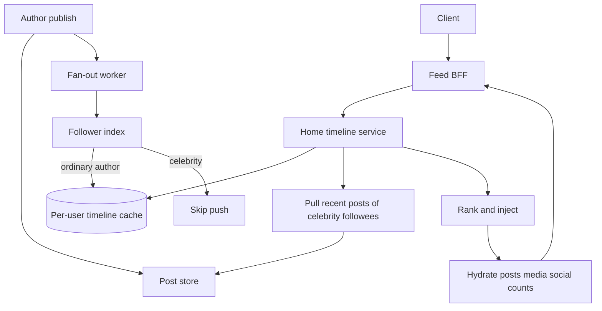

## Concept

A news feed is a personalized, ordered view of activity from people or entities a user follows, plus some injected material the product wants to show. The naive implementation is "on read, query everyone you follow, merge, sort." That works until follow counts and post rates leave the read path doing a scatter-gather that cannot meet a mobile SLA. The other naive implementation is "on write, push this post into every follower's inbox." That works until a celebrity posts and the write path melts.

The design I would ship is a **hybrid fan-out feed**: push into per-user timeline caches for ordinary authors, fall back to pull at read time for celebrity authors, and keep a durable post store that is not the timeline. Ranking is a separate pass on a candidate set, not a replacement for the candidate system. If you start with ranking on the entire corpus you are building a search engine and calling it a feed.

### Requirements

Functional: publish a post (text, media pointers, audience). Follow and unfollow. Fetch a home timeline with cursor pagination. Fetch a user profile timeline (that user's posts). Like and comment counts as sidecar data, not as a reason to rewrite the post. Support delete and "I don't want to see this." Optional: a small ads or recommendations injection slot. Notifications of new posts are a different system; the feed should not block on them.

Non-functional: home timeline reads are the hot path. I would budget p99 of a few hundred milliseconds for a page of 20 items including hydration, not a fantasy of single-digit milliseconds through five services. Writes can be slower for celebrities. Durability of a published post is mandatory; durability of a precomputed timeline is not — it can be rebuilt. Eventual consistency is acceptable: a follower may see a post seconds later. Unfollow should stop new items promptly and may leave already-materialized items until they age out. Multi-region: users read from the nearest region; posts replicate asynchronously.

Out of scope: a full trust-and-safety stack, live video, and "for you" ranking trained on a billion examples. We leave a slot for ranking and we do not pretend we have Facebook's model on day one.

### Capacity sketch

Assumptions: 100 million monthly actives, 20 million daily, average 200 follows, 2 posts per daily user per day, home timeline fetched 10 times per day, page size 20. That is on the order of 200 million posts per day, and a few tens of thousands of timeline reads per second at peak if the day is lumpy. Average post body of a few kilobytes plus media stored elsewhere.

If we fan-out every post to 200 followers, we write on the order of 40 billion timeline insertions per day, which is a bad default. Most of those authors are not celebrities. A hybrid where 99 percent of authors have under a few tens of thousands of followers, and we push those, keeps fan-out tractable. The remaining celebrity posts are stored once and merged at read.

Timeline cache: last 800 to 1,000 post ids per user is enough for "scroll a while." At 8 bytes per id plus overhead, that is a few kilobytes per user. For 100 million users that is hundreds of gigabytes, which fits a sharded Redis or a wide-column store. The post body store is larger and should be the source of truth in a replicated database or object store plus metadata.

### API shape

`POST /posts` `{ text, media_ids, audience }` returns `{ post_id, created_at }`.

`GET /timeline/home?cursor=` returns `{ items: [{ post_id, author_id, ranked_score }], next_cursor }`. Hydration of bodies, avatars, and social counts can be a batch `GET /posts?ids=` from the client or a BFF. I prefer the BFF hydrating a page in one round trip so mobile does not issue twenty calls.

`GET /timeline/user/{id}?cursor=` is the profile, which is just that author's posts and does not use fan-out.

`POST /follows/{id}` and `DELETE /follows/{id}`.

`DELETE /posts/{id}` must remove from the post store and enqueue a timeline tombstone; it will not instantaneously purge every materialized copy.

Cursors are `(timestamp, post_id)` not offsets. Offsets skip and duplicate when the feed is mutating.

### Core data model

`post(post_id, author_id, created_at, audience, text, media_ids, deleted)`. Partition by `post_id` or by `author_id` plus time, depending on whether profile queries or id fetches dominate. I would store by id for get-by-id and keep a secondary `author_posts(author_id, created_at, post_id)` for profiles.

`follow(follower_id, followee_id, created_at)`. Both directions indexed: "who do I follow" and "who follows me." The second index is the fan-out list. It must be sharded; a celebrity's follower list is a dataset, not a row.

`timeline(user_id, created_at, post_id, author_id, source)`. Source is `push` or `inject`. This table or Redis list is the precomputed home inbox for ordinary posts.

`celebrity_flag(author_id)` or a follower-count threshold. Not a VIP marketing list. A user can cross the threshold and we stop pushing.

`tombstone(post_id, created_at)` consumed by timeline readers to hide deleted posts that still sit in a cache.

Media lives in object storage. The feed only stores ids.

## Trade-offs

| Approach | When it wins | Cost / risk |
| -------- | ------------ | ----------- |
| Pull on read (merge followees) | Small follow graphs, profile-like products, early MVP | Read latency and load grow with follows and with celebrity post volume |
| Push on write (fan-out to inboxes) | Bounded follower counts, read-heavy home timeline | Celebrity posts cause write storms; unfollow and delete are messy |
| Hybrid push/pull (proposed) | Real social graphs with a heavy tail of followers | Two read paths; threshold tuning; ranking must understand both sources |
| Chronological only | Simple products, user trust, easy debugging | Engagement usually lower; still need injection for ads later |
| Ranked feed | Attention products, heterogeneous content | Ranking bugs look like "the app is broken"; feedback loops |
| Redis timeline lists | Hot reads, cheap trim of old ids | Rebuild after flush; poor for queries that are not "latest N" |
| Wide-column inbox (Cassandra, DynamoDB) | Durable inboxes, large pages, TTL | Operational cost; harder ad-hoc debug than SQL |

I would not launch with a fully ranked "for you" model. Chronological hybrid fan-out, plus a ranking function that can reorder a candidate page of a few hundred ids, is enough to learn whether ranking even matters. Pull-only is acceptable for an MVP with a few million users and a cap on follows. It is not the architecture I would put in front of a graph that already has celebrities.

Ads and recommendations inject into the candidate list after fan-out, with a frequency cap. They do not replace the social candidate set, or the product stops being a news feed.

## Diagram

## Failure modes

### Fan-out storms

A celebrity is misclassified as ordinary, or the threshold is too high, and a single post fans out to tens of millions of inbox writes. Queue lag explodes, ordinary posts stall, and home timelines freeze on old content. Mitigation: a hard follower-count check at fan-out time, a per-author token bucket, and automatic promotion to celebrity when fan-out lag crosses a line, even if the marketing team likes "everyone gets push."

### Hot keys and hot partitions

A celebrity's `author_posts` partition and their follower index are intrinsically hot. So is a newly viral post's hydration key. Mitigation: cache post bodies aggressively, replicate celebrity partitions, split follower indexes into segments, and coalesce hydration of the same post id. The timeline cache key `user_id` is also hot for bots; rate-limit timeline reads per user.

### Thundering herd on cache miss

A Redis flush, a region failover, or a deploy that changes the timeline key schema sends millions of users to rebuild from pull. The post store and the follow graph will not appreciate that. Mitigation: serve a slightly stale copy from a replica, rebuild timelines asynchronously with a paced worker, and degrade to "latest posts from a sample of followees" rather than a full merge. Never rebuild a million inboxes in a tight loop on the read path.

### Deletes, unfollows, and ghost items

Push fan-out copies post ids. Delete must chase them or readers must filter tombstones. Unfollow should stop new push and hide future reads of that author; old inbox rows may linger. If you promise instantaneous global purge, you will lie. Mitigation: tombstones on read, a lazy compaction that strips inbox rows, and a product copy that "this may take a moment."

### Ranking feedback loops

A slightly engagement-optimized ranker will amplify already-viral posts, then every home timeline looks the same, then you have a hot key. Mitigation: diversity rules, author caps per page, and a chronological escape hatch in debug.

## Real-world example

Twitter's (now X) home timeline and Facebook's News Feed are the two poles this design sits between. Twitter historically leaned on a mix of precomputed timelines and aggressive caching, with fan-out problems that are public lore whenever a celebrity posts. Facebook's feed is a ranking product on a social graph, with a candidate generation stage that is already a distributed system before any ML model runs. Neither is "query friends ORDER BY time."

What I would copy from Twitter-style systems: post id timelines rather than embedding bodies in the inbox; hybrid fan-out for the heavy tail; cursors; and treating the home timeline as a cache. What I would not copy: every historically accumulated ranking signal, Live/Spaces as part of v1, and the operational practice of making the timeline the source of truth.

What I would copy from Facebook: the idea of candidate generation then ranking then hydration, and the honesty that "the feed" is several systems. What I would not copy into a company that does not have that data science bench: a black-box ranker that nobody can debug, or injecting so much recommended content that follow relationships stop meaning anything. Users notice. They call it the algorithm, and they are not wrong.

## What to remember

- Hybrid fan-out exists because follower counts are a heavy tail; push and pull each fail on opposite ends of that tail.
- The timeline is a cache of post ids; the post store is the source of truth.
- Celebrity posts, deletes, and unfollows are failure modes of the data model, not polish items.
- Ranking reorders a candidate set; it is not a substitute for generating that set cheaply.
