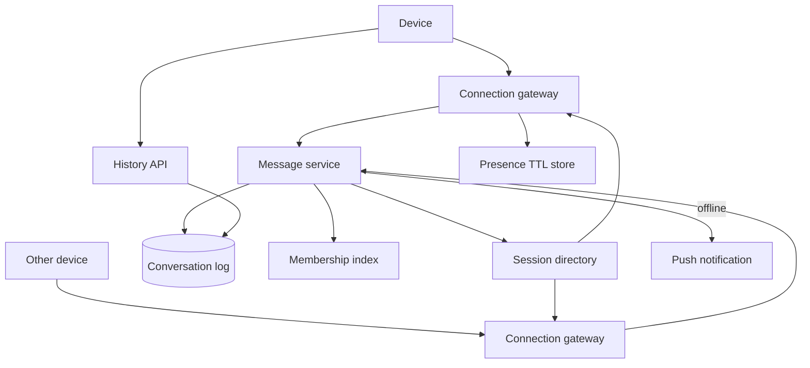

## Concept

A chat system is a delivery and storage problem with a real-time overlay. Messages must be accepted, persisted, fanned out to connected devices, and retrievable later for devices that were offline. Presence, typing, and delivery receipts are extra streams that people treat as core even though they can be lossy. I would not start from WebSockets and bolt storage on. I would start from a durable per-conversation log and treat the socket layer as a cache of "who is listening right now."

The design I would ship is **a message service that appends to a conversation partition, a connection gateway that holds WebSockets, and a fan-out path that pushes to online members and stores for everyone else**. One-to-one chat is a conversation with two members. Groups are the same log with more members. Very large groups (thousands) stop looking like chat and start looking like a channel feed; I would cap interactive groups and send the rest down a different fan-out.

### Requirements

Functional: send and receive messages in 1:1 and small groups. Message history with cursor pagination. Multi-device: a phone and a laptop both receive, and a read on one can mark read on the others if the product wants that. Delivery states: sent to server, delivered to a device, read. Presence: online, recently online, offline, with an explicit freshness. Typing indicators. Media via uploaded blob ids, not bytes on the chat path. Mute, block, and leave group.

Non-functional: send-to-ack for a healthy 1:1 should feel instant, which I would budget as tens to low hundreds of milliseconds in-region, dominated by mobile networks more than by our store. History reads should page. Durability: a 200 on send means the message is in the log, not merely in a gateway buffer. Ordering: per-conversation causal order as seen by the server; global order across conversations is not required. At-least-once delivery to devices, with client-side dedupe by message id. Groups of tens to a few hundreds of members; a 50-thousand-member "group" is a broadcast channel and out of this design. Encryption: transport TLS everywhere; end-to-end encryption is a product decision that changes the server data model and is called out as optional, not pretended.

Out of scope: voice/video calling, a public social feed, and searchable message archives across an enterprise. Search can be a later index of metadata, not of E2E payloads.

### Capacity sketch

Assumptions: 50 million monthly actives, 10 million daily, 40 messages per daily user, average 2 devices, average group size 8 with a long tail. That is on the order of 400 million messages per day, a few thousand persistent writes per second at a lumpy peak, and more fan-out reads than writes because each message hits several devices.

Connected sockets: if 2 million users are online and each has 1.2 connections, the gateway tier holds a few million connections. That is a horizontal WebSocket fleet, sticky by user, not a single node. Message bodies average a few hundred bytes; media is elsewhere. Retention of full history for years is a storage cost in the tens of terabytes plus indexes; I would tier: hot recent messages in a store that likes sequential appends, older pages in cheaper storage.

The dangerous load is not average QPS. It is a group of 200 with a hot thread, or a reconnect storm after a regional blip when every mobile client fetches missed messages and reopens sockets.

### API shape

Clients hold a WebSocket to a gateway:

`send { client_msg_id, conversation_id, ciphertext_or_body, media_ids, reply_to }`

`ack { client_msg_id, server_msg_id, server_ts, seq }`

`recv { server_msg_id, conversation_id, seq, sender, body, server_ts }`

`recv_ack { server_msg_id }` from the client so we can mark delivered.

REST/HTTP for the rest so reconnects are simple:

`GET /conversations/{id}/messages?after_seq=` or `?cursor=`

`POST /conversations` to create 1:1 or group. `POST /conversations/{id}/members`. `POST /media` returns an upload URL.

`PUT /presence` is not needed if the socket is the presence signal; a heartbeat on the socket is enough.

`client_msg_id` is the idempotency key. Retries of send with the same id return the same server id.

### Core data model

`conversation(id, type, created_at, last_seq)`. `last_seq` is the monotonic sequence for that conversation.

`membership(conversation_id, user_id, joined_at, last_read_seq, role)`. This is the fan-out list and the unread math.

`message(conversation_id, seq, message_id, sender_id, created_at, body_or_ptr, client_msg_id)`. Primary key `(conversation_id, seq)`. Unique `(sender_id, client_msg_id)` for idempotency. Body may be a pointer into object storage for large payloads.

`device(user_id, device_id, push_token, last_session)`. For offline push.

`inbox_pointer(user_id, conversation_id, last_delivered_seq)` per device or per user, depending on whether devices share read state.

Gateway session map: `user_id -> [gateway_node, conn_id]`. This is ephemeral, stored in a memory grid or in the gateway's local registry with a gossip/lookup. It is not the source of truth for messages.

Presence: last heartbeat timestamp per user, often in Redis, with a short TTL. Lossy by design.

## Trade-offs

| Approach | When it wins | Cost / risk |
| -------- | ------------ | ----------- |
| WebSocket (proposed) | Interactive chat, bidirectional acks, presence | Stateful gateways; connection storms; sticky routing |
| Long polling | Environments that cannot keep sockets; simple infra | Higher latency, more HTTP overhead, harder presence |
| Server-sent events | One-way server push, HTTP/2 friendly | Client still needs a send channel; no binary frames |
| Per-conversation log | Natural order, cheap history, group replay | Hot partitions for hot groups; fan-out still extra |
| Per-user inbox of copies | Simple per-device fetch, easy unread | Write amp on groups; storage multiplied by members |
| Hybrid: log plus online push | Online users get push, everyone has a log to catch up | Two paths must not diverge on "what exists" |
| E2E encryption | Threat model includes the operator | Server-side search, push previews, and moderation get hard |
| Store-and-forward only (email style) | Delay-tolerant, huge groups | Does not feel like chat |

I would keep a conversation log as source of truth and push to currently connected sessions. I would not copy every message into every member's inbox except as an optimization for 1:1 unread lists. Groups of hundreds already make copies expensive; groups of thousands make them a mistake.

Long polling is a fallback transport, not the architecture. If a corporate proxy kills sockets, the client can poll `GET /messages?after_seq=` and you still have the same log. Do not design two message models.

## Diagram

## Failure modes

### Split fan-out and lost acks

The log write succeeds, the gateway that holds the recipient is stale in the session directory, and the user is "online" on a dead connection. They do not get the push-over-socket, and if we skip offline push because presence said online, the message waits until they reopen history. Mitigation: treat presence as a hint, send APNs/FCM if no `recv_ack` within a short bound, and let history catch-up be the guaranteed path. The socket is acceleration.

### Hot groups and fan-out storms

A 300-person group with a fast thread will hammer one conversation partition and one membership list. Sequence generation on that partition becomes the bottleneck. Mitigation: single-writer per conversation (a partition owner or a Redis incr for seq), cache membership, and cap group size. For announcement groups, switch to a channel design: one log, pull on read, no per-member copies.

### Reconnect storms

A gateway deploy or a load-balancer blip drops a million sockets. Clients reconnect, all ask for `after_seq`, and the history store spikes. Mitigation: jittered reconnect, session resumption tickets, paced history, and keep gateway deploys rolling with connection draining. Never bounce the whole fleet.

### Duplicate messages

Client retries send after a timeout; the first write landed. Without `client_msg_id` uniqueness you double-chat. Workers that fan-out at-least-once will re-push. Mitigation: idempotent append, clients keyed by `message_id`, and receipts that are min/max seq rather than "deliver this id again."

### Ordering surprises

Two devices send at once; a third device sees them in a different order than the sender's UI. Mitigation: server seq is the order. Clients render by `(conversation_id, seq)` and treat `client_msg_id` as optimistic UI only until ack. Do not try to globally order conversations; last-message-at on the conversation list is enough.

### Storage corruption and silent truncation

A bug in compaction drops a seq hole. Clients that page `after_seq` skip a message forever. Mitigation: seq must be gap-free per conversation; readers that see a hole fetch repair or fail loudly; backups of the log; never reuse seq.

## Real-world example

WhatsApp is the product I would map this to. Public descriptions of WhatsApp (and the older Erlang/FreeBSD era, plus the later E2E layer) point at a store-and-forward architecture with a persistent connection, not a "query the chat table every 2 seconds" loop. Messages are queued for offline users. Groups are membership plus fan-out, and very large broadcasts are not the same as a family group.

What I would copy: the conversation as a durable log; the mobile client as a first-class offline actor that will catch up; acks as protocol, not as UI sugar; multi-device as a hard requirement rather than a later surprise; and a hard distinction between transport encryption and E2E. What I would not copy into a first internal chat tool: the full Signal-protocol identity and key-change UX, SMS as a fallback transport, or trying to run the entire connection layer in one language runtime because WhatsApp did it in Erlang. Erlang's strengths are real; your team's operational knowledge is also real.

I would also not copy Slack's channel-centric model if the product is private messaging. Slack is closer to a news feed plus chat. Mixing the two without a group-size policy is how you accidentally build both badly.

## What to remember

- Persist first, then fan-out to sockets; the history API is the correctness path and the WebSocket is acceleration.
- Per-conversation sequences give order; client message ids give idempotency.
- Presence and typing may be lossy; message delivery may not.
- Cap interactive group size, or a hot group becomes a partition incident.
