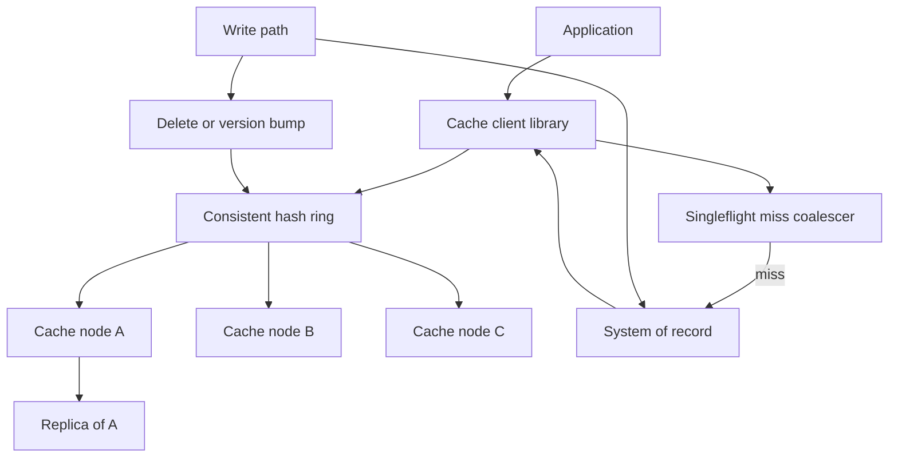

## Concept

A distributed cache is a fleet of memory nodes that answer "get this key" faster than the system of record, with an explicit story for who owns a key, what happens when that owner dies, and how a miss does not become a self-inflicted outage. I would not treat Redis or Memcached as a magic box you point at from the app. The cache is a cluster with a partition function, a client or proxy that honors that function, and a policy for fill, TTL, and invalidation.

The design I would ship is **cache-aside with client-side consistent hashing (Ketama-style virtual nodes), a small replica factor for hot-read keys, and request coalescing on miss**. Writes go to the database, then invalidate or set the cache. The cache is allowed to be wrong for a bounded time. If you need the cache to be a source of truth you are designing a datastore and you should stop calling it a cache.

### Requirements

Functional: `GET`, `SET` with TTL, `DEL`, and `GET` with a fill callback on the client. Optional `MGET`. Namespaces per service so two teams cannot collide. Ability to flush a namespace. Stats: hit ratio, miss ratio, eviction, error, per-node QPS. An admin path to dump a key's replica set and TTL for debugging.

Non-functional: get latency in the sub-millisecond to low-millisecond range in-region when the key is local to the node. Availability: a single node death must not take down the keyspace; misses may rise. Memory is the capacity unit; disk is for optional persistence of a subset, not for the hot path. Consistency: after a write, readers may see the old value until TTL or invalidation. I would rather a short TTL plus explicit delete on write than a fantasy of transactional cache and database. Multi-region: usually a cache per region in front of a regional reader. Cross-region cache is a second product.

Out of scope: using the cache as a queue, as a lock service, as a session store of record, or as a primary database with AOF as your backup plan. Those uses exist in the wild. They are how cache incidents become data-loss incidents.

### Capacity sketch

Assumptions: 200 thousand get QPS at peak, 10 thousand set/invalidate QPS, 20 million hot keys in the working set, average value 2 KB, average key 40 bytes. Working set is about 40 GB plus Redis/Memcached overhead, so I would plan on the order of 80 to 120 GB of cluster memory after fragmentation, replica copies, and headroom. That might be 6 to 12 nodes depending on instance size, not 2.

Network: 200 thousand QPS times 2 KB is hundreds of megabytes per second of goodput if every get hits and values are that large. Many caches are smaller values and the limiter is packet rate, not bytes. I would measure both.

Miss budget: if the origin can do 5 thousand QPS of the cached query, a 5 percent miss ratio at 200 thousand QPS is already 10 thousand origin QPS, which is over budget. The cache is not optional at that ratio. Hit ratio is an SLO, not a dashboard vanity.

### API shape

Clients should not speak a raw cluster protocol from twelve languages if we can avoid it. I want a thin library:

`Get(key) -> { hit, value }`

`Set(key, value, ttl)`

`Delete(key)`

`GetOrFill(key, ttl, fill_fn)` which coalesces concurrent fills for that key in-process.

Admin: `WhichNode(key)`, `Stats()`, `FlushNamespace(ns)`.

Keys are `service:entity:id` with a documented encoding. Values are bytes. The cache does not know JSON. Compression is a client choice for large values; tiny values get worse if you compress them.

I would put a proxy (Envoy, Twemproxy, or Redis Cluster-aware client) in the path only when we cannot update clients. A proxy is a failure domain. Prefer a smart client with a watched node list.

### Core data model

There is no schema in the database sense. There is a keyspace:

- Token ring: each node owns many virtual nodes (tokens). `hash(key)` maps to a primary. Optional replica: next distinct physical nodes on the ring.
- Item: `{ key, value, expire_at, flags }`. Stored in slab or in-memory dict depending on engine.
- Metadata: generation or epoch of the ring, so clients can tell a stale map.
- Optional persistence: snapshot of a subset of keys (session-like) if product insists. Default is ephemeral.

Application records that are cached have an explicit cache key and an explicit invalidation point in the write path. If the write path cannot name the keys, the data is not cacheable this way; use a TTL-only approach and accept staleness.

Namespace version: a small integer `ns_version` prepended to keys, incremented to flush.

## Trade-offs

| Approach | When it wins | Cost / risk |
| -------- | ------------ | ----------- |
| Cache-aside (proposed) | Reads dominate; origin remains source of truth | Stampede on miss; developers forget to invalidate |
| Write-through | Want cache and DB updated in one client call | Write latency includes cache; failure semantics get messy |
| Write-behind | Absorb write spikes | Data loss on crash; you have built a datastore |
| Memcached, consistent hashing | Pure ephemeral cache, simple values, proven Ketama clients | No replica in the classic setup; node death is a miss storm |
| Redis Cluster | Need richer types, optional replica, persistence knobs | Operational complexity; hot slots; MOVE/ASK redirections |
| Redis sentinel + single primary | Small working sets, simple ops | Vertical limit; failover drama |
| Client-side hashing | Lowest hop count | Stale rings split the keyspace |
| Proxy hashing | Many languages, controlled membership | Extra hop; proxy is a SPOF unless you scale it |
| LRU vs TTL vs both | Working set fits with mixed churn | LRU without TTL can serve very stale; TTL without LRU OOMs |

I pick cache-aside plus a Redis Cluster or a Memcached pool with Ketama. If we need replica reads and simple ops, Redis with one replica per shard. If we need the cache to be truly disposable and the values are blobs, Memcached is still a good shape. I would not use write-behind for user data I cannot reconstruct.

Replica reads: they hide a node failure and they can serve stale if replication lags. For a cache, stale-from-replica is usually better than miss-to-origin.

## Diagram

## Failure modes

### Hot keys

A celebrity profile, a homepage fragment, or a globally shared config key lands on one node and one CPU. Hashing cannot split a single key. Detection is per-node QPS and CPU, plus a top-keys sample. Mitigation: local in-process cache with a short TTL in front of the cluster for known hot keys, copy the value to many nodes via an explicit replicate-on-read, or split the key in the application (`page:home:shard:0..N` with identical values). Bounded-load hashing helps request routing, not a single popular key.

### Thundering herd / cache stampede

TTL expiry of a hot key aligns, or a node dies and its entire range misses at once. Origin QPS jumps by orders of magnitude. Mitigation: singleflight per key in the client, probabilistic early refresh (expire a little early on some requests), staggered TTLs, and a serving of stale while fill is in flight. On node death, pace the refill; do not let every app pod fill the same keys.

### Rebalance and membership change

Add a node, the ring moves a fraction of keys, those keys miss, origin spikes. A naive `hash % N` remaps almost everything; even consistent hashing remaps about `1/N`. Mitigation: virtual nodes so movement is in small chunks, warm the new node before it takes production traffic if you can, and add capacity before you need it, not during an incident. Freeze membership during a deploy of the hash library.

### Stale ring and split brain

Two clients with different node lists put the same key on different primaries. You will see random misses and, if you SET on both, silent divergence until TTL. Mitigation: version the cluster config, clients watch it, and refuse to SET if the config is older than a bound. For Redis Cluster, honor MOVED and update the slot map; do not pin an IP.

### Eviction and OOM

Working set exceeds memory. LRU evicts the keys that made the cache worth having, hit ratio collapses, origin dies, and then the cache cannot refill because origin is dead. Mitigation: memory headroom as an SLO, reject SETs when above a watermark, and split cache pools by workload so a bulk job cannot evict the user session keys. Do not share one cluster between "tiny hot objects" and "multi-megabyte blobs."

### Storage corruption

Rare, but a bad disk with Redis persistence, or a bit flip in RAM without ECC, yields garbage JSON that your app then writes back to the origin if you are careless. Mitigation: checksums on values if the payload matters, treat cache as untrusted, never write-behind unvalidated bytes, and prefer ephemeral caches so a restart is a miss, not a poison restore.

## Real-world example

Memcached at Facebook scale and Redis Cluster in the rest of the industry are the two implementations this design is in conversation with. Facebook's memcache papers are still the best writing on leases, stampede, and what a cache does to a MySQL tier. Redis Cluster is what most teams will actually run: hash slots, gossip, replica failover, and a client that must follow redirections.

What I would copy from the memcache lineage: cache-aside, leases or singleflight against stampedes, adding a lease so one client fills, treating the cache as disposable, and putting a lot of energy into client behavior rather than into a smarter server. What I would not copy without their fleet: a custom proxy layer in every rack, or UDP get, or the operational model of thousands of nodes as a first step. Start with a small cluster that fits the working set.

What I would copy from Redis: replica failover for node death, a watched slot map, and namespaces as key prefixes. What I would not copy: Redis as a primary database with AOF as backup, using Redis lists as the job queue on the same nodes as the hot cache, or Cluster when a single primary of 8 GB would have done. Cluster is a tax. Pay it when the working set and QPS demand it.

## What to remember

- A distributed cache is a partition function plus a miss policy; the engine is interchangeable until you rely on its extra data types.
- Cache-aside keeps the origin as source of truth; write-behind makes the cache a database.
- Hot keys and stampedes are the production failure modes; consistent hashing only solves rebalance, and only approximately.
- Hit ratio is capacity planning: a miss ratio that exceeds origin budget is an outage in slow motion.
