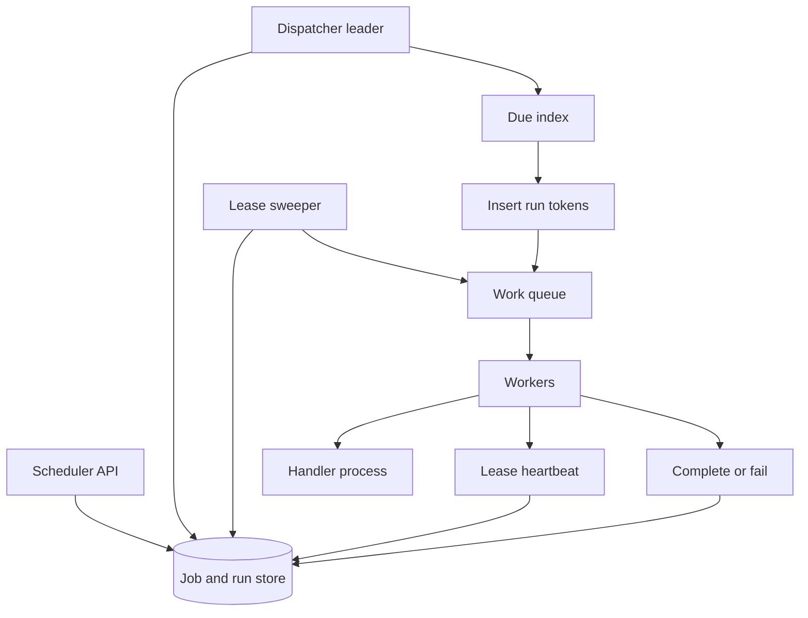

## Concept

A job scheduler is a system that fires work at a time, on a cadence, or when a dependency completes, and that can still tell the truth after a process dies in the middle. Cron on one box is a scheduler until that box is the incident. I would design for **durable job records, a clock that scans due work, a distributed lease so two workers do not run the same firing, and a queue that actually executes**. The scheduler is not the executor. Mixing them is how a slow job delays every other clock tick.

The design I would ship has three parts: a **control store** of job definitions and run history, a **dispatcher** that finds due runs and writes run tokens, and **workers** that claim those tokens. Recurring jobs are definitions plus a computed next-fire. One-shot delayed jobs are the same table with a `run_at`. DAG workflows are a layer on top: a run that completes may enqueue children. I would not start with a full workflow engine if the product need is "email this in 15 minutes" and "rebuild this report every night."

### Requirements

Functional: register a job (`handler`, schedule, payload, timezone, retry policy, timeout, owner). List, pause, resume, delete. Fire one-shot jobs at `run_at`. Fire cron-like expressions. Catch-up policy: skip missed fires, or run once to catch up, never "replay every missed minute of a two-day outage" unless the owner opted in. Inspect run history: queued, running, succeeded, failed, dead. Manual replay of a failed run. Per-job concurrency limit (at most one, or at most N). Idempotency key so a retry of register does not create two definitions.

Non-functional: dispatch latency for a one-shot job should be well under a second once due, in the healthy case, not "next cron minute." Availability of the dispatcher should survive a node loss. At-least-once execution is the default; exactly-once is the worker's idempotency plus a unique run id. Clock: use a stored due time, not "whatever the local JVM thinks." Multi-region: one region is primary for dispatch to avoid double fire; workers may be regional. Audit: who changed a cron, when.

Out of scope: replacing Kubernetes as a container scheduler, or building Airflow's full DAG UI on day one. Also out of scope: using the scheduler as a message bus for request/response RPC.

### Capacity sketch

Assumptions: 50 thousand job definitions, 5 million delayed one-shots per day (password resets, reminder emails, cart nudges), 200 thousand cron fires per day, average handler runtime of a few seconds, p99 of a few minutes, 2 thousand worker cores. Peak due-scan is lumpy at wall-clock hours (top of the hour). The store must support "give me jobs with `next_run_at` less than now" without a table scan.

If we shard due-work by time buckets (for example 1-second or 1-second-epoch keys in Redis, or a btree index on `next_run_at`), the dispatcher is a handful of processes polling. Throughput of fires is thousands per second at the top of the hour, which is a queue problem, not a Postgres problem, if we only use the database as the system of record and Redis or a log as the due index.

Payload size: keep it small, ids not blobs. Large inputs live in object storage, the job holds a pointer. History retention of 30 days of runs at a few hundred bytes each is tens of gigabytes, manageable.

### API shape

`PUT /jobs/{job_id}` `{ schedule: cron | once, cron_expr?, run_at?, timezone, handler, payload, max_attempts, timeout_sec, concurrency, catch_up: skip | one }`

`POST /jobs/{job_id}/pause` `POST /jobs/{job_id}/resume` `POST /jobs/{job_id}/run-now`

`GET /jobs/{job_id}/runs?cursor=`

`POST /runs/{run_id}/ack` from workers is internal. Workers more likely pull:

`Claim(worker_id, capabilities) -> run | empty`

`Heartbeat(run_id, worker_id)`

`Complete(run_id, result)` / `Fail(run_id, error, retryable)`

Handlers are registered in worker processes by name. The control plane does not ship code. If you need to ship code you have built a Functions product.

### Core data model

`job(job_id, handler, schedule_type, cron_expr, timezone, payload_ptr, next_run_at, paused, concurrency, catch_up, version, owner)`.

`run(run_id, job_id, scheduled_at, claimed_at, claimed_by, attempt, status, lease_until, idempotency_key)`. Unique `(job_id, scheduled_at)` for cron so two dispatchers cannot insert two runs for the same tick. Unique `idempotency_key` for one-shots.

Due index: either `next_run_at` btree, or a time-bucketed sorted set `due:{epoch_second} -> job_ids`. The dispatcher peeks at now and the last few seconds for late arrivals.

Lease: `lease_until` on the run. Workers heartbeat. Dispatcher or a sweeper requeues when the lease expires. This is how we survive worker death.

Lock for `concurrency = 1`: a record `running(job_id)` or a Redis lock with the run id as value. Do not use a lock without a lease.

Dead letter: runs that exhaust attempts. Humans replay.

## Trade-offs

| Approach | When it wins | Cost / risk |
| -------- | ------------ | ----------- |
| OS cron on one box | Tiny, single-node apps | Missed fires on down time; no history; no fan-out |
| DB polling dispatcher (proposed core) | Strong record of what should have fired; easy audit | Poll interval vs load; index design matters |
| Delay queue (SQS delay, Redis sorted set) | Huge one-shot volume, simple handlers | Weaker definition management; cron is awkward; visibility timeouts must be right |
| Leader-elected clock plus many workers | Clear "who scans"; workers stay dumb | Leader failover delay; leader must not also execute heavy work |
| Every node tries to fire, relies on a lock | Simple to code | Lock storms at the top of the hour; clock skew double-fires |
| DAG workflow engine (Airflow, Temporal) | Dependencies, retries with state, long running | Operational weight; wrong tool for "send this email in 10 minutes" |
| Catch-up skip vs replay | Skip for reports; replay for payments-like work | Replay of a two-day outage can DDoS downstream |

I would combine a durable job/run store with a Redis sorted set or SQS delay as the due index for one-shots, and a leader-elected scanner for cron. Workers are a separate pool with leases. I would not let the leader run handlers. I would not use Kubernetes CronJob as the product scheduler: it is a good way to start a container on a cadence, a poor way to manage a million delayed user emails with history.

Timezone is not optional. A cron in UTC will fire the daily report at the wrong local day after DST. Store the timezone on the job and compute `next_run_at` in UTC.

## Diagram

## Failure modes

### Double fire

Two dispatchers, clock skew, or a visibility timeout that expires while the handler is still running. Users get two emails or two charges. Mitigation: unique `(job_id, scheduled_at)` insert, leases with heartbeats longer than a GC pause but shorter than a human's patience, and **idempotent handlers**. The scheduler will be at-least-once. If a charge can happen twice, the handler must use an idempotency key in the payment system.

### Missed fires and catch-up storms

Dispatcher is down for an hour. On return, a naive loop fires every missed minute of every job. Downstream dies. Mitigation: default catch-up is `skip` or `one`, a max-catch-up bound, and a paced replay. Detect with `scheduled_at` versus `claimed_at` lag.

### Hot minute and thundering herd

Tens of thousands of crons set to `0 * * * *`. The top of the hour is a self-DDoS. Mitigation: spread default schedules with jitter, shard the due index, and require a reason for "all jobs at midnight UTC." The UI should show a histogram of planned fires.

### Split brain leader

Two leaders both scan. Unique run inserts should make this safe; if the due index is a sorted set `zadd` without the DB unique, it is not safe. Mitigation: leader election (lease in SQL or etcd) plus the unique constraint as the real guard. Election is an optimization so you do not waste scans. The constraint is correctness.

### Poison handlers and stuck leases

A handler hangs. The lease eventually expires, another worker starts, now two run. Or the handler crashes in a loop and burns the retry budget, then sits in dead letter while the product thinks the nightly job is fine. Mitigation: timeouts enforced by the worker runtime (kill the process), retries with jitter, alerts on dead letters and on `job not succeeded in expected window`, and concurrency 1 for jobs that cannot overlap.

### Clock and timezone bugs

Leap seconds, DST, and "every 30th of the month" in February. Mitigation: a well-tested cron library, compute next fire in a single service, store UTC timestamps, and never implement cron yourself in the sprint before launch.

## Real-world example

Apache Airflow is the scheduler most data teams know: a DAG of tasks, a scheduler process, workers, a metadata database, catch-up, and a UI of run history. Temporal and Cadence are the other pole: long-lived workflows as code with durable timers. Sidekiq and Cloud Tasks are the pole for "a lot of one-shot delayed jobs."

What I would copy from Airflow: job and run as data, a UI that shows failed runs, catch-up as an explicit policy, and the split between scheduler and workers. What I would not copy into an online product scheduler: Python DAGs as the only way to register work, a single scheduler that becomes a bottleneck, or catch-up-all as a default. Airflow's metadata DB has been an operational story for a reason; I would keep the control store small and move due-work out of it.

What I would copy from Sidekiq/Cloud Tasks: a delay queue for one-shots, visibility timeouts as leases, and cheap retries. What I would not copy: cron bolted on as "a repeating enqueue" without a definition table, which makes pause/audit/owner a tribal memory.

For a company that already runs Temporal, I would use its timers instead of building this. For a company that needs "nightly reports plus reminder emails," the design above is the smaller system.

## What to remember

- Dispatch and execution are different roles; the clock must not run the heavy handler.
- At-least-once is the honest delivery promise; unique run keys and idempotent handlers are how users see one fire.
- Catch-up policy is a product decision; replaying every missed tick is a failure mode.
- Top-of-hour herd, expired leases, and double leaders are the incidents you design for, not edge cases.
