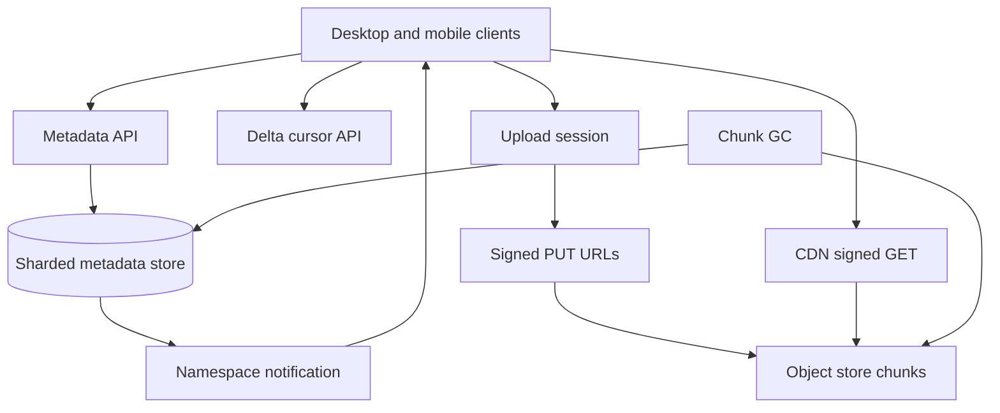

## Concept

A Dropbox-style service is not a disk with an HTTP PUT. It is a sync protocol: clients hold a local tree, the server holds a metadata tree and a blob store, and they converge after disconnects, concurrent edits, and partial uploads. The blob is content-addressed. The namespace is a per-user (or per-namespace) metadata layer that points at those blobs. If you store "the file" as a single object named after the path, rename becomes copy, concurrent edit becomes silent overwrite, and every retry re-uploads gigabytes.

The design I would ship is **chunked, content-addressed blobs in object storage, a strongly consistent metadata service for the namespace, and a notification channel so clients pull a delta instead of scanning the world**. Upload is a session of chunks. Download is a signed URL to the blob store or a CDN. Sync is "what changed in this namespace since cursor C."

### Requirements

Functional: upload and download files, create folders, rename, move, delete (with trash). Sync a desktop client: detect local changes, push, pull remote changes. Share a folder with another account. Version history for a file, at least for a bounded window. Deduplicate identical content across a user's files, and preferably across users if the threat model allows it. Resume an interrupted upload. Conflict handling when two clients edit offline.

Non-functional: a small file should feel immediate. A multi-gigabyte file should make progress, not hold one HTTP connection until it finishes. Metadata operations (rename a folder of 10 thousand files) should be metadata-only, not a blob rewrite. Durability of committed blobs must match the object store's; a committed metadata pointer must never point at a missing blob. Availability of metadata is the availability of the product; blob GET can sit behind a CDN. Clients will be offline for hours. Consistency: after the server acks a change, another of the same user's devices should see it after notification or a short poll. Cross-user share should not leak via predictable blob URLs.

Out of scope: collaborative block-level editing (that is a document editor), full-text search of all file contents as a v1 requirement, and being an S3 competitor for arbitrary app workloads. This is a personal and team file namespace with sync.

### Capacity sketch

Assumptions: 30 million users, 5 million daily clients, average 150 thousand files in a namespace is a heavy user, most have far fewer, average file 300 KB with a heavy tail of video, 2 GB uploaded per active user per day across the fleet is a planning guess not a measurement. Metadata is the row count problem: even 200 files per user times 30 million is 6 billion nodes. That is a sharded metadata store, not a single Postgres.

Chunks: 4 MB is a common size. A 1 GB file is 256 chunks. Chunk hashes are 32 bytes each. The metadata for a file version is a list of chunk ids, not the bytes. Blob store capacity is dominated by unique chunks. Dedup helps backup-like workloads (many copies of the same installer) more than unique photos.

Notifications: tens of millions of clients, most idle. A persistent connection or a cheap poll of a namespace revision is enough. Do not push every chunk event to every client.

### API shape

Clients authenticate as a user and operate on a `namespace_id` (the home folder, or a shared folder).

`POST /upload/sessions` → `{ session_id }`

`POST /upload/sessions/{id}/chunks` `{ offset, checksum, data }` or better: client uploads the chunk to a signed PUT URL, then `POST /chunks { hash, size, session }` to confirm.

`POST /upload/sessions/{id}/complete` `{ path, mode: add | overwrite, parent_rev, chunk_hashes[] }` → `{ file_id, rev }` or `{ conflict }`.

`GET /download { path | file_id, rev }` → signed GET URLs for chunks, or a single concatenated URL.

`GET /delta?namespace_id&cursor=` → `{ entries, new_cursor, has_more }`. This is the sync API.

`POST /files/move` `POST /files/delete` `POST /shares`.

`parent_rev` is optimistic concurrency. If the server's rev does not match, the client must merge or fork.

### Core data model

`namespace(namespace_id, owner, type: home | shared)`.

`node(namespace_id, path_or_id, parent_id, name, type: file | folder, head_rev, deleted)`. I would identify nodes by stable id, not by path, so rename does not rewrite children. Path is derived or indexed for the client.

`revision(file_id, rev, chunk_list_id, size, created_by, created_at, content_hash)`.

`chunk(hash, size, blob_key, refcount)`. Blob key is the object-store location, often the hash itself.

`upload_session(session_id, user_id, chunks_received, expires_at)`.

`share(namespace_id, participant_id, role)`.

`cursor(namespace_id, generation, change_id)`. Delta is a log of metadata changes: `change(namespace_id, change_id, node_id, op, payload)`.

Trash is a flag plus expiry, not an immediate blob delete. Refcount on chunks hits zero, then a GC job deletes the blob after a grace period.

## Trade-offs

| Approach | When it wins | Cost / risk |
| -------- | ------------ | ----------- |
| Whole-file PUT | Tiny files, simple apps | No resume; no dedup; rename and version are copies |
| Chunked upload (proposed) | Large files, resume, block-level dedup | More round trips; chunk size is a tuning knob |
| Content-addressed chunks | Dedup, integrity, retry-safe | Hash collision policy; GC of unreferenced blobs |
| Path-addressed blobs | Naive mapping to S3 keys | Rename is rewrite; sharing and versions hurt |
| Strong metadata DB | Namespace correctness, sharing ACLs | Metadata is the scaling bottleneck; must shard by namespace |
| Eventually consistent metadata | Easier geo | Two clients see different trees; conflicts multiply |
| CDN in front of blobs | Downloads of popular chunks | Cache of private files needs signed URLs and short TTL |
| Direct to origin bucket | Simpler authz | Origin egress cost and latency |
| Sync via full tree scan | Tiny namespaces | Unusable at hundreds of thousands of files |
| Sync via delta log (proposed) | Real desktop clients | Log retention and compaction; cursor meaning |

I would not store files as opaque S3 objects named by path. I would not make metadata eventually consistent across devices of the same user; that is how you get split trees. Blob bytes can be eventually consistent replicas; the pointer in metadata must not flip to a hash until the blob is known durable.

Chunk size: too small and you drown in requests; too large and a 1-byte edit re-uploads a huge block. 2 to 8 MB, with a rolling hash if we later want rsync-style edits, is enough for v1. Rolling hash is an optimization, not a launch blocker.

## Diagram

## Failure modes

### Partial upload and orphan chunks

A client uploads 199 of 200 chunks and dies. Session expiry must GC the orphans or the blob store fills with trash. If complete() is retried after a timeout, we must not create two heads. Mitigation: session TTL, refcount only after complete, complete() idempotent on `session_id`, and a sweeper for unreferenced hashes.

### Storage corruption and hash mismatch

A chunk stored under hash H is not H, due to a bug, a silent disk error, or a client lie. Later downloads fail or, worse, succeed with garbage. Mitigation: verify hash on write before ack, periodic audit sampling, download-time checksum in the client, and never accept a complete() whose chunk list we have not verified present. Treat the object store as untrusted until verified.

### Metadata / blob split brain

Metadata points at hash H, GC thought refcount was zero, blob is gone. Detection is 404 on download after a successful delta. Mitigation: grace period on GC, refcount updates in the same transaction as the revision pointer where possible, and "mark deleted, collect later" rather than inline delete. Never decrement refcount in a fire-and-forget worker without a reconcile job.

### Conflict storms

Two offline laptops edit the same file. If we last-write-win, users lose work. If we always fork, users drown in `conflicted copy` files. Mitigation: `parent_rev` check, automatic fork with a clear name when both sides changed bytes, and auto-merge only for files we understand (not for random binaries). Shared folders need the same rule or collaborators will silently clobber.

### Hot namespaces and thundering herd

A viral shared folder with tens of thousands of members gets a small change; all clients wake and hit delta. Mitigation: delta is cheap (log, not tree walk), notifications are coalesced, CDN for chunks that are actually public-ish, and rate-limit delta per client. A company-wide shared folder is a different product shape; cap participants or treat it as a content distribution namespace.

### Rebalance of metadata shards

Moving a namespace to another metadata shard during growth can stall sync. Mitigation: namespace as the shard key so a user does not span all shards, dual-write or cursor-preserving migrate, and pause GC during move.

## Real-world example

Dropbox is the product this design is aiming at, including the historical move from a custom datastore toward more standard storage, and the long-standing idea that metadata and block storage are different systems. The Magic Pocket work is about storing blobs at scale; the client sync engine is about the tree, the journal, and conflicts. Those are not one service.

What I would copy: content-addressed blocks, a metadata layer that can rename without rewriting bytes, delta sync, upload sessions, and treating the desktop client as a peer that will be offline. What I would not copy into a first version: building our own exabyte blob store instead of S3/GCS, LAN sync, or the full historical complexity of a custom metadata database. Object storage plus a sharded metadata DB is enough until the bill or the latency says otherwise.

I would not copy Google Drive's "everything is a doc with collab" model if the product is file sync, and I would not copy a pure object-store API (S3) if the product is a personal namespace with sharing. Users think in folders and devices, not in buckets and keys.

## What to remember

- Bytes are content-addressed chunks; the tree is metadata. Rename, share, and version ride the metadata.
- `parent_rev` plus a delta cursor is the sync protocol; full scans do not scale.
- GC, hash verification, and split-brain between pointers and blobs are the durability design.
- Conflicts are a product decision you will ship, not an error you can hope to avoid.
